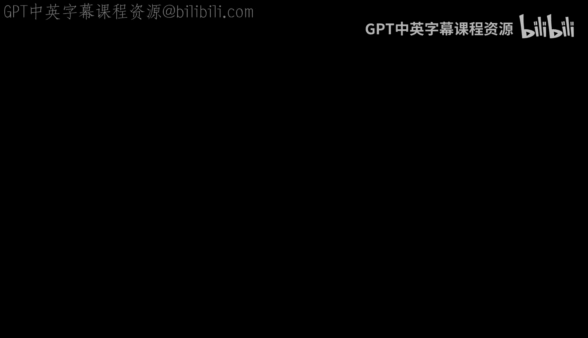

# 宾夕法尼亚大学《人工智能和机器学习基础（AI、数据科学、机器学习）AI and Machine Learning Essentials with Python》 p78 14_02_01_置信区间.zh_en -BV16f421Q72q_p78-

Yeah。To start this video， I'm going to recap an observation about the estimate beta1 hat。

In particular， if you remember， by plotting a histogram of 1 thousand different realizations of beta 1 hat for 1 thousand different data sets。

 we get a histogram that takes this form。This is very close to a normal distribution center aroundze。

5。In particular， one can theoretically prove that the PDF of beta 1 hat is approximately a normal distribution。

We also know theoretically that the expectation of beta 1 hat is equal to beta 1 so we know exactly the center of that bell and also we have expressions for the variance of beta 1 hat given the data。

 so given all this ingredients， we have a full theoretical characterization of the distribution of beta1 hat。

Even though we will never be able to exactly retrieve the value of beta1 that nature is using to generate the data that we observe。

 we can build confidence intervals based on data following the steps below。

A first observation is that 95% of the probability mass of a generic normal distribution with mean mu and vary sigma squared is in the interval mu plus minus2 sigma。

 in other words， if we take the be shape of a normal distribution center at mu and with the standard deviation sigma。

If we look at the integral mu plus minus2 sigma， meaning mu plus 2 sigma mu minus2 sigma。

 the area of the Pf under that curve。Is going to be equal to 0。95。

 indicating that with a 95% probability， the random variable will live in the segment at the bottom。

Applying this fact to our random variable beta 1 hat。

 we can say that beta 1 hat will be in the interval beta 1 plus minus2 standard deviations with a probability 95%。

We can rewrite this event contained in the bracket using this sequence of inequalities。

 essentially beta 1 hat will be sandwiched between beta 1 minus2 standard deviations and beta 1 plus2 standard deviations。

You can prove yourself through a simple exercise that we can rewrite these two inequalities using these other two inequalities。

 so notice that the element in the middle is not beta1 hat anymore， is beta 1。

 which is the real value that nature is using to generate the data and it is completely unknown to us。

Now， in the next slide， we're going to rewrite this sequence of inequalities back in the form of an interval and we will plug it into probabilityability。

So this is what we have in this slide essentially the probability that beta 1 is sandwich in the interval beta 1 hat plus minus2 standard deviations is equal to 95%。

So this may sound very familiar， but notice that in the previous slide， the hat was in here。

And we didn't have hats in here。But now this is the expression that we have。

 and it's very important that we have flipped these hats。In particular。

 what this expression is telling us is that with a 95% probability the value that nature is using to generate the data is in this given interval also remember that we can compute both beta1 hat and it's a standard deviation using a training data set using the expressions at the bottom essentially these are two expressions that we have previously derivedd and now plugging those values into the expression on top we will be able to have an explicit interval and we will note that beta 1 will be in that interval with a 95% probability so this is what's called the 95% confidence interval of beta1。

We can use identical logic to compute the confidence intervals for beta 0。

 essentially we can just use the expressions for the mean and the variance of beta 0 and conclude that beta 0。

Is going to be in the interval， better as it had。Plus， minus。Twice。

The standard deviation of betazito hat。With a 95% probability。

It's worth to include a warning here to remember the assumptions we have made to reach to these conclusions。

The first assumption is based on our observation from the histogram。

 essentially we assumed that beta1 hat is normally distributed。

This is only approximately true in certain situations， however， in other situation。

 this is not the case， and you should be very aware that for certain problems does this not apply。

A second warning is that we have assumed that we have access to the value of sigma square。

 the variance of the measurement noise。This is not always true in practice。

 even though we'll see later on that there are practical ways to estimate sigma square。

