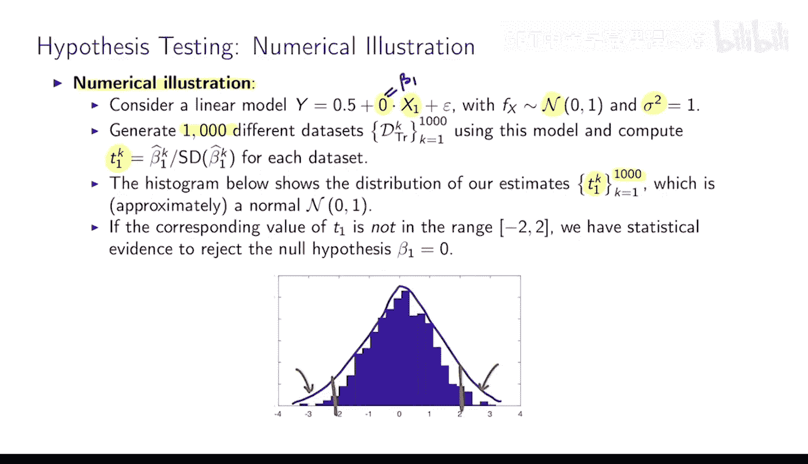

# 宾夕法尼亚大学《人工智能和机器学习基础（AI、数据科学、机器学习）AI and Machine Learning Essentials with Python》 p79 15_02_02_假设检验.zh_en -BV16f421Q72q_p79-

Welcome back。In this set of slides， we're going to cover the topic of hypothesis testing。

To motivate this topic， we're going to consider a data set D drawn from a linear model with p equal to 1 in particular the output will be simply an intercept plus a slope times an input plus a measurement noise。

Looking at the data generated by this linear model。

 we would like to decide whether the input variable x1 influences the output variable y。

Whenever x1 does not influence y， the term in this expression disappears。 In other words。

 we can mathematically model that effect by setting beta 1 equal to0。As a result。

 the output Y be simply a constant plus measurement noise。To figure out if x1 influences the output。

 one might be tempteded to estimate the value of be one hat and check if this value is equal to 0。

However， this is not a good idea for the following reason， whenever beta 1 is equal to 0。

 we know that beta 1 hat is a normal distribution centered around 0。Therefore。

 the probability that beta1 hat is exactly0 is going to be 0。If you don't see this。

 you can convince yourself of this fact by looking， for example。

 the Gaussian distribution that can model weights in a population。

 so let's consider the weight of males in a population。

 this is a Gaussian distribution that's probably center around， let's say 80 kilos。

With some standard deviation。Now， if I ask you the question。

 what's the probability that the weight of a randomly picked individual is equal to an exact real value。

 maybe 82。371817 do dot dot， the probability of that event is going to be 0 because the randomly picked individual will have a0 probability of having exactly this weight。

However， you can ask questions like what is the probability that individual weighs between 78 and 79 kilos。

 and that probability will be the area above that segment。Leria will be a positive number。

Motivated by this problem， we're going to state the following two hypothesistheses。

The first hypothesis called the nu hypothesis and they noted by h sub 0。

 states that there is no relationship between x1 and y In other words， beta 1 is equal to 0。

We will consider an alternative hypothesis that we denote by h sub a that states that there is some relationship between the input x1 and the output y。

In other words， beta 1 is different than 0。To analyze this hypothesis。

 we're going to look into the statistical properties of the random variable beta1 hat。

Consider that HC was true。In other words， beta 1 is equal to0， in that case。

 we know that the random variable beta 1 hat would follow a normal distribution center at0 and with a standard deviation as the beta 1 square。

 which is something that we computed before。Therefore， with a 95% cent chance。

 betterta one hat would be in the confidence interval。

0 plus minus twice a standard deviationEssentially this is something that we saw before。

 but it doesn't hurt to review it again。 So if I have a normal distribution center at0 and with a given standard deviation when I call it Sd。

 the probability that beta1 hat the random variable with this Pdf is in plus minus。

Twice the standard deviation。Will be given by the area on top of that interval。

That as we saw before is going to be equal to 95% of the probability mass。In other words。

 if the variable beta 1 is not in this confidence interval。

 we have the strongest statistical evidence to reject nano hypothesis。

This is in fact the case because if the nu hypothesis is true。

 the probability that beta1 hat falls outside this interval is going to be 5%。

 which is a very small probability， therefore it' is going to be unlikely that beta 1 hat falls outside the confidence interval when the nu hypothesis is true。

Apart from using confidence intervals to verify hypothesis。

 we can pose alternative but equivalent tests。The first one utilizes a random variable t1。

 which is equal to beta 1 hat divided by its standard deviation；

 therefore this random variable follows a normal distribution center at 0 with a standard deviation equal to 1 when the nu hypothesis is true。

To convince yourself of this fact， notice that when the nu hypothesis is true。

 the expectation of beta 1 hat is equal to 0。Also， the variance of t1 is going to be equal to the variance of beta 1 hat divided by the square of the standard deviation which is the variance itself。

 so the result would be the division of the variance over the variance which is equal to 1。

As a conclusion， we would have a 95% chance that the variable t1 is in the confidence interval0 plus minus twice the standard deviation。

 which is equal to 1， meaning in the interval minus 222。

Or equivalent that the absolute value of t1 is less or equal than 2。In other words， if h0 is true。

 we have that t1 is a random variable center at 0 with a standard deviation equal to 1。

 therefore 95% of the mass will be concentrated in the interval minus22。

 which can also be equivalently stated as the absolute value of t1 less or equal than 2。

In consequence， if the absolute value of T1 is greater than 2。

Meaning a random variable T1 is in the tail of this normal distribution。

Then we have a strong statistical evidence to claim that H0 is unlikely to be true。

This is exactly what we had before， meaning if H0 is true。

 it's most likely that t1 will fall in this confidence interval and an observation outside the confidence interval would be a relevant event。

Again， that doesn't mean that it's impossible， that's why we claim whether we have a strong statistical evidence and we don't make definite claims about the influence of x1 on y。

To validate our results， we are going to consider the following numerical illustration。

 we are going to consider a linear model with p equal to 1 in which the input x1 does not influence the output；

 in other words， the value of beta 1 in our model is equal to 0。

Well assume that the inputs are generated according to our normal distribution。

 and that the measurement noise has a variance equal to 1。

We can generate 100 different data sets using the model above and compute for each one of these data sets the value of T1k。

The histogram below shows the distribution of T1k for the thousand realizations under consideration。

 which approximately follows a normal distribution center at pseudo and with variance 1。

 which is what we claim in the previous slide。Therefore。

 if the corresponding value of T1 is not in the range minus 2 to 2。

 we have stronger statistical evidence to reject the nu hypothesis that beta 1 is equal to 0。

You can observe in this histogram that betaagon hat lying outside that interval is irrelevant。

 although it could happen every and then。

