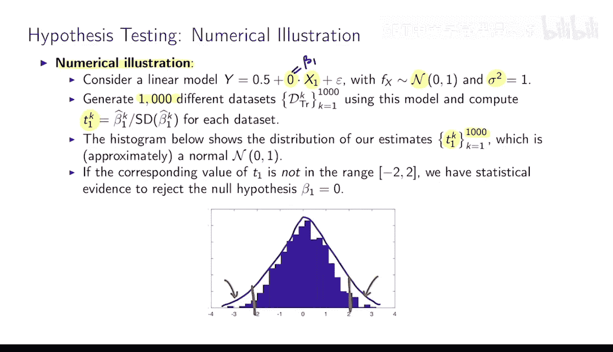

# 人工智能和机器学习基础：15：假设检验 📊

在本节课中，我们将要学习假设检验这一核心统计概念。假设检验为我们提供了一种系统性的方法，用于判断数据中的模式是否具有统计显著性，还是仅仅由随机性导致。我们将从一个简单的线性模型例子出发，理解其背后的逻辑和步骤。

## 动机与问题设定

上一节我们介绍了线性模型。本节中我们来看看如何判断模型中的某个输入变量是否真的对输出有影响。

假设我们有一个从线性模型生成的数据集 **D**，其中 **p = 1**。模型的输出可以表示为：
`y = β₀ + β₁ * x₁ + ε`
其中，**ε** 是测量噪声。

观察这个模型生成的数据，我们想要判断输入变量 **x₁** 是否真的影响输出变量 **y**。

当 **x₁** 不影响 **y** 时，模型中的 **β₁ * x₁** 项会消失。换句话说，我们可以通过设置 **β₁ = 0** 来数学化地描述这种情形。此时，输出 **y** 将简化为一个常数加上测量噪声。

## 为什么不能直接检查估计值？

为了判断 **x₁** 是否影响输出，一个诱人的想法是直接估计 **β₁** 的值（记作 **β̂₁**），然后检查它是否等于 **0**。

然而，这不是一个好方法，原因如下：当真实的 **β₁ = 0** 时，我们知道估计量 **β̂₁** 是一个以 **0** 为中心的正态分布。因此，**β̂₁** 恰好等于 **0** 的概率将是 **0**。

为了理解这一点，可以想象一个用于描述人群体重的正态分布。例如，男性体重的分布可能以 80 公斤为中心。如果我们问“随机抽取的个体体重恰好等于 82.371817... 公斤的概率是多少？”，这个事件的概率是 **0**，因为连续随机变量取任意一个特定精确值的概率为零。但是，我们可以问“体重在 78 到 79 公斤之间的概率是多少？”，这个概率是分布曲线下对应区间的面积，是一个正数。

## 原假设与备择假设

基于上述问题，我们提出以下两个假设：

*   **原假设 (H₀)**：**x₁** 和 **y** 之间没有关系。即 **β₁ = 0**。
*   **备择假设 (Hₐ)**：**x₁** 和 **y** 之间存在某种关系。即 **β₁ ≠ 0**。

为了分析这些假设，我们需要研究随机变量 **β̂₁** 的统计性质。

## 利用置信区间进行检验

假设原假设 **H₀** 为真，即 **β₁ = 0**。在这种情况下，我们知道随机变量 **β̂₁** 服从一个以 **0** 为中心、标准差为 **σ_{β̂₁}** 的正态分布。

因此，有 **95%** 的概率，**β̂₁** 会落在以下置信区间内：
`0 ± 2 * σ_{β̂₁}`

这意味着，如果 **β̂₁** 的观测值**没有落在这个置信区间内**，我们就有了强有力的统计证据来**拒绝原假设**。这是因为，如果原假设为真，**β̂₁** 落在此区间外的概率只有 **5%**，这是一个很小的概率。因此，当原假设为真时，**β̂₁** 落在置信区间外的情况不太可能发生。

## 等效的 t 统计量检验

除了使用置信区间，我们还可以进行等效但形式不同的检验。第一种方法是构造一个随机变量 **t₁**：
`t₁ = β̂₁ / σ_{β̂₁}`

当原假设 **H₀** 为真时，这个随机变量服从一个以 **0** 为中心、标准差为 **1** 的标准正态分布。

因此，我们有 **95%** 的概率，变量 **t₁** 会落在置信区间 `0 ± 2 * 1` 内，也就是区间 **[-2, 2]** 内。这等价于 **|t₁| ≤ 2**。

换句话说，如果 **|t₁| > 2**，意味着 **t₁** 的观测值落在了标准正态分布的尾部，那么我们就有强有力的统计证据认为原假设 **H₀** 不太可能为真。这与之前基于置信区间的结论完全一致。

## 数值模拟验证

为了验证我们的理论，考虑以下数值示例：我们设定一个 **p = 1** 的线性模型，其中输入 **x₁** 不影响输出，即真实参数 **β₁ = 0**。我们假设输入 **x₁** 服从正态分布，测量噪声的方差为 **1**。

我们可以使用上述模型生成 1000 个不同的数据集，并为每个数据集计算 **t₁** 的值。

下图展示了这 1000 次实现中 **t₁** 值的分布直方图。可以观察到，它近似服从一个以 **0** 为中心、方差为 **1** 的正态分布，这与我们之前的论断一致。因此，如果计算出的 **t₁** 值不在 **[-2, 2]** 范围内，我们就有强有力的统计证据拒绝 **β₁ = 0** 的原假设。从直方图中可以看到，**t₁** 值落在此区间外的情况很少，尽管偶尔也会发生。

## 总结

本节课中我们一起学习了假设检验的基本思想。我们从判断线性模型中变量是否显著的问题出发，引入了**原假设 (H₀)** 和**备择假设 (Hₐ)** 的概念。我们了解到，不能通过简单地检查参数估计值是否为零来做判断，而应考察其在原假设下的分布。我们学习了两种等效的检验方法：一是检查参数估计值 **β̂₁** 是否落在以零为中心的**置信区间**内；二是计算标准化的 **t 统计量**，并检查其绝对值是否超过临界值（如 **2**）。如果统计量落在预期分布的小概率区域（如两端的 **5%**），我们就有证据拒绝原假设，认为变量可能是显著的。