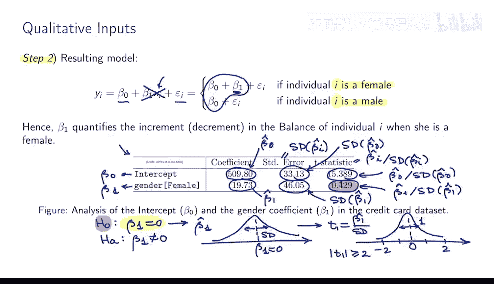

# 宾夕法尼亚大学《人工智能和机器学习基础（AI、数据科学、机器学习）AI and Machine Learning Essentials with Python》 p81 17_03_01_分类输入.zh_en -BV16f421Q72q_p81-

In the following videos， we're going to cover some extensions of the linear models that we have studied before。

At this point， I would like to make a recap about the contents that we have been in the previous slides。

Remember that in this chapter， we are studying a linear model of the form that you can see in this equation。

In particular， we have that the output variable y is nothing but a constant plus a weighted linear combination of the input variables。

 so our input variables are x12 xp。And the weights that we use to perform these linear combinations are beta 1 to be P also include a measurement noise epsilon。

U in this model， we generate a dataset set D that contains pair of points， X I Y I。

 where X I is a p dimensional vector， and Y I is a scholar output。

These points are generated according to the linear model above， in other words， for i equal 12 n。

 meaning for each one of the indexes in our data set。

 we start by drawing a random input vector X of dimension p， X 1。

 Xi2 and X I will be the entries 12 up to p of this particular random input vector Xi。

And these random input vectors are drawn from a distribution Fx。

 which is the marginal distribution of the input vector X。Once we have a particular realization of X。

 we generate an output Yi associated to that input using the linear model above。To be more precise。

 what we have is betaci， the intercept plus a linear combination of the components of that random vector weighted by the parameters beta1 to be P。

To that summation， we also include a measurement noise that is distributed according to a marginal distribution f su epsilon。

Something that I believe is important to remark at this point。

Is that the parameters beta0 to beta P are completely unknown to us。

 these are parameters that nature is using to generate the data that we observe。

 but we do not have direct access to those values。In other words。

 the knowledge that we have is limited to the data set D that is generated according to the linear model。

In the previous slides， we have covered a collection of topics， for example。

 we showed how to compute estimates beta ci hat of betaagon hat from that alon。

These are estimates aiming to approximate the values of Vita 0 and beta p using data。

 remember that these estimates are random variables that are center around each one of the parameter beta。

 For example， the parameter beta I hat is distributed， according to a Gaussian distribution。

 that is center around the true value of Vita I。 However。

 what you observe from data is a random realization of that Gaussian that will never match the exact value of beta I。

 Therefore， since beta I hat that I compute is a random variable。

 I would like to analyze the uncertainty of this estimate。We did that by using confidence intervals。

 which allow us to claim that the true value of the parameter beta i is within a particular interval with a 95% probability。

So if you remember the confidence interval for beta I was equal to an interval where we have beta i hat that we can compute from data minus twice the standard deviation associated to the parameter beta i hat that we can also compute from data。

 so this is the lower limit of the interval and the upper limit of the interval is beta i hat plus twice that same standard deviation。

And what we can claim is that the value that nature uses。

 essentially this better eye that is unknown to us。

 is contained within this interval with a 95% probability。In a closely related topic。

 we also wanted to determine if a particular input Xi influences the output y。In this task。

 we use hypothesis testing， which allow us to build a statistical evidence to reject new hypothesis of the form Xi does not influence y。

We also cover a legal parable that I hope it useful to understand what we can claim and what we cannot claim using data。

In this video we are going to extend the tools that we have seen in the previous slides to more advanced situations。

 for example， in our previous slides we always assume that the inputs x1 to Xp were quantitative variables。

 meaning variables that take real values。However， in practice。

 we might want to deal with qualitative inputs that we call categorical variables。

So these are the variables that instead of taking real numbers， take one value in a finite set。

So examples of categorical variables are n there。Which can be either male or female。Meditital status。

 which are either single or merit or ethnicity， which can be Caucasian， African American and Asian。

To illustrate how we could include the effect of qualitative inputs in a linear model。

 we are analyzing the differences in credit card balance between males and females。

For this particular example， we are going to ignore all other variables。So in this example。

 the output variable Yi is going to represent the credit card balance of an individual I。

And we will consider gender as the only input in our data set， In other words。

 our value of p is going to be equal to 1。Therefore。

 the model that we will have to analyze is a model of the form Bita0do。Plus beta 1 x。Plus。

 some noise。However， in contrast with our other examples， the input x is not a real value anymore。

 but a qualitative variable。In particular， gender。To include gender in our model。

What we're going to do is take the following steps。 in step  one。

 we're going to create a dummi variable， X。So， this variable is going to be one if individual I is a female and0 if individual I is a male。

Therefore， Xi will be able to codify the gender of individual I。Following with the second step。

 we' are going to build a model in which we consider X as defined before。

 therefore when individual i is a female， the value of X will be equal to 1。

 and this term will be equal to beta 0 plus beta 1 plus E i。

 which is what we obtain in this upper equation。In contrast when individual I is a male。

 the value of X will be equal to 0， and this whole term will disappear；

 therefore the model will be reduced to beta 0 plus epsilon I。By comparing these two models。

 you can notice that beta 1 quantifies the increment or decrement in the balance of individual I when she is a female。

To numerical validate our model， we took a real data set containing credit card violence for a collection of individuals for which we know their genders。

Us in this data set， we compute the values of beta 0 and beta 1， in particular in this table。

 we have that the intercept is going to be beta 0。Gender。

Is going to be the slope and the coefficients in this table in the first column of this table are going to be our estimates beta see hat。

And beat a one hat。In this table we also include the standard deviations which we call in here the standard errors。

 but essentially this is essentially a standard deviations of each one of our estimates。

 in particular this value here is going to be equal to the standard deviation of beta0 hat。

 or estimate of the intercept and this value here is going to be the standard deviation of beta 1 hat。

 our estimate of the slope。In the last column we include what's called the T statistic。

 which is something that we have seen before， but let me refresh on memory。

 essentially the T statistic is defined as the ratio between beta i hat and the standard deviation of beta i hat。

So this value in here is going to be equal to beta 0 hat divided the standard deviation of beta 0 hat。

And this value in here is going to be equal to beta 1 hat divided by the standard deviation of beta 1 hat。

These values are important if we want to study the dependencies between the variables， for example。

 we can use a hypothesis test to analyze the effect on gender on credit card balance。To do that。

 we can build the following hypothesis test， we can consider the new hypothesis to be that beta 1 is equal to 0。

 meaning gender does not influence credit cardbal and as an alternative a hypothesis。

 we can consider beta 1 is different than 0， which indicates that gender does impact balance。

Remember that assuming that the new hypothesis is true。

Beta 1 hat is the random variable distributed according to a Gaussian variable。

Center around the true value of beta 1， which in this particular case is equal to 0。

 So it's going to be a Gaussian center at 0 and with a standard deviation that we can compute from the data set。

Dfining the variable T1 as beta 1 hat。Divided by the standard deviation of beta 1 hat。

 what we obtain is another random variable， again a Gaussian with the same mean in this particular case0。

 but in this case the standard deviation is going to be exactly equal to1。Therefore。

 the 95% confidence interval is going to be minus2 to 2。

 and if you remember we reach to the conclusion that if the absolute value of t1 is greater or equal than 2。

 we can reject the new hypothesis。That beta 1 is equal to 0。

 meaning that gender does not influence credit card balance。Looking at that value in our table。

 we have that the T statistic in that second location is exactly the T statistic associated to beta1 hat。

 and this value is less than 2， therefore we cannot reject the new hypothesis。

 that gender does not play a role in credit card balance。

Also notice that we cannot make definitive claims， however。

 we can say that we have strong statistical evidence pointing towards this conclusion。

