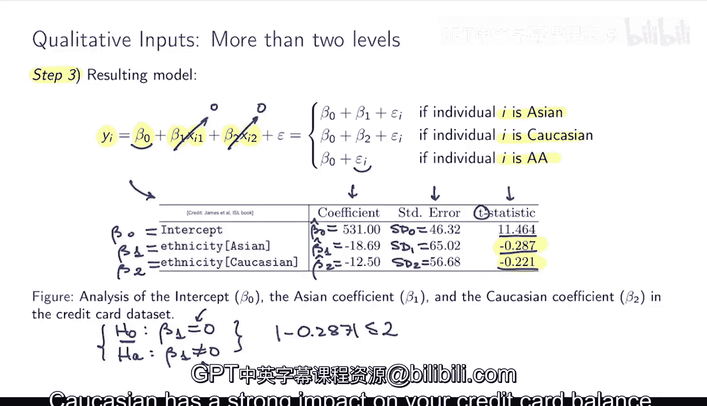

# 宾夕法尼亚大学《人工智能和机器学习基础（AI、数据科学、机器学习）AI and Machine Learning Essentials with Python》 p82 18_03_02_更多分类输入.zh_en -BV16f421Q72q_p82-

In the previous example， we studied a case with one categorical variable having two levels。

 essentially gender that could be either male or female。

We can consider categorical variables with more than two levels。

 so this could be the case of for example， ethnicity。

 which in a very simplified way we are going to classify it as Caucasian， African American or Asian。

In this example， we' are going to analyze the differences in credit cardbal as we did before。

 but in this particular case， instead of considering gender as our only input。

 we' are going to consider ethnicities and nothing else。In other words。

 we will consider ethnicity of individual I as the only input Xi。

Now how can we build a linear model in this situation were going to follow some steps that are similar to the ones before but have some differences。

 so let me go through them in step1， we're going to choose a baseline ethnicity which in this case is going to be African American although you could choose any label in the set above as the baseline。

In a second step， were going to define some dummi variables。 So in this particular case。

 we are dealing with a categorical variable with three particular categories。Therefore。

 we are going to create 3 minus1， which is equal to two dummi variables。

These I variables are going to be called X 1 and Xi 2。

 so this is the first I variable for individual I and the second I variable for individual I。

The first Dmi variable is going to define if individual I is Asian or not。

 substantially if individual I is Asian， this Dmi variable will be 1。Seeo otherwise。

The second D variable will be1 if I is Caucasian and0 otherwise。

By introducing these two dummi variables， we have the following model in step 3。

 essentially the output variable， the credit card balance is going to be equal to an intercept。

 a constant plus a linear combination of the two dummi variables weighted by the parameters beta 1 and beta 2。

Notice that this model bifurcate into three different models according to the ethnicity of individual I。

So， if individual I is Asian， we know that this term is equal to 1， this term is equal to 0。

 therefore this term disappears， and what we get is beta0 plus beta 1 plus the measurement noise。

If individual I is Caucasian， this term is 0， this term is 1。

 and what we will have is beta 0 plus beta 2。Last measurement noise。And finally。

 if individual I is African American， both beta 1 and beta 2 will be 0。

 and the only remaining terms will be beta 0 plus sub measurement noise。

 so these are essentially the three cases that we indicate in this bracket。Using this model。

 we can numerically study the fact of ethnicity on credit card balance。And to this end。

 we're going to use a real data set with a collection of individuals where we have their credit card balance and their ethnicity。

Using these values and the model above， we will be able to create the table at the bottom。

In our particular case， the intercept is going to be the variable beta pseudo。

Ethnicity is going to be related with the variable beta 1。

 and this second ethnicity Caucasian is going to be related with the variable beta 2。

In the first column， we have the coefficients， the estimate beta 0 hat， beta 1 hat。😊。

And beatta du hat。In the second column we have the standard deviations。

 we're going to have the standard deviation of beta 0 hat。

 so I'm going to use the shortcut Sd sub0 for the standard deviation of beta 0 hat。

 we are also going to have the standard deviation of beta 1 hat。

Which I gra as S D sub 1 and the standard deviation of beta2 hat。In the last column。

 what we have is the fraction between beta0 hat and Sd sub 0。

 beta 1 hat and Sd sub 1 and beta2 hat and Sd sub2。

 so this is whats called the these statistics that we can use。

To make claims about dependencies between variables。Using this stat。

 we can now ask some questions and pose them in terms of hypothesis tests， for example。

 one could inquire about the impact of being Asian in the credit card balance。

So if you want to ask if being Asian has an influence on your credit card balance。

 you can make the hypothesis testing in the bottom。

 essentially I'm going to make a new hypothesis which indicates beta 1 equal to0 and an alternative hypothesis which indicates beta 1 different than0。

 so this condition tells you that being Asian does not play a role in credit card balance。Well。

 this term would indicate that being Asian does play a role in your credit card balance。

How do we decide what hypothesis is most likely to be true is by looking at the these statistics？

For example， if we look at the T statistics associated to beta 1。

 we can see that this T statistics is in absolute value， less or equal than2。Therefore。

 this value is consistent with the null hypothesis and we cannot reject the null hypothesis。

In other words， we do not have a strong statistical evidence to claim that being Asian play a role in your credit card balance。

Similar story with the case of Caucasian， that these statistics of the Caucasian variable is also less or equal than2 in absolute value；

 therefore we cannot reject the nu hypothesis of beta 2 being equal to 0。

This mathematical claim in plain English would be that we do not have statistical evidence to claim that being Caucasian has a strong impact on your grade card balance。

