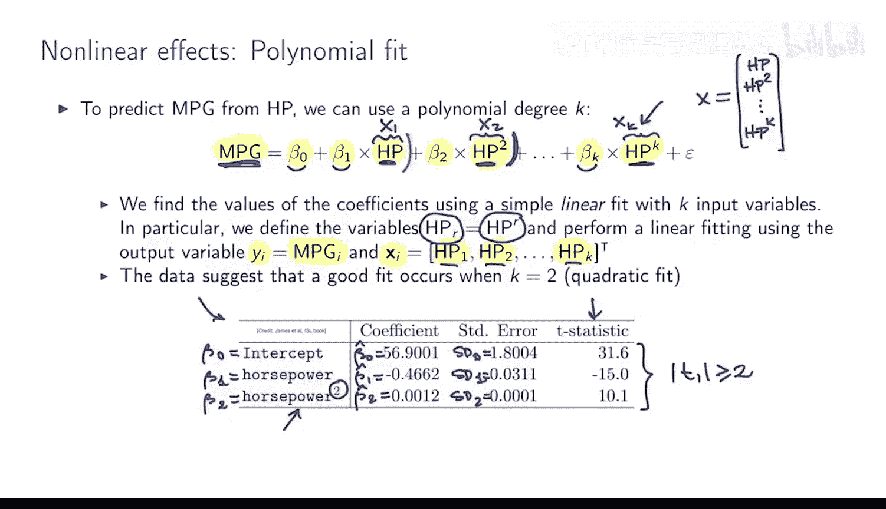

# 宾夕法尼亚大学《人工智能和机器学习基础（AI、数据科学、机器学习）AI and Machine Learning Essentials with Python》 p83 19_03_01_非线性效应.zh_en -BV16f421Q72q_p83-

In the previous video， we saw how to extend the mainity of linear regression to deal with categorical variables。

In this video， I will talk about how to take into account nonlinear effects using this same machinery。

To illustrate that approach， we're going to consider a particular example。

So consider a collection of 392 vehicles。For each vehicle， we're going to have as an input。

 the horsepower。And as an output， the miles gallon consumed by this vehicle。 In other words。

 our data set are going to be pairs of miles gallon and horsepower。

The relationship between the input horsepower and the output much per gallon is plotted in this figure。

Essentially， what we have is a scatter plot where each vehicle is represented by a gray dot。

And these dots will have us coordinate the horsepower and the widespread gallon associated to that vehicle。

In conclusions， well have 392 gray points in this scatter plot。In this same plot。

 we show three different plots。The first plot in orange is the result of a linear regression of a standard linear regression。

You in that data set。The light blue dot is the regression using a polynomial of the grid2。

 essentially a quadratic filling。And the green plot is the result of 15 a polynomia of degree 5。

In general， we can find the coefficients of these polynomial feeds using exactly the same machinery for linear regression。

In particular， what we are going to do is we are going to extend a space of inputs by defining artificial inputs that result from considering different powers of the input variable。

In particular， we will have that miles per gallon， the output would be equal to beta 0 plus beta 1 times Hp。

 we can keep extending our summation until we reach a term beta k times Hp to the power of k。Now。

 this expression defines a polynomial relationship between the input variable HP and the output variable MPG miles per gallon。

We can find the coefficients beta 0 up to beta k using the exact same machinery as we did to find the coefficients in a linear regression。

 in particular we can consider HPp to be our first variable hp square to be our second variable up to hpk to be our cave variable and not just define an x contained in this variable which in this case would be Hp。

H P square。Up to H to whatever degree we want to fit the polynomial。Once we define this input vector。

 we're going to have that Yi is the mouse per gallon of vehicle I。

 and X I is going to contain the newly defined variables。 Notice that we're calling h piece of R。H。

 P to the power of our。So these entries are nothing but the powers of the horsepower。

In the previous plot， we observe that the best bit of the data occur when k is equal to 2。

 meaning a quadratic fit。In this table， well look at the coefficients numerical obtained from this quadratic fit。

 in particular we have the intercept beta 0。The coefficients associated with horsepower and the coefficients associated with the horsepower square。

These are the values beta0 hat。Beta1 hat and beta 2 hat。These are the standard deviation for0。

For one and for2。 And these are the T statistics for beta 0 hat， beta 1 hat and beta 2 hat。

Notice that the values of these statistics are all。😊，Greatter than2。Therefore。

 we do not have strong statistical evidence to claim that some of the inputs are not important。

 In other words， Hopower Square is a reliable input variable。

