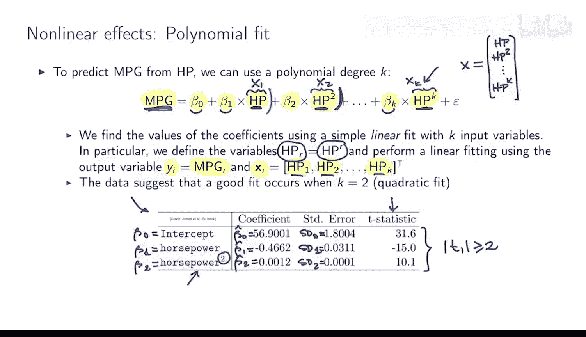

# 人工智能和机器学习基础：19_03_01：非线性效应 📈

在本节课程中，我们将学习如何利用线性回归的框架来处理输入与输出之间的非线性关系。我们将通过一个具体的车辆数据集示例，展示如何通过引入输入变量的高次幂来拟合多项式模型，从而捕捉数据中的非线性效应。

---

在上一节中，我们介绍了如何扩展线性回归以处理分类变量。本节中，我们来看看如何使用相同的数学工具来考虑非线性效应。

为了说明这种方法，我们将考虑一个具体的例子。假设我们有一个包含392辆车辆的数据集。对于每辆车，我们将**马力（horsepower）** 作为输入，**每加仑英里数（miles per gallon）** 作为输出。换句话说，我们的数据集是成对的（每加仑英里数， 马力）。

输入马力与输出每加仑英里数之间的关系绘制在下图中。本质上，我们有一个散点图，其中每辆车由一个灰点表示。这些点的坐标是车辆的**马力**和对应的**每加仑英里数**。因此，在这个散点图中有392个灰点。

在同一图中，我们展示了三条不同的拟合曲线。**橙色曲线**是标准线性回归在该数据集上的结果。**浅蓝色曲线**是使用二次多项式（即二次拟合）进行回归的结果。**绿色曲线**是使用五次多项式进行回归的结果。

通常，我们可以使用与线性回归完全相同的数学工具来找到这些多项式拟合的系数。具体来说，我们将通过定义由输入变量的不同幂次构成的人工输入来扩展输入空间。

特别地，我们假设输出**每加仑英里数（MPG）** 满足以下关系：
`MPG = β₀ + β₁ * HP + β₂ * HP² + ... + βₖ * HPᵏ`
这个表达式定义了输入变量**HP（马力）** 和输出变量**MPG（每加仑英里数）** 之间的多项式关系。

我们可以使用与寻找线性回归系数完全相同的方法来找到系数 β₀ 到 βₖ。具体来说，我们可以将 **HP** 视为我们的第一个变量，**HP²** 视为第二个变量，以此类推，直到 **HPᵏ** 视为第k个变量。然后，我们定义一个包含这些新变量的输入向量 **x**：
`x = [HP, HP², ..., HPᵏ]`
一旦定义了这个输入向量，对于第 i 辆车，**Yᵢ** 是其每加仑英里数，**Xᵢ** 则包含新定义的变量（即马力的各次幂）。

在之前的图中，我们观察到当 **k=2**（即二次拟合）时，对数据的拟合效果最好。在下表中，我们查看从这个二次拟合中获得的数值系数。

以下是二次拟合的系数结果：
*   **β₀_hat（截距）**：56.9001
*   **β₁_hat（HP的系数）**：-0.4662
*   **β₂_hat（HP²的系数）**：0.0012

这些系数对应的标准误差和T统计量如下：
*   **β₀_hat**：标准误差为1.8004，T统计量为31.6。
*   **β₁_hat**：标准误差为0.0311，T统计量为-15.0。
*   **β₂_hat**：标准误差为0.0001，T统计量为10.1。

注意，这些T统计量的绝对值都远大于2。因此，我们没有强有力的统计证据声称某些输入变量不重要。换句话说，**马力平方（Horsepower²）** 是一个可靠的输入变量。

---

在本节课中，我们一起学习了如何将线性回归框架扩展用于拟合非线性关系。核心方法是引入原始输入变量的高次幂作为新的特征，从而将问题转化为一个更高维度的线性回归问题。我们通过车辆马力与油耗的例子，具体演示了二次多项式拟合的过程，并解读了其系数的统计显著性。这种方法为我们提供了一种强大而灵活的工具，用以建模数据中复杂的非线性模式。