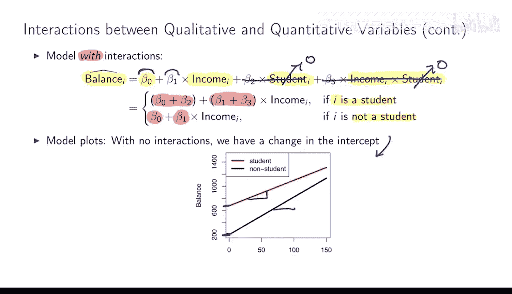

# 宾夕法尼亚大学《人工智能和机器学习基础（AI、数据科学、机器学习）AI and Machine Learning Essentials with Python》 p84 20_03_01_交互项.zh_en -BV16f421Q72q_p84-

Let's now move on to another technique to include non nonlinearient effects， in this case。

 we're going to include interaction terms。We're going to go back to a data set that we saw a few slides ago where we consider 200 different marketing campaigns and for each marketing campaign。

 we're going to analyze an output variable sales as a function of TV advertisement and radio advertisement。

 So in this case we are going to consider just two input variables。

Notice that this model assumes that the effects of TV and radio are independent of each other。

 however， in some real situation， one could think that radio advertisement may increase the effectiveness of TV advertisement。

In statistics， the synergies between variables are called interaction effects and can be analyzed and modelsed using new artificial variables as the one we have at the bottom。

So in this particular model， apart from the original variables， TV and radio。

 we add including an artificial variable that takes into account the product of TV and radio advertisements。

It turns out that using the same tools we presented for linear regression。

 we can find the values of beta 1 hat， beta2 hat and beta 3 hat from data。

 essentially TV will be considered the first input variable。

 radiod will be considered the second input variable and TV times radio will be considered that third input variable and we will disregard that this third input variable is an artificial variable come in as the product of TV and radio。

Using this abstraction， we can perform a linear fit。In particular， for each marketing campaign。

 the output variable will be equal to the cells resulting from that marketing campaign。

 and the input vector Xi will be an input vector with P equal to 3， meaning3 input， 3 features。

 which will be how much was invested on TV， how much was invested on radio and what's the product of these two values for each one of the marketing campaigns in our historical data。

In the table below， we can find the coefficients resulting from the linear regression。

We have in the first column。The values for better I had in the second column。

 we had their standard deviations， and in the last column we have the T statistics。

Notice that all the values of the statistics are in absolute value greater than2。Therefore。

 all the terms considered as inputs are relevant for the output， in other words。

 any hypothesis test in which we assume that one of these three inputs is not relevant would be rejected。

In plain English， what this is telling us is that the interaction between radio and TV advertisement is an important factor。

There is something important for you to keep in mind when using interaction terms。

And this is called the Hiarchy principle。What the hierarchy principle is telling you is that if we include an interaction term。

 for example， TV times radio， we should also include the main terms TV and radio。

 even if the dis statistics indicate that those terms are not significant。For example。

 in the table that we saw before。😊，Every time that the factor TV times radio is important。

 the main factors meaning the individual factors TV and radio will have to be included in the table。

 even if that this statistic is smaller than2。The reason for this principle is that these interaction terms are hard to interpret without the main terms。

Let's now move on to the case in which we have interaction terms between qualitative and quantitative input variables。

 for example， consider the problem of predicting the credit card balance of an individual using as inputs a quantitative variable such as income as well as a qualitative variable such as student。

 so the variable student will have two levels and the variable income will be a real number。

We can build a model without interactions in which we consider。

Incamp and a student has two independent variables。In that case。

 we will have a bifur as we saw before， in the case in which I is a student。

 the student variable could be equal to1。And this term beta 0 would be part of the intercept。

 so this is what we have in here。In contrast， when I is not a student， this variable will be0。

 therefore this term will disappear all along， and the resulting model will be beta 0 plus beta 1 income。

 which is exactly what we have in here。We can then plot these two models。

Notice that the slope of these two models。At exactly the same， meaning the value be 1， however。

 the intercepts。How a different。In particular we have a difference in the intercept。

 this is telling you that if you are a student， your regression function should be incremented by a value beta1 with respect to the case in which you are not a student。

 but these two lines will be paralleled to each other because the slope has the exact same value。

So this would be the line for a student and this would be the regression line for not students。

Let's now consider the model with interactions。In that case， the balance of individual I。

Would be computed as an intercept plus a first term representing the income。

 a second term indicating if you're a student or not and an interaction term。

Multiplying the income and the student variable of individual I。Again。

 this model by fourKs into two cases。If I is a student， then this variable is equal to 1。

 this term is equal to 1。This beta 0 will be part of the intercept and beta 3 times income would be part of a slope beta 1 times income。

 so you can simplify the expression and you will get beta 0 plus beta 2。

And a slope of beta 1 plus beta 3 multiplying the income variable。In contrast。

 if individual I is not a student。Then the variable student will become zero。

 this term will disappear。This term will also disappear。

 and the remaining term will be an intercept of beta 0 and a slope of beta 1。

 which is what we obtain at the bottom。As we did before。

 we can compare the slope and the intercept of these models。In particular。

 the intercept will change as we saw before， but in this particular case this slope will also change。

So not only the intercept is increased， but also the slope is changed by a value beta 3。

In the plot below， we see that the curves for a student and non student not only have a different intercept but also different slopes。

With this， we conclude the topic of linear regression。Next week we'll start a completely new topic。

 which is classification。