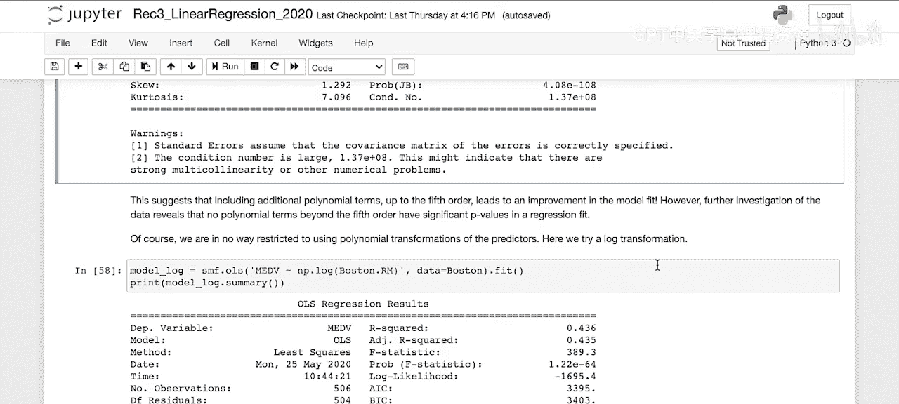

# 人工智能和机器学习基础：22_03_02：线性回归讲解-第二部分

## 📚 课程概述

在本节课中，我们将继续深入学习线性回归。我们将从上一节介绍的线性回归基本概念出发，探讨如何评估线性回归模型的性能，并介绍一种关键的优化算法——梯度下降法。通过本课的学习，你将掌握衡量模型好坏的标准以及模型优化的核心思想。

上一节我们介绍了线性回归的基本形式，即用一个线性方程 `y = w*x + b` 来拟合数据。本节中，我们来看看如何判断这个拟合的“好坏”，以及如何找到最优的 `w` 和 `b`。

## 📊 评估模型性能：损失函数

为了衡量模型预测值与真实值之间的差距，我们需要一个量化指标，这个指标被称为**损失函数**。在线性回归中，最常用的损失函数是**均方误差**。

**均方误差**的计算公式如下：
`MSE = (1/n) * Σ(y_i - ŷ_i)^2`
其中：
*   `n` 是数据点的数量。
*   `y_i` 是第 `i` 个数据点的真实值。
*   `ŷ_i` 是模型对第 `i` 个数据点的预测值，即 `ŷ_i = w*x_i + b`。

MSE的值越小，说明模型的预测越准确，拟合效果越好。我们的目标就是找到一组参数 `w` 和 `b`，使得MSE的值最小。

## 🔍 寻找最优参数：梯度下降法

既然我们的目标是最小化损失函数MSE，那么如何找到使MSE最小的 `w` 和 `b` 呢？这里我们引入一种非常重要的优化算法——**梯度下降法**。

梯度下降法的核心思想是：通过迭代的方式，逐步调整参数，使损失函数值不断减小。它利用损失函数对各个参数的**梯度**（即导数）来指导参数更新的方向。

以下是梯度下降法的基本步骤：

1.  **初始化参数**：随机选择一组初始的 `w` 和 `b` 值。
2.  **计算梯度**：计算当前参数下，损失函数MSE关于 `w` 和 `b` 的梯度。
    *   关于 `w` 的梯度：`∂MSE/∂w = (2/n) * Σ(ŷ_i - y_i) * x_i`
    *   关于 `b` 的梯度：`∂MSE/∂b = (2/n) * Σ(ŷ_i - y_i)`
3.  **更新参数**：沿着梯度的反方向（即下降最快的方向）更新参数。更新公式为：
    *   `w_new = w_old - α * (∂MSE/∂w)`
    *   `b_new = b_old - α * (∂MSE/∂b)`
    其中，`α` 是一个非常重要的超参数，称为**学习率**。它控制着每次参数更新的步长。
4.  **重复迭代**：重复步骤2和步骤3，直到损失函数的值收敛到最小值，或达到预设的迭代次数。

学习率 `α` 的选择至关重要。如果学习率太小，收敛速度会非常慢；如果学习率太大，可能会在最小值附近震荡，甚至无法收敛。

## 🎯 核心概念总结

本节课中我们一起学习了线性回归的两个核心进阶概念：

1.  **损失函数**：我们使用**均方误差**来量化模型预测的误差，其目标是找到使MSE最小的模型参数。
2.  **梯度下降法**：这是一种通过计算损失函数梯度并迭代更新参数来最小化损失函数的优化算法。其关键在于**学习率**的设置，它影响着优化的效率和最终结果。

理解损失函数和梯度下降法，是掌握包括线性回归在内的众多机器学习模型如何被“训练”出来的关键。在接下来的课程中，我们将看到这些概念在更复杂模型中的应用。