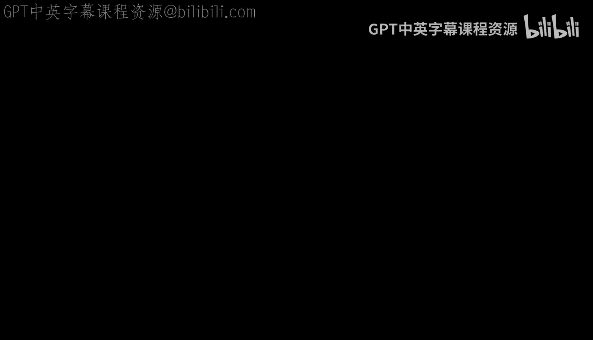
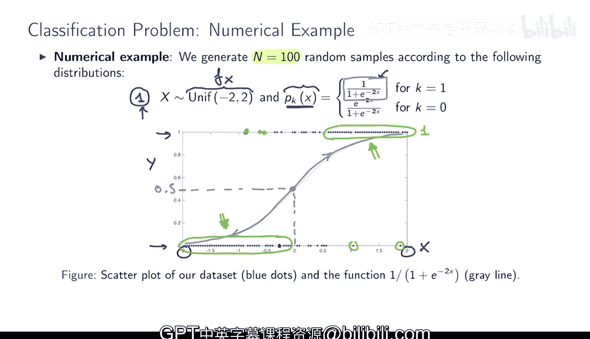

# 宾夕法尼亚大学《人工智能和机器学习基础（AI、数据科学、机器学习）AI and Machine Learning Essentials with Python》 p88 24_04_01_分类.zh_en -BV16f421Q72q_p88-

Welcome back。In this chapter， we're going to talk about classification problems。

So so far we've been talking about regression problems in which the output variable associated with a given input x is a number in the classification setup。

 the outputs are going to be labeled。Let's go into a formal definition of these labels in particular we will consider a discrete set C。

 essentially a set of elements， these elements are going to be k class labels。

 meaning the labels that we can assign to particular inputs。And in this context。

 the output variable y is going to be qualitative and it's going to take a value from the seti。

Our goal is to build a classifier C of x that assigns a class label C to an input x， In other words。

 this function C is going to map elements in RPp， meaning p dimensional vectors of inputs into a discrete set of labels。

Examples of these problems are image classification， so in that particular scenario。

 what we are going to have is an image of maybe dogs and cats。

 so in particular we will have that C would be dog cat。

The input X will be a vector of features extracted from these images，Essential from an image。

 you will decide what features you want to plot into your classifier。

 It's going to be a p dimensional vector。You will feed this vector into a classifier。

And the classifier will tell you if this image correspond to a dog or a cat。

Notice that the classifier will get some images right and some images wrong。

 so this will induce errors that we will analyze later on。

In order to study classification problems from a theoretical point of view。

 we're going to consider what's called a generative model。In a generative model。

 we're going to have a data set D。Of inputs and outputs。

And we're going to assume that these points are generated according to the following two steps。

In a first step， we're going to randomly sample an input Xi from a marginal distribution F of x。

Once we have a realization of the input Xi， we are going to assign an output label Yi to this input using a conditional PF probability mass function。

This PMF is defined in the middle of this equation。Essentially。

 what this probability is telling you is the probability that the output take a particular label K contained in the set C。

Given that we know the input vector X。We're going to define this conditional probability using the function Pk of X。

 and we're going to call this function the conditional class probability。In other words。

 this function will tell us what's the probability that the output of a particular input x is a level K。

Let's illustrate these two steps with a particular numerical example。In this example。

 we are going to generate 100 sample points。According to the following distributions。So first。

 we're going to assume that x is distributed according to a uniform distribution between minus 2 and 2。

So， this is。Es of x mentioned in the previous slide and our conditional class probability。

Is given in this particular formula。So let me generate a hypothetical number according to these two distributions。

 so in a first step， we're going to sample an input x。According to this uniform distribution。

 so imagine that we have a random number generator able to generate numbers uniformly between minus2 and 2。

 and we get that for example， our first sample has a value of0。44。

 just a random number in the interval minus-222。Once we have this realization for the first input in our data set。

 we're going to look into the conditional class probability evaluated at that particular point。

So we have that P of x1。It's going to be P evaluated at 0。44。And this will provide two values。

These values at approximately0。70。For the label K equal to 1。Andze。 30。For the labeled， K equal to 0。

In other words， we're going to flip a coin with a bias 0。70。 If that coin comes head。

 we will assign a label1 to the input x1 and with a 30% probability。

 we will assign a label 0 to the input x1。 So imagine that we flip this coin and we get a label。

K equal to 1。 So in that particular case， y1 will be equal to 1。

And the first sample in our data set will be equal to the point。0。44， x1。With a label  one。

 we can keep generating samples， so let's do a second one for clarity。So repeating the process。

We're going to first choose a random number in the uniform distribution minus-2 and 2。

 so imagine that in this case， we get a value x2， the input of the second sample to be -1。1。In there。

Using that value。We will look into P of x2。And plugging in the value 1。1。

 we will obtain that the probability of getting a label k equal to1 is going to be roughly 0。1。

 Therefore， with a 90% probability， we will get a label 0。Again， we flip a coin with those biases。

And we'll obtain， for example， a label0。So notice that I'm not picking the largest number and flipping a coin with those biases in this particular case。

 the bias for0 is so high that I'm going to assume that the output is equal to 0。

So our second data point will be an input minus-1。1。And an output 0。

So we'll keep repeating this 100 times until we'll fill our data set。

 and this is how we generate the cloud of points in this figure。So I'm going to clean up this screen。

Soently， in this data set， we have points。Where the input x is in the interval minus-22。

And the output y takes value 0 or 1。These are the blue dots in this image。

The gray function in the middle。is is。To a graphical representation of this function on the top。

So this is called a s function。And essentially is a function， that a 0。Takes a height of 0。5。

And then monotonically， increase in this form。Look at at this function。

 we observe that when the function takes values close to one。

 the concentration of outputs that are around one is going to be high。Essentially。

 will have very few values that are 0。And when the function takes low values close to 0。

The outputs of the corresponding inputs will be mostly zeros， even though we'll have some ones。

