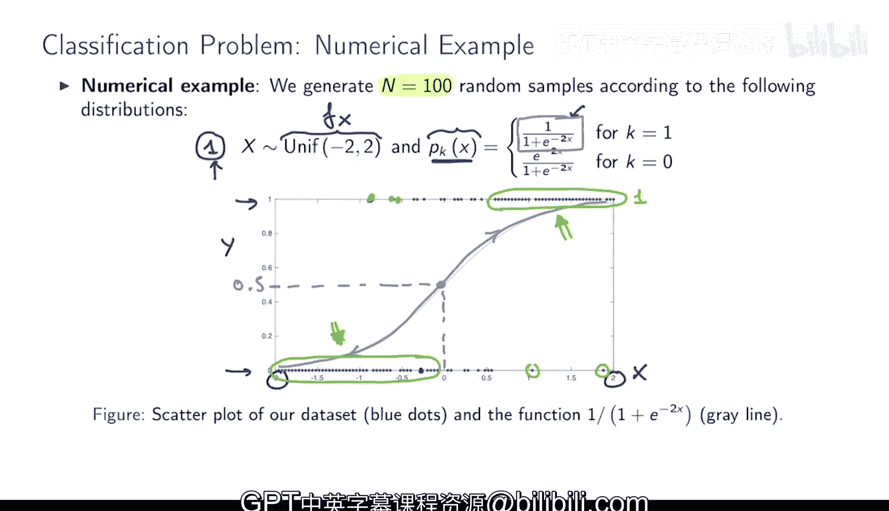

# 人工智能和机器学习基础：第24章：分类问题入门 🧠

在本节课中，我们将要学习机器学习中的分类问题。我们将从回归问题过渡到分类问题，理解其核心定义，并学习一种重要的理论模型——生成模型。

上一节我们介绍了回归问题，其输出是连续数值。本节中我们来看看分类问题，其输出是离散的类别标签。

## 分类问题的定义

在分类问题中，我们处理的是**定性输出**。具体来说，我们有一个离散的类别集合 **C**，其中包含 **k** 个类别标签。对于给定的输入 **x**，输出变量 **y** 将从集合 **C** 中取值。

我们的目标是构建一个分类器 **C(x)**，该函数将输入 **x**（一个 **p** 维向量）映射到离散的类别标签集合中。

**公式表示：**
`C: R^p -> C`

以下是分类问题的典型例子：
*   **图像分类**：例如，区分图片中是狗还是猫。此时，类别集合 **C = {狗, 猫}**。输入 **X** 是从图像中提取的特征向量（例如像素值、形状、颜色等）。分类器接收这个特征向量，并输出预测的类别。

需要注意的是，分类器可能会预测正确，也可能会出错，这会产生分类错误，我们将在后续课程中分析。

## 生成模型

为了从理论角度研究分类问题，我们将引入**生成模型**的概念。生成模型描述了数据是如何被“生成”出来的。

我们假设数据集 **D** 中的样本点（输入 **X** 和输出 **Y**）是按照以下两个步骤生成的：

1.  **生成输入**：首先，从一个**边缘分布 F(x)** 中随机采样一个输入 **Xi**。
2.  **分配标签**：在得到输入 **Xi** 的具体值后，我们使用一个**条件概率质量函数（PMF）** 来为其分配一个输出标签 **Yi**。

这个条件概率函数定义如下：
`P(Y = k | X = x) = p_k(x)`
其中，**k** 是类别集合 **C** 中的一个标签。函数 **p_k(x)** 被称为**条件类别概率**。它告诉我们，对于给定的输入 **x**，其输出为类别 **k** 的概率是多少。

## 一个数值示例

让我们通过一个具体的数值例子来理解这两个步骤。在本例中，我们将生成100个样本点。

**步骤1：定义分布**
*   假设输入 **x** 服从 **[-2, 2]** 区间上的均匀分布，即 `x ~ Uniform(-2, 2)`。这对应了第一步的边缘分布 **F(x)**。
*   条件类别概率 **p(x)** 由以下**S型函数（Sigmoid Function）** 给出：
    `p(x) = 1 / (1 + e^(-x))`
    这个函数给出了当输入为 **x** 时，输出标签为 **1** 的概率。输出为 **0** 的概率则是 `1 - p(x)`。

**步骤2：生成样本**
以下是生成两个样本点的过程：

1.  **第一个样本**：
    *   从均匀分布中采样，得到 `x1 = 0.44`。
    *   计算条件概率：`p(0.44) ≈ 0.70`。这意味着标签为 **1** 的概率是70%，为 **0** 的概率是30%。
    *   我们“抛掷”一枚有偏硬币（正面（1）概率70%，反面（0）概率30%）。假设结果为 **1**。
    *   因此，第一个数据点为 `(x1=0.44, y1=1)`。

2.  **第二个样本**：
    *   再次采样，得到 `x2 = -1.1`。
    *   计算条件概率：`p(-1.1) ≈ 0.10`。这意味着标签为 **1** 的概率是10%，为 **0** 的概率是90%。
    *   抛掷有偏硬币（正面概率10%）。假设结果为 **0**。
    *   因此，第二个数据点为 `(x2=-1.1, y2=0)`。

重复此过程100次，我们就得到了如图所示的样本点云。

## 结果分析

在生成的数据集中：
*   输入 **x** 在区间 **[-2, 2]** 内。
*   输出 **y** 取值为 **0** 或 **1**（图中用蓝色圆点表示）。

图中的灰色曲线是条件概率函数 **p(x)** 的图形表示，即S型函数。观察此图，我们可以发现：
*   当函数值接近 **1** 时（曲线右端），其对应的输入点（x值较大）的输出标签大多为 **1**，只有极少数为 **0**。
*   当函数值接近 **0** 时（曲线左端），其对应的输入点（x值较小）的输出标签大多为 **0**，但也会混有少量 **1**。

本节课中我们一起学习了分类问题的基本概念。我们明确了分类与回归的区别，即输出是离散的类别标签。我们引入了**生成模型**作为理解分类问题的理论框架，它通过**边缘分布**和**条件类别概率**来描述数据的生成过程。最后，我们通过一个具体的数值示例，演示了如何根据S型函数生成分类数据集，并观察了数据分布与概率函数之间的关系。理解这些基础是后续学习具体分类算法（如逻辑回归、决策树等）的关键。