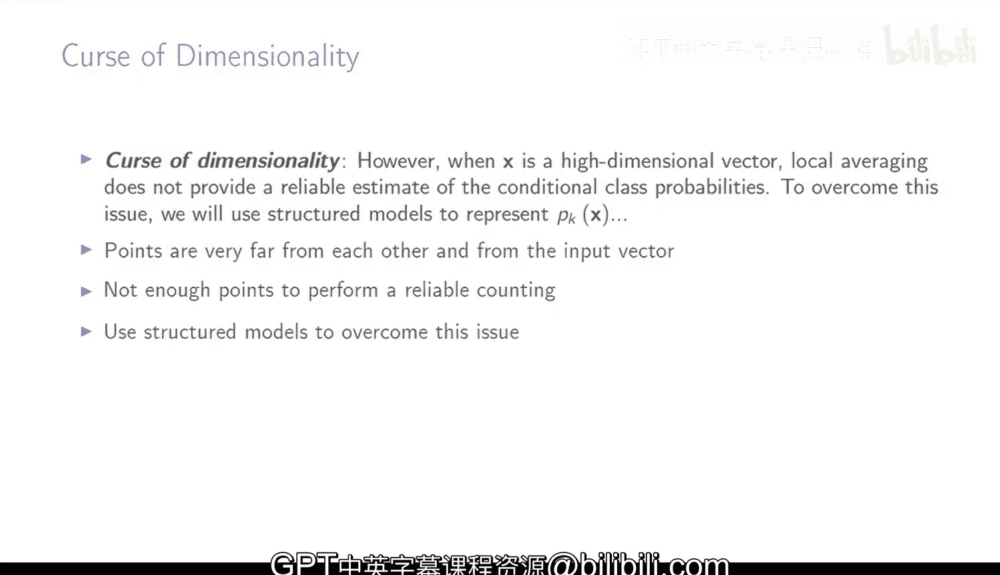

# 宾夕法尼亚大学《人工智能和机器学习基础（AI、数据科学、机器学习）AI and Machine Learning Essentials with Python》 p89 25_04_02_贝叶斯分类器与局部平均.zh_en -BV16f421Q72q_p89-

When we have stated the classification problem and we explain how we have generated our data set。

We're going to define what's called the base optimal classifier， C of x。

So the definition is in the expression below。What this definition is telling you is that for a particular given input x。

 we're going to look at all possible values of k of the conditional class probabilities。

And we will find that label K that maximizes the conditional class probability。In other words。

 given an input X。The BOC， the base Op classifier， assigns a label K that maximizes the conditional class probability。

We will see later on that this classifier minimizes the classification error rate。

 which is a measure of the quality of the classifier。

Let's look into the example in the previous slide to find an explicit form for this base Op classifier。

Going back to the previous slide， we observe that the function P1 of x is given by that gray plot。

We also have that p sub0 of x given in this expression here。Is equal to 1 minus a1 x。

 So this is something that's always true for binary classification problems because the probability of getting a0 should be 1 minus the probability of getting a 1。

Therefore， if we plot the function 1 minus p1， you should obtain a curve that's very similar。

 but somehow symmetric to the gray line， essentially I'm going to have a function。

That still passes through that middle point， essentially the middle point where x is equal to 0。

 and y is 0。5。And the function will be asymmetric smooid。Of these four。Now。

 according to the definition of the optimal base classifier， for any value of x。

 we will assign a label Cx。Corresponding to the largest conditional class probability。 So。

 for example， for this particular value of x in here。

 the values of the conditional class probabilities is this value here for the class 1。

And this value here for the class 0， since the class0 provides a larger value for that value of x。

 we will classify that point with a value 0。This is going to be true for all the points x in this region。

 in particular when x is less than 0。In contrast， for values of x above0。

 an evaluation of the conditional class probabilities will show you that p1 will always be greater than p0。

Therefore， we will assign a label 1 to all the points x greater or equal than 0。The point at zero。

 you can arbitrraarily assign it to any class。Going forward。

 we can have a more formal statement of what I mentioned before。

 essentially since p1 is greater or equal than p0 for x greater or equal than 0。

The baseige optimal classifier will take a value 1 for x greater equal equal than0。And0 otherwise。

 meaning x less than 0。Now， in practice， there is a limitation to apply this logic because we typically do not know the conditional class probabilities that have been used to generate a data set。

In practice， we are given the data set， but we are not given the generative model。

 the same way that when we're dealing with a linear model， were given a data set。

 but we are not given the parameters beta 0 beta 1 up to beta p that nature is using to generate these points。

In other words， only nature knows how the data set is generated。

 but we cannot look into that generative process， that's a black box for us。

 we cannot access the parameters inside the generative process。

A possible approach to solve this issue is reduced in local averaging。

Let me show you how local averaging works in the data set that I showed you before。

 so let's go back to slides。So in this slide， if I clean things up。

 local averaging would work as follows。I want to estimate p1 m0 for a particular value of x。

 let's choose a particular value of x， maybe a value of minus0。2。I'm going to pick a window。

Of a particular wave。For example， values within minus0。4 and seedo， essentially minus0。

2 would be the middle of the window， and you will move pseudo2 units to the right and to the left。

And now I'm going to focus on the window in。By those two values。

And will count the number of ones and the number of zeros in that particular window。

The definition of P1 of x。At that particular value of x， meaning P1 of minus 0。

2 will be equal to the fraction of ones contained in the set of points included in that window。

MPse of minus0。2 will be the fraction of pseudos。That are contained in that particular window。

So going back to this figure， this is essentially what I obtain in that particular blue plot。

 so you can see that by performing a local aver， I obtain a numerical function represented in blue that is a decent approximation of the gray curve which remembers is equal to piece of1 of x。

We can call that blue function P1 hat of x， since it is an approximation of p1 of x。

This P1 hat of x is something that we can compute from data。

 but p1 of x is something that's completely hidden to us， so we will not know this gray line。

Once we have computed P1 hat of x， we can now find an approximation of the base optimal classifier。

Which I'm denoting here by C hat。The rule for this classifier is exactly the same as the one we had before。

 meaning when p1 hat of x is greater or equal than p10 of x。

 we will assign a class 1 to that particular input。In this case。

 the cutting point for the classifier is not exactly a0， which was this value before。

But it is slightly higher than 0， but you can see that for any point beyond this particular value。

We will assign a value Cx。Equal to1， and for points below that particular threshold value。

 we will have an optimal base classifier。 So have to include a hat in there， equal to 0。Now。

 remember that local averaging is not a technique that's new to us。 In particular。

 this is something that we talked about when we describe a genetic regression problem。In particular。

 we could solve a regression problem if we have a very large data set by looking at the outputs。

 corresponding to the inputs that are close enough to a point for which are going to perform regression。

Also you should remember that in that particular situation something called the curse of dimensionality come onto the table。

 and this is something that's going to happen here too。

 essentially when x is a high dimensional input vector doing local aor does not provide a reliable estimate of the conditional class probabilities for the same reason that performing local aor is not a good solution to regression problems in the high dimensional setup。

In particular in high dimensions， all input points are very far from each other。

 and we will not be able to find points that are close enough to the input vector for which we want to perform a classification。

Therefore， if we want to count the number of points of different classes that are contained within a given ball centered around the point x for which we want to perform classification。

 we will not have enough points to perform a reliable counting。To overcome this issue。

 we will resort to structure models， which is the same approach we took for regression problems。

