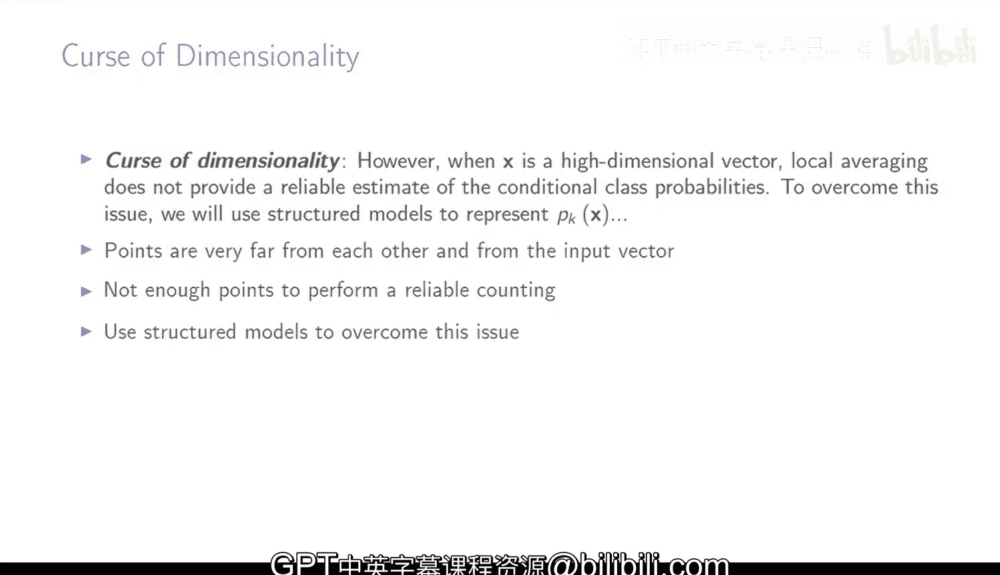

# 人工智能和机器学习基础：25：贝叶斯分类器与局部平均

在本节课中，我们将学习分类问题的核心概念——贝叶斯最优分类器，并探讨如何在实际中通过局部平均法来近似它。我们还将讨论高维数据带来的挑战。

## 贝叶斯最优分类器的定义

上一节我们阐述了分类问题并解释了数据集的生成方式。本节中，我们来看看如何定义一个理论上最优的分类器。

当我们有了分类问题并定义了数据集后，可以定义所谓的贝叶斯最优分类器，记作 **C(x)**。

其定义由以下表达式给出：
`C(x) = argmax_k P(Y=k | X=x)`

这个定义告诉我们，对于一个给定的输入 **x**，我们需要查看所有可能的类别标签 **k** 对应的条件类别概率 **P(Y=k | X=x)**。然后，我们选择那个能使条件类别概率最大化的标签 **K**。换句话说，给定输入 **X**，贝叶斯最优分类器会分配一个能最大化条件类别概率的标签 **K**。

我们稍后会看到，这个分类器能最小化分类错误率，这是衡量分类器质量的一个指标。

## 一个具体例子

让我们回顾上一张幻灯片的例子，为这个贝叶斯最优分类器找到一个明确的形式。

回到之前的幻灯片，我们观察到函数 **P1(x)** 由灰色曲线给出。同时，我们有 **P0(x)** 的表达式，它等于 **1 - P1(x)**。这对于二分类问题总是成立的，因为得到类别0的概率应该是1减去得到类别1的概率。

因此，如果我们画出函数 **1 - P1(x)**，会得到一条与灰色曲线非常相似但大致对称的曲线。它将是一个不对称的S形曲线，仍然通过中间点（即 x=0, y=0.5 的点）。

现在，根据贝叶斯最优分类器的定义，对于任何 **x** 值，我们将分配一个标签 **C(x)**，它对应于最大的条件类别概率。

例如，对于图中这个特定的 **x** 值，类别1的条件概率是这里的这个值，而类别0的条件概率是这里的这个值。由于类别0在这个 **x** 值上提供了更大的概率值，我们将把这个点分类为0。对于这个区域（特别是当 **x < 0**）的所有点，情况都是如此。

相反，对于 **x > 0** 的值，评估条件类别概率会显示 **P1** 总是大于 **P0**。因此，我们将为所有 **x ≥ 0** 的点分配标签1。在 **x=0** 的点，可以任意将其分配给任一类别。

更正式地表述，由于当 **x ≥ 0** 时 **P1 ≥ P0**，贝叶斯最优分类器将在 **x ≥ 0** 时取值为1，否则（即 **x < 0** 时）取值为0。

## 实践中的局限与局部平均法

然而，在实践中应用这个逻辑存在一个限制，因为我们通常并不知道用于生成数据集的条件类别概率。

在实践中，我们被给予数据集，但并未被给予生成模型。这就像处理线性模型时，我们被给予数据集，但并不知道自然界用来生成这些点的参数 **β0, β1, ..., βp**。换句话说，只有“自然界”知道数据集是如何生成的，但我们无法窥探那个生成过程，它对我们来说是一个黑箱，我们无法访问生成过程内部的参数。

解决这个问题的一个可能方法是采用局部平均法。

让我展示局部平均法如何在我们之前展示的数据集上工作。回到幻灯片，如果我把内容清理一下，局部平均法的工作方式如下：

我想估计特定 **x** 值（例如 **x = -0.2**）的 **P1(x)** 和 **P0(x)**。我将选择一个特定宽度的窗口，例如在 **-0.4** 到 **0** 之间的值（**-0.2** 是窗口的中心，向左右各移动0.2个单位）。现在，我将聚焦于这个窗口内的点，并统计该窗口内类别1和类别0的数量。

在特定 **x** 值（例如 **x = -0.2**）处的 **P1(x)** 定义，等于包含在该窗口内的点集中类别1所占的比例。**P0(-0.2)** 则是该窗口内类别0所占的比例。

回到图中，通过执行局部平均，我得到了图中蓝色曲线所代表的数值函数，它是灰色曲线（即真实的 **P1(x)**）的一个不错的近似。我们可以称这个蓝色函数为 **P1_hat(x)**，因为它是 **P1(x)** 的近似值。

这个 **P1_hat(x)** 是我们可以从数据中计算出来的，而真实的 **P1(x)** 对我们来说是完全隐藏的，我们不会知道这条灰色曲线。

一旦我们计算出了 **P1_hat(x)**，我们现在就可以找到贝叶斯最优分类器的一个近似，我在这里用 **C_hat** 表示。这个分类器的规则与之前完全相同，即当 **P1_hat(x) ≥ P0_hat(x)** 时，我们将为该特定输入分配类别1。

在这种情况下，分类器的分割点并不正好是之前的0值，而是略高于0。但你可以看到，对于超过这个特定阈值的任何点，我们将分配 **C(x) = 1**；对于低于该阈值的点，我们将有 **C_hat(x) = 0**。

## 与回归的联系及高维挑战

需要记住的是，局部平均法对我们来说并不是新技术。特别是，我们在描述回归问题时曾讨论过它。具体来说，如果我们有一个非常大的数据集，可以通过查看与待回归点足够接近的输入所对应的输出来解决回归问题。

你还应该记得，在那种情况下会出现所谓的“维度灾难”问题，而同样的情况也会在这里发生。本质上，当 **x** 是一个高维输入向量时，进行局部平均并不能可靠地估计条件类别概率，原因与在高维设置下执行局部平均不是回归问题的好解决方案相同。

特别是在高维空间中，所有输入点彼此之间都非常遥远，我们将无法找到足够接近我们想要进行分类的输入向量的点。因此，如果我们想统计在以待分类点 **x** 为中心的给定球体内包含的不同类别的点的数量，我们将没有足够的点来进行可靠的统计。

为了克服这个问题，我们将求助于结构化模型，这与我们解决回归问题时采取的方法相同。

## 总结

本节课中，我们一起学习了贝叶斯最优分类器的理论定义，它通过最大化后验概率来实现最小化分类错误。由于真实的条件概率未知，我们引入了局部平均法来从数据中近似估计这些概率。然而，在高维空间中，局部平均法因“维度灾难”而失效，这引导我们转向需要结构化模型（如后续将学的逻辑回归、决策树等）来解决实际的分类问题。