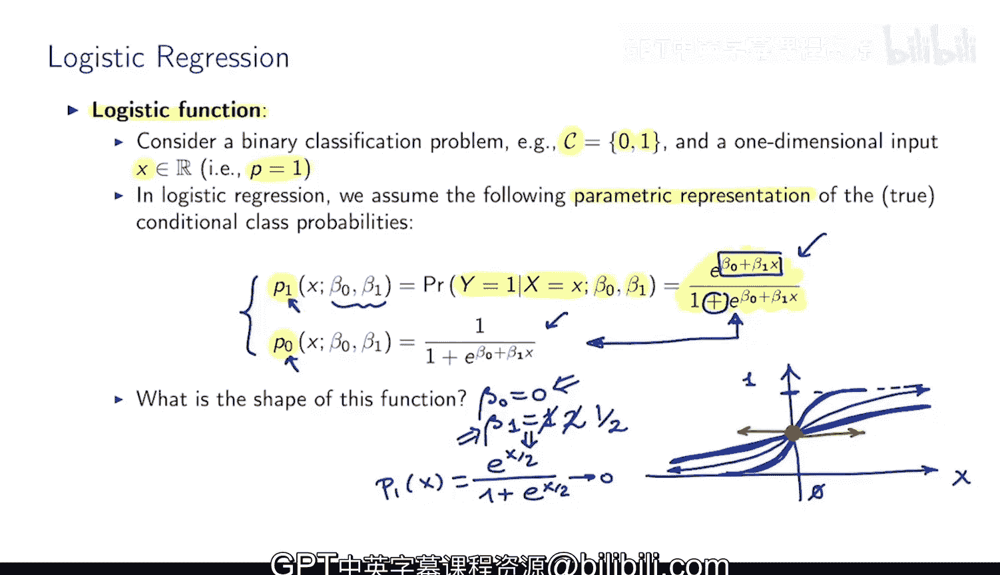

# 宾夕法尼亚大学《人工智能和机器学习基础（AI、数据科学、机器学习）AI and Machine Learning Essentials with Python》 p90 26_04_01_逻辑回归.zh_en -BV16f421Q72q_p90-

Yeah。In the previous video， we have seen how the cur of dimensionality does not allow us to perform local a。

 in only to faithfully estimate the conditional class probabilities for the given data set。Therefore。

 we need to resort to panmetric models。One of these parametric models。

 its what's called a logistic function。So in the case of logistic functions。

 we're going to consider that a binary classification problem。Were the classes at Cdo and Guan。

And for now， we're going to consider that our inputs are one dimensional， essentially p is equal to1。

 therefore our input is just a sc value。The particular parametric representation of the conditional class probabilities are given below。

In particular， the probability that the label is 1。

 given the input x is going to be a function parameterized by beta 0 and beta 1 and is given by the expression on the right。

Essentially， we're going to have an exponent to the power of something that should remind you of a linear regression。

Divided by  one plus the same exponent。So this is what we call piece of one。

 the conditional class probability for the class 1。Again。

 this function is going to be parameterized by beta 0 and beta 1。

We also have that the conditional class probability for the class 0 essentially is the same expression as P1。

 but the numerator instead of an exponent is equal to 1。You should realize。😮。

That the probability that the output is 1 plus the probability that the output is 0 should sum to1。

 since these are the only two possibilities as outputs。

You should notice that the sum of these two functions。

 the conditional class probabilities for0 and1 are going to sum to 1。

 and I invite you to verify this。Now， what is the shape of this function here？

This function is called a sigmoid function。And we can study shape by looking at some particular examples。

 For example， let's consider for simplicity that beta 0 is equal to 0。And beta 1 is equal to1。

In that case。That sigmoidal function is going to be e to the power of x。

Divided by 1 plus e to the power of x。Now， if we look at how this function be one of x as a function of x。

 we're going to get the following form。So if we evaluate the function at x equal to 0。

We're going to get that e to the seedo is equal to 1 divided by  one plus e to the seedo， which is1。

 So we're going to obtain a value of 12。When x goes to infinity e to the x will grow to infinity。

 and in the denominator e to the x will dominate the1， therefore this will converge towards 1。

 so for x going to infinity， we' are going to have an asyttic value。

That will go towards one this way。In contrast， when x goes to minus infinity。

 e to the minus infinity will converge to 0 and we will obtain0 divided by 1 plus 0。

 essentially this will converge asymptically towards 0。

 so we're going to have a function that converge towards 0 this way。

Let's now increment the value of beta 1 from 1 to 2。 In that case， p1 of x will look like this。

And through a very simple analysis， you can convince yourself that what this increment in the exponent really is doing is accelerating the rate of growth。

And the rate of decrease of this function。So we're going to get an S shape function therefore for the word sigmoid is coming from sigmma in Greek。

And the shape of the sigmmic function will be changed when you change the value of better one。

If instead of changing the value of be 1 from 1 to2。

 we change it to something like one half meaning less than1。The function P1 x would look like this。

And the sigmoid function could increase much slower， so will be much flatter。

So essentially we can tune the rate of growth of the sigmoid by changing the value of beta one。

Now what's the effect of beta0， you can also convince yourself that the value of beta0 will be able to shift this function to the right and to the left。

Therefore， the two parameters beta0 metagon will allow you to1 tune the rate of growth of the sigmoid function and two shift that sigmoid function to the right or to the left。

