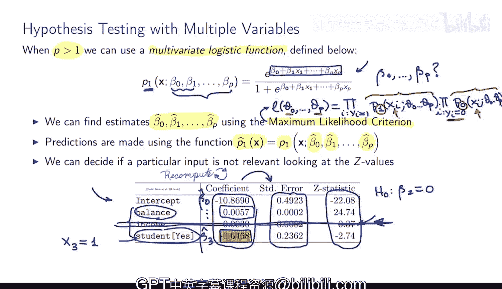

# 宾夕法尼亚大学《人工智能和机器学习基础（AI、数据科学、机器学习）AI and Machine Learning Essentials with Python》 p92 28_04_01_逻辑回归中的假设检验.zh_en -BV16f421Q72q_p92-

In this video， we're going to revisit the concept of hypothesis testing。In particular。

 we will use hypothesisth testing to decide if a particular input influences the output variable。

Remember that in our learning process， we do not have access to the true value of beta0 beta 1。

We only have access to the data generated by nature。 Therefore。

 we will not be able to definitely know if beta 1 is equal to 0。

 which could be the case when the input does not influence the output。

Also remember that our estimate beta 1 hat that we obtain using in maximum likelihood estimation is a random variable because it depends on the random data set collected from nature。

It turns out that this random variable is unbi， therefore when beta 1 is equal to0。

 this random variable is center around 0。Also， the standard deviation of this random variable can be computed from data。

Therefore， once we have a data set， we will be able to compute the standard deviation of this random variable as well as a particular realization of beta 1 hat。

Using these two values， we can now compute the value of Cta 1 as the fraction of beta 1 hat divided by the standard deviation。

It's easy to prove that since beta 1 hat is normally distributed。

 Cta 1 is also a normal distribution， cent net0 whose variance is normalized to be equal to 1。

If you remember， this distribution contains 95% of its mass in the interval minus 222。

 so essentially the area below the Gaussian distribution will be 0。95。

This tell us that the probability that the absolute value of C 1 is less than 2 is going to be 95%。

Therefore， if the absolute value of Cta 1 is greater than 2， then we have a statistical evidence。

To reject the new hypothesis， which in this case， is that the input does not influence the output。

We can illustrate this idea using the default data set that we saw in the previous video。

In this particular case， we have a single input， meaning the balance of an individual to predict his or her probability of default。

U seem maximum likelihood estimator we can compute the values of beta0 hat and beta 1 hat。

 which are contained in this first column。The standard deviations can be computed using any statistical software package。

And these are the values that we obtain。 the theoretical computation of these values are beyond the scale of this course。

 but any software will provide you with these values。

Now dividing the first column over the second column。

 we will compute the C statistics and observe that in this case。

 the value of the C statistics are in absolute value greater than 2。Therefore。

 we don't have statistical evidence to reject the hypothesis that the input does not influence the output。

In other words， balance is relevant to predict the probability of default。

In the case of dealing with multiple variables， meaning when p is greater than 1。

 we can use the multivaririate logistic function， which is defined below。

So here we have the conditional class probability for class 1。Instead of having two parameters。

 as we have for b equal to1。We're going to have p plus 1 parameters， beta 0 to beta P。

 The shape of this function is very similar to the one we saw before。

The only difference is that the exponent。In the function is going to take the form of a linear regression with P inputs。

 essentially we're going to have beta 1 x1 plus beta pxp plus an intercept beta 0。

So as we did in the previous examples， we are going to assume that nature is generating points according to this conditional class probability。

 but the values of betas are something that are not known to us。

 in other words beta0 up to beta P are something that are unknown to us。

Using an available dataset set， we can use maximum likelihood estimation to compute estimates of those values。

Once we have these estimates， we can make predictions using an approximation of the conditional class probability。

 which has the shape of the multivariral logistic function where we substitute the values of beta0 to beta p。

 which are unknown to us to the estimated values beta0 hat to beta P hat。In the table below。

We're going to use the default data set， but in here。

 instead of considering a single input which in the previous example was balance。

 we're going to consider three different input features for each individual， which are the balance。

The income。And a categorical variable indicating if this individual is a student or not。

We can deal with a categorical value the same way as we did in linear regression。

 essentially you should define a dumi variable x3， which will take the value 1 if this individual is a student and zero otherwise。

Once you introduce this dummi variable。You can run the maximum likelihood criterion。

 which in the multivariate case， will be formally equivalent to the one that we saw for p equal to 1 in particular。

 the likelihood function will be a function of the parameters30 to3 P which are genetic parameters that are used in the linear function included in the exponent and this likelihood function will be equal to the product of the conditional probability that the output is one corresponding to those inputs。

Times a second product over the points for which the outputs are equal to 0。And again。

 we multiply the conditional class probabilities for those input points using the class0。

Notice again that given the inputs Xs， this product turns out to be a function exclusively of the unknown parameters。

 Theta 0 to Theta P。And finding the maximum of that function will provide us with the estimate beta 0 hat to beta P hat。

According to this procedure and using the default data set， we will be able。

To find these estimates for beta 0 hat up to。Beta 3 hat。Also。

 a standard statistical software package will allow you to compute the standard deviations of the beta hats。

 which remember there are always random variables。Dividing the first and second column。

We will obtain C statistics and notice。The dec statistic associated with beta2 hat is in absolute value less than 2。

Therefore， the new hypothesis cannot be rejected。This indicates that this second variable income is not relevant to make predictions about the probability of defaulting。

Also， I would like to remark that once you remove this second variable。

You will need to recompute the coefficients of your logistic regression using the two input variables。

 balance and student， so essentially you will not be able to use these coefficients once you remove the second variable。

