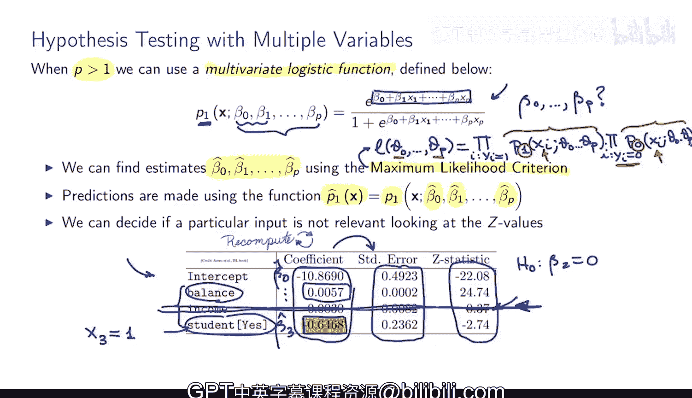

# 宾夕法尼亚大学《人工智能和机器学习基础》：28_04_01：逻辑回归中的假设检验 📊

在本节课中，我们将要学习如何在逻辑回归的框架下应用假设检验。我们将回顾假设检验的核心概念，并学习如何利用它来判断一个特定的输入变量是否对输出变量有显著影响。

## 概述

上一节我们介绍了逻辑回归的基本模型。本节中，我们来看看如何评估模型中每个输入变量的重要性。我们将通过假设检验来回答一个关键问题：某个输入变量是否真的影响了输出结果？

## 假设检验回顾

在机器学习的学习过程中，我们无法得知模型参数（如 `β0`, `β1`）的真实值。我们只能接触到由“自然”生成的数据集。因此，我们无法确切知道 `β1` 是否等于 0（这对应着输入不影响输出的情况）。

我们通过最大似然估计得到的估计值 `β1_hat` 是一个随机变量，因为它依赖于从“自然”中随机收集的数据集。这个随机变量是无偏的，因此当真实的 `β1` 等于 0 时，`β1_hat` 的分布将围绕 0 波动。此外，这个随机变量的标准差可以从数据中计算出来。

## Z统计量的计算与应用

一旦我们有了一个数据集，我们就能计算出 `β1_hat` 的标准差以及 `β1_hat` 的一个具体实现值。利用这两个值，我们可以计算 Z 统计量 `Z1`，其公式为 `β1_hat` 除以它的标准差。

`Z1 = β1_hat / std(β1_hat)`

可以证明，由于 `β1_hat` 服从正态分布，`Z1` 也服从一个均值为 0、方差为 1 的标准正态分布。这个分布有 95% 的概率质量落在区间 `[-2, 2]` 内。这意味着 `|Z1| < 2` 的概率是 95%。

因此，如果计算出的 `|Z1|` 大于 2，我们就有了统计证据来拒绝原假设（即输入不影响输出）。

## 单变量案例演示

我们可以用之前视频中见过的“违约”数据集来演示这个想法。在这个案例中，我们使用单个输入变量（个人余额）来预测其违约概率。

使用最大似然估计，我们可以计算出 `β0_hat` 和 `β1_hat` 的值。它们的标准差可以通过任何统计软件包计算。将估计值除以对应的标准差，我们就得到了 Z 统计量。在这个案例中，Z 统计量的绝对值大于 2。

因此，我们没有统计证据来接受“输入不影响输出”的假设。换句话说，余额与预测违约概率是相关的。

## 扩展到多变量逻辑回归

在处理多个变量（即 `p > 1`）时，我们可以使用多元逻辑函数，其定义如下：

`P(Y=1|X) = 1 / (1 + exp(-(β0 + β1*x1 + ... + βp*xp)))`

这里，条件类别概率（类别为 1）的形状与之前相似，唯一的区别是指数部分变成了一个具有 `p` 个输入的线性回归形式。我们假设“自然”根据这个条件概率生成数据点，但参数 `β0` 到 `βp` 对我们来说是未知的。

## 多变量案例的参数估计与检验

使用可用的数据集，我们可以通过最大似然估计来计算这些参数的估计值 `β0_hat` 到 `βp_hat`。一旦有了这些估计值，我们就可以用它们来近似条件类别概率并进行预测。

在下面的表格中，我们使用“违约”数据集，但这次考虑三个不同的输入特征：余额、收入以及一个表示该个体是否为学生的分类变量。处理分类变量的方法与在线性回归中相同，即定义一个虚拟变量 `x3`（是学生则为 1，否则为 0）。

引入这个虚拟变量后，可以运行最大似然估计。在多元情况下，似然函数的形式与 `p=1` 时类似，它是参数 `β0` 到 `βp` 的函数。找到这个函数的最大值，就能为我们提供参数的估计值 `β0_hat` 到 `βp_hat`。

根据这个程序并使用“违约”数据集，我们可以找到 `β0_hat` 到 `β3_hat` 的估计值。同样，标准统计软件包可以计算出这些 `β_hat` 的标准差。将估计值除以标准差，就得到了 Z 统计量。

请注意，与 `β2_hat`（对应收入变量）相关的 Z 统计量绝对值小于 2。因此，不能拒绝原假设。这表明第二个变量“收入”对于预测违约概率并不显著。

需要强调的是，一旦移除了这个不显著的变量，你需要使用剩下的两个输入变量（余额和学生身份）重新计算逻辑回归的系数。你不能在移除变量后继续使用原来的系数。

## 总结

本节课中我们一起学习了如何在逻辑回归中应用假设检验。我们回顾了假设检验的原理，学习了如何通过计算 Z 统计量来判断一个输入变量是否对输出有显著影响。我们从单变量案例入手，然后扩展到多变量逻辑回归，并了解了如何处理分类变量以及如何解释检验结果。关键在于，如果某个变量的 Z 统计量绝对值大于 2，我们就有证据认为该变量是显著的；反之，则可以考虑将其从模型中移除，并重新拟合模型。