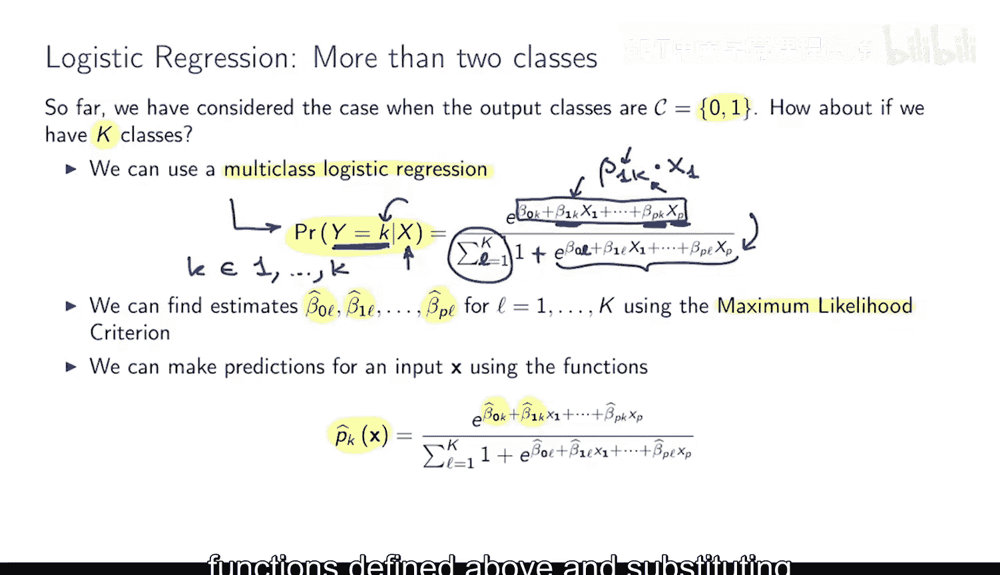

# 宾夕法尼亚大学《人工智能和机器学习基础（AI、数据科学、机器学习）AI and Machine Learning Essentials with Python》 p93 29_04_02_多类别逻辑回归.zh_en -BV16f421Q72q_p93-

So far， we have study logistic regression when we have only two output classes。C to and Guan。

 this is what's called a binary classification setup。Now， in many scenarios。

 we will have k different classes where K will be in general greater than 2。In that case。

 we can use a multi class logistic regression。A multiclass logistic regression uses the following parametric shape for the conditional class probabilities。

In particular， the probability that the output is equal to a label k where k can be from 1。

To capital K， given the input x。Is equal to exponent。

To the power of a term that is similar to a linear regression term。

 So now notice that the parameters beta have two sub indexes in this particular case，1 k。

The first index will indicate that this value of Veta is within in the first variable。

And the second index k indicates that this varies a one corresponding to the conditional class probability for class K。

 so in this particular case we have beta 1k up to beta pk where beta pk will be weigh in x of p。

In the denominator， what were going to have is a summation over all possible classes of1 plus the same exponent that we have in the numerator。

However， this exponent will correspond to the class L that will be sum from 1 to capital K。

 meaning all the classes in our problem。In this scenario， we can still estimate the known parameters。

 beta hats using the maximum likelihood estimation。

 and this is formally equivalent to what we have seen before。Once we have the values of better hats。

 we can build an estimate of the conditional class probabilities。

By using the conditional class probability functions defined above。

And substituting the values beta by be hats。

This concludes our coverage of logistic regression， which is a technique to perform classification。

