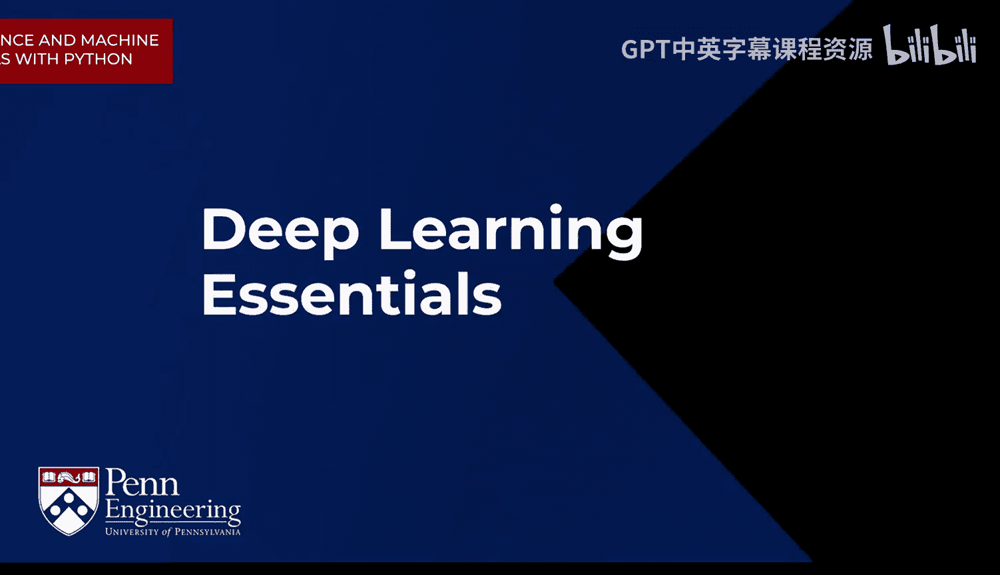

# 宾夕法尼亚大学《人工智能和机器学习基础（AI、数据科学、机器学习）AI and Machine Learning Essentials with Python》 p94 01_01_01_深度学习基础入门.zh_en -BV16f421Q72q_p94-

Welcome back to the University of Pennsylvania's specialization in artificial intelligence and machine learningEssentials in Python。

 I'm here with Peique Cowy who teaches our principles of deep learning course。

Pritique deep learning is an incredibly exciting topic， and like other aspects of neural networks。

 I think that there's interesting inspirations from how the human brain works。

 Can you tell us a little bit about how people could understand deep learning through the lens of the human visual processing system。

😊，So lets let's take nature's camera as an example。

 our eye and so when when light hits your retina it is transduuced into voltages by series of cells some of them are called rod。

 some of them are called cones and just to give people an appreciation of what they are a typical cell phone camera has about 50 million pixels your typical retina has about 100 million of these cells so they are basically like pixels and after receiving light as such there is multiple layers of cells。

 some of them are called bipolar cells， some of them are called ganglion cells inside your retite cells that convert light into spikes that convert these spikes into things like edges and shapes and colors there are cells that are sensitive to different kinds of motions and different directions of motion and all this information is passed on to your brain roughly at 10 MBps per second faster than the wi-fi in。

😊，Through I bet your brain has multiple layers of processing on top of this so it takes input which is a light field and then converts it into things like objects things like memories it recognizes the same face when you see it again it deduces things based on what we are looking at in the world and roughly speaking neural computation is a sequence of small computations being performed layer by layer one after the other and and the greatest mystery or the deepest property about this computation is that it is performed by pretty rudimentary little neurons each neuron is rather independent in how it works as compared to the others。

😊，But together they performed these miraculous kinds of computation and so deep learning is our attempt at mimicking what goes on in the biological brain on a computer and this is the field of artificial intelligence it has become synonymous with deep learning over the years especially these days that has been driving progress in so many fields yeah that's really fascinating so I think one of the early successes of having these multilayer deep neural networks was in computer vision and I think that you're right that many other fields have been driven by progress in deep learning can you give us some examples of the sort of technologies that are enabled by deep learning。

😊，Yeah， so if you， if you take other data modalities， for example。

 natural language processing deep networks have become incredibly good at natural language processing。

 Most of us have seen some have had some experience with things like Cha GP or Google's Gemini that can process text in in interesting ways you can ask questions and converse with these models there are models that use both text and images they would also in sounds to it。

 there are models that create videos， So these are models that do that work with different kinds of data modalities。

 If we talk about applications， there is neural networks or deep networks being used in things like autonomous driving。

 Most parts of the industry used in neural networks today for performing in diverse range of tasks most fields of science use deep learning technology today whether it is identifying new galaxies。

😊，These in telescopes are identifying different kinds of cells that you see inside the human body。

 it's hard to imagine a field of science or engineering that has not been impacted by deep learning or that is not actively using it。

Can you give us a little preview of what learners will encounter in your essentials of deep learning course in our online specialization？

So the course begins with what I call a definition of intelligence。

 we are attempting to build artificial intelligence so we should ask ourselves what it even means and I try to argue that an intelligent organism or an intelligent machine ought to have three basic properties it should be able to sense the world it should be able to understand the world understand its environment and it should be able to act upon it to something with this understanding with this we take a look at the history of how we have been attempting to build intelligence and this begins with the 1940s some of the earliest ideas by people like Alan Turing or malo and pits who try to build machines that could compute in some ways and then we go through 60s and the 80s and 90s and until today when we build very different kinds of networks and then we start doing start building deep。

Neworks from the ground up so the first part of this story begins with perceptron it's a very simplistic model for distinguishing between two kinds of objects let's say apples and oranges well talk about how stochastic gradient descent which is a very popular way of fitting a perceptron making sure the perceptron distinguishes within apples and oranges correctly works this progresses into something called as current methods which are now fancier variants of perceptron they will put in more bes and vessels kernel methods incidentally where the precursor to neural networks they were running most of our machine learning technology until 10 years ago and they have progress since so we look at a fully connected networks which are which will be our first insight into how water neural network looks like what a deep neural network looks like it has multiple layers。

 the neurons are somewhat rudimentary in how they work will use an algorithm or a technique called back propagation which allows us to fit a neural network。

If all neural networks that we use today including fully connected networks。

 backrop is no different than a chain rule， we quote it up a little bit differently when we use it for deep learning and so the first part of the course gives us the essentials of beginning our investigation into deep learning。

That's fabulous， so that seems like it gives students a really great foundation of deep learning。

If the students were to go beyond and take your full course here at the University of Pennsylvania。

 what else would they learn？So we look at for example the progress of architectures from convolutional neural networks which are particularly suited to understanding natural images or sounds then we look at attentionbased networks which are very popular for understanding text because they can look at very large pieces of information as si and off a little nuggets of evidence and that summer completes this story on neural architectures。

 all the different variant then we look at how to train these architectures we look at optimization algorithms will do a little bit more mathematics also of how these algorithms work when you should use one or the other how you should tweak them to get good results in practice and deep learning tends to be deep learning is still a very nebulous field for all its progress and all its fascinating results and so the course focuses a lot on understanding in。

Get intuition about these objects both from basic mathematical principles and a lot of hands on programming and experience and the course later goes into some of the details of why networks work well。

 why they shouldn't work well or why they would work well then we look at generative models like variational encoders of GNs and that is theory of canvas on which this course is playing that sounds great I'm really excited to try out your course。

And I hope you are too， please join us for critiques Princip of Deep learning course。

 and we hope you enjoy it。