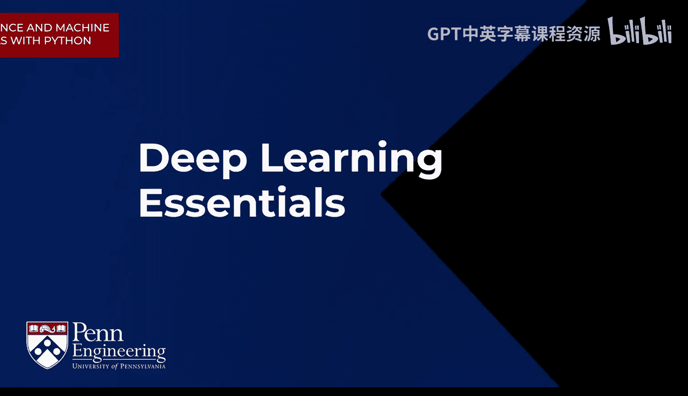

# 宾夕法尼亚大学《人工智能和机器学习基础》课程：01：深度学习基础入门 🧠

在本节课中，我们将要学习深度学习的基础概念，了解其与人类大脑处理信息方式的联系，并预览整个课程的核心内容。

## 从生物视觉系统理解深度学习

上一节我们介绍了课程背景，本节中我们来看看如何通过人类视觉处理系统来理解深度学习。

让我们以自然的“相机”——眼睛为例。当光线照射到视网膜时，会被一系列细胞（如视杆细胞和视锥细胞）转化为电压信号。一个典型的手机摄像头约有5000万像素，而人类视网膜约有1亿个此类细胞，它们本质上就像像素点。在接收光线后，信息会经过多层细胞（如双极细胞、神经节细胞）的处理，这些细胞将光信号转化为神经冲动，进而识别边缘、形状、颜色，甚至对不同类型的运动方向敏感。所有这些信息以大约每秒10MB的速度传递到大脑，比许多Wi-Fi连接还要快。

大脑在这些输入之上进行了多层处理。它将光场输入转化为物体、记忆等概念，能够再次识别同一张面孔，并根据所见进行推断。大致来说，神经计算是一系列小型计算逐层进行的过程。这种计算最神秘或最深刻的特性在于，它是由相当基础的小神经元执行的。每个神经元的工作方式相对独立，但它们共同协作，完成了这些奇迹般的计算。

因此，深度学习是我们尝试在计算机上模仿生物大脑运作的领域。这属于人工智能范畴，近年来，尤其是在当前，深度学习已成为人工智能的代名词，并推动着众多领域的进步。

## 深度学习驱动的技术与应用

上一节我们探讨了深度学习的生物灵感，本节中我们来看看深度学习所赋能的一些具体技术和应用领域。

以下是深度学习技术应用的一些例子：
*   **自然语言处理**：深度网络在自然语言处理方面变得极其出色。大多数人都体验过类似ChatGPT或Google Gemini的模型，它们能以有趣的方式处理文本，进行问答对话。
*   **多模态模型**：有些模型同时使用文本和图像，甚至加入声音处理。
*   **视频生成**：存在能够创建视频的模型。
*   **自动驾驶**：自动驾驶汽车的大部分技术环节如今都使用了神经网络。
*   **科学研究**：今天，大多数科学领域都在使用深度学习技术，无论是识别望远镜中的新星系，还是辨别人体内不同类型的细胞。

很难想象有哪个科学或工程领域尚未受到深度学习的影响，或者没有在积极使用它。

## 深度学习基础课程内容预览

上一节我们看到了深度学习的广泛应用，本节中我们将预览本门基础课程的核心学习内容。

课程始于对“智能”的定义。我们试图构建人工智能，因此应该问自己智能究竟意味着什么。我认为，一个智能有机体或智能机器应具备三个基本属性：它应该能够感知世界、理解世界（理解其环境），并能够基于这种理解采取行动。

基于此，我们将回顾人类尝试构建智能的历史。这始于20世纪40年代艾伦·图灵、麦卡洛克和皮茨等人的早期思想，他们试图构建能够以某种方式计算的机器。然后我们将穿越60年代、80年代、90年代，直至今天，了解我们如何构建了非常不同类型的网络。

接着，我们将从零开始构建深度网络。故事的第一部分从**感知机**开始。这是一个用于区分两类对象（例如苹果和橙子）的非常简单的模型。我们将讨论**随机梯度下降**——一种非常流行的拟合感知机的方法，确保感知机能正确区分苹果和橙子。

这会进展到所谓的**核方法**，它们是感知机更复杂的变体。核方法 incidentally 是神经网络的前身，在大约10年前主导了我们的机器学习技术，并且此后也在发展。然后，我们将研究**全连接网络**，这将是我们首次深入了解神经网络（特别是深度神经网络）的模样。它包含多层结构，神经元的工作方式相对基础。我们将使用一种称为**反向传播**的算法或技术来拟合神经网络。

如今我们使用的所有神经网络，包括全连接网络，都离不开反向传播。反向传播本质上就是链式法则，只是在深度学习中我们以略有不同的方式应用它。因此，课程的第一部分为我们提供了开始探索深度学习的基础知识。

## 进阶课程内容展望

上一节概述了基础课程，本节中我们简要了解一下在宾夕法尼亚大学的完整课程中，学生还将学习哪些进阶内容。

例如，我们将研究架构的演进：
*   **卷积神经网络**：特别适用于理解自然图像或声音。
*   **基于注意力的网络**：在理解文本方面非常流行，因为它们能够审视大量信息并聚焦于关键证据片段。

这大致完成了关于神经架构的故事。然后，我们将研究如何训练这些架构，探讨优化算法，并进行更多数学分析，了解这些算法的工作原理、何时该使用哪一种以及如何在实践中调整它们以获得良好结果。

深度学习仍然是一个非常模糊的领域，尽管取得了诸多进展和令人着迷的成果。因此，课程重点在于从基本数学原理和大量动手编程经验中，理解和培养对这些模型的直觉。课程后期还会深入探讨网络为何有效（或为何本应无效却有效）的一些细节。我们还将研究生成模型，如变分自编码器和生成对抗网络。这构成了本课程展开的理论画布。

本节课中，我们一起学习了深度学习如何从人类视觉系统获得灵感，探索了其推动的多项关键技术，并预览了从智能定义、历史发展到感知机、全连接网络及反向传播等核心概念的课程路线图。希望这为你开启了深度学习探索之旅。