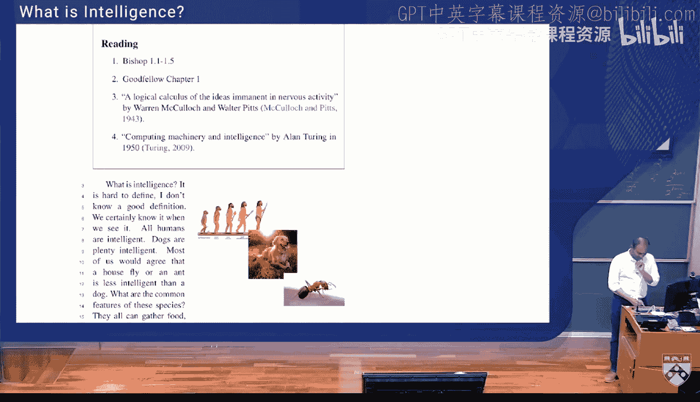
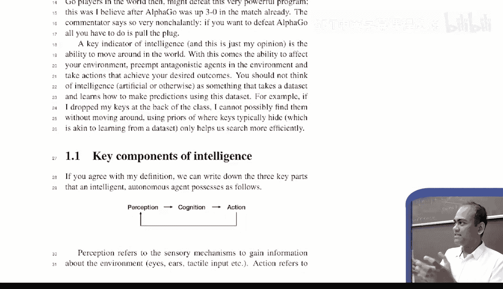

# 宾夕法尼亚大学《人工智能和机器学习基础（AI、数据科学、机器学习）AI and Machine Learning Essentials with Python》 p96 03_01_01_什么是智能.zh_en -BV16f421Q72q_p96-

So what is intelligence Well， intelligence is very hard to define。

 but it is very easy to see when something is intelligent or is when something is not intelligent。

All of us would agree that human beings are intelligent， you and I are intelligent。

 we can do many different things， we can drive a car， we can solve integral girls。

And we can speak and sing songs， et ceter， and these are all things that you would associate with intelligent behaviors。

You would also agree that a dog is not as intelligent as you。

 but at the same time you would also agree that a dog is intelligent。

 it knows that it should be fetching a frisbee when you throw it it knows when you are feeling a little bit sad and at the end of the day a dog can move around this world and do things that are different than what let's say computer does。

嗯。Ants are also intelligent， probably not as intelligent as dogs。

 but they can do very many clever things， many many ants can come together and they can build structures。

 they live in colonies and they have a social structure associated to these different individuals coming together and living together to perform certain kinds of tasks they they can adapt when the environment changes around them。

 and these are all things that we recognize today or we would characterize today as motifs of intelligent behavior。

Okay thingsings that allow you to adapt things that allow you to change how you do things if the environment changes around you and this in a nutshell is what intelligence is about the ability to change what you do ir with respect to how the world around you changes Okay the ability to adapt Why do we do all these things well there is one purpose we do these things to survive。

 so the ultimate goal of organism or a living organism is to survive and everything that makes this difficult is stuff that needs to be adapted to and to do this efficient this well you need intelligence。

If you believe in this definition we can ask a second question are plants intelligent the kind of intelligent。

 some of them show behaviors you put a potted plant next to a window it will move towards the window to gain more sunlight and while it cannot move around and go to a different part of the room by itself without you moving it it can definitely do this much so theyre clearly not as intelligent as a moving animals but they are kind of intelligent here is one funny example that I like to show this is a plant called a tuiquet tunics are plants that live on the floor of the ocean when they are born they're animals they have a nervous system they have ganglion cells and this plant it want us around on the floor it finds a nice big fat rock to live on with moss that it can use to gain。

utents from and at that point of time a tuniciqueate digests its own ganglion cells and doesn't move anymore。

 it doesn't have any need for these cells because it has found this one source of nutrition that it can use for the rest of its life。

诶。This is often used as a metaphor for professors， they study very hard when there are students like you and I and like you and then they go to universities and they digest their own brain and stop thinking afterwards so this is not a very nice joke but I can make this kind of jokes a tunict in order to protect itself it develops a little thick coating around it called a tunic and that is what it is called a tunict okay so plan that used to be mobile ones。

 but it's not mobile anymore because it don't got a nervous system。😊，嗯。

I would like to impress upon you the salient properties of these examples that we have taken。

 All of these are organisms， living organisms to be specific。 They can move around。

 they can do things that a machine cannot do machine displays a different kind of intelligence and just just to make it more clear。

 Alphago is a computer program that a company called Deep mindd。 Deep mindd is in the UK in London。

 They built a computer program to play a game called go。 Go is a game very popular in East Asia。

 not that different from chess for the rest of the people who haven't seen it before basically a very hard game and widely considered to be one of the bastionians of human intelligence。

 No computer had managed to beat a human being at go before。

 So Deep Min took upon this challenge they built a computer program to play go。

 It was a very good program they。cied to make it compete with this guy。 His name is called Lee Seid。

 is a Korean champion， Korean go champion and is widely regarded to him the best go players in the world at that time。

 so。After three matches， Deep mindd or Al go ahead won all three matches against this person。

 and it was a little surprising or it was very shocking for most go players as to how can a computer ever beat a human being at this very difficult task。

 I don't want to sound right， but I want to show you this one little coat that the person says the person is at himself go champion in the US。

 He says if you want to defeat this machine， all you have to do is pull the plug。

 the machine cannot play anymore。 And then you win by default。 And of course this is a joke。

 but it hits upon a very important thing when I come at you to hit you you will run away。

 if you don't run away， then that is not a very intelligent behavior If you do the same thing to a machine。

 machinesch don't get to run away。 machines have a very very narrow definition of what they can do。

 and you can affect them in any which way beyond。definition and the machine has no way to respond。

 Okay so Algo is very good。 the best thing at go， but it is very good at this one narrow task。

 So when we talk about intelligence， we are necessarily interested in displaying different kinds of behaviors。

 behaviors that allow us to adapt from many， many different things。

 there are examples of very narrow intelligence that are still useful and that is what computers are that they are there are different things。

and this is just my opinion so I was brought up as a robotist and so this is how I think about intelligence some of you maybe more computer scientists and you would think of intelligence as a slightly more narrow definition of a computer being good at one specific task and that's totally consistent with everything and appropriate also but next time you see a machine ask yourself what are the properties of this machine that make you want to call it intelligent or not machines that only respond to stimuli that are coming at them from in a passive sense have a limited notion of intelligence if I drop my keys at the back of this classroom there is no way I will be able to find them no matter how many images you give me from this vantage point I have to actually go there and search for them we are interested in designing machines that can have。

These behaviors。