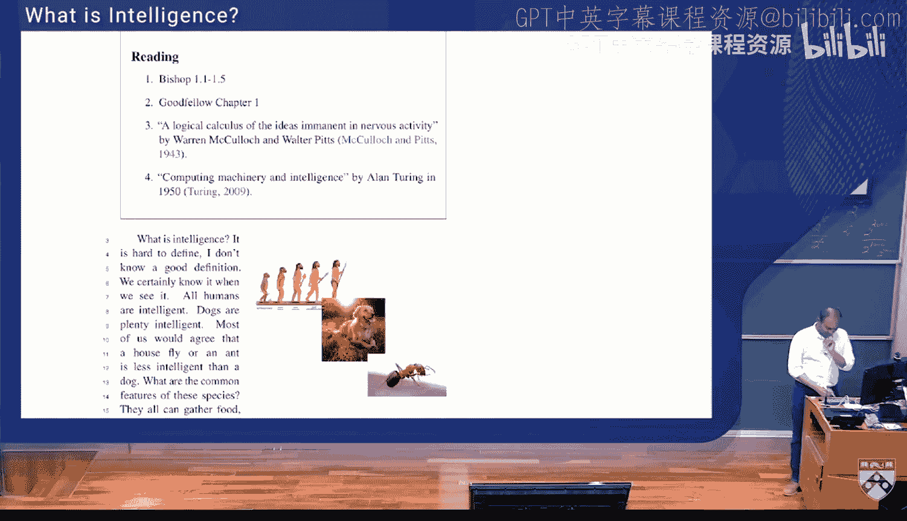
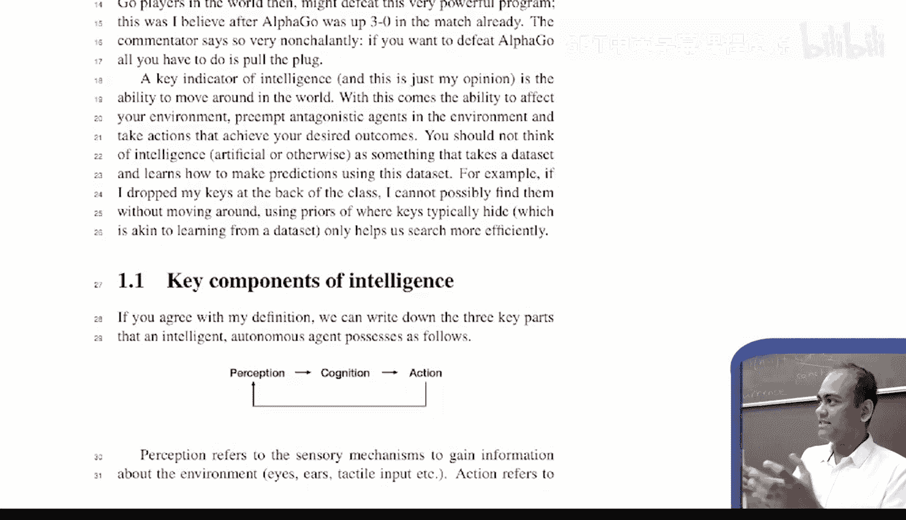

# 人工智能和机器学习基础：03_01_01：什么是智能 🤔

在本节课中，我们将要学习“智能”这一核心概念。我们将探讨智能的定义、它在不同生物体中的表现，以及它与机器智能的区别。

---

## 概述

智能是一个难以精确定义但易于观察的概念。我们通常通过一个实体能否适应环境变化、执行复杂任务来识别其智能。本节将分析从人类到植物，再到计算机程序的各种智能表现形式，并提炼其关键特性。

---

## 智能的定义与观察

智能很难定义，但很容易判断某物是否具有智能。

所有人都认同人类具有智能。你和我都是智能的。我们可以做许多不同的事情：我们可以开车，可以解微积分方程。

我们还可以说话和唱歌等等。这些都是你会联想到的智能行为。

你也会同意，狗不如你聪明。但同时你也会同意，狗是智能的。它知道当你扔出飞盘时应该去接住；它知道当你感到有点悲伤时如何安慰你；归根结底，狗可以在世界上活动，并做出与计算机截然不同的事情。

蚂蚁也是智能的，可能不如狗聪明，但它们能做很多巧妙的事情。许多蚂蚁可以聚集在一起建造结构。它们群居生活，并拥有与这些不同个体聚集、共同生活以执行特定任务相关的社会结构。当周围环境发生变化时，它们能够适应。这些都是我们今天认识到或会将其描述为智能行为特征的事情。

简而言之，智能就是关于**适应能力**——根据你周围世界的变化来改变你行为的能力。我们做所有这些事情是为了一个目的：**生存**。生物体的最终目标是生存，而任何使生存变得困难的事情都需要去适应。为了高效地做到这一点，你需要智能。

---

## 植物是智能的吗？

根据这个定义，我们可以问第二个问题：植物是智能的吗？在某种程度上，是的。有些植物表现出行为：你把一盆植物放在窗边，它会向窗户移动以获得更多阳光。虽然它不能自己移动并走到房间的不同位置（除非你移动它），但它肯定能做到这一点。所以它们显然不如能移动的动物聪明，但它们也算是有某种智能。

这里有一个有趣的例子：一种叫做“海鞘”的植物。海鞘是生活在海底的植物。当它们出生时，它们是动物，拥有神经系统和神经节细胞。这种植物在海底游动，找到一块又大又肥的岩石居住，上面有苔藓可供其获取营养。在那个时候，海鞘会消化掉自己的神经节细胞，并且不再移动。它不再需要这些细胞，因为它已经找到了一个可以终生使用的营养来源。

这常被用作教授的隐喻：当他们还是像你我这样的学生时，他们努力学习，然后他们去了大学，消化了自己的大脑，之后就不再思考了。这不是一个很好的笑话，但我可以开这种玩笑。海鞘为了保护自己，会在周围形成一层厚厚的覆盖物，称为“被囊”，这就是它名字的由来。所以，这是一种曾经可以移动的植物，但现在不再移动了，因为它没有了神经系统。

---

## 智能的关键特性

我想向你们强调我们所举这些例子的显著特性。

所有这些例子都是生物体，具体来说是**活的生物体**。它们可以四处活动，可以做机器做不到的事情。机器表现出一种不同的智能。

为了让这一点更清晰，让我们看看AlphaGo。AlphaGo是一家名为DeepMind（位于英国伦敦）的公司构建的计算机程序，用于玩一种叫做“围棋”的游戏。围棋在东亚非常流行，对于没接触过的人来说，它与国际象棋没有太大不同，基本上是一种非常困难的游戏，被广泛认为是人类智能的堡垒之一。在此之前，没有计算机能在围棋上击败人类。

DeepMind接受了这个挑战，他们构建了一个下围棋的计算机程序。这是一个非常棒的程序。他们试图让它与这个人竞争。他叫李世石，是韩国围棋冠军，当时被广泛认为是世界上最好的围棋棋手之一。经过三场比赛，DeepMind的AlphaGo程序赢得了对这个人的全部三场比赛。对于大多数围棋棋手来说，计算机怎么可能在这个非常困难的任务上击败人类，这有点令人惊讶，或者说非常震惊。

我不想听起来很傲慢，但我想给你们看一句俏皮话。这个人（一位美国围棋冠军）说：“如果你想打败这台机器，你所要做的就是拔掉插头。机器就不能再玩了。然后你就默认获胜了。”当然，这是个玩笑，但它触及了一个非常重要的问题：当我冲过来打你时，你会跑开。如果你不跑开，那就不算是一种非常智能的行为。如果你对机器做同样的事情，机器不会跑开。机器对其能做的事情有一个非常非常狭窄的定义。你可以在其定义之外的任何方面影响它，而机器无法做出反应。

所以，AlphaGo非常擅长围棋，是这项狭窄任务中的佼佼者。因此，当我们谈论智能时，我们必然对展示**多种不同行为**感兴趣，这些行为允许我们适应许多不同的事情。当然，也存在非常有用的、狭窄智能的例子，这就是计算机的现状，它们是不同的事物。

这只是我的观点。我是作为机器人学家被培养出来的，所以我这样思考智能。你们中的一些人可能更多的是计算机科学家，你们可能会将智能视为计算机擅长某一特定任务的更狭义定义。这完全一致，也很恰当。但下次你看到一台机器时，问问自己：这台机器的哪些特性让你想称它为智能或不智能？那些只能被动地对来自外界的刺激做出反应的机器，其智能概念是有限的。如果我把钥匙掉在这个教室后面，无论你从这个角度给我多少图像，我都无法找到它们。我必须亲自去那里寻找。我们感兴趣的是设计能够拥有这些行为的机器。

---

## 总结

本节课中，我们一起学习了智能的核心概念。我们了解到，智能的本质是**适应环境变化的能力**，其根本目的是为了**生存**。我们观察了从人类、动物到植物展现出的不同层级的智能，并将其与像AlphaGo这样的**狭窄机器智能**进行了对比。关键的区别在于，生物智能具有**主动性、适应性和行为的多样性**，而当前典型的机器智能则擅长**特定、定义明确的任务**。理解这种区别是思考人工智能未来发展的基础。