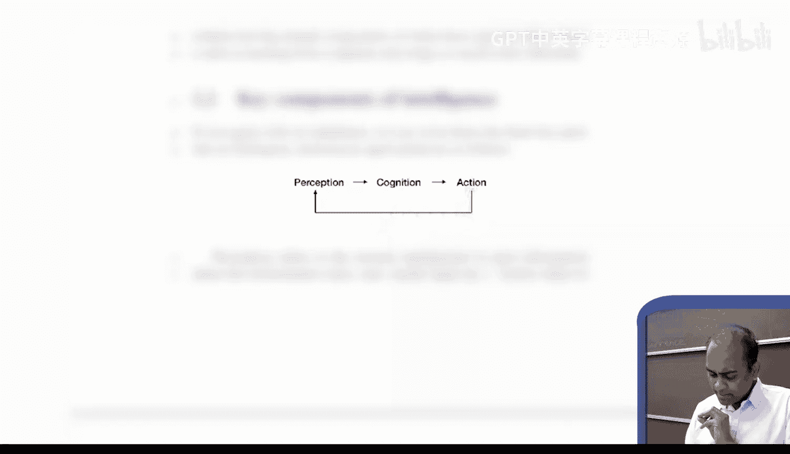
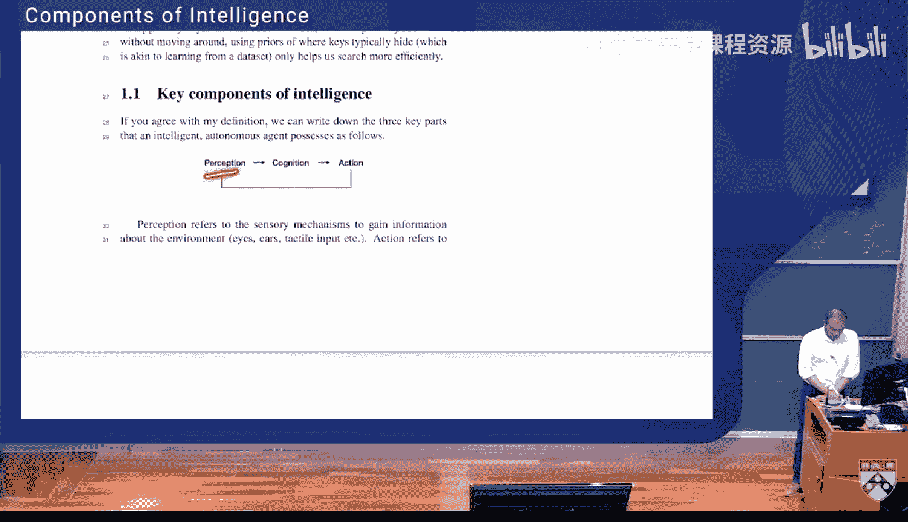
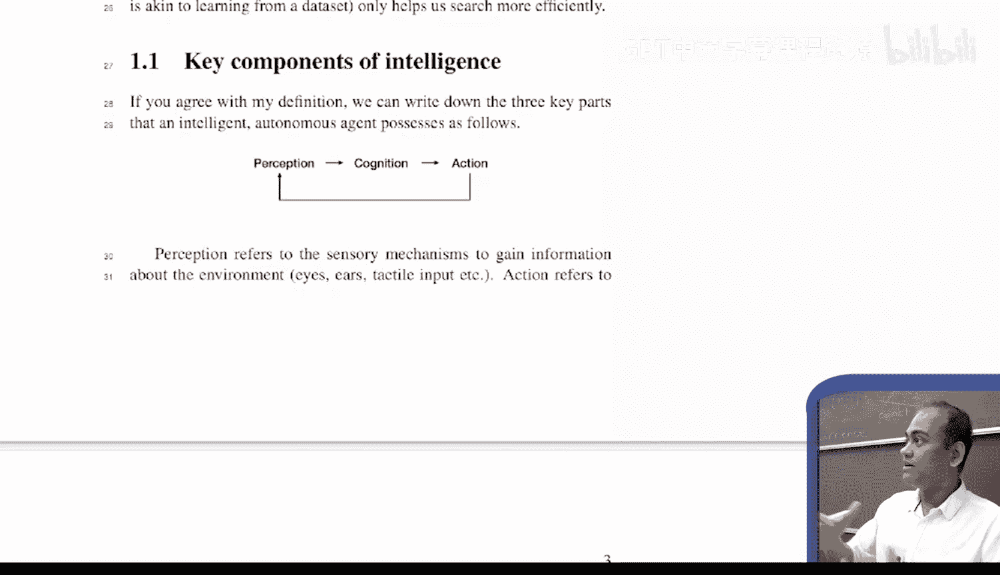

# 宾夕法尼亚大学《人工智能和机器学习基础（AI、数据科学、机器学习）AI and Machine Learning Essentials with Python》 p97 04_01_02_智能的组成部分.zh_en -BV16f421Q72q_p97-

Here are three components of intelligence。 The first one people call perception。

 perception is the ability to see things， to understand things。

The next one is called action， action is the ability to affect things。

 to walk to fly for birds to change your location if something is coming at you。

And what glues them together is something that people will call cognition。

 cognition is what your brain does， your brain takes in stimuli from your senses， eyes， your no skin。

 and then does something computes something using the stimuli to tell you where you should walk go to next how you should move your hands and feet next。

And of course you don't do these things in isolation。

 it is not just a matter of you looking at some stimuli and taking some actions if I were to go around searching for the keys that I lost I necessarily imagine how the world would look like if I go to so and so part of the room the reason I go to the back of the room to search for keys is because I imagine I must have lost them there right so this ability to take an action that is likely to give you a certain kind of observation。

 a certain kind of stimulus is also necessary to display interesting behaviors。Okay。

 and these three concepts together form intelligence。

 Now this class is not going to look at all three of them。

 I wanted to lay down the context and now we are going to choose which one of them we are going to focus on。

And there are different classes at Penn in particular and different universities also they'll talk about these three different aspects。

 so typically computer visionion would talk about perception。

 the ability to see that is one of our most powerful senses classes that talk about action would be in mechanical engineering or in control theory or in motion planning and they will tell you how to act and they usually assume that you know very much about what you are seeing。

 you you have already understood what is itre seeing whereas courses in perception will tell you how to perform operations on stuff that you see or stuff that you sense。

In this class we are going to talk about the one in the middle cognition。

 we are going to assume that someone has given us some stimuli。

 we are going to assume that we know what actions to take or we know what to do using the stimuli。

 but we are worried about how to do this process efficiently and this is in a very specific part of an intelligent organism。

 not the entirety of it， a particular part of it。

Okay， so this class will focus on learning and you can think of it as cognition。

