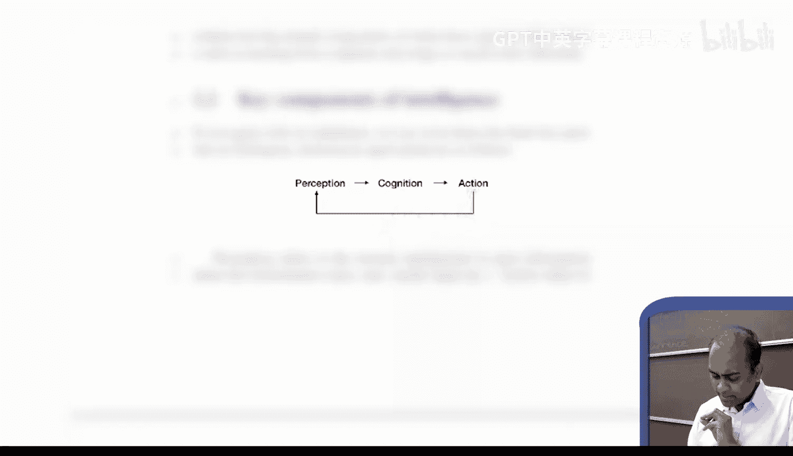
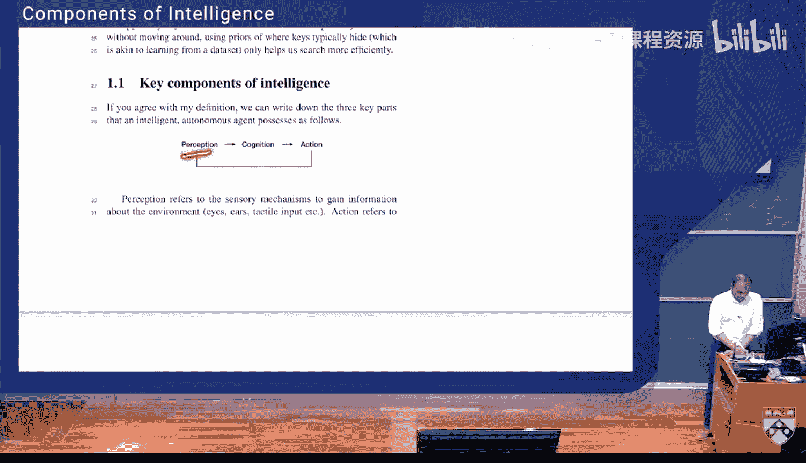
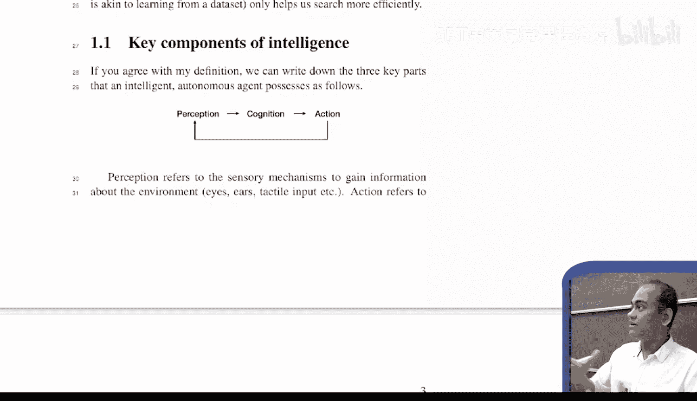

# 人工智能与机器学习基础：04_01_02：智能的组成部分 🧠

在本节课中，我们将要学习构成智能的三个核心组成部分。理解这些部分有助于我们明确本课程的重点方向。

智能通常被认为由三个相互关联的部分构成：感知、行动和认知。这三者共同作用，使生物或机器能够与环境互动并做出决策。

## 感知 👁️

上一节我们介绍了智能的整体框架，本节中我们来看看第一个组成部分：感知。

感知是指观察和理解事物的能力。它涉及接收来自外部世界的信号，例如通过眼睛看、耳朵听或皮肤感受。

以下是关于感知的关键点：
*   感知是智能系统获取外部信息的主要途径。
*   它处理来自各种感官的原始数据。
*   在计算机科学中，计算机视觉等领域专门研究视觉感知。

## 行动 🏃

在了解了如何获取信息后，我们接下来看看智能的第二个组成部分：行动。

行动是指影响和改变事物的能力。例如行走、飞行（对鸟类而言），或在有物体靠近时改变自身位置。

以下是关于行动的关键点：
*   行动是智能系统对外部世界产生影响的输出。
*   它涉及运动规划、控制理论等。
*   机械工程等领域的课程通常专注于如何行动，并假设系统已充分理解感知到的信息。

## 认知 🤔

感知和行动并非孤立存在，将它们连接起来的粘合剂是第三个组成部分：认知。

认知是大脑进行的工作。大脑接收来自感官（如眼睛、鼻子、皮肤）的刺激，然后进行计算处理，最终决定下一步应该走向哪里或如何移动手脚。

真正的智能行为不仅是对刺激做出反应。例如，当我寻找丢失的钥匙时，我会想象如果走到房间的某个位置，世界会是什么样子。我之所以去房间后面寻找，是因为我推测钥匙可能掉在那里。这种**根据可能获得的观察结果（刺激）来采取行动**的能力，对于表现出有趣的行为至关重要。

## 本课程的焦点 🎯

以上三个概念共同构成了智能。然而，本课程不会涵盖所有三个方面。

不同的大学课程会侧重这三个方面的不同部分。例如：
*   计算机视觉课程主要讨论**感知**。
*   机械工程、控制论或运动规划课程主要讨论**行动**。

在本课程中，我们将重点讨论中间的部分：**认知**。

我们将做出以下假设：
1.  已经有人为我们提供了某些刺激（感知输入）。
2.  我们知道需要采取什么行动或如何使用这些刺激。

我们关注的核心问题是：**如何高效地进行这个认知处理过程**。这涉及智能体中一个非常具体的部分，而非其全部。你可以将本课程的重点——**学习**——理解为认知的核心。

## 总结 📝

本节课中我们一起学习了智能的三个组成部分：感知（接收信息）、行动（影响世界）和认知（处理信息并决策）。我们明确了本课程将聚焦于**认知**部分，特别是如何通过**学习**来高效地处理信息，为后续的具体机器学习算法学习奠定基础。