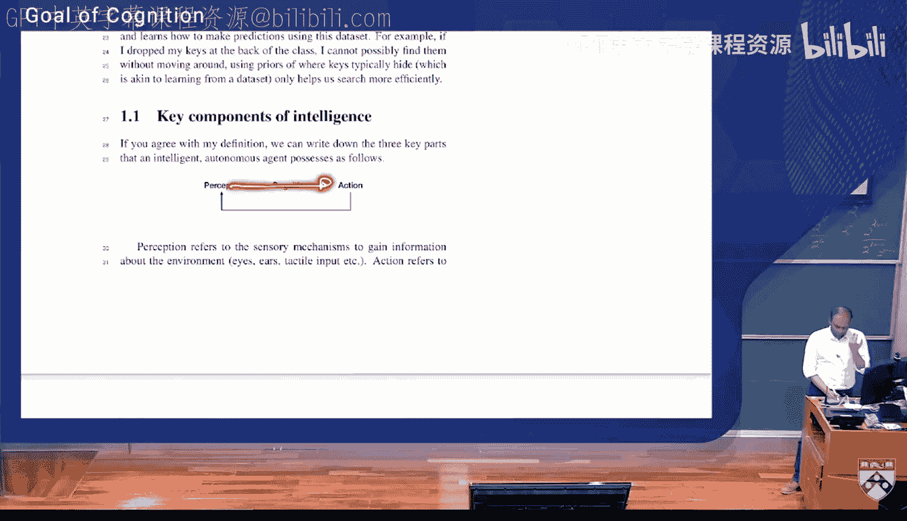
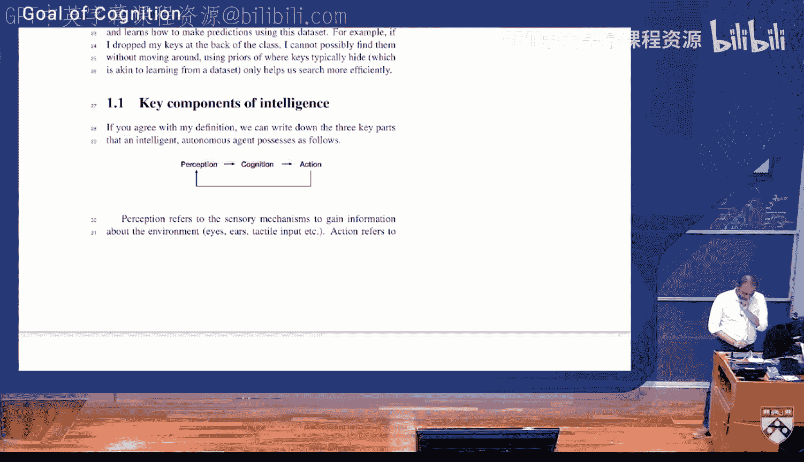
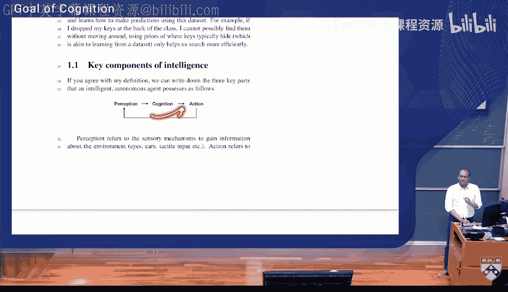
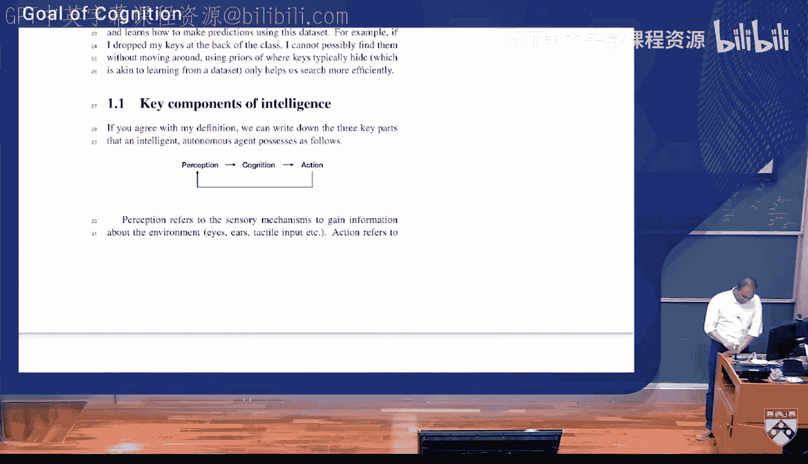

# 宾夕法尼亚大学《人工智能和机器学习基础（AI、数据科学、机器学习）AI and Machine Learning Essentials with Python》 p98 05_01_03_认知的目标.zh_en -BV16f421Q72q_p98-

The second thing that I want to emphasize is the goal of coordogniination or the goal of learning and to convince you of this。

 let me give you an example So imagine that you are a supreme agent。

 a supreme agent is something that is infinitely fast and infinitely clever and has zero limitations on its performance and you are driving a car now in order to understand how to drive a car。

 you necessarily need to know what other cars in your vicinity will do the su agent doesn't really find this because for every little thing that other cars could do the su agent can simulate very quickly in its head about what they will do and take the necessary action if there's a car that is going to cut in front of you while you are driving in a lane。

 the su agent knows exactly what is going to happen because it has sensed it infinitely quickly and it knows exactly that it should be breaking a tiny bit。

まだ。So if you had no limits on the kind of computations that you can do。

 if you have no limits on the kind of。Stimuli or kind of perception that you have。

 then you wouldn't need any learning。Because you could directly use your stimuli and take the actions without ever having to。

Summarize this stimuli or without ever having to use past knowledge。So the reason we use learning。

Is because we would like to make this process more efficient。

 we want to understand when current observations are similar to past observations and then basically regurgitate those actions that we took in the past because we cannot simulate things as quickly as the Supremepreme agent or we cannot compute things as efficient as supreme agent。

So learning at the end of the day is a process of summarization of past experiences and using this summarization to take current actions。

 It is necessarily a prior on the kind of action that you take just because a car cut you off Yes doesn't mean that the car will cut you off today and that is why you shouldn't be breaking today you should be breaking based on the observations that you receive right now learning is a prior that makes it likely that people who drive Mustangs typically cut other people off and those are the kind of prior that we will be learning from past data and past experiences so a machine。

A machine running algorithm is not something that gives you the outputs directly。

 It gives you a prior on the outputs， the actual output。

 the actual action that you take depends on what your current observation is。

This is very different from a chessplain program where the chessplain program has a very clear notion of the state and it doesnt have to rely too much on this inference of what action it should take。

 given the state the action is critical。😊。