# 宾夕法尼亚大学《人工智能和机器学习基础（AI、数据科学、机器学习）AI and Machine Learning Essentials with Python》 p99 06_01_01_智能的起源-1942-1950.zh_en -BV16f421Q72q_p99-

Let us think about how people started to think of intelligence。

 Let us discuss how people start to think of intelligence。

 This is not the first time people are talking about intelligence。

 People have been trying to do this stuff since the early 40s and roughly speaking。

Most people would agree that our modern notions of artificial intelligence began somewhere in the early 40s。

 so this gentleman to the left hand side is Warren McClock。

 he was a professor of neuroscience in Chicago and the one on the right is this guy called Walter Pis。

 who was a mathematician a logician in Chicago and then later at MIT。

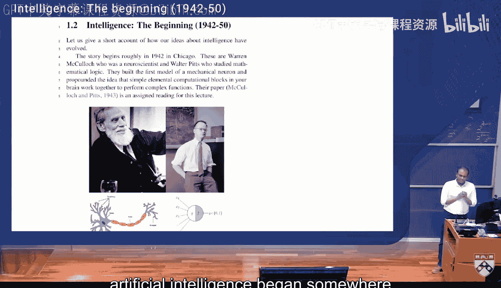

And they together built the first model of neuron the way they were thinking is we have a brain。

 your brain has many neurons， the fact that your brain has many different kinds of neurons was known roughly from the early 1900s and what these two were interested in doing was taking this biological neurons and then abstracting it out into some mathematical object that they could understand a bit better biological neurons are complicated things for instance your brain has about 10 rest to 14 connections between in roughly 10 rest to nine neurons or 1 rest to 10 years。

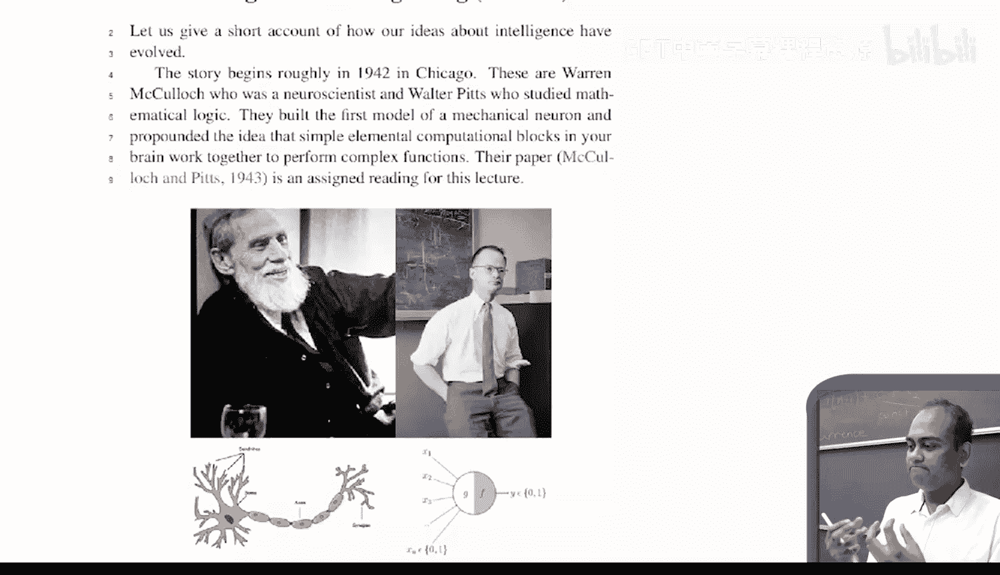

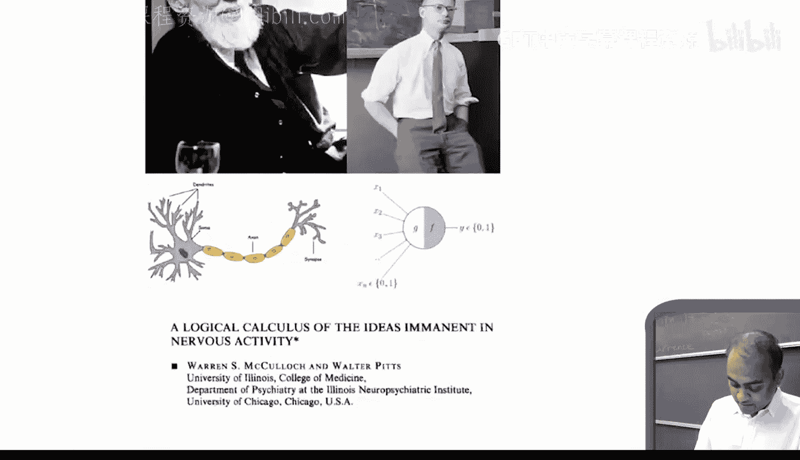

Neurons and these are large crucibles of chemistry so there is many reactions that take place。

 there is electrical impulses that travel between one neuron and another neuron across the body of the neuron and if you take a class on neuroscience you will spend roughly half of the class simply studying the little reactions that happen to transmit messages across these。

😊。

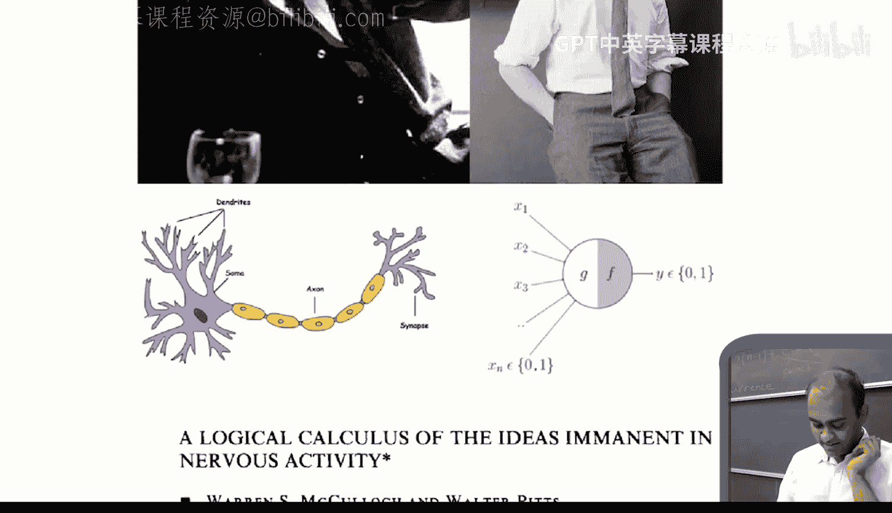

Now we don't want to necessarily always model this complexity in order to build intelligent computers。

 intelligent machines， so what Maclo and pits did is that they said let a neuron be this simple thing。

 it is a box that takes in n inputs x1 x2 x3 till XN。

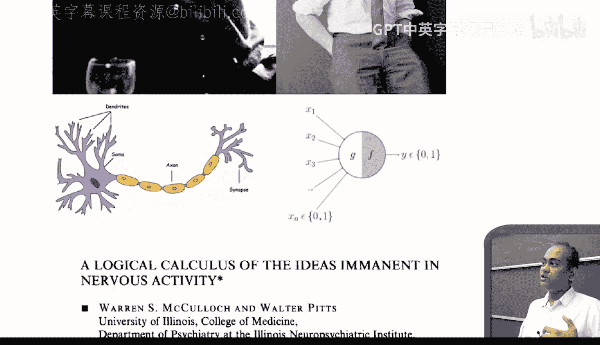

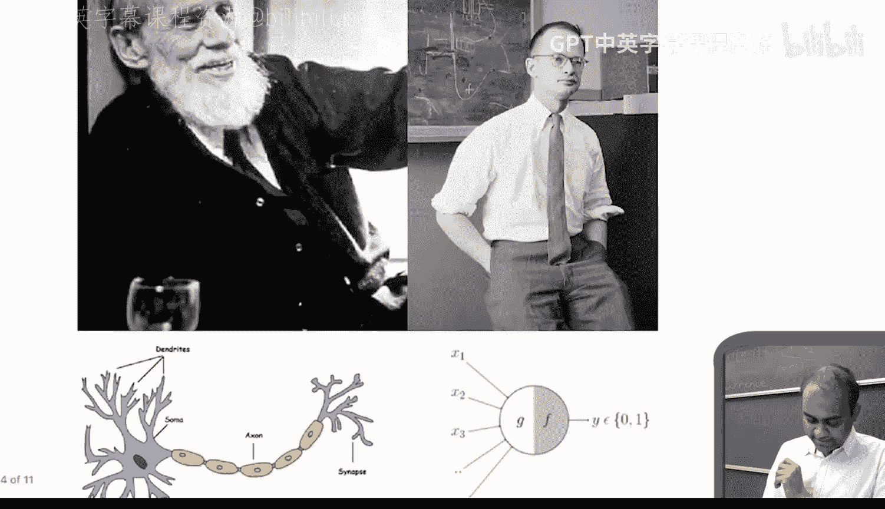

And produces one output。It is not very close to a biological neuron。

 but its a very core subtraction for it。 a biological neuron takes in many different inputs from many different neurons。

 and at the end of the neuron it produces an impulse the neuron fires or it does not fire and this is kind of like the output of this mathematical neuron。

How does it choose whether to fire or not fire Well。

 there is a function that you can choose in this function neuroscientists will tell you what the function is in machine learning or in learning we're interested in cooking up functions that allow us to create specific kinds of outputs and there's a little lesson to be learned here so we know human biological brains can do intelligent things in order instead of directly replicating what the biological brain does you abstract it out into a very simplistic object or this one looks nothing like the biological neuron but now you get to play with this object。

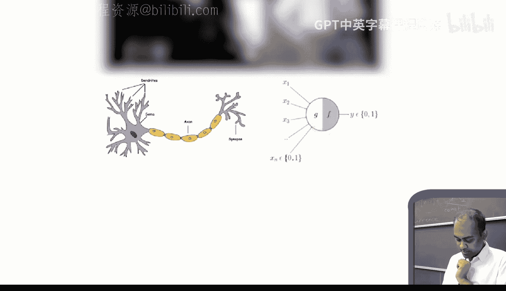

And roughly speaking， the neurons that we use today are pretty damn similar to these kinds of neurons。

 Okay we kind of change the function a little bit。 we change what the output a little bit。

 but fundamentally they are not that different。And another thing that I forgot to mention was Walter Pis was a logician and he was interested in capturing the biology using principles of logic and that is why this model is kind of simplistic it is a booleion that is output by this neuron。

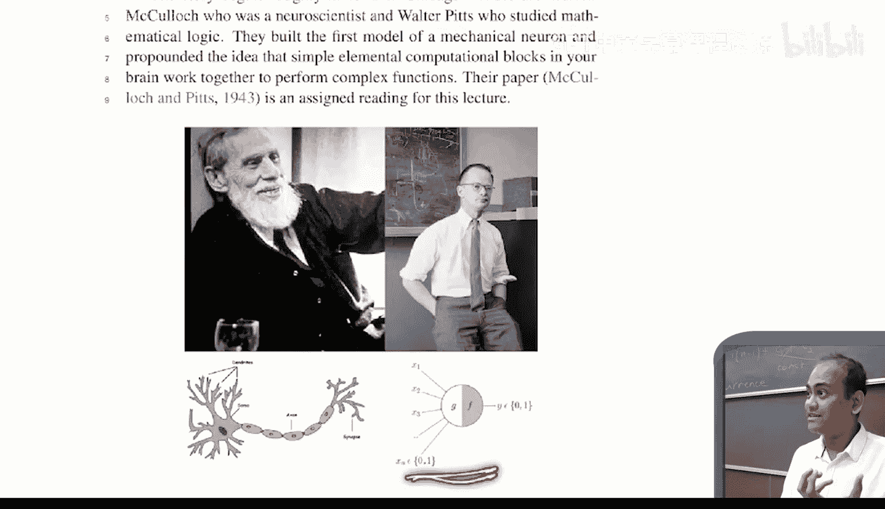

Okay。Around the same time in England after the war Alan Turing had developed the theory of computation slightly before the war and he was kind of getting more interested in how biological computation happens in biological brains and what he created is a way of thinking about intelligence that is quite popular right now for instance if you see this it is a paper that is called computing machinery and intelligence by Alan Turing and the first section is called imitation game so this is where he said I think a computer is something that can convince a human being that it is a human being if a human being we never to see the computer giving its answers so if I can answer all the questions that you have without you knowing whether I'm a human or a computer that I'm a human for all practical purposes and that is what we have come to。

A tuuring test。 So this is the more philosophical part of what he did。

 the more tangible part of what he did was he created models for neurons。

 So he he started to think about neurons as as objects that have threshold non nonlinearities that take in multiple output inputs and create multiple outputs and these kind of things。

And。Roughly speaking， the neuron that allent tuuring build or are conceived in England are not really built。

 so yet is not that different from MacKlog and Ps neuron， it is the same object。

 the same mathematical abstraction that people began to use to think as a way of building components of intelligence。

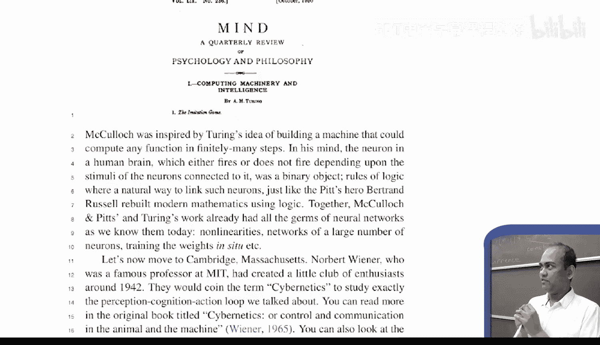

Okay。嗯。At the same time in Cambridge Massachusetts Aranting was in the Cambridge UK。

 a bunch of professors led by this guy called Norber Winer。

 began to think of themselves as the cybernetic society they wanted to imagine machines that can do things that humans do and that is why they called themselves the cybernetic society。

 and so this is a picture of the meeting， so this is Nor Wienner， this is MacKock。

 this is pititz and this is Gray Walter I think。

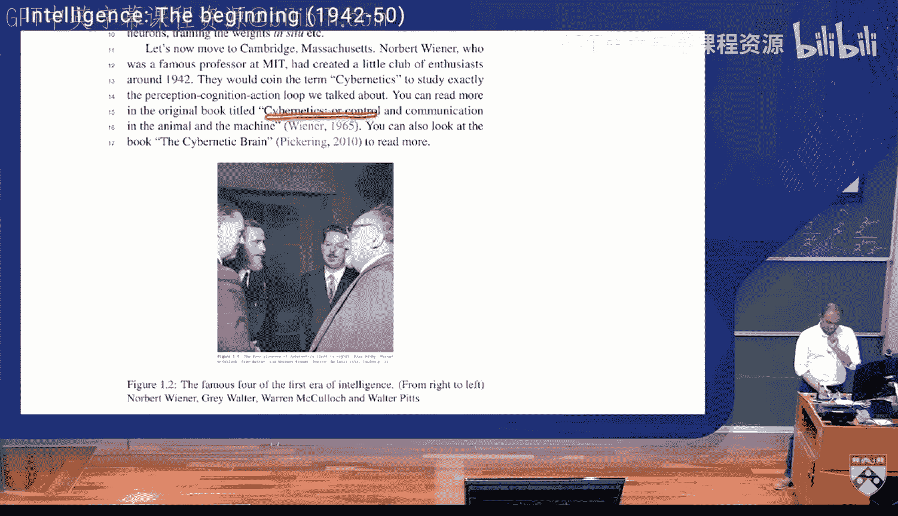

Yeah。Actually， this is clear what that this is。And if you need any more incentive to take this class I will show you the table of contents of the textbook on cybernetics that Norbertner wrote in the 40s it's a beautiful textbook to read even today remains evergreen but so it begins with a bunch of philosophical things like what is time incident data is also the first chapter of Newton's Prinncipia and then it talks about group theory。

 some physics feedback as a notion of two interacting things coming together so just like we do a loop between action and perception there are feedback loops within the brain that allow you to do very different things if you don't see if in one part of your field of you you see something that is repetitive and not very useful your brain automatically shuts it off and allows your eyes to。

foocus on the remainder of the scene so that you don't have to waste computational power to process these changing things in modern machine learning today we call this attention more broadly you would think of this as feedback。

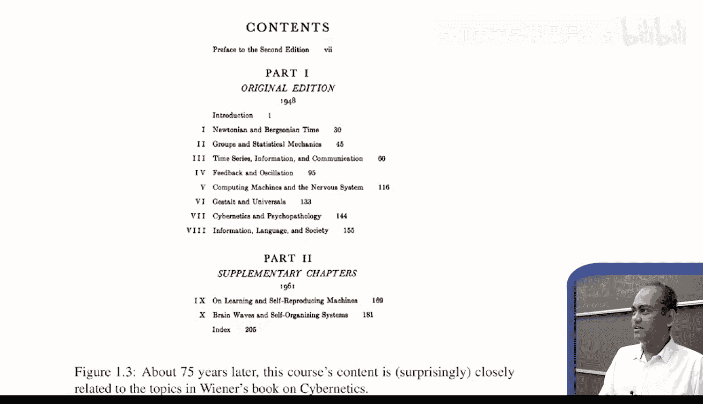

And then there is stuff about language etc， so the concepts that Wener thought were foundational in the pursuit of intelligence are also essentially verbatim the concepts that we will do in this class we'll look at information theory we look at feedback we will look at representations of continuous signals etc。

 so the way we think of intelligence has changed in its language across the last 80 years or so but the central tenets haven't really changed much。

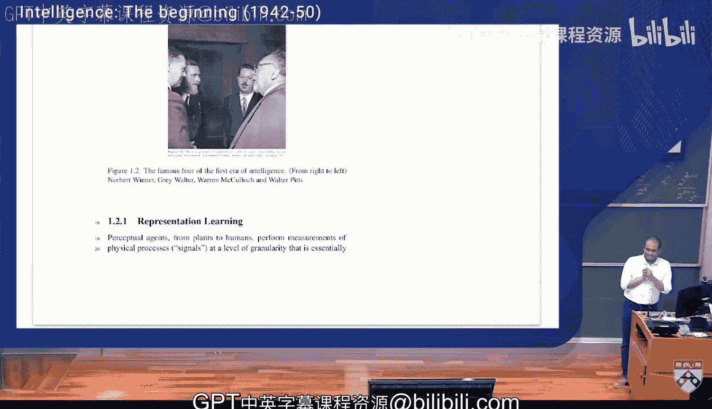