# 人工智能和机器学习基础：06_01_01：智能的起源 (1942-1950) 🧠

在本节课中，我们将要学习人工智能思想的早期起源，了解在20世纪40年代，科学家们如何开始将生物大脑的运作抽象为数学模型，从而为现代人工智能奠定基础。

## 现代人工智能思想的萌芽

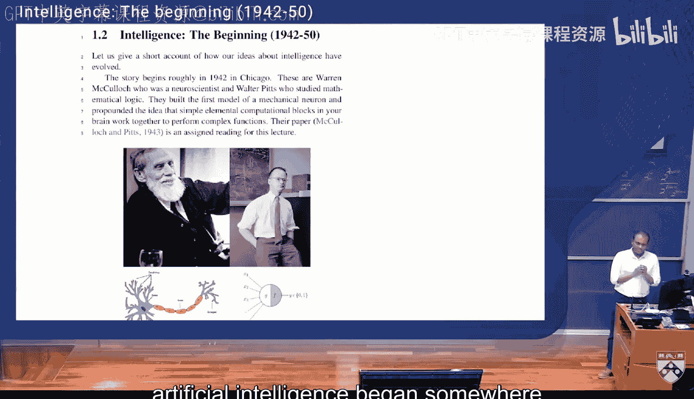

让我们思考人们是如何开始思考“智能”这一概念的。这并非人类首次探讨智能。人们从20世纪40年代初就开始尝试理解并构建智能。大致来说，大多数人会同意，我们现代意义上的人工智能概念始于40年代初。

## 麦卡洛克与皮茨的神经元模型

上一节我们提到了人工智能思想的萌芽，本节中我们来看看两位关键的先驱者。左边这位是沃伦·麦卡洛克，他是芝加哥大学的神经科学教授。右边这位是沃尔特·皮茨，他是一位数学家、逻辑学家，先后在芝加哥大学和麻省理工学院工作。

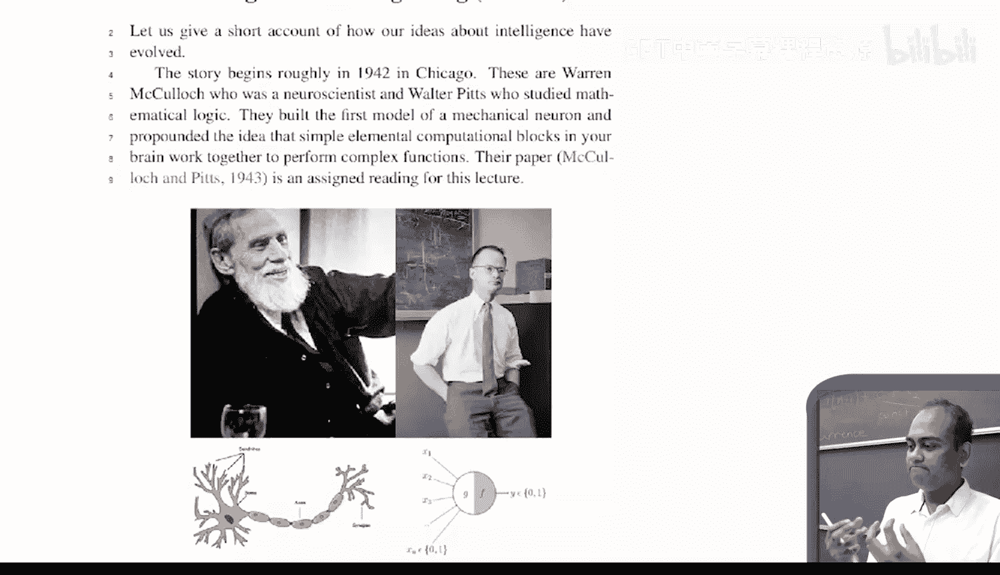

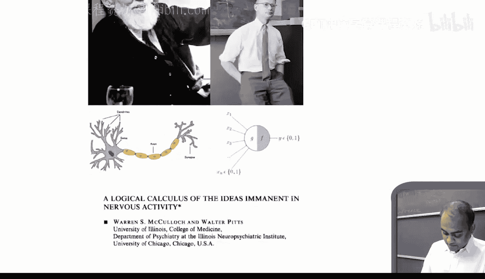

他们共同构建了第一个神经元模型。他们的思路是：我们拥有大脑，大脑由许多神经元构成。大脑拥有多种不同神经元这一事实，大约在20世纪初就已为人所知。这两位研究者感兴趣的是，将这些生物神经元抽象成他们能更好理解的数学对象。

生物神经元是复杂的实体。例如，你的大脑大约有10^14个连接，分布在约10^9个神经元之间。

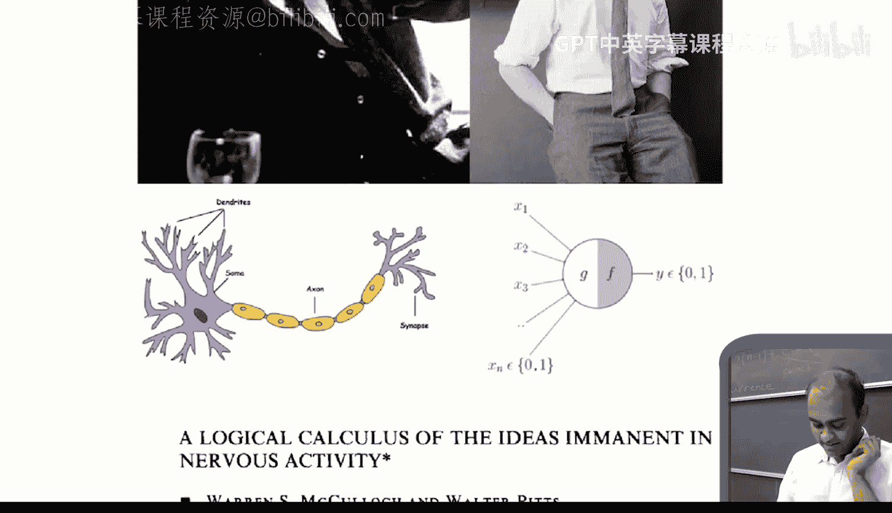

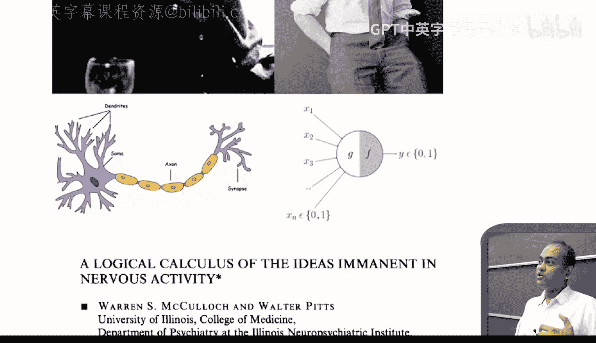

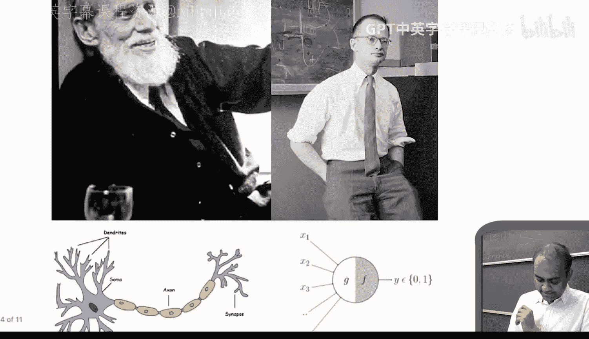

神经元是大量化学反应的场所，存在许多反应。电脉冲在神经元之间传递。如果你学习神经科学课程，大约会花一半时间仅仅研究这些传递信息的小反应。

为了构建智能计算机或智能机器，我们并不总是需要模拟这种复杂性。因此，麦卡洛克和皮茨提出，让神经元成为一个简单的对象。它是一个接收n个输入（x1, x2, x3, ..., Xn）的盒子。

它产生一个输出。这与生物神经元并不十分接近，但它是其一个非常核心的抽象。生物神经元接收来自许多不同神经元的多种输入，在神经元末端产生一个脉冲——神经元要么“放电”，要么“不放电”。这类似于这个数学神经元的输出。

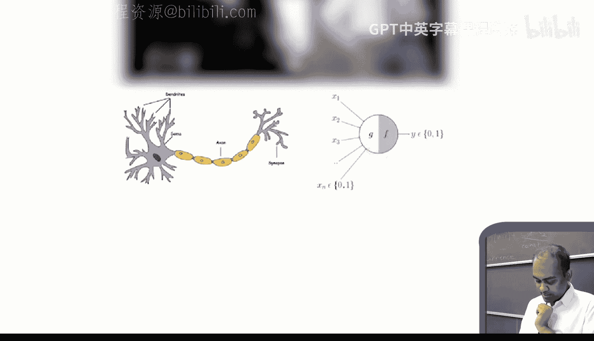

它如何选择放电或不放电呢？这取决于一个函数。神经科学家会告诉你生物神经元中的函数是什么。在机器学习或学习中，我们感兴趣的是构造能产生特定类型输出的函数。这里有一个小启示：我们知道人类生物大脑能做智能的事情。与其直接复制生物大脑的运作，不如将其抽象成一个非常简化的对象。这个对象看起来与生物神经元完全不同，但现在你可以对这个对象进行操作。

大致来说，我们今天使用的神经元与这类神经元非常相似。我们稍微改变了一下函数，也稍微改变了输出，但本质上没有太大不同。我忘了提到的另一点是，沃尔特·皮茨是一位逻辑学家，他热衷于用逻辑原理来捕捉生物学特性。这就是为什么这个模型如此简化——这个神经元的输出是一个布尔值。

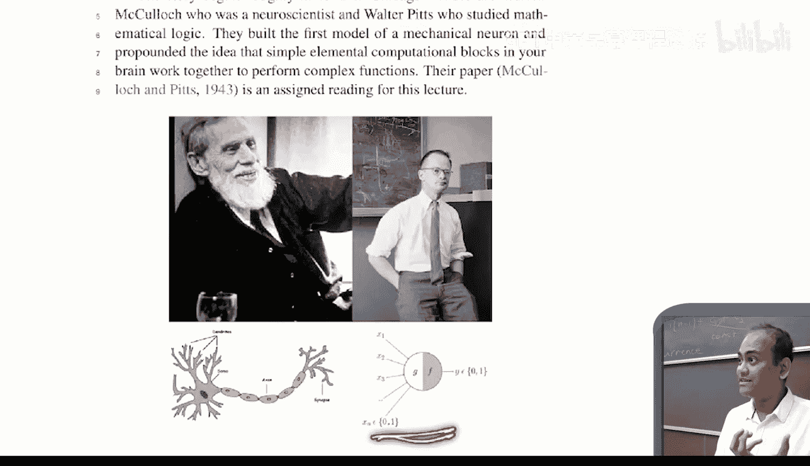

## 图灵与智能的哲学思考

大约在同一时期，战争结束后，在英国的艾伦·图灵发展了他的计算理论。他对生物大脑如何进行生物计算越来越感兴趣。他提出了一种思考智能的方式，这种方式至今仍非常流行。

例如，你可以看到这篇名为《计算机器与智能》的论文，作者是艾伦·图灵。第一节叫做“模仿游戏”。在这里他说：我认为，计算机是能让人类相信它是人类的东西。如果一个人从未见过计算机给出答案，那么如果我能回答你所有的问题，而你并不知道我是人还是计算机，那么从所有实际目的来看，我就是人类。这就是我们后来所说的**图灵测试**。

这是他工作中更具哲学性的部分。他工作中更具体的部分是创建了神经元模型。他开始将神经元视为具有阈值非线性的对象，接收多个输入并产生多个输出。

大致来说，艾伦·图灵在英国构想（而非实际构建）的神经元，与麦卡洛克和皮茨的神经元并没有太大不同。它是同一个对象，同一种数学抽象，人们开始将其视为构建智能组件的一种方式。

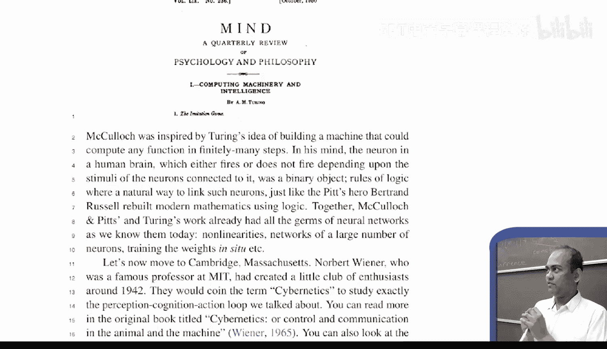

## 控制论学会的诞生

与此同时，在美国马萨诸塞州的剑桥（图灵在英国剑桥），由诺伯特·维纳领导的一批教授开始自称为“控制论学会”。他们想要设想能做人所能做之事的机器，这就是他们自称控制论学会的原因。

这是一次会议的照片，这是诺伯特·维纳，这是麦卡洛克，这是皮茨，我想这是格雷·沃尔特。

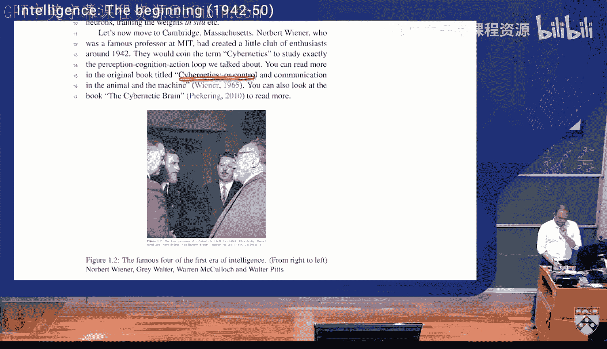

如果你需要更多学习这门课的动力，我可以展示诺伯特·维纳在40年代撰写的控制论教科书的目录。即使在今天，它也是一本值得阅读的经典教科书。它以一些哲学问题开始，比如“时间是什么？”，这也是牛顿《自然哲学的数学原理》的第一章。然后它讨论了群论、一些物理学概念。

**反馈** 作为两个相互作用事物结合的概念被提出。就像我们在行动和感知之间形成一个循环一样，大脑内部也存在反馈回路，使你能够做非常不同的事情。例如，如果你视野的某一部分看到重复且无用的东西，你的大脑会自动将其关闭，让你的眼睛聚焦于场景的其余部分，这样你就不必浪费计算能力来处理这些变化的东西。在现代机器学习中，我们称之为 **注意力机制**。更广泛地说，你会认为这就是反馈。

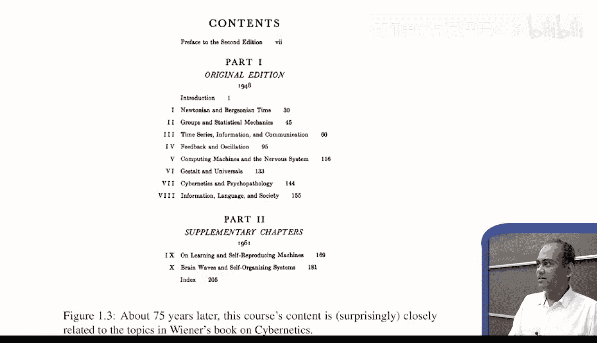

然后还有关于语言等内容。因此，维纳认为在追求智能过程中基础的概念，也基本上是我们本课程将要学习的概念。我们将研究信息论、反馈、连续信号的表示等。

所以，在过去的80年左右，我们思考智能的方式在其语言表述上发生了变化，但其核心原则并没有太大改变。

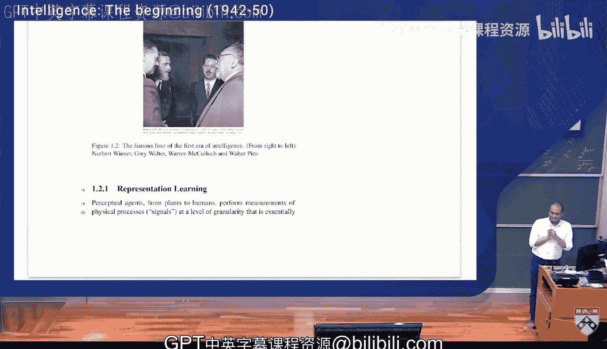

## 总结

本节课中我们一起学习了人工智能在1942年至1950年间的早期起源。我们了解到，麦卡洛克和皮茨如何将复杂的生物神经元抽象为简单的数学模型（接收多个输入 `x1, x2, ..., xn`，通过一个函数产生一个布尔输出），这成为了现代人工神经网络的基础。同时，艾伦·图灵从哲学和计算模型层面定义了机器智能（图灵测试），而诺伯特·维纳等人创立的控制论学会则引入了 **反馈** 等核心概念。这些早期工作确立了抽象、数学建模和系统交互作为构建智能机器的基本思路，其影响延续至今。