# 课程02：因果关系的困惑 🤔

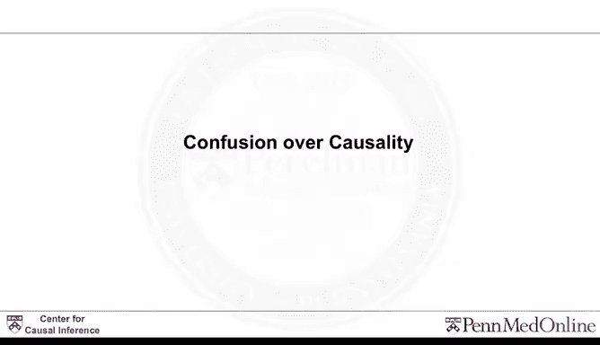

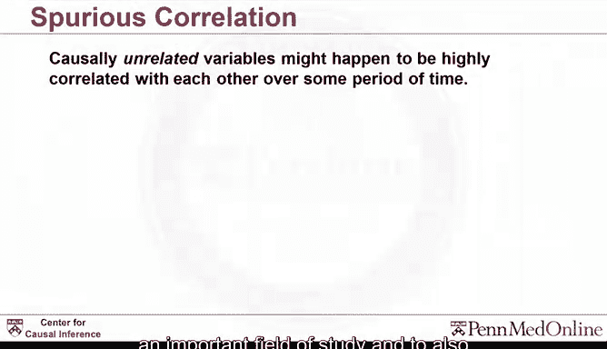

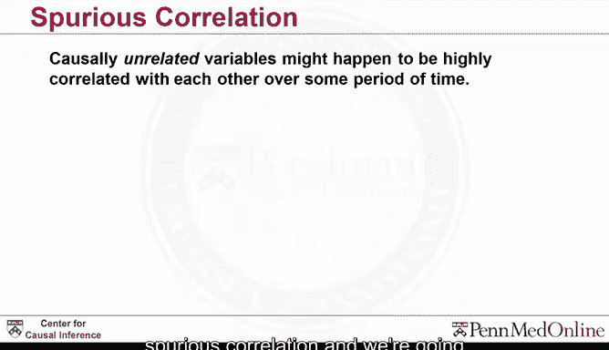

在本节课中，我们将探讨为什么因果关系有时会引发争议或令人困惑。我们将通过分析虚假相关、个人轶事、科学报道和反向因果等具体例子，来理解建立因果推断这一正式研究领域的重要性，并以此作为后续课程学习的动机。

---

## 虚假相关

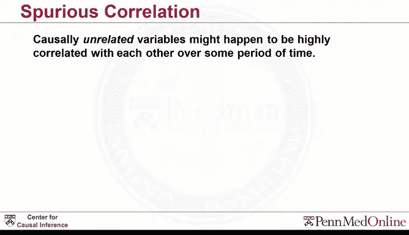

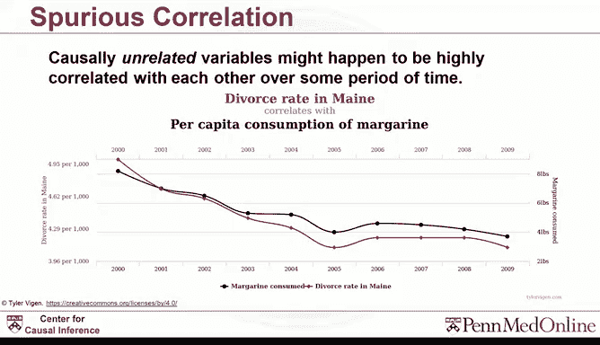

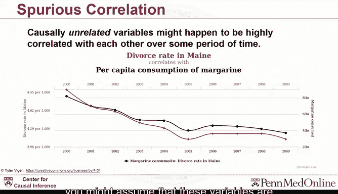

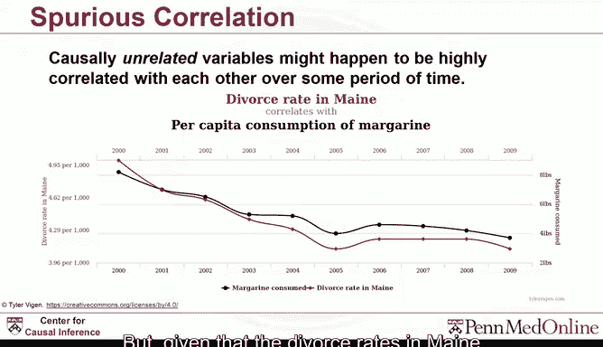

上一节我们介绍了因果关系可能令人困惑，本节中我们来看看第一个原因：虚假相关。虚假相关指的是两个无关的变量，可能在一段时间内偶然地高度相关。

以下是一个典型的例子：

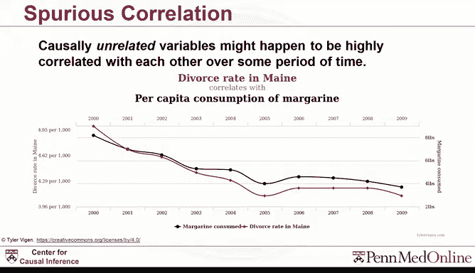

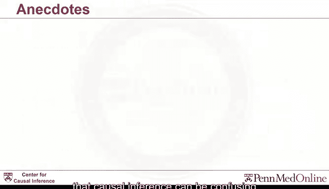

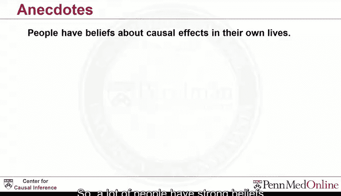

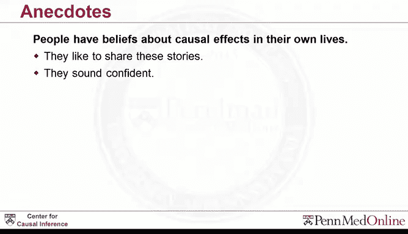

图中展示了美国缅因州2000年至2009年的离婚率（红色曲线）与人造黄油人均消费量（黑色曲线）。两条曲线走势非常接近。如果不了解这些变量，人们可能会认为它们相互关联或影响。但考虑到它们是“缅因州离婚率”和“人造黄油消费量”，我们有理由怀疑它们实际上并无因果关系。

这个例子中，虚假相关是显而易见的。我们并不认为离婚会影响人造黄油的消费，反之亦然。但在现实中，我们可能遇到两个关系不那么明确的变量，这时就会产生困惑：这究竟是虚假相关，还是真实的因果关系？识别现实世界中的这类虚假相关例子，有时会让因果关系显得不可知。因果推断领域将帮助我们回答这个问题。

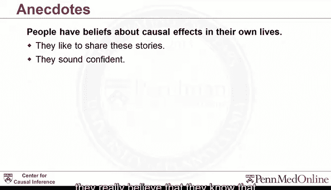

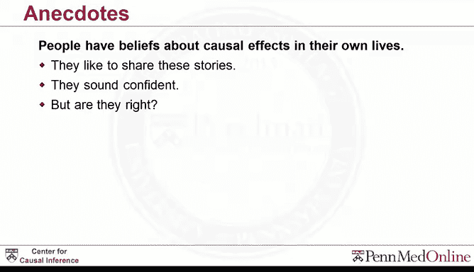

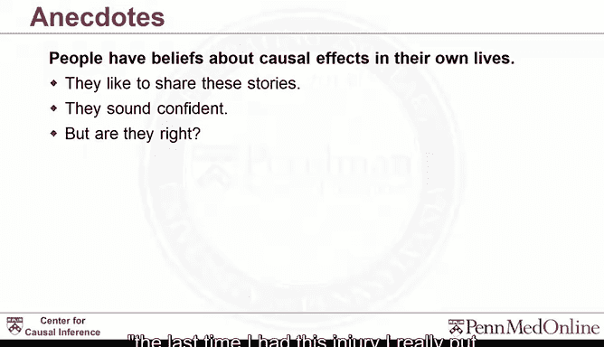

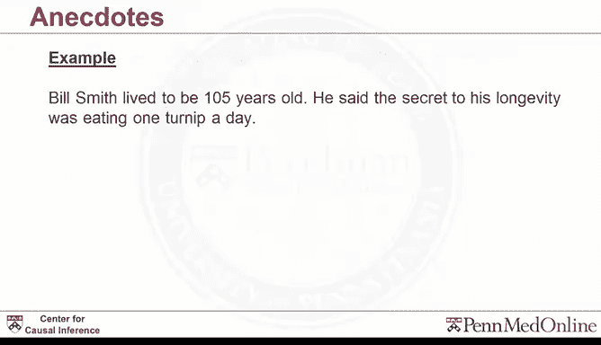

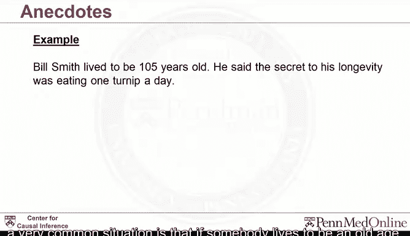

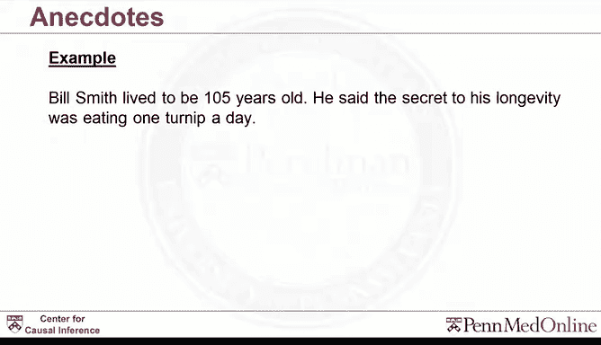

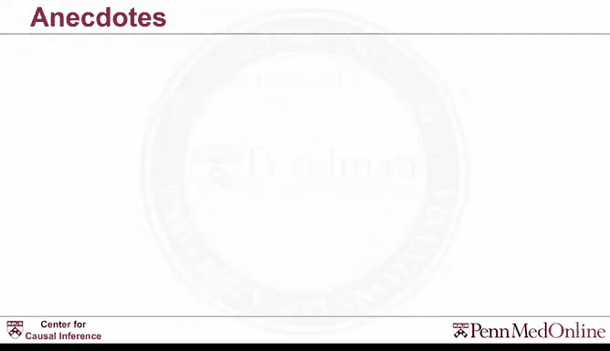

---

## 个人轶事

另一个使因果推断变得混乱的原因是个人轶事。许多人对自己生活中的因果效应抱有坚定的信念，并乐于分享这些故事。

例如，某人可能会告诉你：“上次我受伤时，用了这种药膏，对我很有效。”但我们如何知道他们是否正确？这需要我们解答。

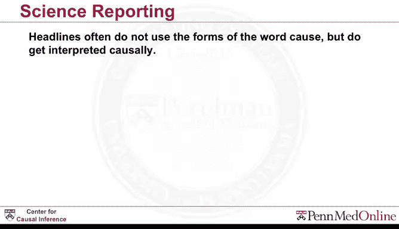

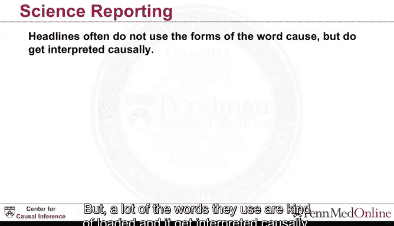

另一个常见的情况是，当某人长寿时，人们会问他的秘诀。假设比尔·史密斯活到了105岁，他有一个独特的习惯：每天吃一个芜菁。因为他认识的人中只有他这样做，并且他长寿了，所以他相信这有助于他的长寿。

但我们实际知道什么？我们只知道两件事：
1.  他活到了105岁。
2.  他每天吃一个芜菁。

我们并不知道他的饮食是否真的影响了他的寿命。请注意，这里说的是“影响”，因为他的饮食也可能缩短了他的寿命（尽管他活到了105岁，但如果吃别的，或许能活更久）。我们根本不知道这是否存在因果关系，即不知道是延长、缩短还是毫无影响。更重要的是，我们不知道如果其他人养成这个习惯会发生什么。这类轶事的隐含意义通常是：“这不仅对我有效，我推荐你也这样做，因为它对你也会有效。”但我们实际上并不知道情况是否如此。

---

## 科学报道与新闻标题

另一个引发大量讨论、怀疑和辩论的领域是科学报道和新闻标题。很多时候，科学记者会小心避免使用任何形式的“导致”一词，但他们使用的许多词汇带有暗示性，容易被解读为因果关系。

以下是我近年来发现的一个真实标题：
> “高红肉饮食与炎症性肠病相关”

读到这个标题的人可能会想：“我不应该吃红肉了。”这里具有暗示性的词是“相关”，但“相关”的含义并不明确。他们是在说一种因果关系（即少吃红肉会降低患炎症性肠病的风险）吗？还是像前面幻灯片中展示的虚假相关一样，只是碰巧有关联但并无因果关系？仅从标题无法明确其真正含义，必须深入研究该研究的设计和方法，才能判断这是否是因果关系。

另一个例子：
> “研究显示电子游戏与学业成绩存在正相关”

同样，“相关”一词再次出现。这在标题中非常常见，但其含义不明确。他们用“研究显示”稍微缓和了一下语气，但仍不清楚这是否为因果关系。可能爱玩电子游戏的人恰好本来就是成绩较好的学生（无论玩不玩游戏），也可能是玩电子游戏本身有助于提高学业成绩（例如，提高注意力）。从这个标题看，并不清楚。

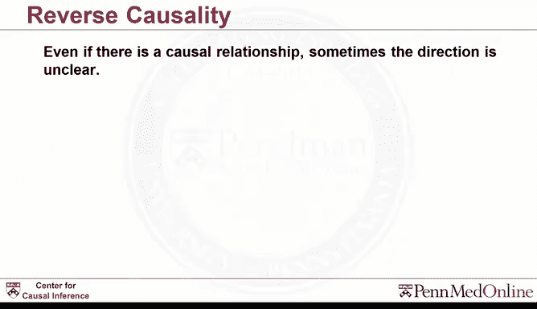

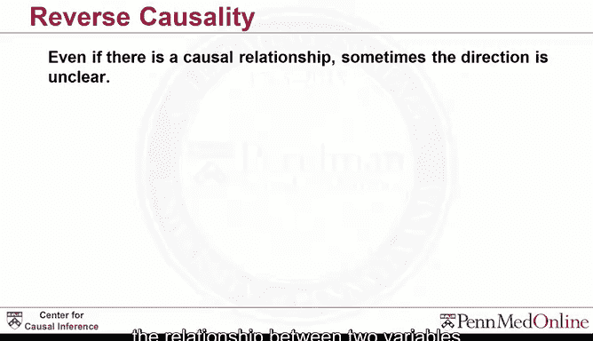

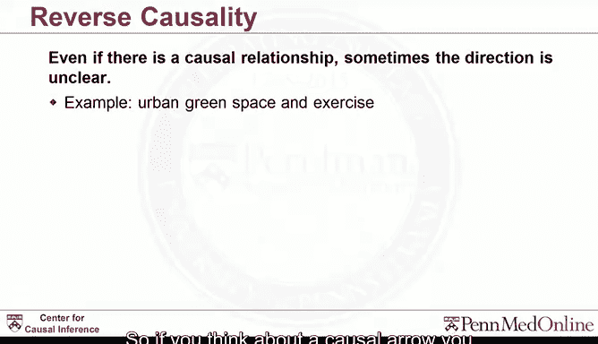

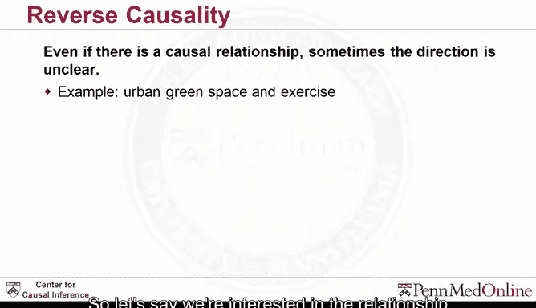

还有一个例子：
> “男性仅喝一两杯啤酒，前列腺癌风险飙升四分之一”

这听起来绝对是因果关系，因为“飙升”一词暗示饮酒影响了风险。但他们不可能随机分配男性去喝更多啤酒，所以这一定是一项观察性研究。那些摄入更多酒精的男性似乎前列腺癌风险更高。但如果我们改变饮酒行为，会影响前列腺癌风险吗？从标题看并不清楚，尽管它有所暗示。因此，我们仍需仔细审视研究方法，看是否能得出因果结论。

最后，一个巧妙的标题：
> “研究显示，打网球可降低任何年龄段的死亡风险”

这里的关键词是“降低”。同样，这听起来像是因果关系：多打网球，就不太可能早逝。但这是否是因果关系，在我看来并不明确。

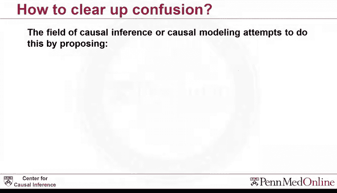

关于所有这些标题，有一点需要注意：由于因果关系通常不明确，对于任何此类标题，你都可以轻易地说“这只是相关，相关不等于因果”。但如果你对结果感到兴奋，你也可能分享这个标题。人们对这类标题的怀疑程度，很大程度上取决于他们的观点。如果你是个网球爱好者，看到这个标题，你可能会在社交媒体上分享，感到兴奋。而如果你的生活方式不那么活跃，也许你不相信网球对你有益，看到这样的标题，你可能会非常怀疑，并说“这只是相关”。很多时候，人们对标题的怀疑程度取决于他们先前的信念。我们希望在很大程度上摆脱这一点，真正根据证据本身来审视：研究是如何设计的？使用了什么统计方法？做了哪些假设？然后严格基于证据，而不是基于我们先前的信念，来对因果关系做出判断。

---

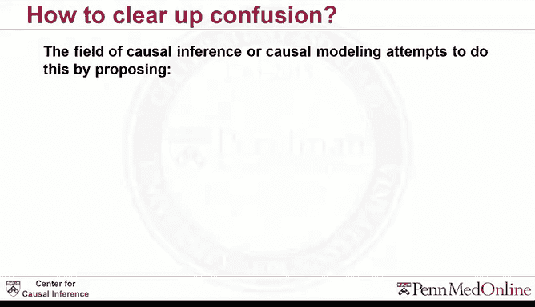

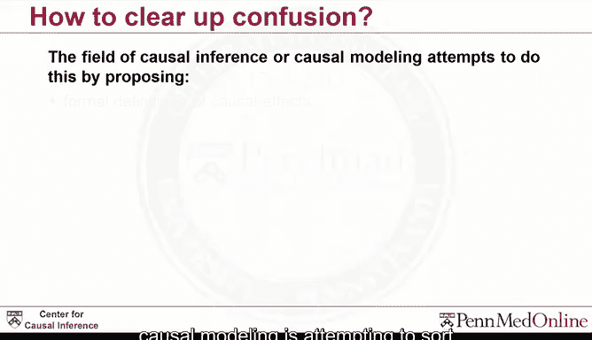

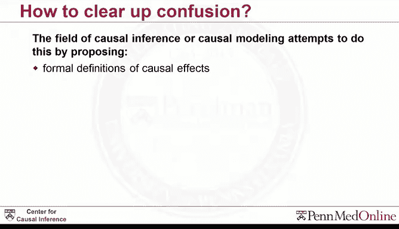

## 反向因果关系

上一节我们讨论了虚假相关和新闻标题，现在我们来探讨所谓的“反向因果关系”。这里我们考虑的是这样一种情况：两个变量之间的关系可能是因果性的，但因果方向可以是任意的。

举个例子，假设我们感兴趣的是城市绿地与运动量之间的关系。一种假设是，如果城市有更多绿地，那么这与运动量有关，但具体是怎样的关系呢？这里有一个问题：是爱运动的人更倾向于优先选择住在绿地附近吗？如果城市里有一个漂亮的公园，也许那些已经经常锻炼的人会想搬到那里。所以，可能是拥有大量绿地的城市吸引了爱运动的人居住。

另一方面，这可能是研究人员更感兴趣的问题（特别是那些想鼓励人们多运动的研究者）：城市环境中的绿地会导致人们更多地运动吗？也许已经住在城市里的人，如果你建造更多绿地、更多公园，他们的运动量会增加。因此，在横断面观察性研究中，我们可能会看到绿地越多，运动量越大。但这里的因果箭头可能指向任一方向：绿地可能导致人们更多地运动，也可能吸引爱运动的人来居住，或者是两者的结合。要厘清这一点，我们需要仔细检查这些变量之间的时间关系，并确保我们的数据能够提供某种信号，表明绿地的变化是否导致了已居住在那里的人运动量的变化。这类研究必须设计得非常仔细，否则我们就会陷入困惑，不知道因果箭头指向哪个方向。

---

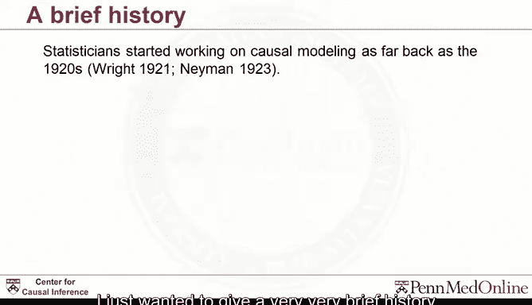

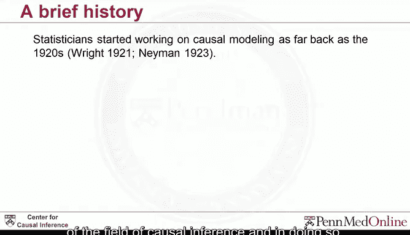

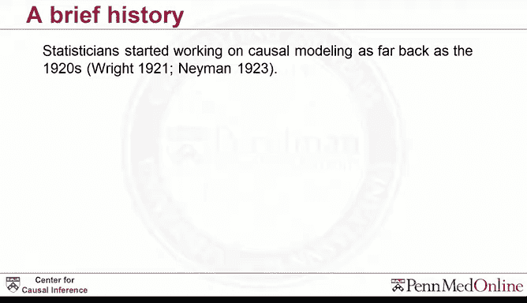

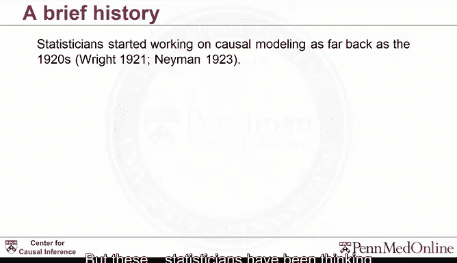

## 因果推断领域简介

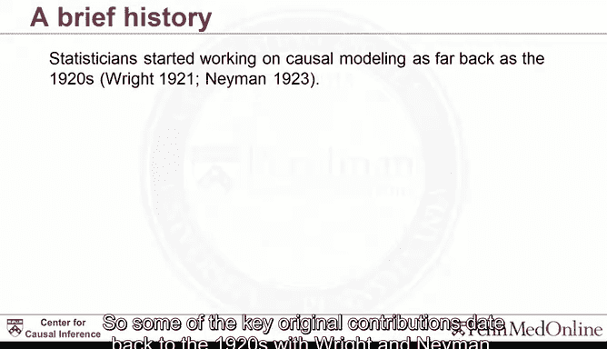

我们已经列举了许多例子来说明因果关系为何令人困惑。这旨在阐明我们为何需要一个正式的因果推断领域，以及你为什么可能对学习这门课程感兴趣。

因果推断或因果建模领域试图澄清许多这类困惑。一种方法是提出因果效应的正式定义：我们所说的“因果效应”到底是什么意思？一旦我们明确了因果效应的含义，特别是针对特定研究问题或研究感兴趣的因果效应，那么我们需要哪些假设才能从数据中识别出因果效应？我们要么提前设计研究，知道我们希望收集哪种数据；要么我们已经有了数据，并想知道需要哪些假设才能利用这些数据识别因果效应。

因果推断领域的研究人员努力识别因果假设：我们需要假设什么才能得到这些因果效应？与此相关的是，在观察性研究中，我们必须控制变量，即控制那些被称为“混杂变量”的因素——这些变量既会影响我们感兴趣的处理或暴露，也会影响结果。关于我们需要实际控制哪些变量，存在一些规则。在未来的视频中，我们将花相当多的时间讨论为了估计因果效应需要控制哪些变量。

因果推断领域的另一个重要贡献是敏感性分析。敏感性分析关注的是，你的结果对我们某些因果假设可能被违反的情况有多敏感？我们必须做出因果假设来识别因果效应，但如果这些假设被违反了怎么办？敏感性分析试图量化这一点：如果我们的假设被轻微违反，会改变我们的结论吗？如果被严重违反，会多大程度上改变我们的结论？因此，敏感性分析是因果推断的重要组成部分，我们将在后面讨论。

---

## 因果推断简史

我想简要介绍一下因果推断领域的历史。在此过程中，我会遗漏许多重要贡献，对此我向被遗漏者表示歉意，但这只是一个非常概括的概述。统计学家们思考因果建模已有很长时间，一些关键的最初贡献可以追溯到20世纪20年代的赖特和奈曼。但大约从20世纪70年代起，它才真正成为一个正式的统计研究领域，并且此后一直在不断发展。

以下是几个重点：
*   **潜在结果的重引入**：其中一个最重要的成果是潜在结果框架的重引入，例如鲁宾1974年经典论文中的“鲁宾因果模型”。之所以说“重引入”，是因为这在20世纪20年代的论文中实际上已经讨论过，但在几十年里很大程度上被遗忘了。自20世纪70年代以来，它已成为思考和讨论因果效应的常规词汇的一部分。
*   **因果图**：另一个重要贡献是因果图，由罗宾斯、格林兰和珀尔等人做出了关键贡献。在未来的视频中，我们将花大量时间讨论因果图。它们通常被认为非常有助于我们写下我们认为的世界是如何运行的，特别是关于我们感兴趣研究的变量。一旦你画出这些因果图，相关的理论已经发展出来，可以指导你需要控制哪些变量来识别因果效应。我们将看到，这些因果图与潜在结果框架相关联，两者之间的联系将帮助我们在估计因果效应时决定使用何种统计方法。
*   **倾向得分**：在估计因果效应方面，一个主要贡献是倾向得分，由罗森鲍姆和鲁宾首次引入。
*   **时间依赖性混杂**：过去二三十年另一个主要研究领域与“时间依赖性混杂”有关。粗略地说，这指的是处理或暴露随时间变化的情况，并且某一时间的暴露会影响未来许多不同的变量，而这些变量又会影响未来的处理，从而形成一种反馈循环。那么，当所有这些变量相互影响时，如何估计随时间变化的处理对结果的联合因果效应呢？这是一个非常困难的问题，但已经取得了很大进展，关键贡献来自杰米·罗宾斯和他的“G-方法”。
*   **最优动态治疗策略**：另一个令人兴奋的领域涉及最优动态治疗策略。这是另一个非常困难的研究领域，在21世纪取得了很大进展。“动态治疗策略”指的不仅仅是治疗A是否优于治疗B，而是针对具有特定特征的这位患者，我应该给他哪种治疗？作为某些实际变量的函数，什么是最优治疗？其中一些变量可能随时间变化。如何根据一些重要的临床变量来识别最优策略？这个领域已经取得了很大进展。
*   **靶向学习**：最后，在机器学习领域，有一种称为“靶向学习”的通用方法最近变得流行起来。这更像是一种基于半参数理论和高维数据的机器学习方法，我认为已经取得了许多有希望的结果，这主要由马克·范德兰和他的合作者开发。

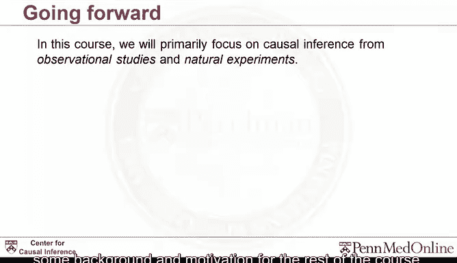

---

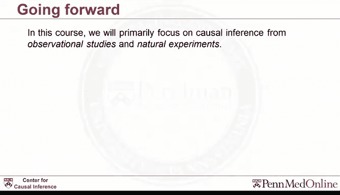

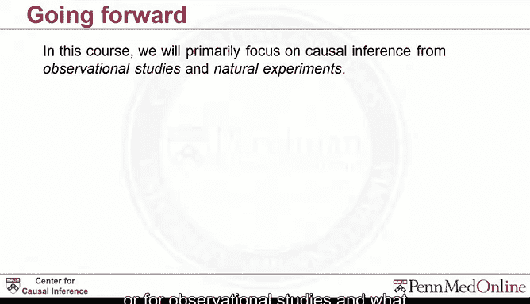

## 课程展望与总结

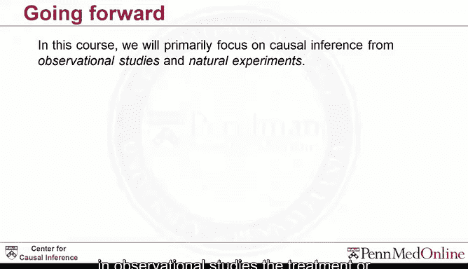

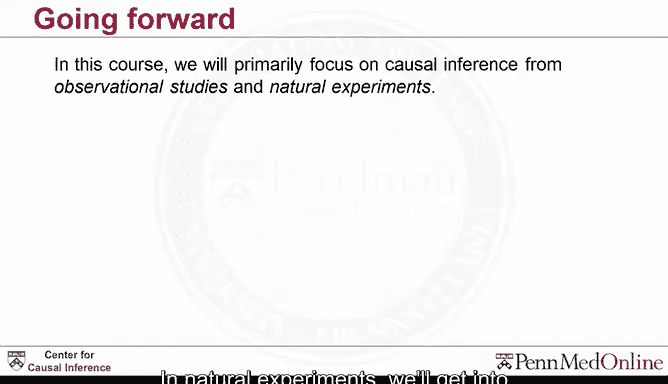

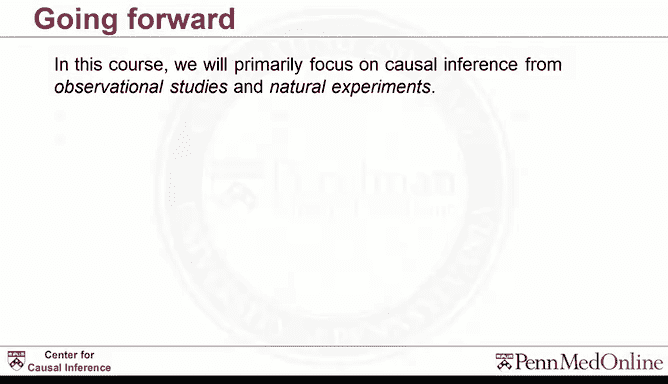

现在，我们展望一下未来。本视频旨在为课程的其余部分提供一些背景和动机。接下来，我们将专注于从观察性研究和所谓的“自然实验”的角度进行因果推断。在很大程度上，我们将忽略随机对照试验，尽管随机对照试验将是我们因果推理的一部分（在随机对照试验中，你实际上是随机分配处理或暴露）。在观察性研究中，处理或暴露就是现实世界中的样子，没有直接的人为干预。自然实验我们稍后会讲到，它指的是现实世界中某些情况看起来像是随机的，即使我们没有正式进行随机化。

随着我们更深入地研究因果建模，记住以下几点很重要：
1.  我们必须做出一些**不可检验的假设**（即因果假设）。“不可检验”意味着我们无法真正从数据中检查它是否为真，我们必须基于某种信念做出假设。当然，很多时候，这种信念并非盲目的，我们很大程度上能够判断这些假设是否合理。但正因为无法检验，这些是我们必须相信其为真的假设，这也是我们进行敏感性分析的原因。
2.  科克伦在1972年关于观察性研究的经典论文提醒我们，观察性研究需要**保持相当的谦逊**，因为我们只能声称是在摸索着接近真相。因此，即使我们学习因果推断领域，并且相信我们能更好地把握因果关系，我们也不会确切知道是否达到了目标。所以我们需要保持谦逊，并始终牢记这一观点。

在本节课中，我们一起学习了因果关系为何令人困惑，探讨了虚假相关、个人轶事、科学报道的模糊性以及反向因果等问题。我们了解到，正是这些挑战催生并推动了因果推断这一正式研究领域的发展，该领域通过定义因果效应、建立识别假设、发展控制混杂的方法以及进行敏感性分析，来帮助我们更严谨地探索和理解因果关系。记住，在因果推断的道路上，我们既要运用严谨的方法，也要保持必要的谦逊。