# 3：潜在结果与反事实 🧠

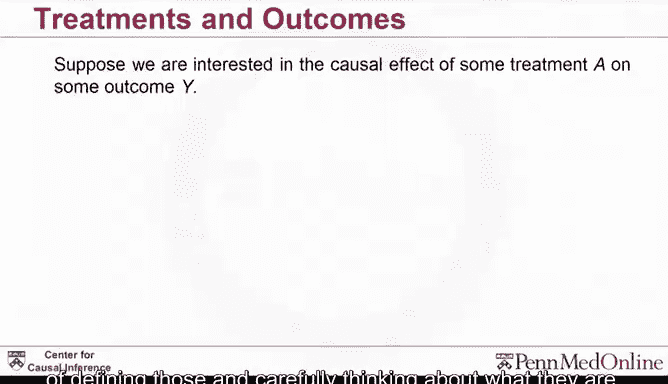

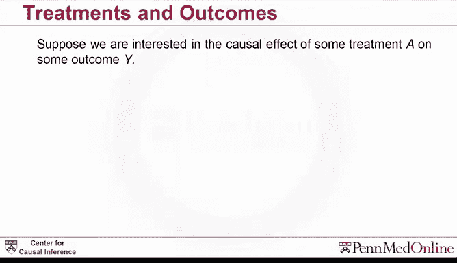

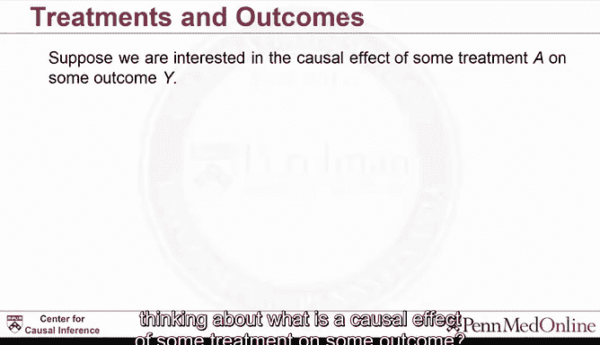

在本节课中，我们将学习因果推断的两个核心概念：潜在结果与反事实。我们将从定义和符号开始，这些符号将在整个课程中使用。理解这些概念对于定义因果效应至关重要。

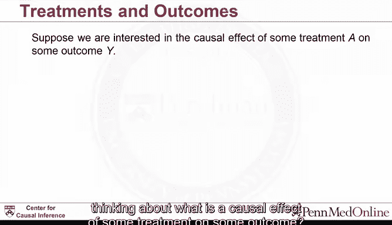

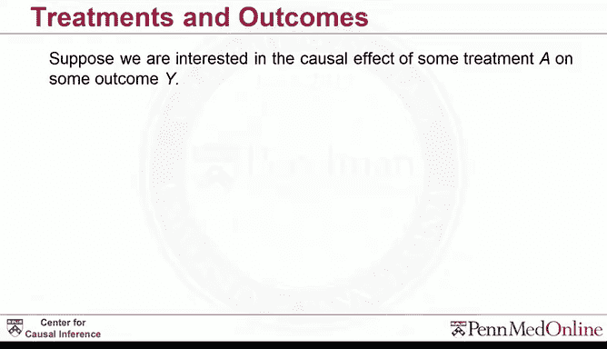

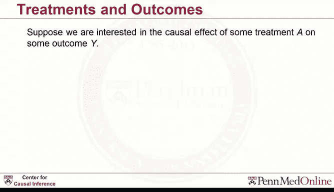

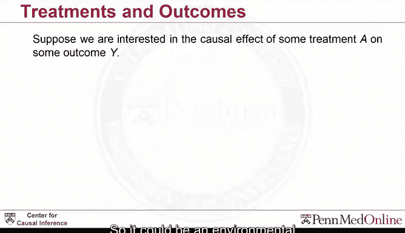

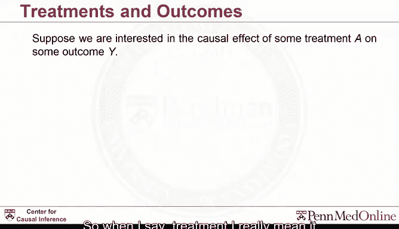

## 处理与结果

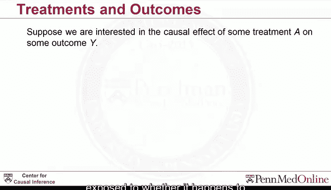

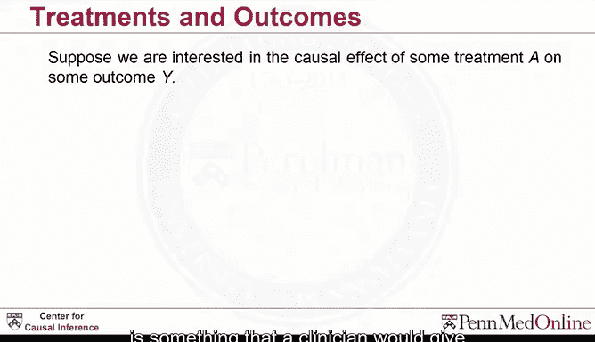

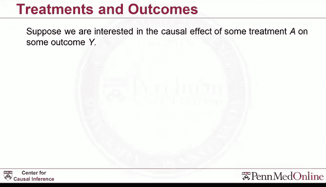

上一节我们介绍了课程概述，本节中我们来看看因果推断的基本要素：处理与结果。当我们思考因果效应时，核心问题是某个处理对某个结果产生了何种影响。

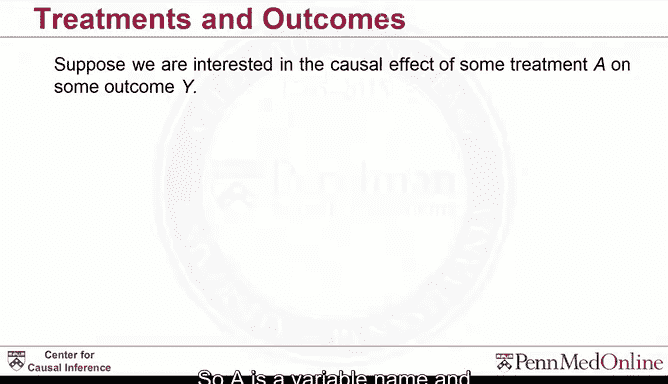

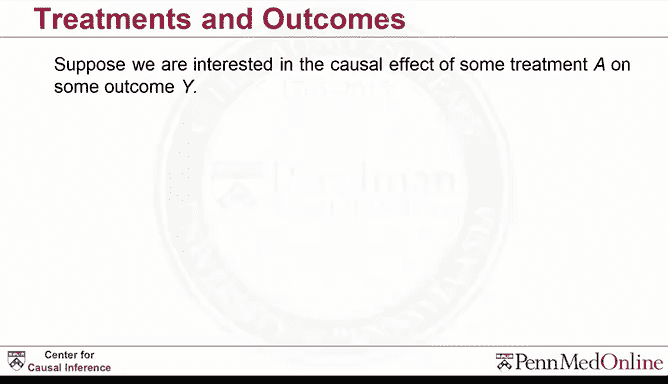

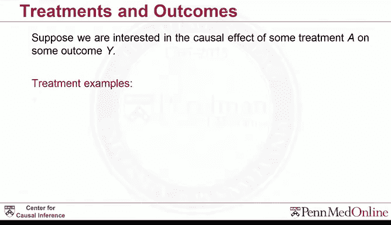

*   **处理**：也称为暴露，用变量 **A** 表示。它可以是环境暴露、药物等任何我们想了解其对结果影响的事物。在本课程中，我们通常考虑二元处理，即只有两种处理选项。
*   **结果**：用变量 **Y** 表示。它可以是任何我们关心的结局指标。

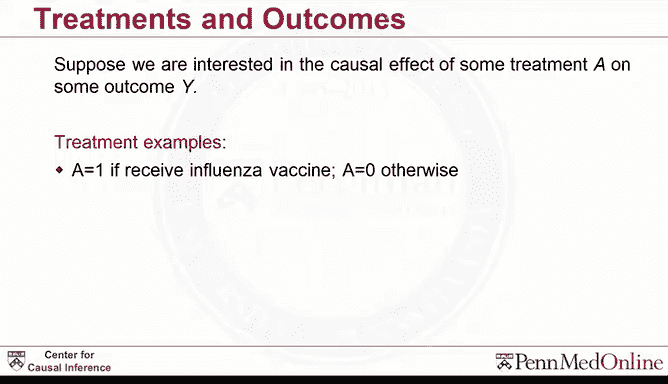

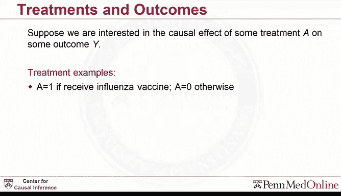

以下是处理与结果的例子：

*   **处理示例**：
    *   流感疫苗：`A = 1` 表示接种，`A = 0` 表示未接种。
    *   他汀类药物：`A = 1` 表示服用，`A = 0` 表示未服用。
    *   活性药物 vs 安慰剂：`A = 1` 表示活性药物，`A = 0` 表示安慰剂。
*   **结果示例**：
    *   心血管疾病：`Y = 1` 表示两年内患病，`Y = 0` 表示未患病。
    *   死亡时间：`Y` 是一个连续变量，表示存活时间。

## 潜在结果

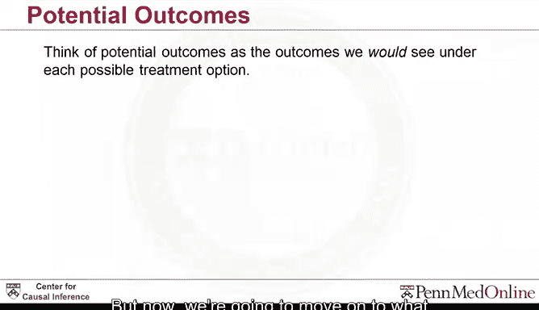

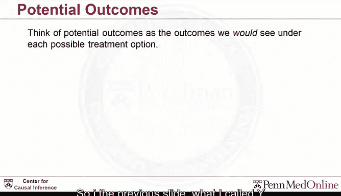

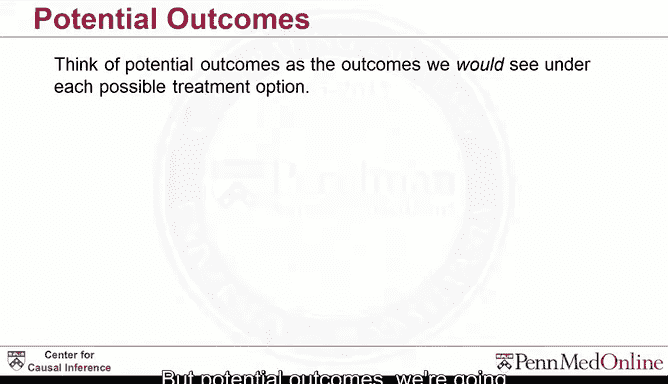

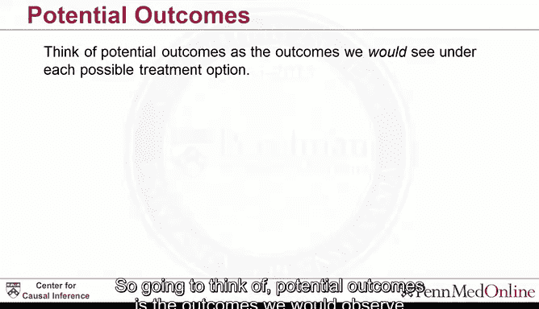

上一节我们定义了观察到的结果 `Y`，本节中我们来看看一个更基础的概念：潜在结果。潜在结果是指在每种可能的处理下，我们**将会**观察到的结果。这是一种事前的、假设性的思考。

我们使用上标符号来表示潜在结果：`Y^a` 表示当处理 `A` 被设定为特定值 `a` 时将会观察到的结果。

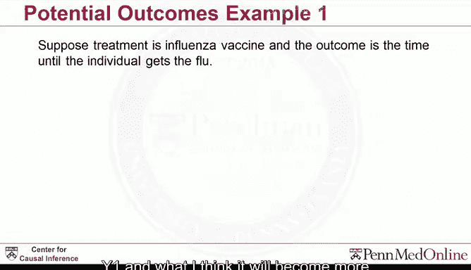

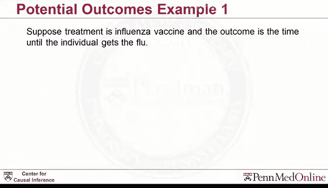

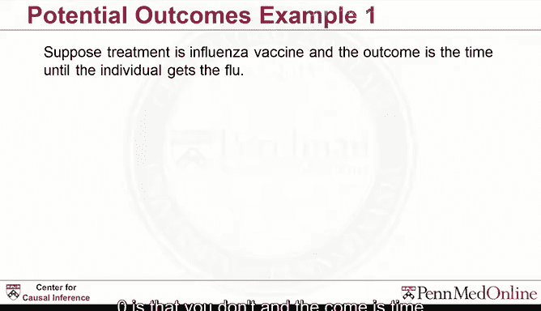

在二元处理的情况下，每个人都可以被认为拥有两个潜在结果：
*   `Y^1`: 如果接受处理（`A=1`）时的结果。
*   `Y^0`: 如果未接受处理（`A=0`）时的结果。

让我们通过例子来理解：

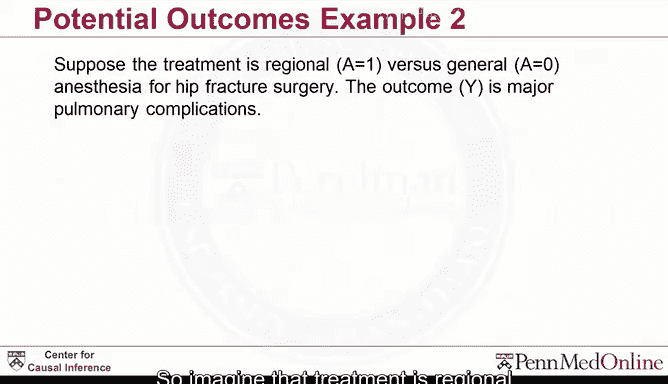

**示例1：流感疫苗**
*   处理 `A`: 流感疫苗（1=接种，0=未接种）。
*   结果 `Y`: 个体患上流感所需的时间。
*   潜在结果：
    *   `Y^1`: 如果该个体**接种了**流感疫苗，他患上流感所需的时间。
    *   `Y^0`: 如果该个体**未接种**流感疫苗，他患上流感所需的时间。

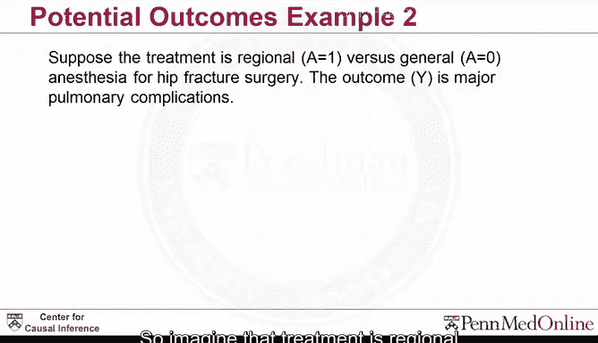

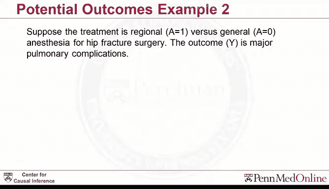

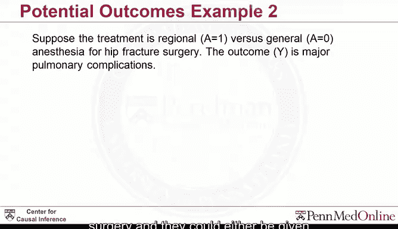

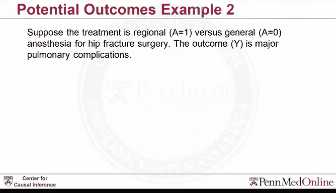

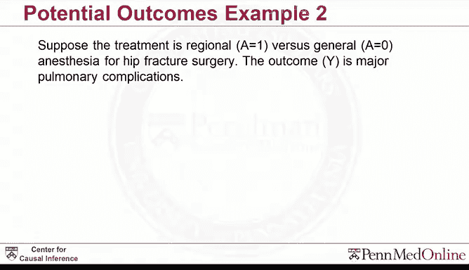

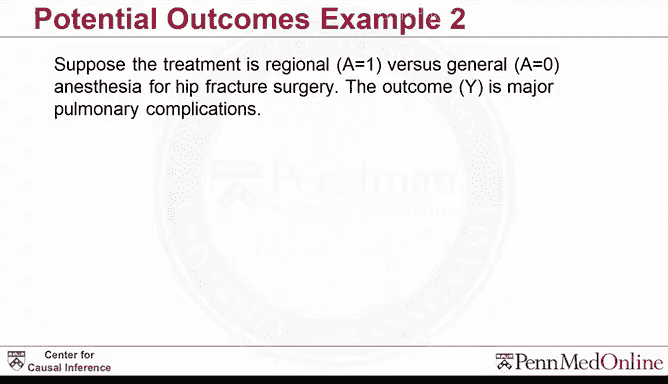

**示例2：麻醉方式**
*   处理 `A`: 麻醉方式（1=区域麻醉，0=全身麻醉），研究对象为髋部骨折手术患者。
*   结果 `Y`: 主要肺部并发症（1=发生，0=未发生）。
*   潜在结果：
    *   `Y^1`: 如果该患者**接受了**区域麻醉，是否会发生肺部并发症。
    *   `Y^0`: 如果该患者**接受了**全身麻醉，是否会发生肺部并发症。

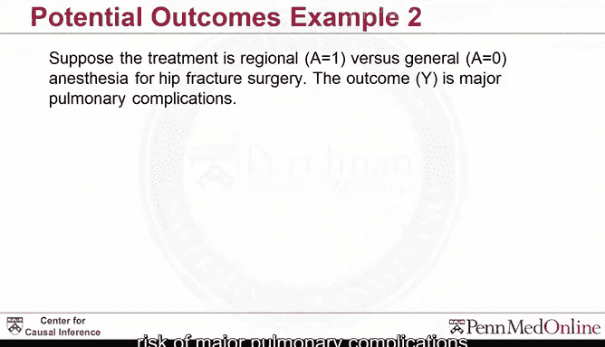

## 反事实

上一节我们介绍了事前的潜在结果，本节中我们来看看一个事后的概念：反事实。反事实结果是指，在实际情况已经发生之后，去思考**如果**处理方式不同，结果**将会**是怎样的。

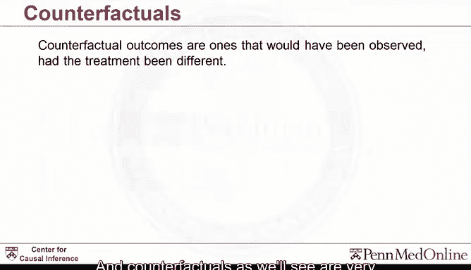

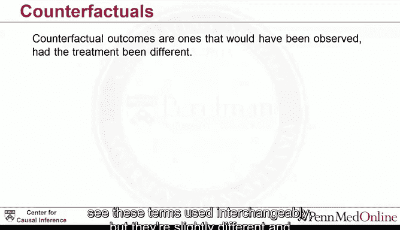

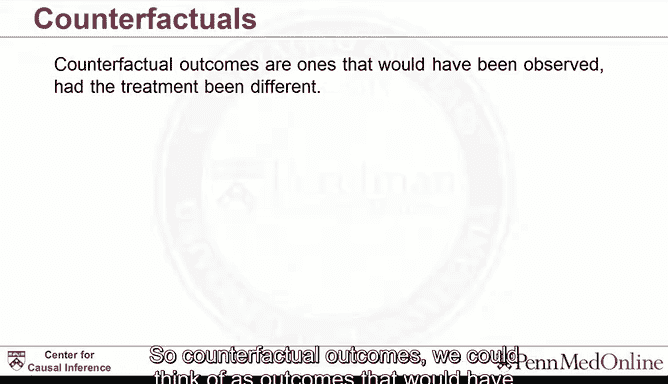

反事实与潜在结果紧密相关，但视角不同：
*   如果你的实际处理是 `A=1`，那么你的反事实结果就是 `Y^0`（即，如果你没接受处理会怎样）。
*   如果你的实际处理是 `A=0`，那么你的反事实结果就是 `Y^1`（即，如果你接受了处理会怎样）。

**示例：流感疫苗有效吗？**
假设你实际接种了流感疫苗（`A=1`）并且没有生病（观察到的结果 `Y = Y^1 = 未生病`）。
那么，你的反事实问题是：**如果我当初没有接种疫苗，我会生病吗？**
对应的反事实结果就是 `Y^0`。这个结果我们永远无法真正观察到，因为它与事实相反。

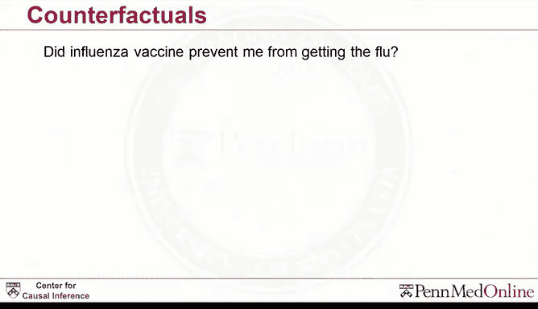

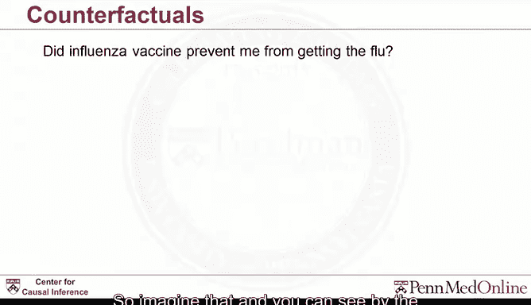

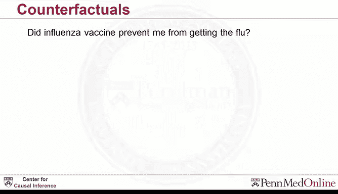

## 潜在结果与反事实的联系

现在，让我们总结一下潜在结果与反事实之间的关系。

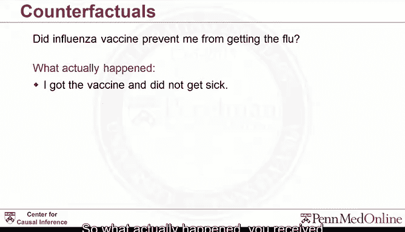

在研究开始前、任何处理决定做出之前，所有结果都是**潜在结果**（`Y^0` 和 `Y^1`）。它们代表了未来可能发生的两种假设情形。

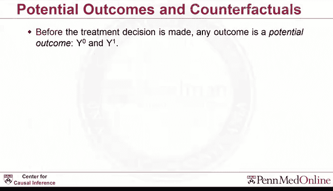

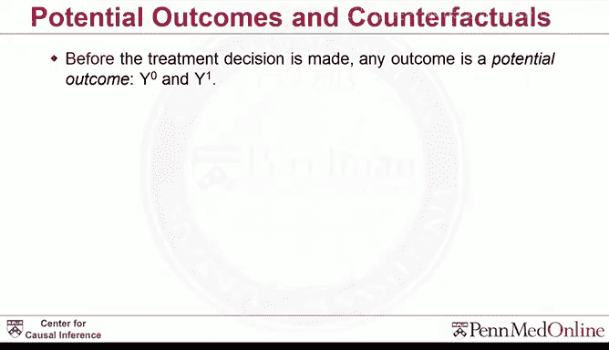

在研究结束后、处理决定已经做出并观察到结果后：
*   **观察到的结果**是与你实际接受的处理相对应的那个潜在结果，记为 `Y^A`（例如，若 `A=1`，则观察到 `Y^1`）。
*   **反事实结果**则是与你实际接受的处理相反的那个潜在结果，记为 `Y^(1-A)`（例如，若 `A=1`，则反事实结果是 `Y^0`）。

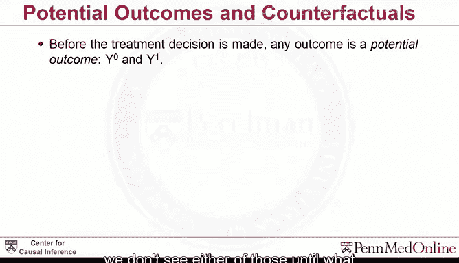

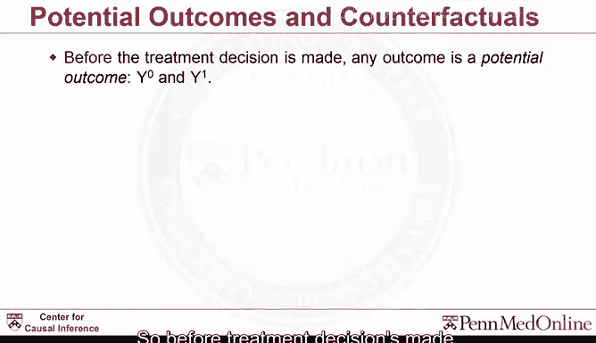

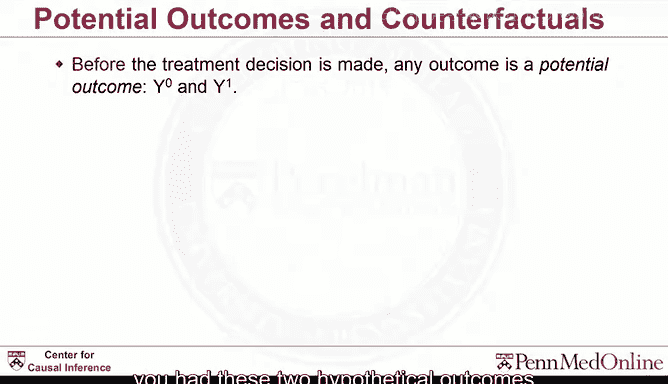

通常，我们假设反事实结果与潜在结果是相同的数值概念，只是思考的语境（事前假设 vs 事后反思）不同。因此，这两个术语经常被互换使用。

## 总结

本节课中我们一起学习了：
1.  **处理（A）与结果（Y）** 是定义因果效应的基本变量。
2.  **潜在结果（`Y^a`）** 是一种事前的、假设性的概念，指在每个可能的处理下将会发生的结果。
3.  **反事实结果** 是一种事后的概念，指在已知实际处理的情况下，思考“如果处理不同，结果会怎样”。它对应于那个未被观察到的潜在结果。
4.  潜在结果与反事实在数值上被认为是相同的，它们是连接观察数据与因果推论的核心桥梁。理解它们对于后续学习如何定义和估计因果效应至关重要。