# 4：假设性干预 🧪

在本节课中，我们将要学习**假设性干预**的概念。我们将探讨因果效应的含义，区分定义明确与定义不明确的因果效应。我们会讨论**可操纵变量**的含义、假设性干预的一般概念，并介绍**因果推断的根本问题**——它是什么、为何具有挑战性，以及我们如何开始思考克服这个问题的方法。

---

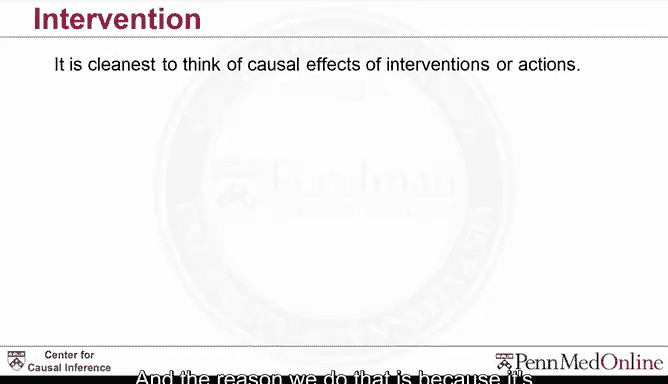

## 什么是干预？🔧

上一节我们介绍了课程主题，本节中我们来看看**干预**的具体含义。

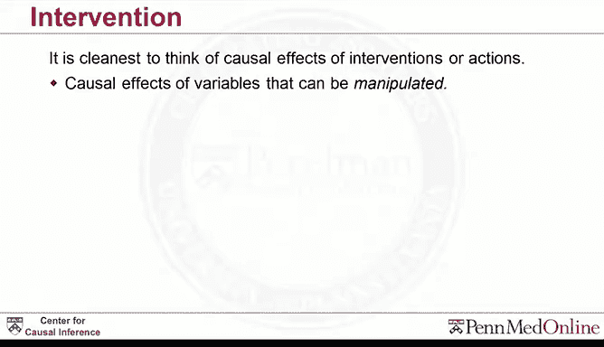

我们之所以要定义干预，是因为思考干预的因果效应是一种清晰的方式。有时干预也被称为**行动**。通常，干预指的是一个可以被操纵的变量——无论是在假设中，还是在实践中我们确实能够操纵它。我们将详细讨论这意味着什么，但核心思想是：我们关注的是那种我们可以进行干预、操纵或采取行动的变量。

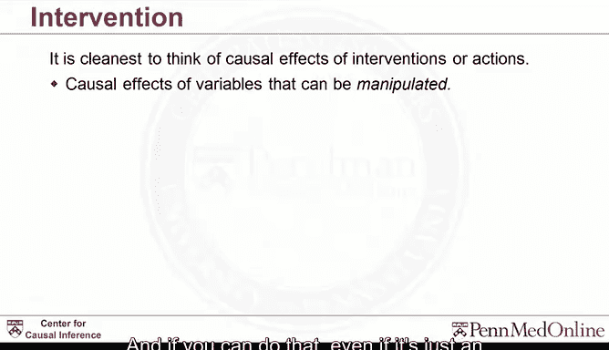

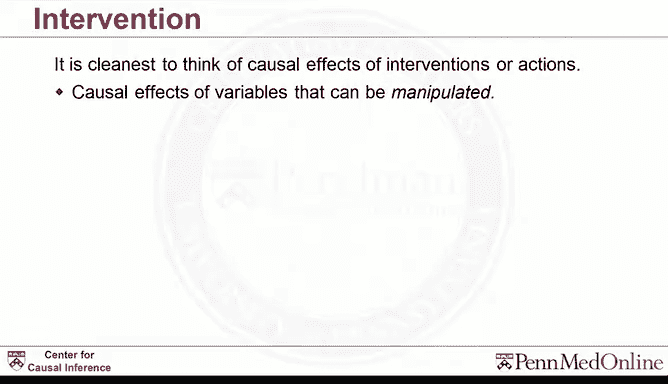

如果能做到这一点（即使只是思想实验），我们就可以思考这类变量的因果效应。

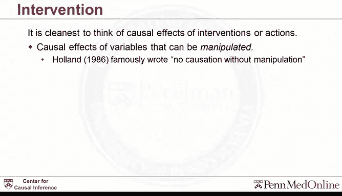

---

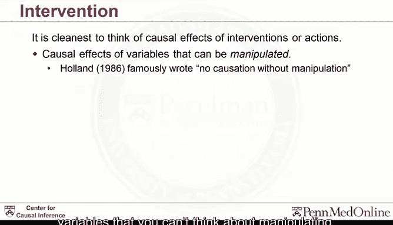

## “无操纵则无因果” 📜

Holland 曾提出“无操纵则无因果”，这句话在因果推断领域被广泛引用。

其主要观点是：对于那些你无法想象去操纵的变量，思考其因果效应是困难的。然而，**干预的因果效应**通常是定义明确的。

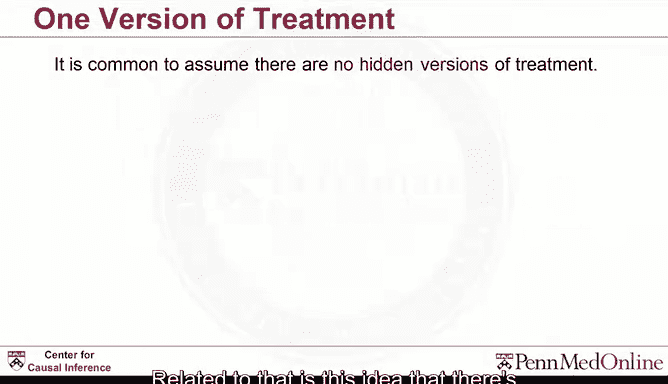

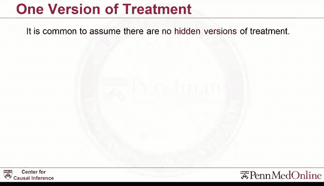

例如，假设我们想比较药物A与药物B的因果效应。原则上，我们可以想象操纵这个过程：给一些人药物A，给另一些人药物B，并决定谁接受哪种药物。从这个意义上说，我们是在操纵它，我们可以想象采取某种行动。因此，如果我们想知道药物A相比药物B的因果效应是什么，至少在原则上，理解其含义是相对容易的。也就是说，我们可以假设性地干预某人服用何种药物。

---

## “治疗的单一版本”假设 💊

与此相关的是“**治疗的单一版本**”这一概念。有时这也被称为“无隐藏治疗版本”的假设。

例如，假设我们感兴趣的是身体质量指数（BMI）对健康结果的因果效应。这是一个常见的研究兴趣点，例如，你会听到很多关于肥胖对健康影响的讨论。

但这里我们遇到了一个问题：因为达到一个特定BMI值的方法有很多种。无论是考虑一般的BMI，还是体重或肥胖，假设我们想假设性地操纵BMI（这是我们感兴趣的自变量），我们就会遇到问题，因为存在许多潜在的实现方式，而这些不同的方式可能与不同的结果相关联。

我们可以想象，例如，可能通过开具减肥药来帮助某人达到特定BMI，或者通过锻炼、饮食、手术等多种方式。这意味着，如果我们把BMI视为某种“治疗”或暴露变量，那么达到特定值的方法不止一种，而你所使用的方法可能与结果相关。

一个极端的例子是吸烟。在某些情况下，人们通过吸烟来减肥。吸烟可能是降低BMI的一种方式，但吸烟本身可能与你感兴趣的结果相关。因此，在思考BMI或肥胖的因果效应时，我们进入了困难的领域，原因之一就是不存在“治疗的单一版本”，而且它也不是那种容易操纵的东西。

在这种情况下，更好的做法可能是思考**旨在操纵体重的特定干预措施的因果效应**。如果我们对体重、BMI或肥胖对某个结果的因果效应感兴趣，与其试图估计那个难以定义的东西，不如思考某个旨在影响体重或BMI的干预措施的因果效应是什么。

---

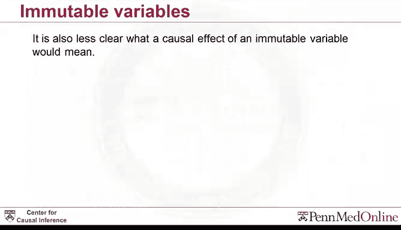

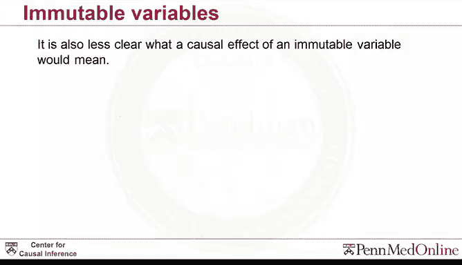

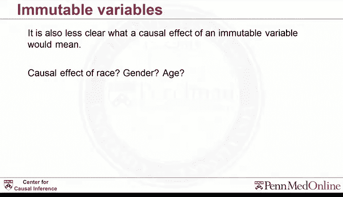

## 不可变变量的挑战 🧬

另一个困难的案例是**不可变变量**。

这里我们谈论的是诸如种族、性别或年龄等事物。作为研究者，我们甚至无法在假设中真正改变或操纵这些变量。当我们思考潜在结果或反事实时，我们是在想象如果治疗是另一种情况，可能会发生什么。

假设我们对种族对某个结果的因果效应感兴趣。思考一个潜在结果是非常困难的：如果你的种族不同，结果会是什么？因为我们无法直接操纵它。这是一个我们无法操纵的变量的例子，这使得因果推断变得相当困难。年龄也是如此。我们可以看到，随着人们年龄增长，他们患某些结果的风险更高，但很难想象实际物理上操纵他们的年龄意味着什么。

因此，在这些情况下，因果效应的定义更加困难。当我们思考这类变量的因果效应意味着什么时，我们进入了更具挑战性的领域。

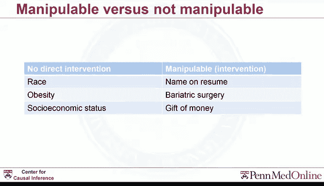

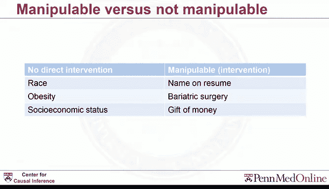

---

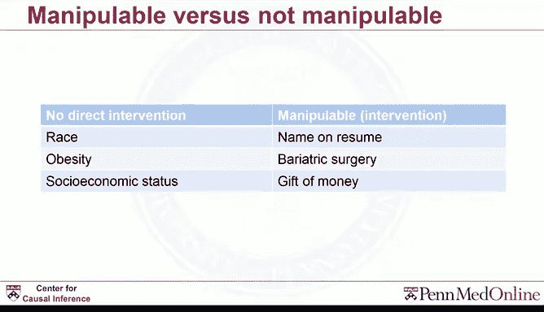

## 应对策略：关注可操纵的干预 🛠️

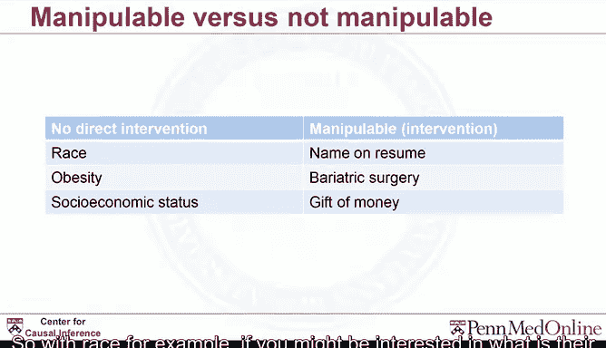

上一节我们讨论了不可变变量带来的挑战，本节中我们来看看如何应对。

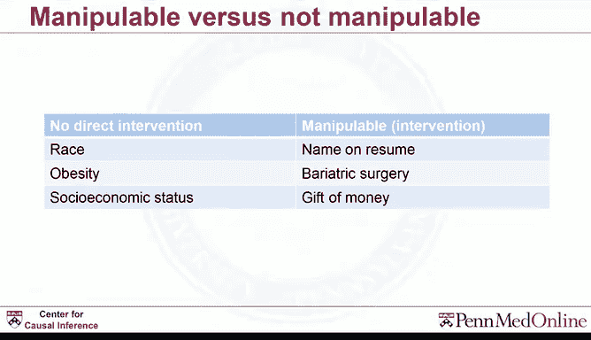

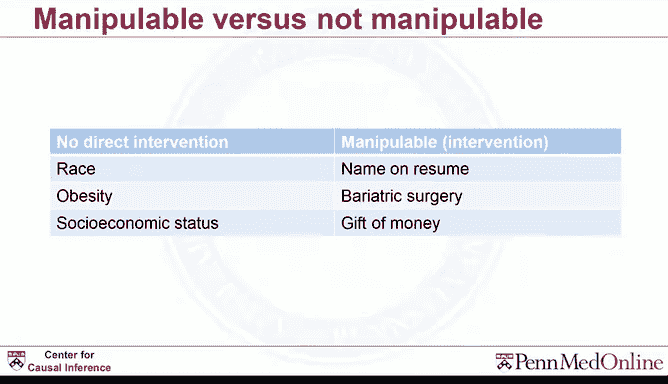

一种解决方法是，与其直接思考这些变量及其因果效应（因为你无法直接干预它们），不如思考你可以操纵的相关事物，即**你可以采取行动的干预措施**。

例如，关于种族，你可能感兴趣的是：招聘实践中是否存在基于种族的歧视？我们无法想象改变某人的实际种族，然后看他们是否会被雇佣，但我们可以潜在地发送完全相同的简历，唯一的区别是名字听起来像是人们通常联想到的非裔美国人名字还是白人名字。简历上的名字是我们可以直接操纵的东西，然后我们就有可能识别出**那种特定类型干预的因果效应**，即基于名字听起来是非裔美国人还是白人的招聘歧视。实际上已经有很多这类研究。

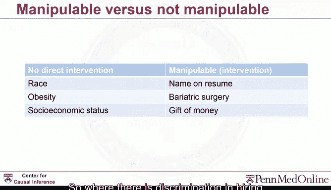

关于肥胖，你可以想象例如减肥手术。减肥手术的因果效应是什么？因为这里实际上做出了决定：我是否应该接受减肥手术？这是可以采取的行动，是一种干预，是可操纵的，因此我们有希望在那里识别出因果效应。

社会经济地位是一个非常宽泛的概念，不容易直接操纵某人的社会经济地位。但我们可以想象一种干预，例如，给某人一笔钱作为礼物。这笔额外收入、这笔额外的钱对你感兴趣的某个结果有什么影响？赠送金钱是我们可以直接操纵的事情。

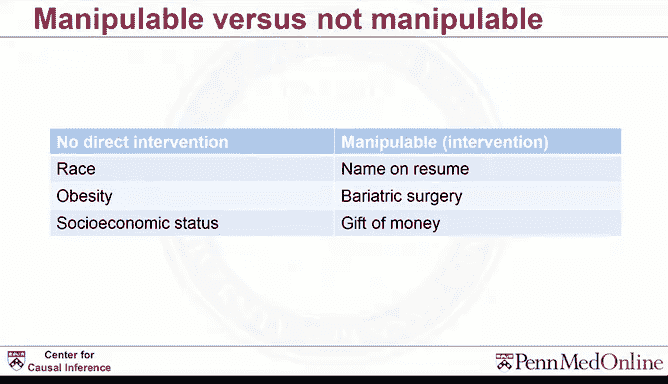

---

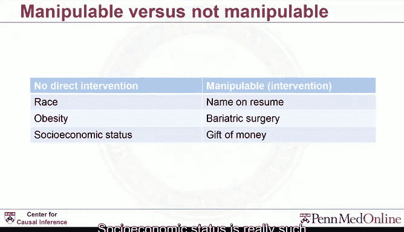

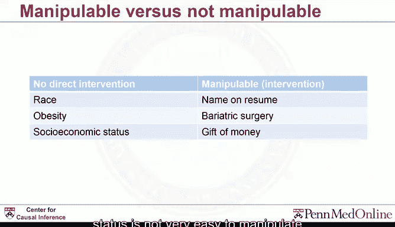

## 本课程的焦点 🎯

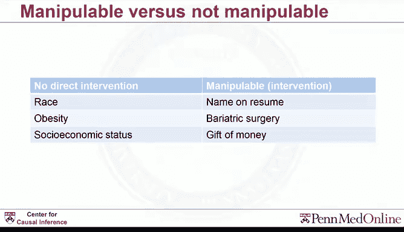

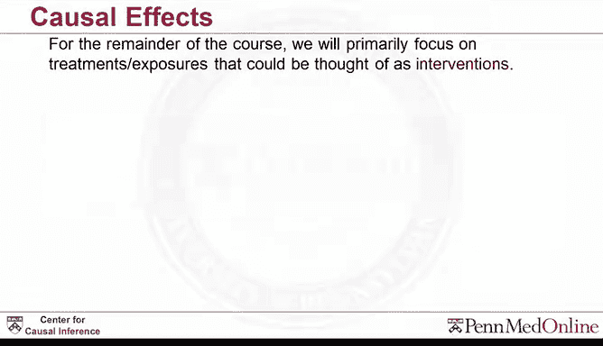

在课程的剩余部分，我们将主要关注那些我们可以视为干预措施的治疗或暴露变量。至少，在假设上，我们可以想象一种干预。

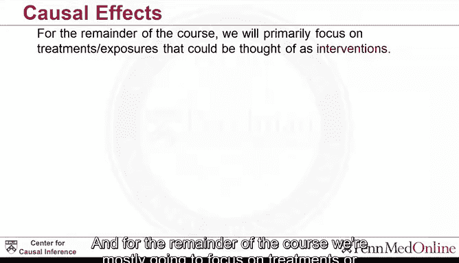

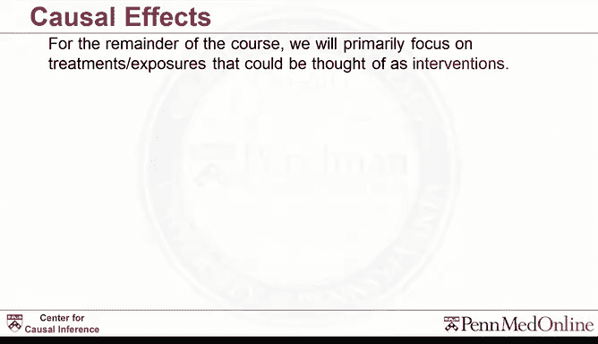

一种有助于判断某个变量是否属于可操纵类型、是否属于假设性干预的方法是：**能否想象一个随机试验**？你可以设想一个假设的试验。你能想象一个可能存在的、可以操纵这个变量的假设随机试验吗？可能实际进行这个试验是不道德的，但我们应该能够想象它可能发生。

例如，在伦理上，我们可能不能随机分配人们吸烟或不吸烟，但我们可以假设性地想象这样做，对吧？这可能不符合伦理，但我们至少可以想象它。因此，在这种情况下，吸烟原则上可以被视为可操纵的，所以我们可以想象吸烟的因果效应。

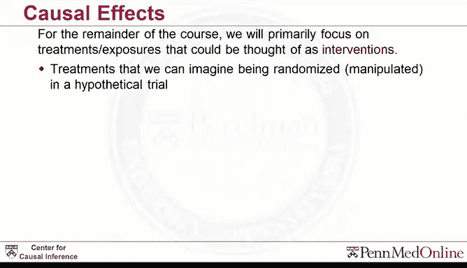

然而，我们无法真正想象一个会改变某人种族或改变某人BMI的假设试验。但这并不是说年龄、种族、性别或肥胖没有因果效应。我认为大多数人都相信存在。只是很难定义在这些背景下我们正式所说的因果效应是什么，而且我们很难将其很好地纳入潜在结果框架。在本课程中，我们将使用潜在结果框架来识别因果效应。因此，广泛认为这些（种族、性别、肥胖等）存在因果效应，但只是它不能非常清晰地融入这种涉及数据和估计等形式化的因果框架。这些都是非常困难的问题。

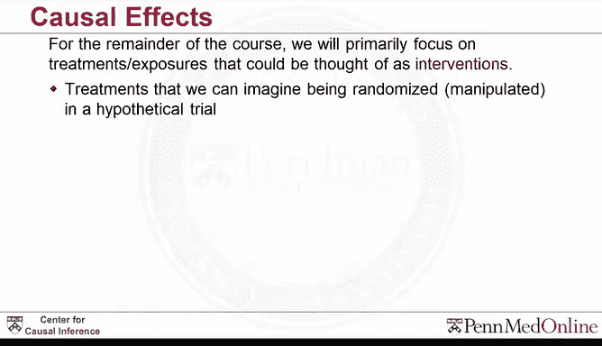

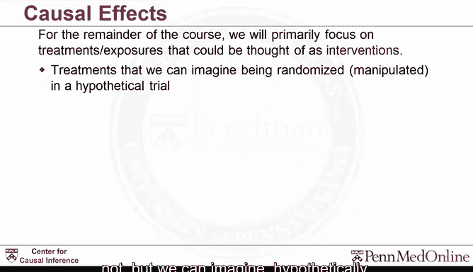

我们将专注于稍微容易一点的问题：那些我们可以视为假设性干预的变量。

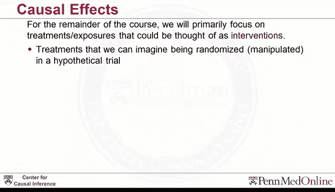

---

## 为何关注假设性干预？ 🤔

我们关注假设性干预，因为它们的含义定义明确，这是关键原因之一。此外，它们**具有潜在的可操作性**，这实际上是一个非常关键的点。

如果你知道了肥胖的因果效应（假设存在一个），你能做什么呢？你的下一步将是：我能对此做什么？你会开始想象各种行动。因此，如果我们发现肥胖正在缩短人们的寿命，并且我们真的相信这是一个因果效应，那么我们会想弄清楚我们能做什么。我们会提出干预措施。所以，实际上，我们会想知道**那个特定干预措施的因果效应**是什么。

这样，我们就回到了假设性干预和因果效应的框架。如果我们坚持这个假设性干预的框架，那么我们最终会得到具有潜在可操作性的输出。

---

## 那么，什么是因果效应？ ⚖️

现在我们来广泛地想象一下。当潜在结果 `Y(1)` 和 `Y(0)` 彼此不相等时，我们就说发生了因果效应。因此，如果暴露或治疗变量 `A` 对 `Y` 有因果效应，那么 `Y(1)` 就不同于 `Y(0)`。也就是说，**治疗下的潜在结果**不同于**未治疗下的潜在结果**。

作为一个例子，假设一小时后我的头痛消失了。变量是“一小时后头痛是否消失”，结果是“是”或“否”。我们的观察结果 `Y` 等于值“是”（如果一小时后头痛消失）或“否”（否则）。

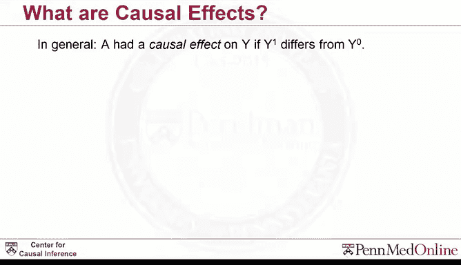

让我们想象可能的治疗是布洛芬。我们称之为 `A`，`A = 1` 表示你服药，`A = 0` 表示你不服。

那么在现实中，我们只看到一种情况。你可能会这样说：“我服用了布洛芬，我的头痛消失了。因此，药物起作用了。”我相信在现实生活中，你会听到人们说这样的话。我经常听到类似的说法：某人做了某事，观察到了某个结果，然后他们说“因此它起作用了”。

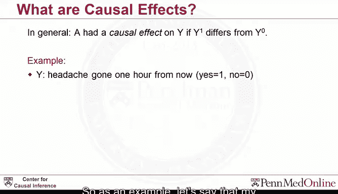

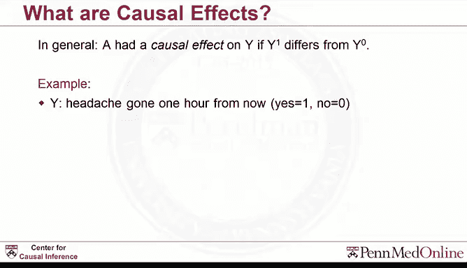

但这实际上不是正确的因果推理。他们真正告诉你的只是：`Y(1) = 1`。换句话说，他们只告诉了你：在治疗下（即服用了布洛芬），结果（头痛消失）等于1。但如果你没有服用布洛芬，会发生什么？这是未知的。换句话说，你的反事实是什么？如果你没有接受治疗，你的头痛会自行消失吗？我们实际上并不知道。

因此，只有当这些潜在结果彼此不相等时，才存在因果效应。如果你的头痛无论如何都会消失，那么我们就不能说服用药物导致了你的头痛消失。

---

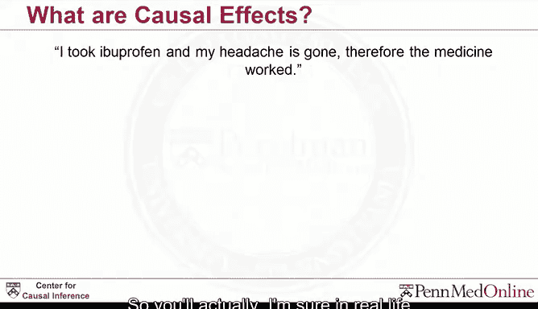

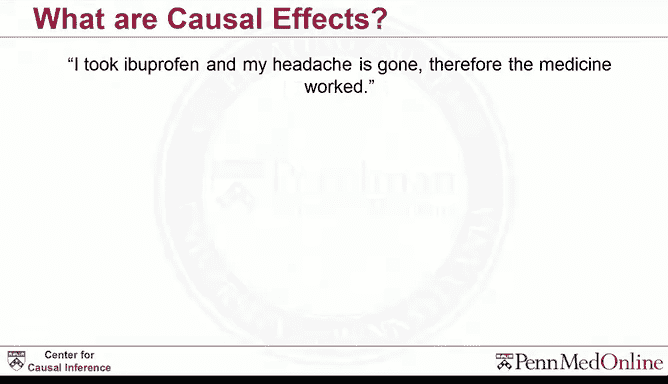

## 因果推断的根本问题 🚧

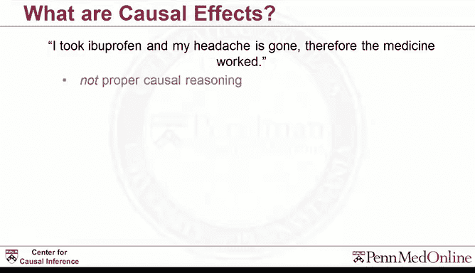

上一节我们通过例子引出了一个问题，现在我们来正式定义它：**因果推断的根本问题**。

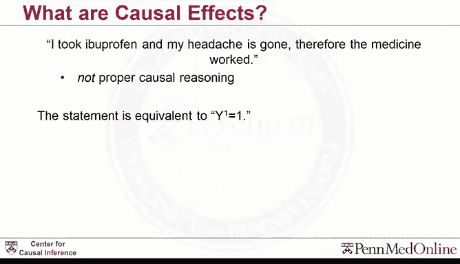

希望你现在已经识别出了一个问题。这个问题被称为因果推断的根本问题：**对于每个人，我们只能看到一个潜在结果**。

在前面的例子中，我们不知道如果他们不服用布洛芬会发生什么。这是我们永远无法为那个人看到的东西。但我们刚刚说过我们需要知道它，才能知道是否存在因果效应。所以这是一个问题，事实上，这是根本问题。

然而，你可以做出某些假设来估计所谓的**总体或平均因果效应**。与其思考“这个治疗对我个人是否有效”，我们可以从整体上思考一个群体。我们永远无法知道的是所谓的**单位水平因果效应**或**个体水平因果效应**——如果我没有服用布洛芬，会发生什么？我实际上无法确切知道这一点。所以我们不会真正去思考针对个体的因果效应。

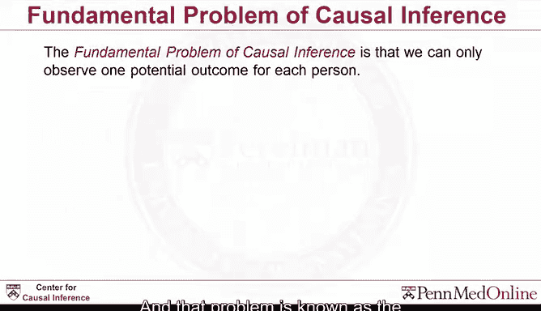

可以说这是一个几乎无解的问题。但可能的是思考类似这样的问题：**如果每个头痛的人都服用布洛芬，头痛缓解率会是多少？与如果没有人服用相比呢？** 现在我们不是在试图找出每个个体的因果效应，而是作为一个整体群体，如果每个人都做一件事与如果每个人都做另一件事相比，在这种情况下头痛率会如何？

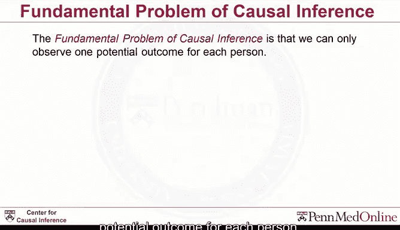

这样，我们就能够对暴露或治疗在总体上、在群体水平上的效果做出一般性陈述。本课程的大部分内容将集中于此：估计这类群体水平的因果效应。

这就是我们处理因果推断根本问题的方法：通过观察整个群体，而不是观察个体。

---

## 总结 📝

本节课中我们一起学习了：

*   **假设性干预**的含义及其重要性：它帮助我们清晰定义因果效应，并使研究结果具有潜在的可操作性。
*   **可操纵变量**与**不可变变量**（如种族、年龄）的区别，以及为何后者在因果推断中更具挑战性。
*   **“治疗的单一版本”** 假设，以及当变量（如BMI）存在多种实现方式时定义因果效应的困难。
*   应对不可变变量挑战的策略：转而研究与它们相关的、**可操纵的具体干预措施**的因果效应。
*   正式定义了**因果效应**：当潜在结果 `Y(1) ≠ Y(0)` 时，治疗 `A` 对结果 `Y` 存在因果效应。
*   因果推断的**根本问题**：对于任何个体，我们只能观察到一种治疗状态下的结果，永远无法同时知道其反事实结果。
*   解决根本问题的出路：从估计**个体因果效应**转向估计**群体平均因果效应**，这是本课程后续内容的焦点。

通过将焦点放在假设性干预和群体效应上，我们为系统性地进行因果推断奠定了坚实的基础。