# 课程06：因果推断速成课 - 因果假设 🧠

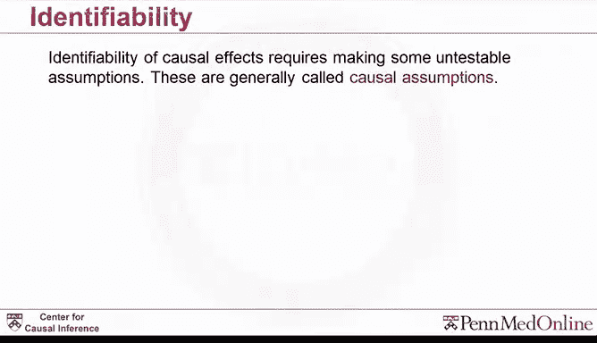

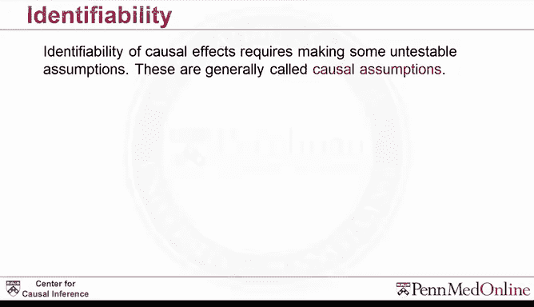

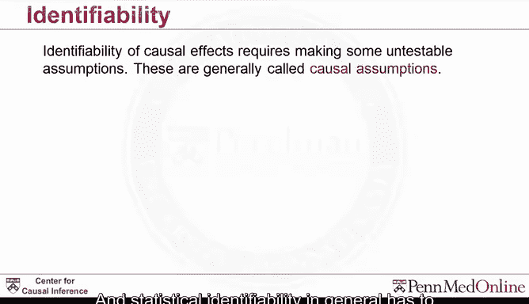

在本节课中，我们将学习因果推断中至关重要的四个核心假设。这些假设是连接潜在结果与观测数据的桥梁，是进行有效因果推断的理论基础。我们将逐一探讨它们的含义、作用以及重要性。

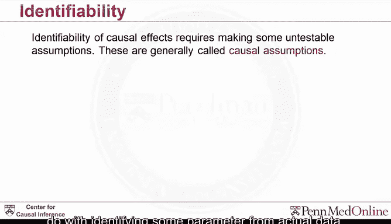

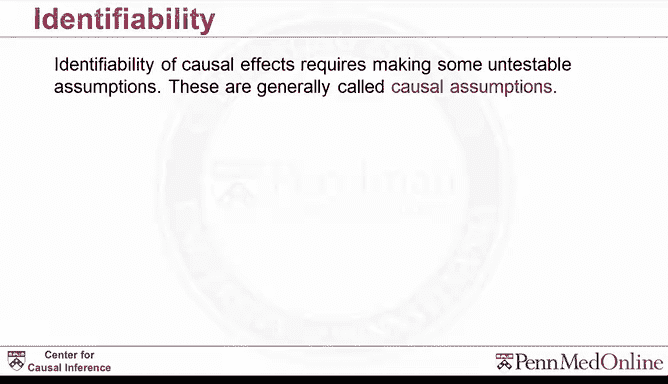

---

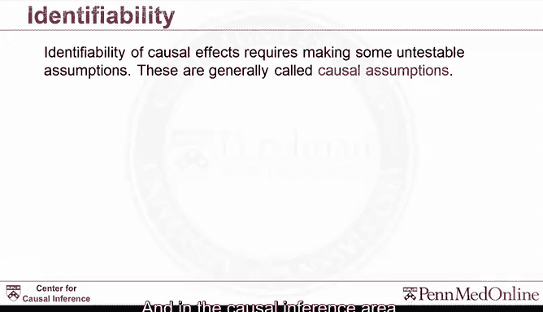

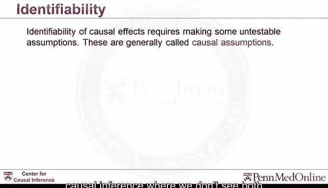

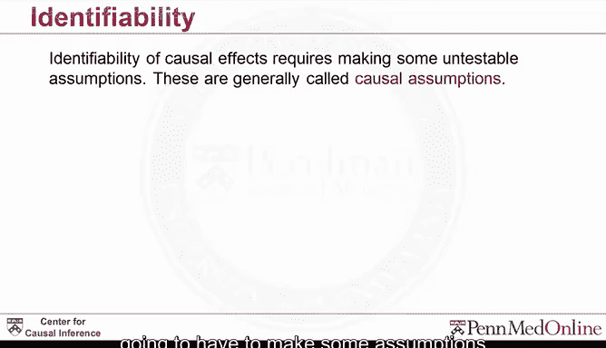

## 概述

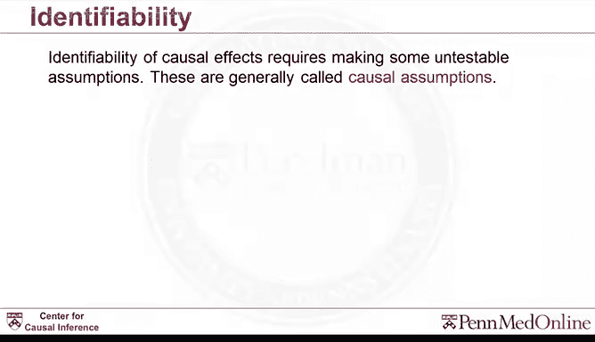

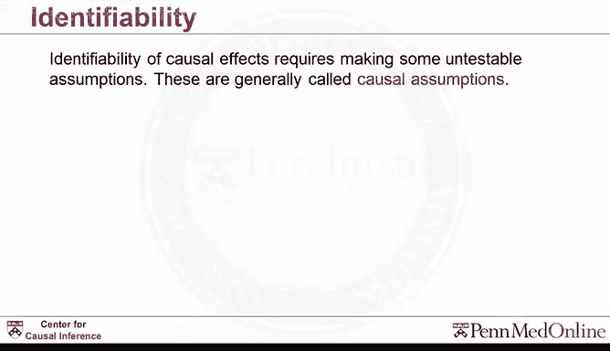

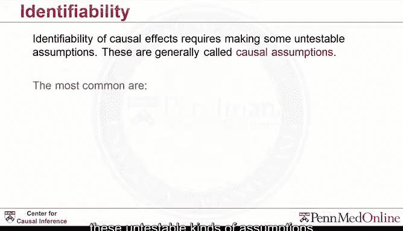

因果效应的可识别性需要我们做出一些**无法通过数据检验的假设**。统计上的可识别性，指的是能够从实际数据中估计出某个参数。在因果推断领域，我们面临一个根本性问题：我们无法同时观测到同一个体的所有潜在结果。因此，为了识别因果效应，我们必须引入一些假设，这些假设被称为**因果假设**。

最常见的四个因果假设是：
1.  稳定单元处理值假设
2.  一致性假设
3.  可忽略性假设
4.  正值性假设

在讨论这些假设时，我们默认观测数据包含一个结果变量 **Y**，一个处理变量 **A**，以及一组处理前的协变量 **X**。X 可以理解为研究中收集的背景信息，例如人口统计学特征、临床诊断等，是我们希望控制的变量集合。

---

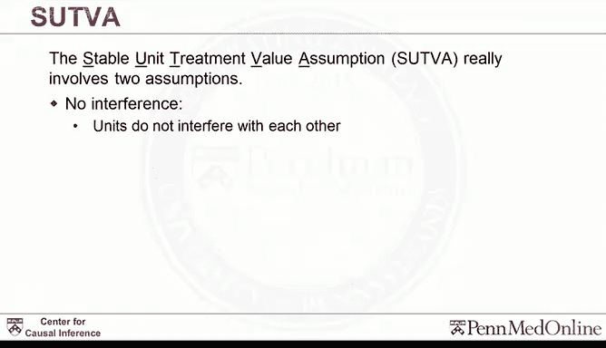

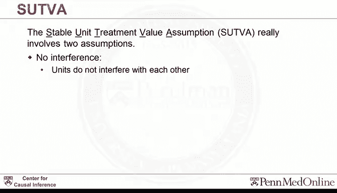

## 稳定单元处理值假设 (SUTVA) 🧱

SUTVA 假设可以看作由两部分组成：无干扰性和单一版本处理。

上一节我们提到了因果推断的基本问题，本节我们首先来看 SUTVA 假设如何简化我们对潜在结果的定义。

**1. 无干扰性**
无干扰性是指个体之间互不干扰。这里的“单元”通常指人（如患者）。所谓“干扰”，是指一个单元接受的处理会影响另一个单元的结果或处理效果，有时也称为“溢出效应”或“传染效应”。

以下是可能存在干扰的场景示例：
*   行为干预研究：如果研究对象之间相互交流，那么一个人所受干预的效果可能取决于与他互动的人接受了何种干预。
*   疫苗研究：一个人接种疫苗的效果可能取决于总体人群的接种比例。

通常，我们假设无干扰性成立，即给某人分配处理时，其效果不依赖于其他人的情况。虽然存在处理干扰的因果推断方法，但本课程不涉及。

**2. 单一版本处理**
这部分假设要求处理只有一种明确的版本。这一点很重要，因为它关系到能否将潜在结果有效地与观测数据联系起来。如果存在多种版本的处理，连因果效应的定义都会变得模糊，并引发其他问题。因此，我们假设存在一个定义清晰、我们可以对其进行干预的单一处理变量。

**SUTVA 的优势**在于，它允许我们仅根据个体自身的处理状态来定义其潜在结果。我们无需考虑其他所有人的处理状态，这极大地简化了问题。在许多情况下，这是一个合理的假设。

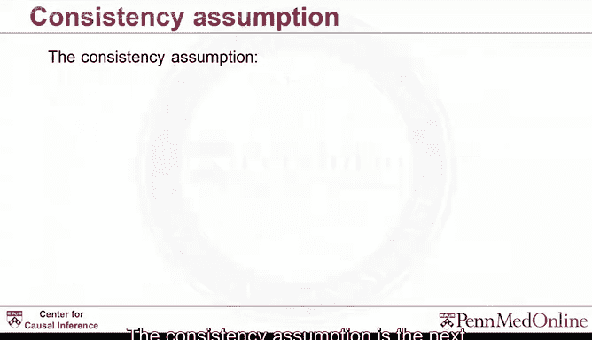

---

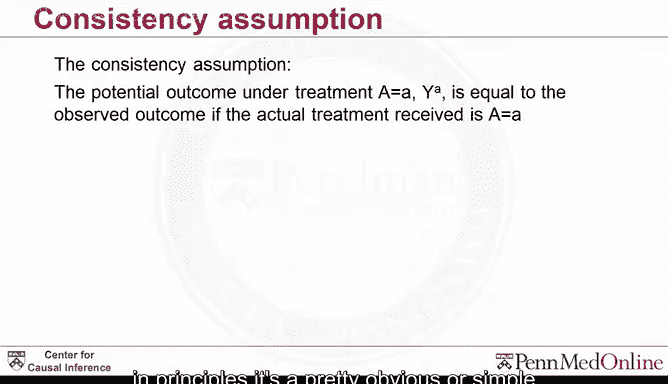

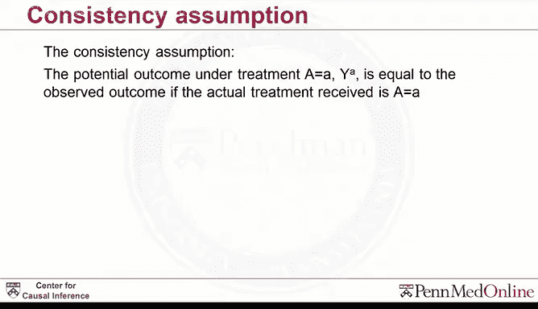

## 一致性假设 🔗

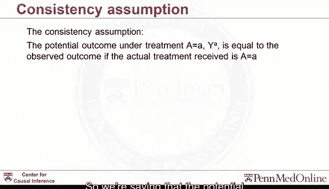

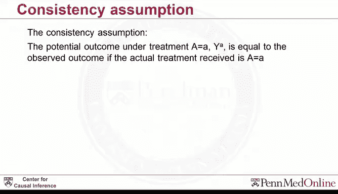

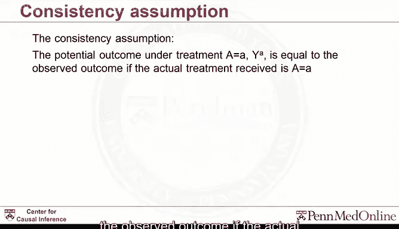

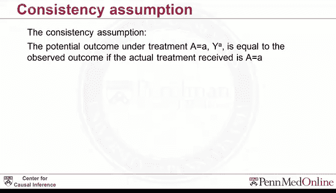

一致性假设直接连接了潜在结果与观测数据，其原则相对简单明了。

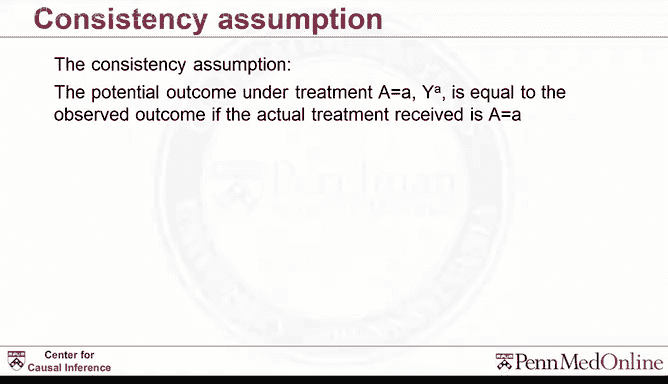

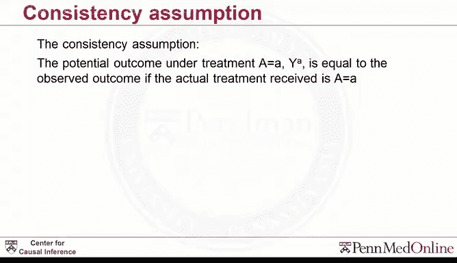

上一节我们了解了 SUTVA 如何简化问题，本节我们来看一个更直接的连接假设——一致性。

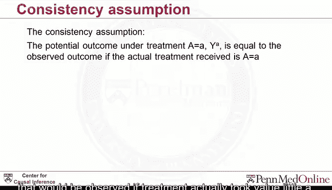

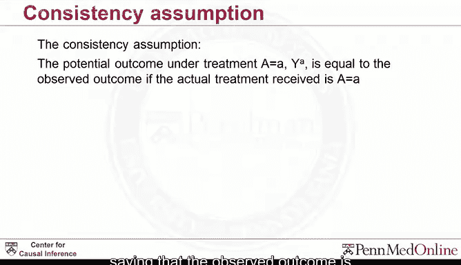

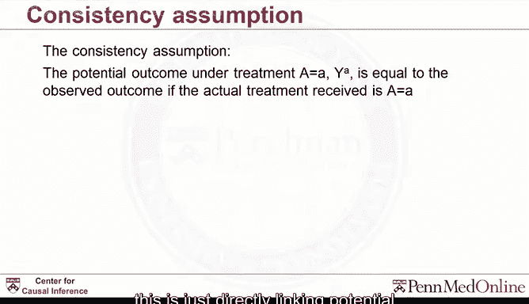

该假设表述为：当实际接受的处理 **A = a** 时，观测到的结果 **Y** 就等于在该处理水平下的潜在结果 **Yᵃ**。

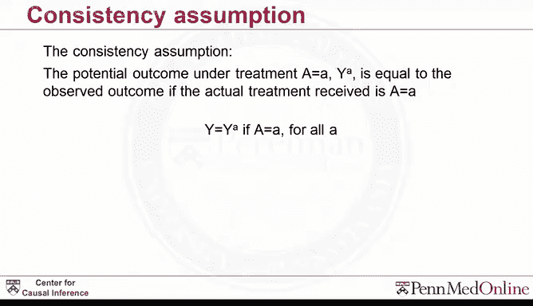

用公式表示即：
**Y = Yᵃ if A = a**

换句话说，如果个体实际接受的处理是 **a**，那么他观测到的结果就是他假设接受处理 **a** 时会出现的潜在结果。这个假设为所有可能的处理水平 **a** 建立了观测结果与潜在结果之间的直接对应关系。

---

## 可忽略性假设 🎲

可忽略性假设可能是我们将要讨论的最重要、最受关注的假设，有时也称为“无未测混杂”假设。

在建立了观测与潜在结果的直接联系后，我们面临的核心挑战是处理并非随机分配。本节引入的可忽略性假设旨在解决这个问题。

该假设的基本思想是：在给定一组处理前协变量 **X** 的条件下，处理分配 **A** 与潜在结果 **Y⁰, Y¹** 独立。

用公式表示即：
**(Y⁰, Y¹) ⫫ A | X**

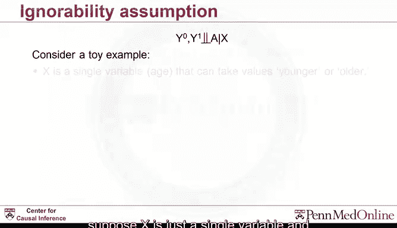

这里的符号 **⫫** 表示独立性。**X** 通常被认为是混杂变量集合。在实践中，处理可能分配给更年长或病情更重的人（即非随机），但一旦我们控制了诸如年龄、健康状况等变量（即 **X**），我们就可以认为处理近似于随机分配。

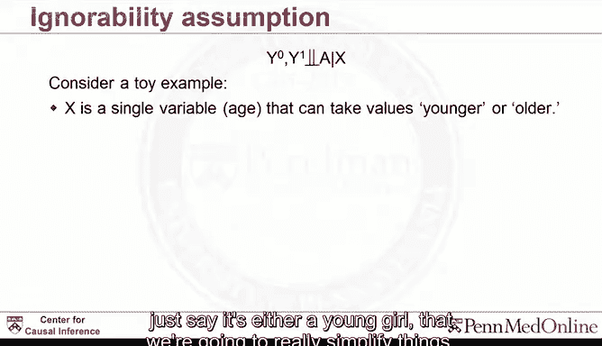

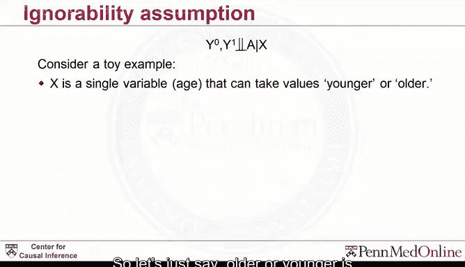

在具有相同 **X** 值的人群中，处理分配可以被视为与潜在结果无关。这里的“随机”特指与潜在结果独立，而不一定是其他意义上的随机。

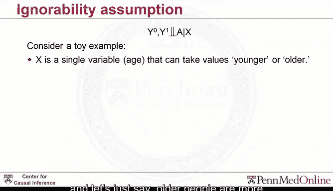

**示例**：假设 **X** 是“年龄”（简化为“年轻”或“年长”）。年长者更可能接受处理（A=1），同时年长者本身发生结果（如髋部骨折）的风险也更高，无论是否接受处理。在这种情况下，处理并非随机分配（边际上不独立）。但如果年龄是唯一影响处理分配和结果的变量，那么在“年轻”和“年长”这两个群体内部，处理分配可以看作是随机的。此时，我们说在给定年龄的条件下，处理分配是可忽略的。

这个假设之所以关键，是因为如果我们拥有足够多且正确的协变量 **X**，那么处理分配本身就不再是需要担心的因素，它变得“可忽略”，相当于实现了随机化。

---

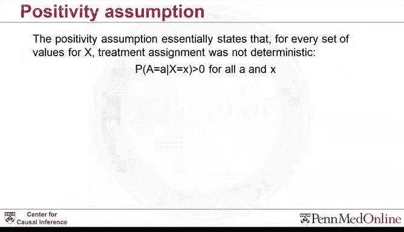

## 正值性假设 📊

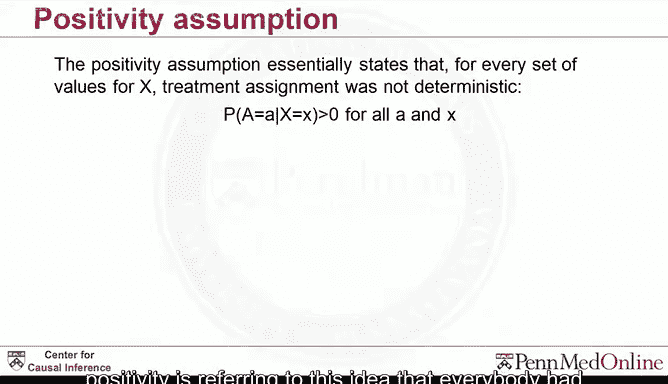

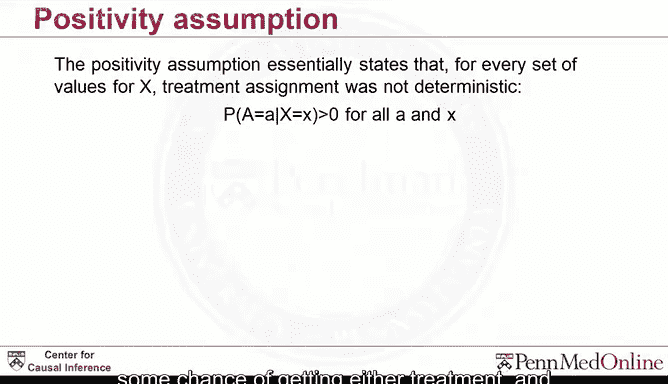

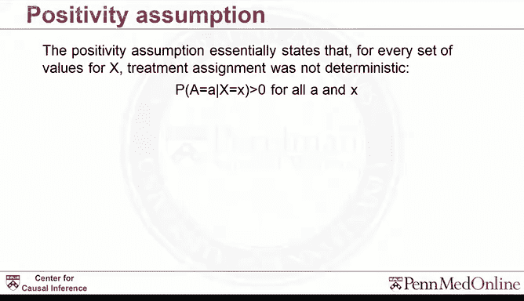

正值性假设指的是，每个人（在给定协变量 **X** 的条件下）都有一定的机会接受任何一种处理。

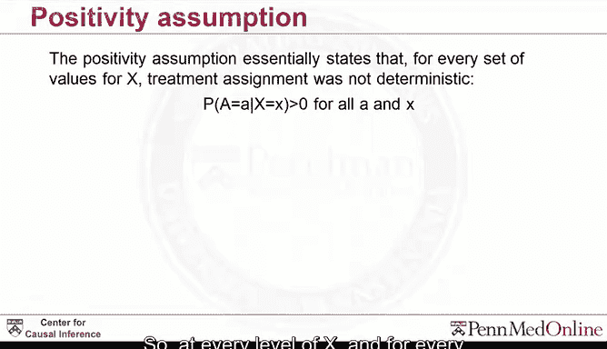

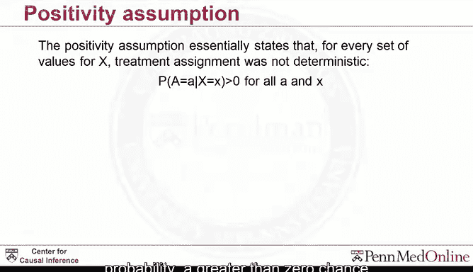

理解了可忽略性假设让我们能够在控制X后视处理为随机，我们还需要确保有足够的数据来估计效应。这就是正值性假设的作用。

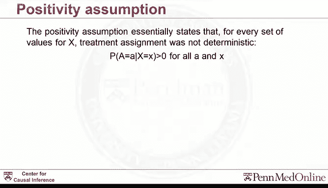

该假设要求：对于每一个协变量 **X** 的取值 **x** 和每一种处理 **a**，个体接受该处理的概率都大于零。

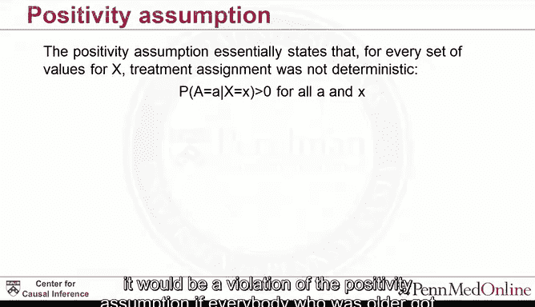

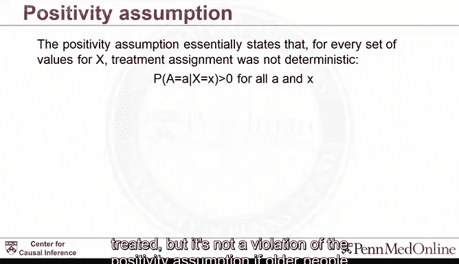

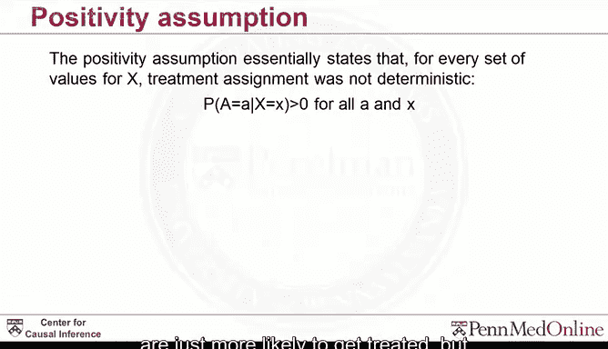

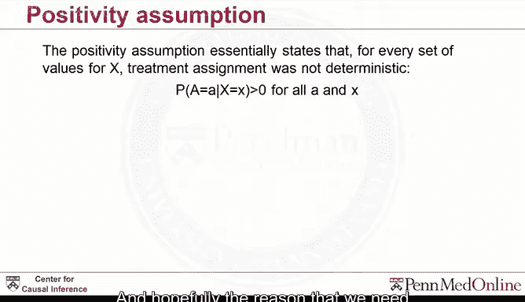

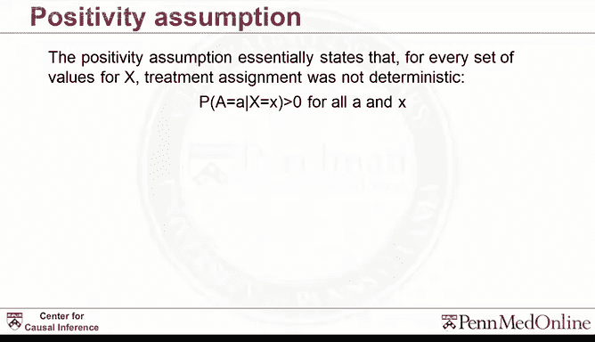

用公式表示即：
**P(A = a | X = x) > 0 for all a, x**

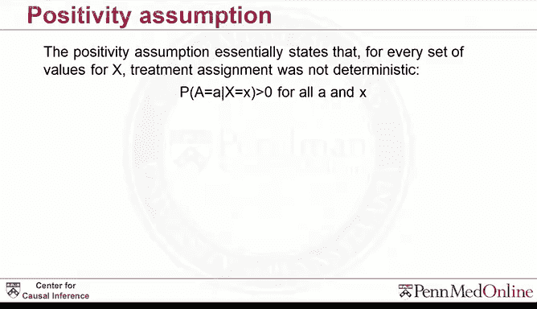

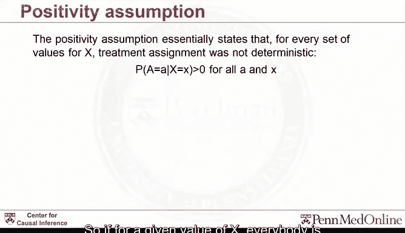

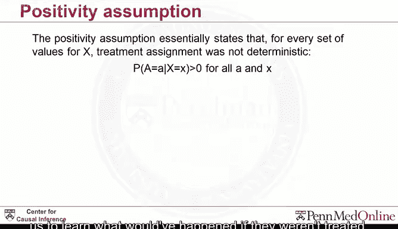

换句话说，处理不能是协变量 **X** 的确定性函数。以前面的年龄例子来说，如果所有年长者都接受了处理（概率为1），而所有年轻者都没接受处理（概率为0），这就违反了正值性假设。但如果年长者只是更可能接受处理，而年轻者也有机会接受处理，则不违反。

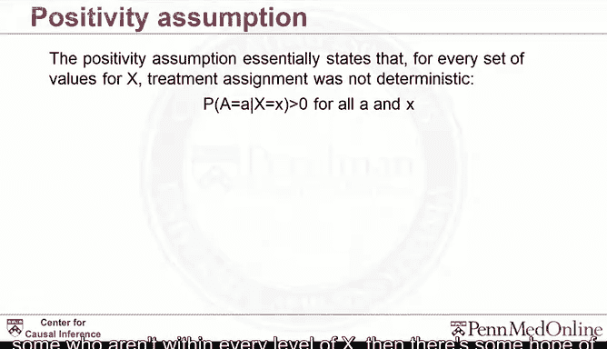

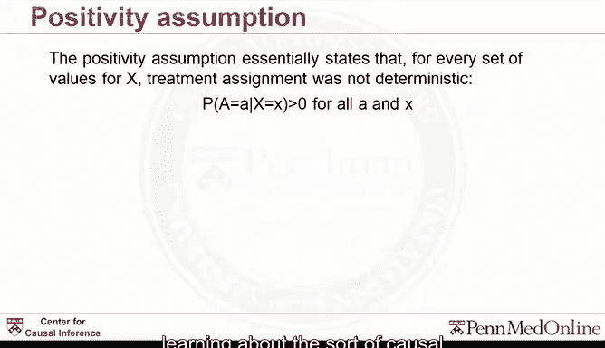

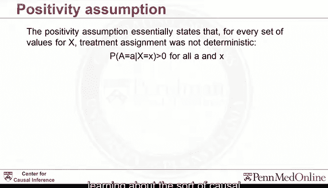

**我们需要这个假设的原因很明确**：为了了解在每种处理情境下会发生什么，我们需要数据。如果在某个 **X** 水平下，所有人都接受了处理，我们根本无法了解如果他们未接受处理会发生什么。只要在每个 **X** 水平下，都既有接受处理的人也有未接受处理的人，我们就有希望估计该群体内的因果效应。

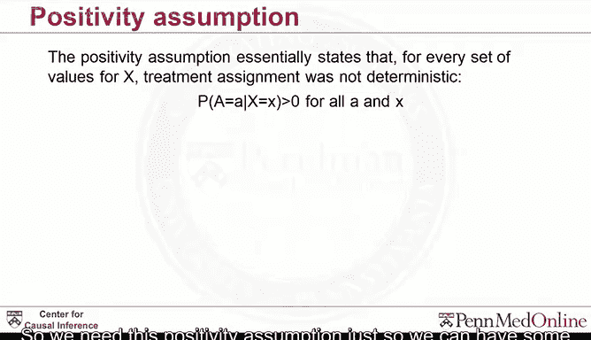

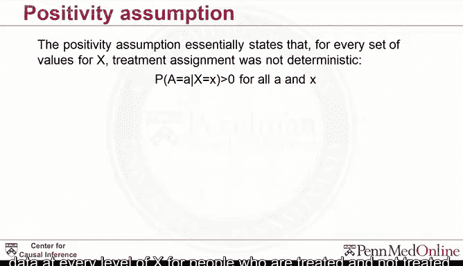

正值性假设也帮助我们定义了感兴趣的人群。如果有些人永远不可能接受某种处理，我们通常会将他们排除在研究之外，只对那些有机会接受处理的人群进行推断。总之，如果处理分配是完全确定的，我们将缺乏识别因果效应所需的数据。

---

## 利用假设连接观测数据与潜在结果 🔄

现在，我们将运用这些因果假设，正式建立观测数据与潜在结果之间的连接。

前面我们分别介绍了四个核心假设，本节我们将看到如何综合运用它们，从纯粹的观测数据表达式中推导出涉及潜在结果的表达式。

我们从仅涉及观测数据的一个期望值开始：
**E[Y | A = a, X = x]**
这表示在治疗 **A = a** 且协变量 **X = x** 的子群体中，观测结果 **Y** 的平均值。

**第一步：应用一致性假设**
根据一致性假设，当 **A = a** 时，观测结果 **Y** 等于潜在结果 **Yᵃ**。因此，上式等于：
**E[Yᵃ | A = a, X = x]**
至此，我们利用一致性假设，将纯观测表达式与潜在结果联系起来。

**第二步：应用可忽略性假设**
根据可忽略性假设，在给定 **X** 的条件下，处理分配 **A** 与潜在结果 **Yᵃ** 独立。这意味着，一旦条件于 **X**，再条件于 **A** 不会提供关于 **Yᵃ** 均值的额外信息。因此，我们可以去掉条件中的 **A**：
**E[Yᵃ | X = x]**
这一步完全依赖于可忽略性假设。

**第三步：获得边际因果效应**
我们最终感兴趣的往往是**边际因果效应**，即不条件于特定 **X** 值的总体平均效应（例如，潜在结果期望值的差 **E[Y¹] - E[Y⁰]**）。为了从 **E[Yᵃ | X = x]** 得到 **E[Yᵃ]**，我们需要对协变量 **X** 的分布进行积分（或求和）：
**E[Yᵃ] = ∫ E[Yᵃ | X = x] dP(x)**
由于 **E[Yᵃ | X = x] = E[Y | A = a, X = x]**（通过前两步推导），我们最终得到：
**E[Yᵃ] = ∫ E[Y | A = a, X = x] dP(x)**
这个公式表明，潜在结果的总体平均值可以通过对观测数据中条件期望值按协变量分布进行加权平均来获得。

---

## 总结

本节课我们一起学习了因果推断的四个核心基础假设：
1.  **稳定单元处理值假设**：包含无干扰性和单一版本处理，它简化了潜在结果的定义，使其仅依赖于个体自身的处理状态。
2.  **一致性假设**：直接建立了实际接受的处理所对应的观测结果与潜在结果之间的等价关系。
3.  **可忽略性假设**：这是最关键的一步，它假定在控制了足够的预处理协变量后，处理分配与潜在结果独立，相当于在协变量条件下实现了随机化。
4.  **正值性假设**：确保在每一个协变量组合下，都有个体接受每一种处理，从而为我们提供了估计因果效应所需的数据支持。

最后，我们看到了如何综合运用**一致性**和**可忽略性**假设，从一个纯粹的观测数据表达式出发，逐步推导出与潜在结果相关的表达式，并最终通过积分得到我们关心的边际因果效应。这些假设是连接理论与现实、从观测数据中识别因果效应的基石。