# 7：因果推断速成课 - 分层法 📊

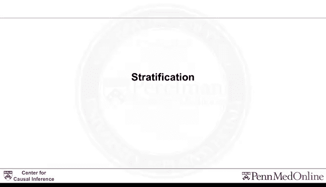

在本节课中，我们将学习一种估计因果效应的方法：**分层法**。我们将探讨如何通过分层和标准化来识别因果效应，并了解这种方法的局限性，以及为什么在实际应用中我们通常需要其他更复杂的因果推断方法。

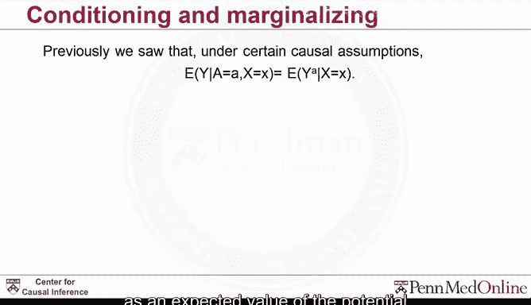

---

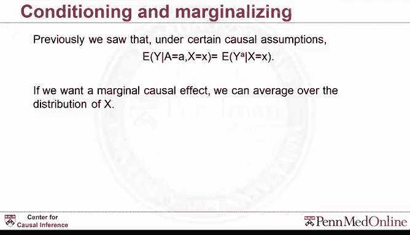

## 分层与边际化：标准化的核心

上一节我们介绍了如何将观测结果与潜在结果联系起来。本节中，我们来看看如何通过**分层**和**边际化**来估计**边际因果效应**。

我们通常感兴趣的因果效应是**边际因果效应**，即不依赖于特定协变量 `X` 的效应。例如，平均因果效应定义为：
```
E[Y¹] - E[Y⁰]
```
注意，这个公式中**没有**条件于 `X`。

为了从条件于 `X` 的期望值得到我们想要的边际期望值，我们需要对协变量 `X` 的分布进行平均。这个过程被称为**标准化**。

标准化的核心公式如下：
```
E[Yᴬ] = Σₓ { E[Y | A=a, X=x] * P(X=x) }
```
其中：
*   `E[Yᴬ]` 是我们想得到的潜在结果 `Yᴬ` 的期望值。
*   `E[Y | A=a, X=x]` 是在治疗 `A=a` 且协变量 `X=x` 的子群体中，观测结果 `Y` 的期望值。这是我们可以从数据中计算出来的。
*   `P(X=x)` 是协变量 `X` 在总体中的边际分布概率。
*   `Σₓ` 表示对所有 `X` 的可能取值求和。

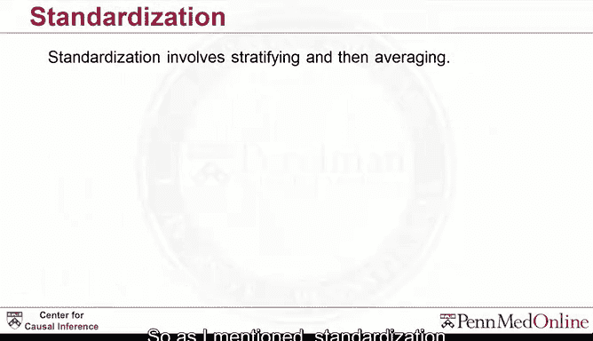

**简单来说，标准化就是先按重要变量分层计算效应，然后按照这些变量在总体中的分布进行加权平均。**

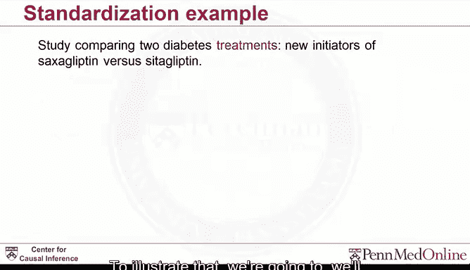

---

## 一个实例：糖尿病药物比较 💊

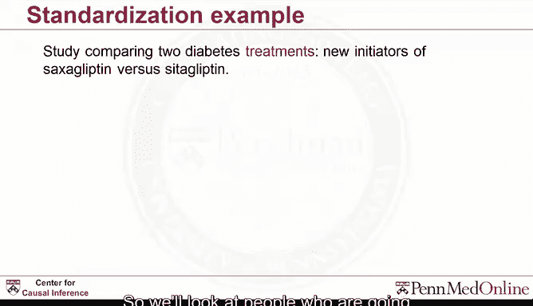

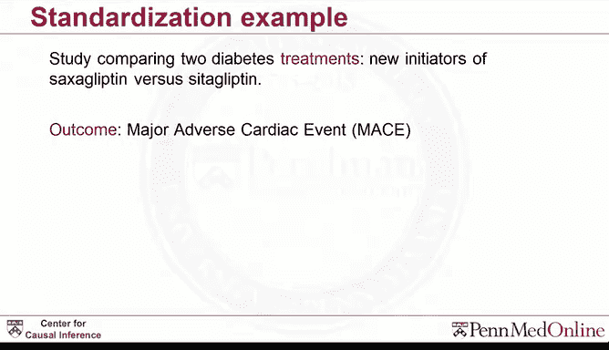

为了说明标准化的过程，我们来看一个假设的例子。

我们的研究人群是糖尿病患者，我们想比较两种口服降糖药：**沙格列汀**（较新）和**西格列汀**。结局指标是主要不良心脏事件。

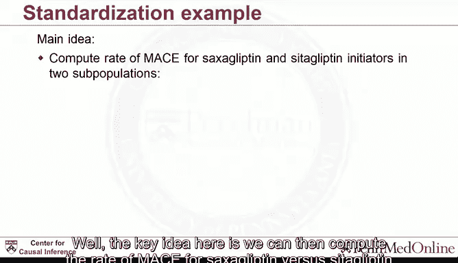

一个挑战是：使用沙格列汀的患者更可能有其他口服降糖药的使用史。而有此历史的患者本身发生心脏事件的风险就更高。如果不考虑这个因素，直接比较可能会产生误导。

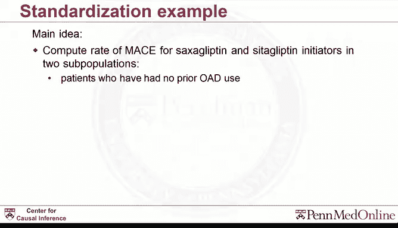

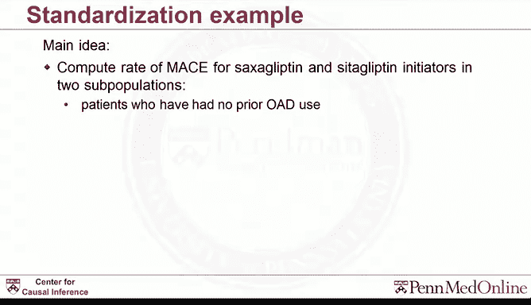

以下是处理这个问题的步骤：

### 第一步：按关键变量分层

我们的关键变量 `X` 是“是否有其他口服降糖药使用史”。我们按此将总体分为两层：
1.  无使用史组
2.  有使用史组

然后，我们在每一层内分别计算两种药物的心脏事件发生率。

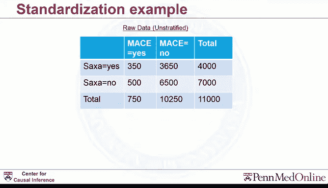

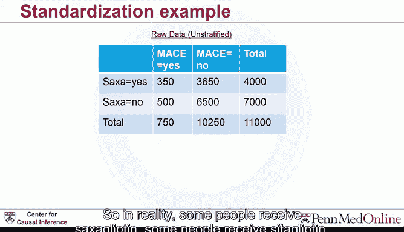


以下是原始数据汇总表（未分层）：
| 治疗 (A) | 发生MACE (Y=1) | 未发生MACE (Y=0) | 总计 | P(Y=1 \| A) |
| :--- | :---: | :---: | :---: | :---: |
| 沙格列汀 (A=1) | 350 | 3650 | 4000 | 350/4000 = 8.8% |
| 西格列汀 (A=0) | 500 | 6500 | 7000 | 500/7000 ≈ 7.1% |

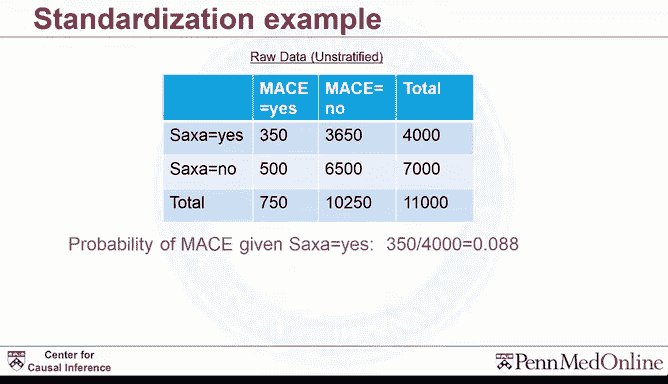

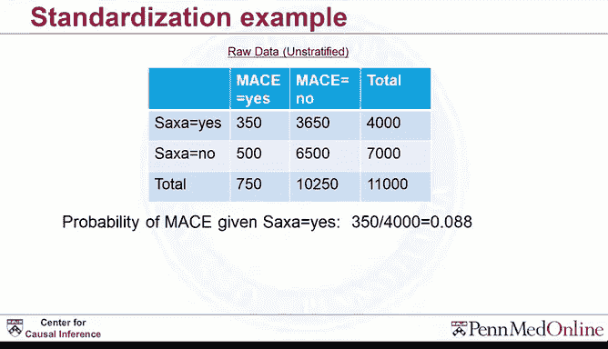

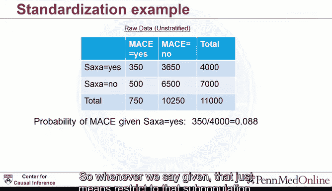

*粗看之下，沙格列汀组的事件率（8.8%）高于西格列汀组（7.1%）。但这可能是因为沙格列汀更多地用在了高风险（有用药史）患者身上。*


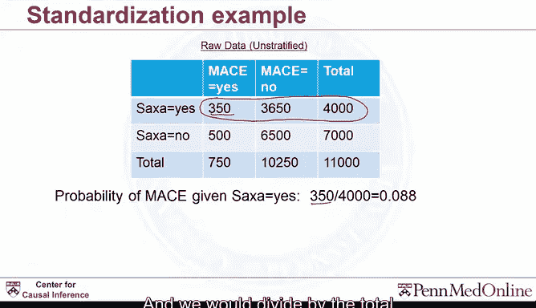

### 第二步：计算层内条件期望

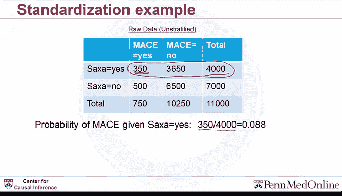

现在，我们按“是否有用药史”进行分层，得到两个子表。

**分层数据：**
*   **无用药史组 (X=0)**
    | 治疗 (A) | Y=1 | Y=0 | 总计 | P(Y=1 \| A, X=0) |
    | :--- | :---: | :---: | :---: | :---: |
    | 沙格列汀 | 50 | 950 | 1000 | 50/1000 = 5.0% |
    | 西格列汀 | 200 | 3800 | 4000 | 200/4000 = 5.0% |

*   **有用药史组 (X=1)**
    | 治疗 (A) | Y=1 | Y=0 | 总计 | P(Y=1 \| A, X=1) |
    | :--- | :---: | :---: | :---: | :---: |
    | 沙格列汀 | 300 | 2700 | 3000 | 300/3000 = 10.0% |
    | 西格列汀 | 300 | 2700 | 3000 | 300/3000 = 10.0% 

**关键发现：** 在每一层内部（即控制了用药史 `X` 后），沙格列汀和西格列汀的心脏事件发生率**完全相同**（无史组均为5%，有史组均为10%）。这表明，在控制了混淆变量 `X` 后，两种药物的效果没有差异。

---

### 第三步：边际化（标准化）

上一节我们得到了层内的条件期望。本节中，我们通过边际化来得到我们最终关心的**边际潜在结果期望值** `E[Yᴬ]`。

我们以计算“若所有人都服用沙格列汀”的潜在结果期望 `E[Y¹]` 为例。根据标准化公式：
```
E[Y¹] = E[Y|A=1,X=1] * P(X=1) + E[Y|A=1,X=0] * P(X=0)
```

我们从数据中填入各个部分：
1.  `E[Y|A=1,X=1]` = 300/3000 = 0.10
2.  `P(X=1)` = (3000+3000) / 11000 = 6000/11000 ≈ 0.545
3.  `E[Y|A=1,X=0]` = 50/1000 = 0.05
4.  `P(X=0)` = (1000+4000) / 11000 = 5000/11000 ≈ 0.455

代入计算：
```
E[Y¹] = (0.10 * 0.545) + (0.05 * 0.455) ≈ 0.0545 + 0.02275 = 0.07725 ≈ 7.7%
```

同理，我们可以计算“若所有人都服用西格列汀”的潜在结果期望 `E[Y⁰]`，过程完全对称，结果同样是 **7.7%**。

因此，边际平均因果效应为：
```
ACE = E[Y¹] - E[Y⁰] = 7.7% - 7.7% = 0
```
这证实了两种药物在总体上的效果没有差异。

---

## 标准化方法的局限性 🚧

虽然标准化的概念清晰有效，但在实践中面临一个重大挑战：**维度灾难**。

在实际的观察性研究中，为了满足“给定 `X` 后治疗可忽略”的假设，我们通常需要控制**许多**协变量（如年龄、血压、多种病史、生活习惯等）。

如果我们尝试对所有变量组合进行分层，很快就会遇到**大量空单元格**的问题。也就是说，许多协变量值的组合在样本中根本不存在或只有极少数个体，导致我们无法在该层内可靠地计算 `E[Y|A, X]`，从而使得标准化无法进行。

> 例如，同时按年龄（20-80岁，每岁一层）和血压（几十个分层）进行分层，会产生上千个格子，很多格子里面可能根本没有数据。

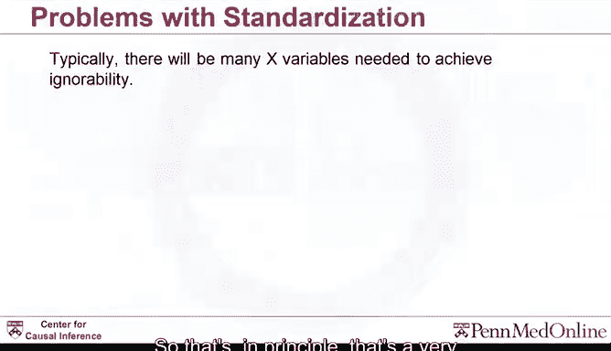

因此，我们需要能够处理高维协变量 `X` 的替代方法。

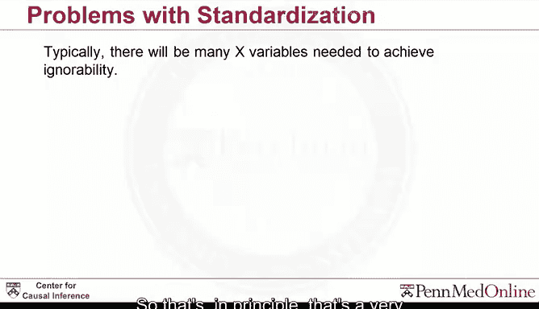

---

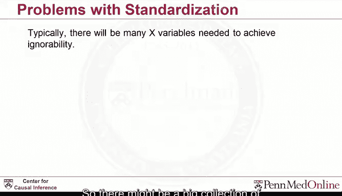

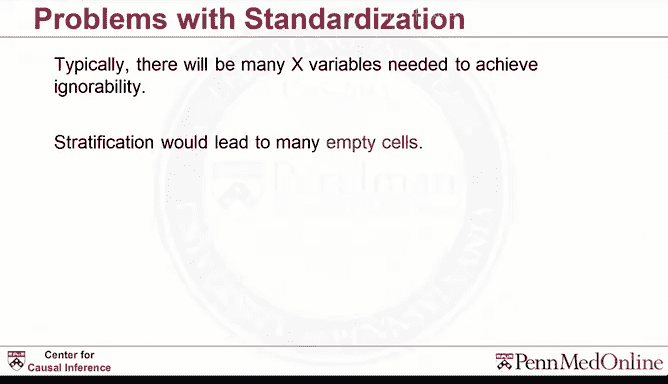

## 总结与展望 📝

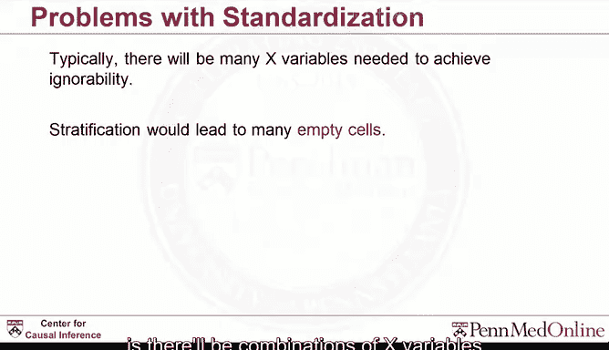

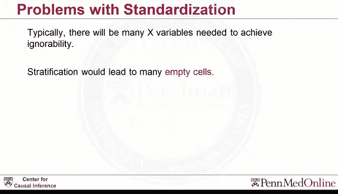

本节课中我们一起学习了：
1.  **分层与标准化**是估计边际因果效应的一种基础方法。其核心是**先按混淆变量分层计算条件效应，再按该变量的总体分布进行加权平均**。
2.  我们通过一个糖尿病药物比较的实例，一步步演示了如何通过分层发现粗比较中的偏差，并通过标准化得到无偏的因果效应估计。
3.  标准化方法在理论上是理想的，但在实践中因**维度灾难**而难以直接应用，当需要控制的变量很多时，会出现数据稀疏或空单元格的问题。

正因为标准化的这一局限性，在后续课程中，我们将探索其他更适用于现实复杂数据的因果推断方法，例如：
*   匹配法
*   逆概率加权法
*   倾向得分法
*   工具变量法

这些方法的核心思想，依然是为了实现某种形式的“标准化”，但通过更精巧的统计手段来克服高维数据的挑战。