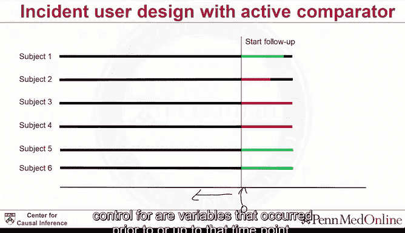

# 8：新用户与主动比较器设计 🎯

在本节课中，我们将聚焦于两种重要的研究设计：**新用户设计**（Incident User Design）和**主动比较器设计**（Active Comparator Design）。我们将学习它们的基本概念、解决的问题，以及如何通过它们来减少混杂偏倚。

---

## 从横截面视角看治疗

上一节我们讨论了混杂因素，本节中我们来看看研究设计如何帮助我们应对挑战。首先，思考一种常见的观察方式：**横截面观察**。这意味着在某个特定时间点，对人群进行“快照”式观察。此时，一些人可能正在接受治疗，而另一些人则没有。

例如，假设我们想研究练习瑜伽对血压的因果效应。我们可能有一个群体，其中一部分人练习瑜伽，另一部分人不练习。这就是横截面观察：我们只关注当前谁在练习，而不考虑他们过去的治疗历史。

对于当前不练习瑜伽的人，他们可能过去练习过，也可能从未练习过。对于当前正在练习的人，他们可能是长期练习者，也可能是初学者。这带来了一个问题：对于那些过去练习过但现在停止的人，他们为何停止？也许瑜伽让某些人感到焦虑，导致他们停止练习。这些可能因瑜伽而血压升高的人最终退出了研究。此外，长期练习者与初学者或从未开始者可能存在很大差异。这种仅观察当前治疗状态（是或否）而不考虑完整历史的方法，会引入各种难以控制的**选择偏倚**。

---

## 新用户设计：聚焦于治疗起始

为了解决上述问题，我们可以采用**新用户设计**（也称为新起始者设计）。这种设计的基本思想是，只关注**新近开始治疗**的人群，而不是所有当前正在治疗的人（无论治疗了多久）。

在瑜伽的例子中，我们感兴趣的是那些**开始练习瑜伽**的人，并在他们开始后的一个预定时间点观察其结局（如血压）。这样，我们关注的因果问题就变成了：**在从未练习过瑜伽的人群中，开始练习瑜伽的因果效应是什么？** 通过将问题略微调整为关注“起始治疗”的效应，我们实际上获得了一个更清晰、更少偏倚的研究问题。

以下是新用户设计的关键优势：
*   **消除遗留效应**：避免了因过去治疗可能产生的持续效应（如长期练习者停止后仍受益）带来的混淆。
*   **减少选择偏倚**：避免了因治疗无效而停止治疗的人群与持续治疗人群混合造成的偏倚。

然而，新用户设计的一个挑战是：**如何确定对照组（未治疗组）的随访起始时间（时间零点）？** 对于治疗组，时间零点很明确，即他们开始治疗的时刻。但对于未治疗组，确定一个可比的时间零点则不那么直接，通常需要通过匹配基线特征等方法来解决。

---

## 主动比较器设计：比较两种主动干预

另一种强大的设计是**主动比较器设计**。在这种设计中，我们不将治疗组与“无治疗”组比较，而是与接受**另一种主动干预或治疗**的组进行比较。

在瑜伽的例子中，我们可能将瑜伽与另一种健身课程（如尊巴舞）进行比较。我们感兴趣的问题是：**瑜伽与尊巴舞相比，哪种更有益？** 这是一个两种主动干预的直接比较。

主动比较器设计的一个主要优点是能**显著减少混杂**。比较练习瑜伽的人和完全不运动的人，两组人可能差异很大。但比较选择两种不同健身课程（瑜伽 vs. 尊巴舞）的人，他们在健康意识、生活方式等方面可能更为相似。在药物研究的例子中，比较两种不同的降压药（如袢利尿剂 vs. ACE抑制剂）的患者，比比较用药者与不用任何降压药者，两组患者的基线特征通常更接近。

需要注意的是，主动比较器设计也**改变了因果问题**。它回答的是一个更具体、更狭窄的问题：**两种特定主动治疗之间的相对效应**，而不是治疗与“无治疗”之间的绝对效应。选择哪种设计，取决于你真正想回答的科学问题。

---

## 强强联合：新用户设计 + 主动比较器设计

在实践中，我们可以将**新用户设计与主动比较器设计结合起来**，这通常能产生非常稳健的因果推断。在这种联合设计中：
1.  我们只纳入在某个时间点**新开始**两种治疗中任何一种的患者。
2.  在治疗起始时间（时间零点），所有患者都**未使用过**这两种治疗中的任何一种。
3.  从时间零点开始，患者开始接受治疗A或治疗B，我们对其进行随访。

这种设计确保了治疗组和对照组在治疗起始前具有可比的治疗史（均为“新用户”），并且由于比较的是两种主动干预，基线特征的差异可能更小，从而进一步减少了混杂偏倚。

---

## 设计的局限性与扩展

最后，我们需要认识到这些设计并非适用于所有情况。

以下是新用户与主动比较器设计的一些局限性：
*   **无法实施新用户设计**：对于某些暴露（如空气污染），可能不存在“零暴露”的时期，因此无法定义“新用户”。
*   **科学问题不匹配**：研究者可能真正感兴趣的就是与“未暴露”组进行比较（例如，吸烟者 vs. 完全不接触烟草者），而不是与另一种主动暴露比较。
*   **关注点不同**：本节课我们主要关注**治疗起始**这个“时点治疗”的设定。但因果推断中也有方法可以处理**随时间变化的治疗**（例如，持续治疗一整年 vs. 从不治疗），这涉及更复杂的时变处理效应分析。

---

## 总结

本节课我们一起学习了两种重要的观察性研究设计：
1.  **新用户设计**：通过聚焦于新开始治疗的患者，避免了长期治疗者、治疗遗留效应和因无效而停止治疗带来的选择偏倚。
2.  **主动比较器设计**：通过比较两种主动干预，利用两组患者在健康意识、求医行为等方面的相似性，有效减少了混杂偏倚。

将两者结合使用，即在新用户中比较两种主动治疗，是实践中进行因果推断非常有力且常用的策略。选择何种设计，最终取决于你想要回答的具体因果问题。