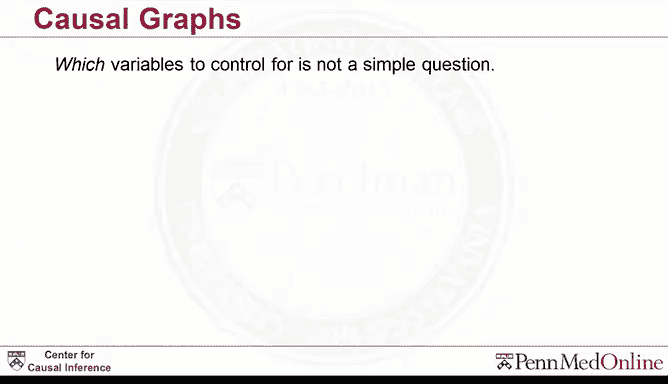

# 课程09：混杂因素与可忽略性 🧩

在本节课中，我们将学习因果推断中的一个核心概念：混杂因素。我们将探讨什么是混杂因素，它如何与“可忽略性”假设相关联，并了解为什么我们需要借助因果图来帮助我们识别和控制混杂因素。

---

## 什么是混杂因素？

上一节我们介绍了潜在结果和平均因果效应的概念。为了从观测数据中估计因果效应，我们需要做出一些假设，其中最关键的一个就是**可忽略性假设**。

可忽略性假设是指，在给定一组协变量 **X** 的条件下，治疗分配与潜在结果独立。用公式表示如下：
`(Y(1), Y(0)) ⟂ A | X`
其中，`Y(1)` 和 `Y(0)` 是潜在结果，`A` 是治疗分配。

如果这个假设成立，就意味着在具有相同 **X** 值的个体中，治疗分配就像是随机的，这使我们能够进行有效的因果推断。

---

## 混杂因素的定义与示例

混杂因素是那些同时影响**治疗分配**和**结果**的变量。这里“影响结果”是指独立于治疗之外的影响，而不是通过影响治疗来间接影响结果。

以下是几个例子，帮助我们理解什么变量是或不是混杂因素：

**以下是三种常见情况的分析：**

1.  **不是混杂因素：仅影响治疗**
    *   **示例**：假设治疗分配完全随机，比如通过抛硬币决定。
    *   **分析**：抛硬币这个机制只决定了谁接受治疗，但本身不会影响健康结果。因此，它不是混杂因素。

2.  **不是混杂因素：仅影响结果（风险因素）**
    *   **示例**：有癌症家族史的人，未来患癌（结果）的风险更高。但家族史并不影响他们是否接受某种特定治疗的决定。
    *   **分析**：这个变量只影响结果，不影响治疗分配。这类变量通常被称为**风险因素**，而不是混杂因素。它们不会破坏可忽略性假设。

3.  **是混杂因素：同时影响治疗和结果**
    *   **示例**：年龄较大的人，患心血管疾病（结果）的风险更高，同时他们也更可能被处方他汀类药物（治疗）。
    *   **分析**：年龄同时影响了接受治疗的可能性和健康结果本身。如果不控制年龄，我们就会错误地将结果差异全部归因于治疗。因此，年龄在这里是一个**混杂因素**。

---

## 混杂因素控制的目标

基于以上理解，我们在进行因果推断时的核心任务之一就是**混杂因素控制**。这主要包含两个层面：

**以下是混杂因素控制的三个关键步骤：**

1.  **识别变量集合 X**：找到一组协变量 **X**，使得在给定 **X** 后，可忽略性假设成立。也就是说，**X** 需要包含所有重要的混杂因素。
2.  **应用统计方法**：在确定了合适的 **X** 后，我们需要使用相应的统计方法（如回归、匹配、加权等）来估计控制这些混杂因素后的因果效应。这将是本课程后续的重点。
3.  **借助因果图**：识别出正确的变量集合 **X** 并非易事。我们将在未来的视频中引入**因果图**这一工具。因果图能以可视化的方式清晰展现变量间的因果关系，帮助我们系统性地识别出哪些变量必须被控制，哪些不需要，从而更科学地满足可忽略性假设。

---

## 总结

本节课中，我们一起学习了混杂因素的核心概念。我们明确了混杂因素是同时影响治疗和结果的变量，理解了它如何与可忽略性假设相关联，并认识到控制混杂因素对于获得无偏因果估计至关重要。最后，我们了解到，因果图将是帮助我们完成混杂因素识别这一关键任务的有力工具。在接下来的课程中，我们将深入探讨因果图的具体应用。