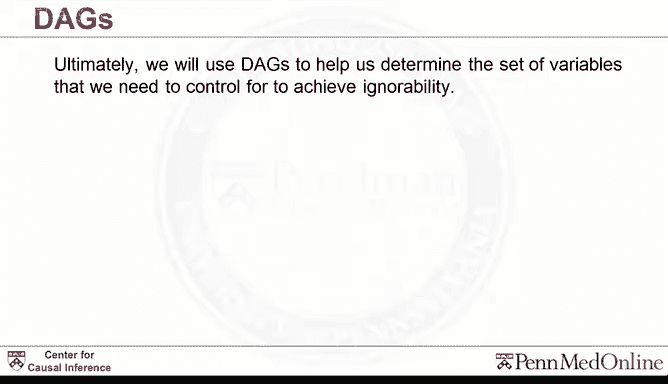

# 10：因果图入门 🧭

在本节课中，我们将学习因果图的基本概念。我们将熟悉相关术语，并开始理解变量之间“路径”的含义。因果图是进行因果推断的有力工具，它能帮助我们明确需要控制哪些变量，并使我们的研究假设变得清晰可见。

## 什么是因果图？ 📊

上一节我们介绍了课程目标，本节中我们来看看因果图究竟是什么。

因果图，在因果推断文献中通常特指**有向无环图**，它是用于表示变量间因果关系的一种图形模型。它之所以有用，是因为它能帮助我们识别需要控制哪些变量以消除混杂偏倚，并以直观的方式将我们的假设明确呈现出来。

## 图形模型基础

接下来，我们通过一些简单的图形来理解核心概念。

首先，我们来看两个变量A和Y。它们被称为**节点**或**顶点**，可以代表单个变量，也可以代表一组变量。节点之间的连线称为**边**。

*   **有向图**：如果节点之间的边是箭头，例如 `A → Y`，则表示A直接影响Y。这构成了一个**有向路径**。
*   **无向图**：如果节点之间的边只是一条线，例如 `A — Y`，则表示A和Y之间存在关联，但因果方向未知。

图形模型编码了关于变量间关系的假设。它们能告诉我们变量是否相互独立、是否存在依赖关系或条件独立性。重要的是，它们还能用于推导非参数的因果效应估计量。

## 关键术语与路径

现在，让我们引入更多术语来理解更复杂的图形。

请看一个包含四个节点（W, Z, A, B）的图。**路径**是指沿着边从一个顶点到达另一个顶点的路线。例如，从W到B可能有两条路径：`W → Z → B` 或 `W → Z → A → B`。而从Z到W只有一条路径：`Z → W`。

## 什么是有向无环图？

我们之前提到了有向无环图，现在来详细定义它。顾名思义，它必须满足两个条件：

1.  **有向**：所有边都必须是有方向的箭头。
2.  **无环**：图中不能存在循环。例如，`A → B → Z → A` 这样的循环是不允许的。

一个合格的有向无环图，其所有连接都是箭头，并且没有任何路径能让你从某个节点出发，沿着箭头方向最终又回到该节点。

在后续课程中，当我们提到“因果图”时，指的都是有向无环图。

## 节点关系：父母、子女、祖先与后代

为了描述图中节点的关系，我们使用一套类似家族树的术语。这些概念应该很容易理解：

*   **父母**：如果一个节点有箭头直接指向另一个节点，那么它就是后者的父母。例如，在 `A → Z` 中，A是Z的父母。
*   **子女**：承接箭头的节点就是发出箭头节点的子女。例如，Z是A的子女。
*   **祖先与后代**：通过一连串的箭头路径，可以定义更远的亲属关系。如果A是Z的父母，而Z是D的父母，那么A就是D的**祖先**，D就是A的**后代**。

需要注意的是，在有向无环图中，一个节点可以有多个父母。例如，一个节点D可以同时有B和Z两个父母。

## 因果图的核心用途

正如之前提到的，我们将使用有向无环图来帮助我们确定，为了控制混杂（即实现**可忽略性**），我们需要调整哪些变量集合。

然而，在深入探讨如何具体操作之前，我们必须先理解有向无环图与概率分布之间的关系。这将是后续内容的基础。

---

**本节课中我们一起学习了**：因果图（特指有向无环图）的基本定义、图形表示方法以及关键术语（如节点、边、路径、父母、子女等）。我们了解到因果图能直观展示变量间的因果假设，并最终将用于指导我们选择需要控制的变量，以进行有效的因果推断。