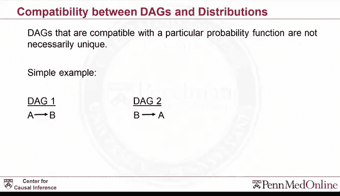

# 课程11：有向无环图与概率分布的关系 🔗📊

在本节课中，我们将学习有向无环图与概率分布之间的关系。我们将理解DAG如何编码关于概率分布的信息，并学习如何根据给定的DAG分解联合概率分布。

---

## DAG与概率分布

上一节我们介绍了有向无环图的基本概念。本节中，我们来看看DAG如何编码关于变量或节点（顶点）的假设。一个DAG会告诉我们哪些变量是相互独立的，哪些变量在给定条件下是独立的，以及如何分解和简化联合概率分布。

以下是一个示例图，包含四个节点（或变量集）：D、A、B和C。这是一个正确的有向无环图，因为图中只有有向路径。我们将探讨这个特定的DAG如何编码关于A、B、C和D联合分布的信息。你可以将A、B、C和D视为随机变量或随机变量集，它们必然有一个联合分布。这个DAG编码了关于该联合分布的假设。

那么，这个DAG具体告诉了我们什么？首先，它意味着在给定所有其他变量的条件下，C的条件分布等于C自身的概率。换句话说，C独立于所有其他变量。我们知道这一点是因为C是孤立的，没有任何变量影响它，它也不影响任何其他变量。因此，它是一个独立的随机变量。

其次，我们可以观察B的条件分布。B直接受A影响，间接受D影响（因为D影响A，A再影响B）。因此，在给定所有其他变量（C、D、A）的条件下，真正重要的是A。只要我们知道A，我们就知道了关于B概率的一切信息。D不会提供额外信息，因为D的影响已通过A体现。此外，C与B无关。因此，我们可以将条件分布简化为只依赖于A。

此外，D和B是边际相关的，因为D影响A，A再影响B。因此，它们不是边际独立的，而是相互关联的。这是我们可以从图中学到的另一个信息。

最后，考虑D的条件分布。我们可以将其简化为只依赖于A，因为B与D的关系也仅通过A。只要我们对A进行条件化，我们就知道了关于D所需的一切信息。C仍然是孤立的。

这些例子展示了如何从DAG中了解概率分布。为了更清晰地理解这些概念，我们来看另一个例子。

---

## 另一个DAG示例

考虑另一个DAG示例。在这个图中，如果我们观察A的条件分布，可以将其简化为只依赖于D，因为只有D直接影响A。因此，只要我们对D进行条件化，我们就知道了关于A的一切信息。

接下来，考虑D的条件分布。在这种情况下，我们可以从条件中剔除C，但仍需对A和B进行条件化。这意味着在给定B的条件下，D与C独立。为什么可以剔除C？因为一旦我们对B进行条件化，C就无法提供关于A的间接信息。C本身受B影响，但既然我们已经对B进行了条件化，C就不会提供新的信息。然而，我们需要对A和B都进行条件化，因为D直接影响A和B，所以A和B都能独立地提供关于D的信息。

现在，我们在图中添加一条从A指向C的箭头。这会产生什么影响？观察A的条件分布，现在我们可以从条件中剔除B，但需要保留C和D。A与B在给定C和D的条件下是独立的。因为D直接影响A，A直接影响C，所以我们需要对它们进行条件化。B仅通过其他变量（这些变量我们已经条件化了）与A间接相关，因此可以剔除B。

同样地，观察D的条件分布，我们只需要对A和B进行条件化，C不会提供关于D分布的新信息。因为从D到C的所有路径都经过A或B，而我们已经对这些变量进行了条件化。因此，在给定A和B的条件下，D与C是条件独立的。

---

## 联合分布的分解

上一节我们了解了DAG如何编码条件独立性。本节中，我们来看看如何根据DAG分解联合概率分布。给定一个DAG，我们可以通过依次仅对父节点集进行条件化来分解联合分布。

具体步骤如下：
1.  从根节点（没有父节点的节点）开始。
2.  沿着后代线进行，始终对父节点进行条件化。

让我们通过一个例子来明确这个过程。在这个例子中，有两个根节点：C和D。根节点是没有父节点的节点，因此C和D是根节点。我们从它们开始分解联合分布。

联合分布是P(A, B, C, D)。根据上述步骤，我们首先处理根节点。根节点是独立的随机变量，因此我们有P(C)和P(D)。接下来，我们寻找这些根节点的子节点。C没有子节点，因此处理完毕。D有一个子节点A，因此我们乘以P(A|D)。然后，我们寻找A的子节点，即B，因此乘以P(B|A)。最终，联合分布被分解为：
`P(A, B, C, D) = P(C) * P(D) * P(A|D) * P(B|A)`

这个分解是由DAG所隐含的。当然，这个分解并非普遍成立，但如果DAG是正确的，那么这就是联合分布的一个恰当分解。

为了更清楚地理解，我们来看另一个例子。在这个图中，只有一个根节点D。因此，我们从P(D)开始。接下来，寻找D的子节点，即A和B。因此，我们乘以P(A|D)和P(B|D)。然后，寻找A和B的子节点。A没有子节点，B有一个子节点C。因此，我们乘以P(C|B)。最终，联合分布被分解为：
`P(A, B, C, D) = P(D) * P(A|D) * P(B|D) * P(C|B)`

最后，我们在图中添加一条从A指向C的箭头。现在，C有两个父节点：A和B。因此，当我们处理C时，需要对它的两个父节点进行条件化。分解变为：
`P(A, B, C, D) = P(D) * P(A|D) * P(B|D) * P(C|A, B)`

我们可以看到，DAG直接告诉了我们如何分解联合分布。

---

## DAG与分布的兼容性

因此，DAG与分布之间存在一种兼容性。回到这个特定的DAG，它隐含了一个特定的分解。我们可以认为这个概率分解与这个特定的DAG是兼容的。如果我从这个联合分布的特定分解开始，然后你向我展示这个DAG，我会说它们是兼容的，即该分解与该图兼容。

接下来，我们将反过来看。特定的概率函数不一定隐含唯一的DAG。这里有一个简单的例子，涉及两个DAG。第一个DAG包含两个节点A和B，箭头从A指向B，表示A影响B。第二个DAG包含相同的两个节点，但箭头从B指向A，表示B影响A。这两个DAG传达了不同的信息：第一个表示A影响B，第二个表示B影响A。但它们都告诉我们A和B是相关的。

然而，假设我不是从DAG开始，而是从某个概率陈述开始。例如，假设我告诉你P(A, B) ≠ P(A)P(B)，这表示A和B是相关的，或者说A和B不是独立的。如果你从这个陈述开始，你可以画出DAG1或DAG2，但你不知道哪个是正确的。两个DAG都与这个概率陈述兼容。因此，概率陈述并不隐含唯一的DAG。相反，如果你从一个特定的DAG开始，它会隐含某些关于概率陈述的信息。

---

## 总结

本节课中，我们一起学习了有向无环图与概率分布之间的关系。我们了解到DAG可以编码变量之间的条件独立性，并指导我们如何将复杂的联合概率分布分解为更简单的条件概率的乘积。同时，我们也认识到，一个概率关系可能对应多个兼容的DAG结构，这体现了因果推断中从数据到模型的不唯一性。掌握这些关系是理解后续更复杂因果模型的基础。