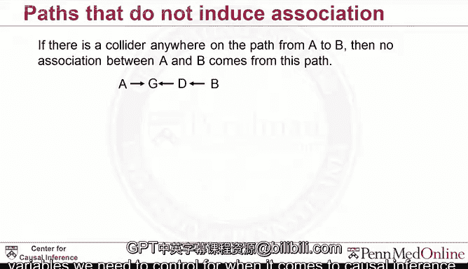

# 12：路径与关联 🔗


在本节课中，我们将学习因果图模型中路径的基本类型，并理解不同类型的路径如何影响变量之间的关联关系。我们将重点探讨哪些路径能传递信息并导致变量关联，哪些路径则不能。

## 路径的类型 🛤️

上一节我们介绍了因果图的基本概念，本节中我们来看看连接图中两个节点的路径有哪些主要类型。理解这些类型是分析变量间关联的基础。

以下是三种基本的路径结构：

1.  **分叉路径**
    在这种结构中，一个中间变量 **E** 同时影响两个外部变量 **D** 和 **F**。其结构类似于一个叉子，信息从 **E** 流向 **D** 和 **F**。
    ```
    D ← E → F
    ```

2.  **链式路径**
    在这种结构中，变量按顺序影响下一个变量，形成一个链条。例如，**D** 影响 **E**，**E** 再影响 **F**，信息沿着一个方向流动。
    ```
    D → E → F
    ```

3.  **对撞路径**
    这种结构与分叉路径相反，两个外部变量 **A** 和 **B** 共同影响一个中间变量 **G**。箭头指向 **G**，看起来像信息在此对撞。
    ```
    A → G ← B
    ```

## 路径如何诱导关联 🤝

理解了路径的类型后，我们现在来看看这些路径何时会导致路径两端的变量（例如 **A** 和 **B**）相互关联。关联意味着它们不是独立的，一个变量的信息可以通过路径传递到另一个变量。

以下是能诱导关联的路径示例：

*   **分叉路径（含共同原因）**
    当路径中存在一个共同原因（如 **E**）影响两端的 **A** 和 **B** 时，信息从 **E** 流向两者。因此，**A** 和 **B** 会通过 **E** 而相互关联（不独立）。
    ```
    A ← E → B
    ```

*   **链式路径（信息流）**
    在链式路径中，信息可以从一端流向另一端。例如，**A** 影响 **G**，**G** 再影响 **B**，那么 **A** 的信息就能传递到 **B**，导致两者关联。
    ```
    A → G → B
    ```

接下来，我们看看不会诱导关联的路径。关键在于路径中是否存在“对撞器”。

以下是不会诱导关联的路径示例：

*   **对撞路径**
    在对撞路径 `A → G ← B` 中，**A** 和 **B** 的信息都流向 **G** 并在此“对撞”。没有信息从 **G** 流回 **A** 或 **B**，也没有信息直接在 **A** 和 **B** 之间流动。因此，仅通过这条路径，**A** 和 **B** 是独立的。
    ```
    A → G ← B  # A 和 B 在此路径上独立
    ```

*   **包含对撞器的复杂路径**
    即使路径更长、更复杂，只要路径上**任何位置**存在一个对撞器（变量有两个箭头指向它），它就会阻断信息的流动。例如，在路径 `A → G ← B → F` 中，**G** 是一个对撞器，它阻止了从 **A** 到 **F** 的信息流（反之亦然）。

## 总结 📝

本节课中，我们一起学习了因果图中的路径类型及其与变量关联的关系。

*   我们认识了三种基本路径：**分叉路径**、**链式路径**和**对撞路径**。
*   我们了解到，**分叉路径**和**链式路径**通常会在路径两端的变量间诱导出**关联**，因为信息可以通过共同原因或单向影响进行传递。
*   最关键的一点是，如果一条路径上存在**对撞器**（即一个有两个箭头指向它的变量），那么这条路径通常**不会**使其两端的变量相互关联，因为对撞器会阻断信息的流动。



理解路径与关联的规则，是后续学习如何通过控制变量（调整）来进行因果推断的基础。我们将运用这些知识，来识别为了估计因果效应而需要调整的变量集合。