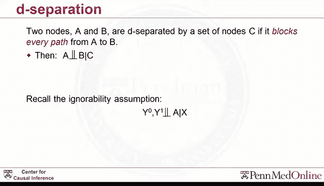

# 13：条件独立与d-分离 🧩

在本节课中，我们将学习因果图论中的核心概念：如何通过“阻断”路径来建立变量间的条件独立性。我们将重点理解“阻断”的含义、认识“对撞节点”的特殊性，并最终掌握判断变量是否被“d-分离”的规则。

## 理解“阻断” 📌

上一节我们介绍了因果图的基本结构，本节中我们来看看如何通过控制路径上的节点来“阻断”信息流。路径可以通过控制路径上的节点来被阻断。

考虑一条路径：A 影响 G，G 影响 B。想象我们现在控制了变量 G。G 位于这条链的中间。在这种情况下，我们会阻断从 A 到 B 的路径。

之前我们展示过，在这样一条链中，信息确实能从 A 传递到 B，因此 A 和 B 是相关的。但这种相关性是通过 G 产生的：A 影响 G，G 最终影响 B。所以，实际上是 G 导致了 A 和 B 之间的关联，在某种意义上，它是将两者联系在一起的纽带。因此，如果我们控制了 G（“控制 G”是“阻断它”的另一种说法），我们就阻断了这条路径。这里的核心思想是：如果 G 位于这条链的中间，我们阻断它，就能使 A 和 B 变得独立。

以下是一个更具体的假设性例子：
*   **A** 是温度（室外温度）。
*   **G** 是人行道是否结冰。
*   **B** 是某人是否摔倒。

显然，室外温度 A 会影响人行道是否结冰 G。而 G 会影响 B，即人行道是否结冰会影响某人是否摔倒。但我们假设 A 到 B 没有直接的箭头，即温度不直接影响某人是否摔倒（例如，如果外面很冷但没有冰，你摔倒的可能性并不比外面暖和且没有冰时更高，这只是为了说明而做的假设）。

A 和 B 在这里是边际相关的，温度和某人是否摔倒显然是相关的。如果是温暖的一天，就不可能有冰，因此某人不太可能摔倒。

然而，想象我们现在要阻断 G。控制 G 意味着我们使其同质化。在这种情况下，意味着我们固定了人行道是否结冰的状态。如果我们将其固定，那么 A 和 B 之间就不应该存在关联。例如，如果我控制 G，设想一个“人行道结冰”的世界，那么温度和摔倒应该是无关的。同样，如果我控制 G 并设定“人行道不结冰”，温度和某人摔倒仍然应该彼此无关。这就是通过使 G 对每个人都相同来阻断它，也就是我们所说的控制它。这就是“阻断”的含义。

## 阻断“分叉”路径 🍴

上一节我们介绍了如何阻断链式路径，本节中我们来看看如何阻断“分叉”路径。分叉路径上的关联也可以被阻断。

这里我们有一条路径，其中 G 同时影响 A 和 B，这是一个分叉。同样，A 和 B 彼此相关，因为 G 同时影响它们，我们在之前的视频中讨论过这一点。但现在，如果我们控制 G，我们将阻断从 A 到 B 的路径。在这个图中，A 和 B 彼此相关的唯一原因是 G 同时影响它们。因此，如果我们固定 G，为 G 选择一个值，控制它使其对每个人都相同，那么 G 就不再影响 A 和 B（因为我们把它固定了）。这样我们就阻断了这条路径，现在 A 和 B 彼此独立。所以，如果我们控制 G，就会阻断这条路径。希望这足够直观：我们可以阻断这类路径，可以阻断分叉，也可以阻断链。

## 对撞节点的特殊性 ⚡️

上一节我们看到阻断链和分叉能带来独立性，本节中我们来看看一个相反的情况：对撞节点。对撞节点会创造一种不同的、几乎可以说是相反的情况。

现在考虑一个倒置的分叉，即信息在 G 处发生碰撞。根据之前的视频，A 和 B 在这里实际上是独立的。所以 A 和 B 不通过这条路径关联，信息在 G 处碰撞。如果我们真的希望 A 和 B 彼此独立，我们实际上不需要做任何事情，没有需要阻断的路径，我们直接就能得到独立性。

然而，如果你控制了 G，你实际上会在 A 和 B 之间创造出一个关联。所以在这里，如果你阻断 G，实际上会在 A 和 B 之间诱导出关联，这和我们之前看到的效果几乎是相反的。

以下是一个简单的例子来帮助理解这个概念，因为它有时是反直觉的：
*   **A** 是一个开关的状态（例如电灯开关），它要么开要么关。
*   **B** 是第二个开关的状态。
*   **G** 是灯泡是否亮起。

想象一下，我们通过抛硬币来决定 A，所以 A 完全独立于一切。同样，我们用另一枚独立的硬币来决定 B。现在想象，G 只有在 A 和 B 都处于“开”的位置时才会亮起。显然，A 和 B 彼此独立，因为它们只是基于两次独立的抛硬币。我们可以用这个图来描述：A 和 B 都影响 G，但 A 和 B 彼此独立。

正如我们所说，A 和 B 是独立的。例如，如果我告诉你 B 是开的，这并不能告诉你任何关于 A 的信息。然而，**在给定 G 的条件下**，A 和 B 实际上是相关的。如果你阻断或控制了 G，你就在 A 和 B 之间诱导出了一个关联。我用 G 周围的矩形表示阻断，然后在 A 和 B 之间画一条虚线曲线，让你知道当你控制 G 时，你在 A 和 B 之间打开了一条路径。

想象我控制了 G，这意味着我告诉你 G 是什么，或者我固定了 G。例如，如果我告诉你灯是灭的。那么，如果 B 是开的，A 必须是关的，反之亦然。所以，当我告诉你 G 是什么时，我就知道了 A 和 B 之间的一些关系。但之前，如果我告诉你 B 是什么，我不会知道任何关于 A 的信息，因为 A 只是由抛硬币决定的。一旦我告诉你 G 是什么，A 和 B 就拥有了关于彼此的信息。我们在下面的图中用虚线曲线描绘了这一点，表明如果你阻断 G，你就在 A 和 B 之间打开了一条新路径。所以现在，在给定 G 的条件下，A 和 B 是条件相关的。

## 理解“d-分离”规则 📐

上一节我们学习了不同路径的阻断规则，本节中我们将利用这些规则来理解“d-分离”。我们将使用刚刚学到的一些规则来思考，一组节点是否能在给定路径上使变量之间产生独立性。如果一组节点能做到这一点，我们就称之为“d-分离”。这里的“d”代表“依赖”，我们考虑的是两个节点之间存在依赖关系的路径，我们想知道一组变量 C 是否能消除这种依赖。随着深入，这会变得更清晰，但这是主要思想。

一条路径被一组节点 C “d-分离”，如果：
1.  它包含一个**链**，并且**中间节点在 C 中**。这里“中间部分”指的是像 E 这样的节点。为了达到 d-分离（本质上是独立性），我们需要 E 在 C 中，我们之前看到过这一点。你可以把 C 看作是我们将要控制的所有节点的集合，只要链的中间部分在其中，就应该没问题。
2.  或者，如果路径包含一个**分叉**，并且**中间节点在 C 中**。这里“中间部分”指的是信息流向下游变量的路径顶端部分，如果是分叉，我们需要控制它。
3.  或者，如果路径包含一个**倒置分叉（对撞节点）**，我们**不希望**那个中间节点在 C 中。我们之前看到，如果我们控制了那个中间节点，会诱导出关联。所以，如果它包含一个倒置分叉，我们不希望那个中间节点在 C 中，我们也不希望该对撞节点的**任何后代**在 C 中。

在这一点上，有些内容可能还不清楚，但我们将更详细地讲解。你会注意到，我刚才指出的这三件事都遵循了之前我们查看不同路径类型、关联性以及何时可以阻断的幻灯片内容。

## 节点间的“d-分离” 🔗

上一节我们讨论了一条路径的 d-分离，但两个变量之间可能有很多条路径。接下来，我们将思考两个节点之间的一般性 d-分离。

如果一组节点 C **阻断了从 A 到 B 的每一条路径**，则称两个节点 A 和 B 被 C “d-分离”。你可以想象从 A 到 B 有许多条路径。我们将尝试通过使用一组节点 C 进行阻断，来创建 A 和 B 之间的条件独立性。也就是说，我们将控制 C。如果我们成功了，阻断了所有路径，那么它们就是 d-分离的，我们可以说 A 在给定 C 的条件下独立于 B。

到目前为止，我们正在学习很多这些规则，但都是为了构建某个目标。特别是作为动机，请回想一下**可忽略性假设**。

可忽略性假设与处理分配 A 有关，即 A 在给定 X 的条件下独立于潜在结果。希望你现在能看到这里的联系：我们的长期目标是识别一组变量 X，它能在 A 和潜在结果之间建立条件独立性。换句话说，我们将实现 A 和潜在结果之间的 d-分离。这就是我们正在努力的方向。在现阶段，我们严格学习的是那些必须用来判断可忽略性何时成立的规则。

---

**本节课总结**：在本节课中，我们一起学习了因果推断中判断变量独立性的核心工具。我们首先理解了通过控制中间节点来“阻断”链和分叉路径，从而消除变量间的虚假关联。接着，我们认识了对撞节点的特殊性，即控制它会反而“打开”路径，诱导出新的关联。最后，我们综合这些规则，掌握了“d-分离”的完整定义：如果一组变量 C 阻断了两个变量间的所有路径，则称这两个变量被 C “d-分离”，即在给定 C 的条件下独立。这些概念是理解后续可忽略性假设和选择调整变量的基础。