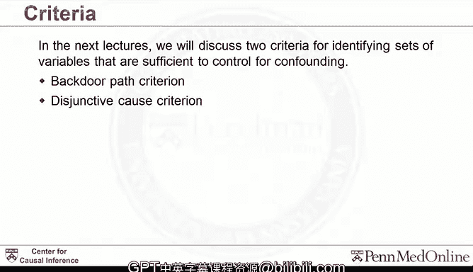

# 14：混杂因素再探讨 🔄

在本节课中，我们将重新审视混杂因素的概念。我们将学习前门路径与后门路径的定义，并理解为何需要阻断后门路径以控制混杂。

## 前门路径 🚪

上一节我们回顾了混杂因素的基本概念。本节中，我们来看看路径分析中的“前门路径”。

前门路径是指从暴露变量 **A** 到结局变量 **Y** 的路径，其**起始箭头从 A 指出**。这意味着信息或因果效应是沿着箭头方向，从 A 流向 Y。

以下是两个前门路径的例子：

*   **直接效应**：路径为 **A → Y**。这表示 A 直接影响 Y。
*   **间接效应**：路径为 **A → Z → Y**。这表示 A 通过影响中间变量 Z 来间接影响 Y。

在因果推断中，如果我们只关心 A 对 Y 的**总效应**，我们通常**不会**去阻断或控制前门路径上的变量。因为这些路径本身就代表了治疗或暴露的因果效应。控制它们会掩盖我们想要估计的效应。

> 例如，在路径 **A → Z → Y** 中，Z 是 A 影响 Y 的一个机制。如果我们控制了 Z，就等于移除了 A 通过 Z 影响 Y 的那部分效应，从而无法估计 A 对 Y 的总效应。

如果研究者希望量化效应通过不同中介路径传递的比例，则需要进行**因果中介分析**。但本课程主要关注总效应的识别。

## 后门路径 🚶‍♂️

理解了前门路径后，我们来看看需要重点关注的“后门路径”。

后门路径是指从 **A** 到 **Y** 的路径，但其**起始箭头指向 A**。这是一种“迂回”的路径，它并非代表 A 对 Y 的因果效应，而是反映了由于混杂因素导致的 A 与 Y 之间的虚假关联。

一个典型的后门路径例子是：**A ← X → Y**。
在这个路径中：
*   **X** 是一个混杂变量。
*   **X** 同时影响 A 和 Y。
*   这导致即使 A 对 Y 没有真实因果效应，A 和 Y 之间也会出现统计关联。

我们的核心目标就是**阻断所有从 A 到 Y 的后门路径**。一旦成功阻断，A 与 Y 之间剩余的关联就可以更可信地归因于 A 对 Y 的因果效应（即前门路径）。这等价于在给定一组变量 **X** 的条件下，实现了可忽略性假设：

`(Y(1), Y(0)) ⫫ A | X`

其中，**X** 就是那组足以阻断所有后门路径的变量集合。

## 混杂控制准则 📐

那么，如何找到这组变量 **X** 呢？以下是两个常用的准则：

*   **后门路径准则**：这组变量 **X** 必须阻断所有连接 A 与 Y 的后门路径，且不能阻断任何前门路径，同时自身不能被 A 影响。
*   **分离原因准则**：这组变量 **X** 需要包含所有 A 和 Y 的共同原因，或者对这些共同原因进行测量后的代理变量。

应用这些准则可以帮助我们从复杂的因果图中，系统地识别出需要调整的变量集，从而有效控制混杂偏倚。

---

**本节课总结**：我们一起学习了因果图中的前门路径与后门路径。前门路径代表因果效应，不应被阻断；后门路径代表混杂偏倚，必须被阻断。通过后门路径准则或分离原因准则，我们可以识别出需要调整的变量集合，以控制混杂，从而估计暴露对结局的因果效应。