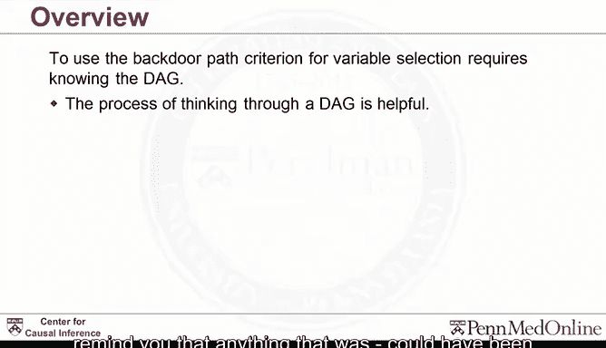

# 15：后门路径准则 🚪

在本节课中，我们将学习**后门路径准则**。我们将理解它的定义，如何判断它是否被满足，以及更一般地，如何根据给定的有向无环图来判断一组变量是否足以控制混杂。

## 概述

上一节我们讨论了混杂和路径的概念。本节中，我们将学习一个具体的准则——后门路径准则，它可以帮助我们系统地判断，为了准确估计处理对结果的影响，需要控制哪些变量。

## 什么是后门路径准则？

根据后门路径准则，一组变量足以控制混杂，需要满足以下两个条件：
1.  **它阻断了所有从处理到结果的后门路径。**
2.  **它不包含处理的任何后代变量。**

记住，处理的**后代变量**实际上是处理因果效应的一部分，因此我们**不希望**控制处理的效应。只要满足这两个条件，就满足了后门路径准则。

满足条件的变量集**不一定是唯一**的，可能存在多种选择。接下来，我们通过几个例子来理解这一点。

## 示例分析

以下是几个具体的DAG示例，我们将逐一分析如何应用后门路径准则。

### 示例一：简单后门路径

假设这是真实的DAG。我们关注处理 `A` 和结果 `Y` 之间的关系。图中还有其他变量 `V` 和 `W`。

从 `A` 到 `Y` 恰好有一条后门路径：`A <- V -> W -> Y`。这条路径上没有对撞节点，因此它是开放的。

为了阻断这条后门路径，我们需要控制路径上的变量。

以下是足以控制混杂的变量集合：
*   `V` （控制 `V` 即可阻断路径）
*   `W` （控制 `W` 也可阻断路径）
*   `V` 和 `W` （同时控制两者）

通常，人们倾向于控制更少的变量，因此可能会选择 `V` 或 `W`。

### 示例二：包含对撞节点的路径

假设这是真实的DAG。我们同样关注 `A` 和 `Y`。

从 `A` 到 `Y` 有一条后门路径：`A <- V -> M <- W -> Y`。这条路径在 `M` 处有一个**对撞**。因此，这条路径**已经被阻断**，实际上不存在混杂。你甚至可以不进行任何调整，直接分析 `A` 和 `Y` 的关系。

然而，如果你错误地控制了 `M`（一个对撞节点），会发生什么？控制 `M` 会打开 `V` 和 `W` 之间的路径，从而**创造出一条新的、开放的后门路径**：`A <- V -> M <- W -> Y`（现在 `M` 被控制，路径打开）。

因此，如果你控制了 `M`，就必须额外控制其他变量来阻断这条新路径。

以下是足以控制混杂的变量集合：
*   `{}` （空集，即不控制任何变量）
*   `V`
*   `W`
*   `M, V`
*   `M, W`
*   `M, V, W`

**注意**：仅控制 `M` 是不够的，它会导致混杂。

### 示例三：多条后门路径

在这个例子中，有两条从 `A` 到 `Y` 的后门路径。

**路径一**：`A <- Z -> V -> Y`。无对撞节点，可通过控制 `Z` 或 `V` 来阻断。

**路径二**：`A <- W -> Z <- V -> Y`。在 `Z` 处有对撞，因此这条路径**已被阻断**。但是，如果你控制了 `Z`，就会打开 `W` 和 `V` 之间的路径，此时你需要额外控制 `W` 或 `V` 来阻断新路径。

综合考虑两条路径，以下是足以控制混杂的变量集合：
*   `V` （阻断路径一，且路径二本身已阻断）
*   `V, Z`
*   `Z, W`
*   `V, Z, W`

**注意**：仅控制 `Z` 或仅控制 `W` 是不够的。仅控制 `Z` 会打开新路径；仅控制 `W` 则无法阻断路径一。**最小集合**是 `V`。

### 示例四：更复杂的DAG

这个DAG更为复杂，包含三条后门路径。

以下是三条路径及阻断方法：
1.  `A <- Z -> V -> Y`：可通过控制 `Z` 或 `V` 阻断。
2.  `A <- W -> Z -> V -> Y`：可通过控制 `W`、`Z` 或 `V` 阻断。
3.  `A <- W -> M -> Y`：可通过控制 `W` 或 `M` 阻断。

综合来看，存在多种变量组合可以同时阻断这三条路径，例如控制 `V` 和 `W`，或控制 `Z` 和 `M` 等。你需要确保所选集合能覆盖所有路径的阻断条件。

## 现实应用与思考

你可能觉得这些复杂的DAG不切实际，但实际上在学术研究中，学者们会构建非常详细的因果图。例如，一项研究母亲孕前体重状态与剖腹产关系的文献，就提出了一个包含众多变量的复杂DAG。

这引出了两个问题：
1.  **如何构建这样的DAG？** 这基于领域知识和文献，是**一种假设**，可能不完全正确。
2.  **如果DAG画错了怎么办？** 即使DAG略有错误，你选择的变量集可能仍然足以控制混杂。这提示我们需要进行**敏感性分析**（后续课程会涉及），来评估假设错误对结论的影响。

尽管如此，画出DAG的过程本身非常有价值，它能**形式化地梳理**你对变量间关系的思考。

## 总结

本节课我们一起学习了**后门路径准则**。其核心是：要控制混杂，需要选择一组能**阻断所有处理到结果的后门路径**，且**不包含处理后代变量**的变量集。

关键要点是：
*   准则的应用依赖于已知的**DAG**。
*   满足条件的变量集通常**不唯一**，应优先选择最小集合。
*   构建DAG是一个基于假设的有用过程，能帮助系统化思考。

然而，在实践中，我们可能无法获知完整的DAG。这引出了下一个问题：如果我们没有完整的DAG信息，还能否找到足以控制混杂的变量集？我们将在下一个视频中讨论这个替代性准则。