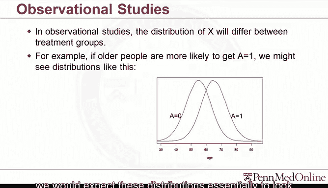

# 17：观察性研究 🧐

在本节课中，我们将学习观察性研究。我们将首先理解随机试验与观察性研究的区别，然后探讨“匹配”这一控制混杂因素的方法如何尝试使观察性研究模拟随机试验的效果。最后，我们还将讨论匹配方法的一些优势。

## 随机试验与观察性研究的区别

上一节我们介绍了混杂因素的基本概念。现在，我们来看看研究者如何应对混杂问题。

我们可以考虑一个简单的有向无环图（DAG），它描绘了经典的混杂设置：一组变量 **X** 同时影响治疗分配 **A** 和结局 **Y**。因此，控制 **X** 就足以控制混杂。这里的 **X** 可以看作是一组足以控制混杂的变量集合，其选择可以基于“充分混杂变量集”等准则。我们在此进行简化，核心假设是 **可忽略性假设**，其含义是：在给定协变量 **X** 的条件下，潜在结局与治疗分配独立。本质上，我们假设在控制了这些混杂因素后，治疗分配就像是随机化的。

那么，在随机试验中是如何处理这个问题的呢？在现实世界中，治疗分配 **A** 部分由变量 **X** 决定，而 **X** 也影响结局 **Y**。随机试验通过实际随机化治疗分配来解决这个问题。这相当于切断了从 **X** 指向 **A** 的箭头。随机化后，**X** 不再影响 **A**，从而阻断了 **A** 到 **Y** 的后门路径。

随机试验的另一个特点是，治疗组和对照组中协变量 **X** 的分布是相同的。我们从一个感兴趣的人群（用一个大圆圈表示）中，随机分配部分人接受治疗（A=1，蓝色圆圈），另一部分人接受对照（A=0，灰色圆圈）。由于随机化，两个治疗组中 **X** 的分布应与原始人群相同，没有理由不同。这就实现了 **协变量平衡**。因此，如果两组结局出现差异，就不会是因为 **X** 的分布不同造成的。在随机试验中，我们通过设计（随机化）来处理混杂因素 **X**。

## 为何不总是使用随机试验？

既然随机化如此有效，为何不总是采用随机试验呢？原因有以下几点：

*   **成本高昂**：随机试验通常比观察性研究昂贵得多，涉及伦理审查、招募受试者、长期随访、复杂协议和大量人员。
*   **伦理问题**：有时随机分配暴露或治疗是不道德的。例如，研究吸烟是否导致肺癌时，随机让人吸烟是不道德的。
*   **参与意愿低**：许多人可能拒绝参与试验，因为他们不想被“实验”，或嫌随访麻烦。这导致我们能推断的人群范围缩小，代表性降低。
*   **耗时漫长**：随机化后需要等待结局发生（如五年生存率），可能耗时很久。等到结果出来时，研究问题可能已不再相关（例如，已有新药上市）。

## 观察性研究的类型

鉴于随机试验的局限性，观察性研究有其用武之地。主要有两种类型：

**1. 前瞻性观察性研究**
这类研究是计划性的，研究者主动收集数据。通常会招募受试者，并定期（如每半年或每年）随访收集数据。与试验类似，它会在计划时间点收集一套共同的变量，并严格按照协议测量结局。但与试验不同，其监管较弱，因为研究者不主动干预治疗，只是观察现实情况。合格人群通常也更广泛。不过，它仍有成本较高、实施较慢（需等待结局）的缺点。

**2. 基于数据库的观察性研究（回顾性）**
这类研究越来越普遍，利用为其他目的已存在的数据。数据是被动收集的，研究者并未主动收集。例如：
*   **电子病历**：为临床诊疗而记录，可用于研究。
*   **行政数据**：如保险理赔数据。
*   **登记库**：如癌症登记库。

以下是这类数据的优缺点：

*   **优点**：
    *   **样本量大**：例如，可能包含整个医疗系统的数据。
    *   **成本低廉**：数据已存在，只需提取和分析。
    *   **分析快速**：数据（治疗、结局）可能已具备，分析速度快。
*   **缺点**：
    *   **数据质量较低**：缺乏统一的数据收集标准（如不同实验室的检测方法不同）。
    *   **测量变异性大**：即使像血压测量，其程序也可能在不同诊所或个人间存在差异。
    *   **数据收集时间不受控**：例如，病情重的患者就医频繁、数据多；健康者数据少。

## 观察性研究的核心挑战：混杂

在观察性研究中，我们不对治疗进行随机化。因此，我们关心的混杂变量 **X** 的分布在治疗组间通常不同。例如，想象老年人更可能接受治疗（A=1），而年轻人更可能接受对照或未治疗（A=0）。在分布图上，治疗组（蓝色曲线）的高峰可能在60多岁，而对照组（灰色曲线）的高峰可能在50多岁。虽然存在重叠区域，但总体分布不平衡。这与随机试验中我们期望的平衡状态不同。

## 匹配方法：模拟随机试验

匹配方法试图使观察性研究更像随机试验。其主要思想是：将治疗组（A=1）的个体与对照组（A=0）的个体进行配对，配对依据是协变量 **X**。我们试图为每个治疗组个体找到一个具有相似或相同 **X** 值的对照个体。

在前面的年龄例子中，观察性研究里年轻年龄段的对照个体多，年长年龄段的治疗个体多。而随机试验中，任何年龄段的治疗和对照个体数应大致相同。匹配的目标就是实现这一点：在任何特定的 **X** 取值组合下，治疗组和对照组的个体数量应大致平衡。

## 匹配的优势

匹配方法在处理混杂方面有几个显著优势：

*   **在“设计阶段”处理混杂**：这里的“设计阶段”指的是在不查看结局数据的情况下进行操作。匹配可以仅基于协变量 **X** 进行，对结局数据盲法，这与随机试验中在结局出现前就通过设计控制混杂的思路相似。
*   **揭示协变量分布的重叠不足**：匹配可能发现某些治疗组个体找不到任何相似的对照个体。这表明这些个体几乎没有机会接受对照治疗。这非常有用，因为我们可能希望将这些人排除在研究之外。对无法接受另一种治疗的人进行效应推断需要外推，而我们没有相关信息。这有助于识别 **正性假设**（即对于任何协变量组合，接受任一种治疗的概率都应非零）的违反情况，并通过排除相应个体来满足该假设。如果不进行匹配，这种重叠不足可能被忽视。

## 匹配后的分析

一旦完成匹配，数据在协变量 **X** 上应该达到平衡。此时，我们可以像分析随机试验数据一样进行结局分析。分析可以相对简单，例如，直接比较匹配后两组结局的均值。这感觉上非常类似于分析一个随机试验的数据。

---

本节课中，我们一起学习了观察性研究。我们比较了随机试验与观察性研究的核心区别，了解了观察性研究的两种主要类型及其优缺点。我们重点探讨了观察性研究中混杂分布不平衡的核心挑战，并深入介绍了“匹配”这一方法如何通过模拟随机试验的平衡特性来控制混杂。最后，我们总结了匹配在“设计阶段”处理混杂、揭示数据重叠问题等方面的优势，以及匹配后如何进行简洁的结局分析。