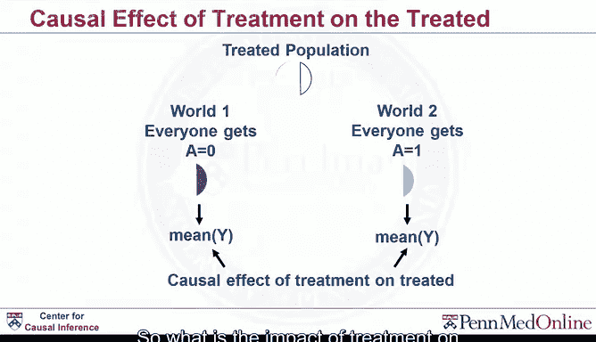

# 18：匹配方法概述 🧩

在本节课中，我们将学习因果推断中一种重要的方法——匹配。我们将了解匹配的基本动机、它所针对的总体，并区分“随机平衡”与“精细平衡”这两个核心概念。

## 匹配的基本动机

上一节我们提到了匹配的目标。本节中，我们来看看匹配背后的核心动机是什么。

匹配的目标是，根据我们识别出的、足以控制混杂因素的一组协变量，将处理组个体与对照组个体进行配对。

为了便于理解，我们先从单一协变量的情况开始。假设我们只关心一个协变量：高血压。我们将高血压患者标记为红色，非高血压患者标记为蓝色。

想象一下，高血压诊断部分决定了个体接受何种治疗，也可能与结局相关。因此，这是一个我们需要控制的变量。

在一个假设的小型人群中，处理组和对照组在高血压这个协变量上存在不平衡。在处理组中，67%的个体是红色的（患有高血压）。而在对照组中，情况相反，只有20%是红色的。这与随机试验中的期望不同，在随机试验中，处理组和对照组的高血压患者比例应大致相同。

我们可以通过匹配来解决这个问题。我们将每个处理组个体与一个对照组个体配对。

以下是匹配过程：
*   将一个红色的处理组个体与一个红色的对照组个体配对。
*   将一个蓝色的处理组个体与一个蓝色的对照组个体配对。
*   重复此过程，直到为所有处理组个体找到匹配。

匹配完成后，未被匹配的对照组个体将被剔除。现在，在这个匹配后的样本中，处理组和对照组在高血压这个协变量上实现了完美平衡：两组都有67%的红色圆圈。这类似于随机试验中协变量达到的平衡状态。

## 多协变量与随机平衡

上一节我们讨论了单一协变量的简单情况。然而，现实分析中我们通常需要控制多个协变量，其中一些可能是连续变量，这使得匹配变得复杂得多。

实际上，我们几乎不可能在全部协变量上找到完全相同的个体进行精确匹配。一个处理组个体可能找不到任何在协变量上与其完全一致的对照组个体。

但即使在随机试验中，处理组和对照组个体也并非完美匹配。对于一个给定的处理组个体，可能没有一个对照组个体是完美匹配。然而，随机试验中**协变量的分布在两组之间是平衡的**。我们将这种平衡称为**随机平衡**。

因此，匹配的目标并非追求精确的个体匹配，而是通过寻找**相近的匹配**，使得匹配后两组间协变量的**分布非常相似**，从而实现类似随机试验的随机平衡。

例如，假设我们现在有两个协变量：性别（男/女）和年龄（岁）。我们有两个处理组个体和更多的对照组个体（通常对照组规模更大，以便有更多选择来寻找良好匹配）。

以下是寻找匹配的过程：
*   对于第一个处理组个体（男性，56岁），我们在对照组中寻找一个相近的匹配，例如一位55岁的男性。
*   对于第二个处理组个体（女性，47岁），我们在对照组中找到一位年龄完全相同的女性作为匹配。

通过这个过程，我们使得对照组中协变量的分布看起来与处理组相似。

## 匹配所估计的因果效应

上一节我们了解了如何通过匹配使协变量分布平衡。本节中，我们来看看这种匹配方法默认估计的是哪一种因果效应。

如果我们从处理组群体出发，并尝试从对照组中为他们寻找匹配，那么最终我们会使对照组的协变量分布与处理组相似。因此，我们最终估计的是**处理组个体的平均处理效应**。

`ATT = E[Y(1) | A=1] - E[Y(0) | A=1]`

这与针对整个总体的**平均因果效应**形成对比。匹配通常侧重于估计ATT，因为这是一个有效的因果效应，它推断的是**实际接受治疗的人群**。我们比较的是他们实际接受治疗的结果与他们如果都未接受治疗时的潜在结果。

当然，也存在一些方法可以使匹配后的样本代表总体，从而估计ATE，但这通常更复杂。在本视频中，我们主要记住，典型的匹配方法（从处理组出发寻找对照）估计的是ATT。

## 精细平衡的概念

上一节我们讨论了随机平衡。本节中，我们介绍一个相关的概念：精细平衡。

有时我们可能无法为所有个体找到理想的匹配。可能对于许多个体，我们能找到非常好的匹配，但对于另一些则不能。然而，如果我们最终仍然能使处理组和对照组之间协变量的**边际分布相同**，我们可能愿意容忍一些不理想的匹配。这就称为**精细平衡**。

请看一个具体例子。假设我们有两个匹配对：
*   **匹配对1**：处理组（男性，40岁）匹配到对照组（女性，45岁）。这不是一个理想的匹配（性别不同，年龄也不同）。
*   **匹配对2**：处理组（女性，45岁）匹配到对照组（男性，40岁）。同样不是一个理想的匹配。

单独看，每个匹配对都没有良好的随机平衡（个体不相似）。但如果我们把这两个匹配对放在一起看：
*   处理组：50%为男性，平均年龄为 (40+45)/2 = 42.5岁。
*   对照组：50%为男性，平均年龄为 (45+40)/2 = 42.5岁。

尽管个体匹配不理想，但两个群体在性别和年龄的**分布上完全相同**。这就实现了精细平衡。

许多匹配软件可以施加精细平衡约束。软件在寻找匹配时，会尽量寻找最佳的成对匹配，但只要最终能达到精细平衡，它也会容忍一些较差的匹配。这是一个可以在软件中设定的选项。

## 匹配的数量：一对一与多对一

最后，我们来讨论匹配的数量策略。到目前为止，我们主要关注**一对一匹配**，即为每个处理组个体寻找一个对照组匹配，然后剔除未匹配者。

但还有其他选项：
*   **多对一匹配**：可以预先决定为每个处理组个体匹配K个对照组个体。例如，进行五对一匹配。
*   **可变数量匹配**：匹配的数量可以变化。我们可能为一些处理组个体匹配一个对照，为另一些匹配多个对照，这取决于能找到多少良好的匹配。

这些方法之间存在权衡。大体上讲，一对一匹配通常能产生更好的个体匹配质量，但会丢弃更多数据，可能导致效率损失。多对一匹配能利用更多数据，但可能降低个体匹配的相似度。

## 总结

本节课中，我们一起学习了因果推断中匹配方法的概述。

我们首先了解了匹配的基本动机：通过配对使处理组和对照组在重要协变量上达到平衡，以模拟随机试验的条件。接着，我们认识到当存在多个协变量时，目标是实现**随机平衡**，即协变量分布在两组间相似。

我们明确了典型的匹配方法（从处理组出发寻找对照）所估计的是**处理组个体的平均处理效应**。然后，我们学习了**精细平衡**的概念，即即使个体匹配不完美，只要两组协变量的边际分布相同，也是可以接受的。

最后，我们简要讨论了不同的匹配数量策略（一对一、多对一、可变匹配）及其权衡。

理解这些核心概念，是进一步学习和应用具体匹配方法（如倾向得分匹配）的重要基础。