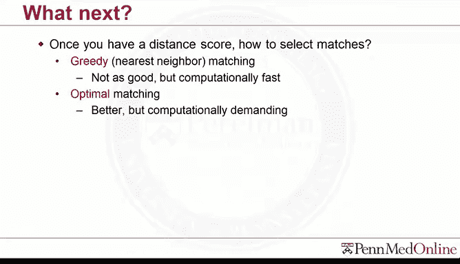

# 因果推断速成课程 P19：直接基于混杂因素匹配 📊

在本节课中，我们将学习如何通过直接匹配混杂因素来进行因果推断。我们将首先理解为何需要距离矩阵，并探讨几种距离矩阵的选项。接着，我们将讨论如何利用这些距离矩阵进行匹配。

## 为什么需要距离矩阵？ 🤔

为了找到“接近”的匹配对象，我们需要一个衡量“接近程度”的指标。由于我们通常需要控制许多变量，几乎不可能找到一个处理组个体与一个对照组个体在所有变量上完全一致。因此，我们需要一个度量标准来评估两组协变量之间的相似程度。

我们将介绍两种距离度量方法：**马氏距离** 和 **稳健马氏距离**。它们都能衡量两组协变量的相似性。

## 马氏距离 📏

首先，我们引入一些符号。`X_j` 表示个体 `j` 的协变量向量。这里的 `j` 代表数据集中的一个人，`X` 是你预先确定需要控制的一组混杂因素变量。

个体 `i` 和个体 `j` 之间的协变量距离用 `D(X_i, X_j)` 表示。它是一个函数，输入两个个体的协变量值，输出一个单一的距离分数。

其公式如下：

`D(X_i, X_j) = sqrt( (X_i - X_j)^T * S^{-1} * (X_i - X_j) )`

让我们分解一下这个公式：
*   `(X_i - X_j)` 是协变量向量的差值。对于每个变量（例如年龄、血压），我们计算个体 `i` 和 `j` 之间的差值。
*   `^T` 表示转置。
*   `S` 是协变量 `X` 的协方差矩阵，`S^{-1}` 是其逆矩阵。这部分的作用是**缩放**。由于变量（如年龄和糖尿病状态）的单位和尺度不同，直接相加差值没有意义。逆协方差矩阵相当于将每个变量的差值除以其方差，从而将所有变量置于一个可比较的尺度上。

总的来说，你可以将其粗略地理解为**缩放后的平方差之和再开方**。如果两组协变量差异很大，距离值就大；如果差异很小，距离值就小。我们可以为任何一对个体计算这个 `D` 值，特别是将一个给定的处理组个体与所有不同的对照组个体进行比较，从而得到一个距离列表，帮助我们找到良好的匹配。

### 示例说明

假设我们只有三个协变量：年龄、COPD（慢性阻塞性肺病，1=是，0=否）和女性（1=是，0=否）。

我们有一个处理组个体：年龄78岁，无COPD，女性。
我们需要在对照组中为他寻找匹配。假设有6个对照组候选人。

以下是匹配过程的简要说明：
*   **候选人A**：年龄70岁，有COPD，男性。在COPD和性别上都不匹配，距离值较大（例如4.2），不是好匹配。
*   **候选人B**：年龄18岁，无COPD，女性。在COPD和性别上匹配，但年龄差异巨大，距离值也较大（例如3.6），不是好匹配。
*   **候选人C**：年龄75岁，无COPD，女性。在所有三个变量上都接近，距离值最小（例如0.5），是最佳匹配。

通过计算所有候选人与处理组个体的马氏距离，并选择距离最小的一个，我们就能找到最接近的匹配。这个计算过程可以很容易地用R等软件完成。

## 稳健马氏距离 🛡️

接下来，我们看看马氏距离的一个替代方案：**稳健马氏距离**。其动机与**异常值**有关。异常值可能导致个体间的距离非常大，即使他们的其他协变量非常相似。

为了解决这个问题，我们可以使用**秩次**。这是一种经典的稳健统计方法，即用变量的秩次代替原始值进行计算。

具体操作如下：
1.  对于每个变量（如年龄），将数据集中的所有值从小到大排序，并用其排名（1, 2, 3,...）代替原始值。
2.  然后，对转换后的秩次数据应用相同的马氏距离公式。

这样做的好处是，可以减轻极端值的影响。例如，年龄最大和第二大的个体，原始年龄可能相差很大，但它们的秩次只差1。

此外，在使用秩次时，通常希望协方差矩阵 `S` 的对角线是常数，这意味着所有变量在尺度上被同等对待，不会过度加权某个变量。统计软件通常可以自动处理这些细节。

## 距离矩阵的应用策略 ⚙️

我们已经了解了为什么需要距离以及两种距离度量方法。匹配的一个优点是，你可以采取一些灵活的策略，例如对某些变量要求精确匹配，而对其他变量允许近似匹配。

以下是两种常见策略：

1.  **对关键变量进行精确匹配**：如果你希望对少数最重要的混杂因素进行精确匹配，可以在计算距离后增加一个步骤：如果个体在这些关键变量上不匹配，就将计算出的距离设置为无穷大（或一个极大的数），从而在匹配算法中排除这种组合。

2.  **基于倾向得分进行距离匹配**：另一种常见的方法是先计算倾向得分，然后在倾向得分上进行距离匹配。这将是另一个视频的主题，但在此提请注意这种可能性。

## 匹配算法选择 🧮

一旦我们有了距离矩阵，如何实际选择匹配对象呢？我们将介绍两种最流行的算法。

上一节我们介绍了如何计算个体间的距离，本节中我们来看看如何利用这些距离进行实际的配对。

以下是两种主要的匹配算法：

*   **贪婪匹配**：也称为**最近邻匹配**。其工作原理是：依次为每个处理组个体，从未被匹配的对照组中挑选距离最小的那个作为匹配对象。它的优点是**计算速度非常快**，通常可以毫无压力地应用于大型数据集。
*   **最优匹配**：这种算法试图最小化所有匹配对之间的**总距离**或**平均距离**，而不仅仅是单个处理对象的最短距离。理论上，这应该能产生**整体上更好的匹配质量**。但它的缺点是**计算量要求很高**，在大型数据集上可能遇到困难。

---

**本节课总结**：在本节课中，我们一起学习了直接基于混杂因素进行匹配的核心步骤。我们首先理解了为何需要距离度量，并深入探讨了**马氏距离**和**稳健马氏距离**这两种衡量协变量相似性的方法。接着，我们了解了如何应用距离矩阵，包括对关键变量进行精确匹配的策略。最后，我们介绍了两种实际的匹配算法：计算高效的**贪婪匹配**和追求全局最优但计算量大的**最优匹配**。掌握这些概念是进行有效匹配分析的基础。