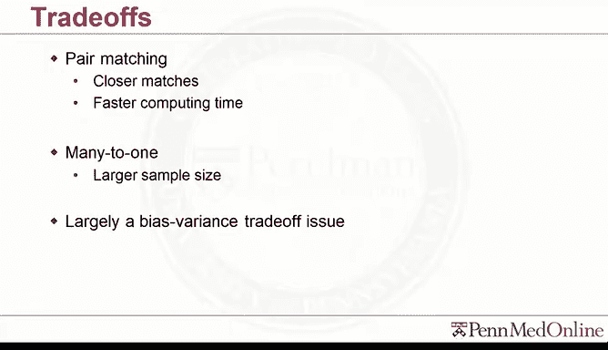

# 20：贪婪最近邻匹配 🎯


在本节课中，我们将学习一种名为“贪婪最近邻匹配”的因果推断方法。我们将了解其算法原理、优缺点，并探讨一对一匹配与多对一匹配的区别，最后介绍“卡钳”的概念。

## 概述

贪婪最近邻匹配是一种直观且易于实现的匹配算法。它通过为每个处理组个体寻找距离最近的对照组个体来构建匹配对。我们将从算法步骤开始，逐步深入其细节。

## 贪婪匹配算法

上一节我们介绍了匹配的基本前提，即已识别出一组足以控制混杂的预处理协变量，并计算了每个处理组个体与所有对照组个体之间的距离 `D_IJ`。本节中，我们来看看贪婪匹配的具体执行步骤。

以下是贪婪匹配算法的核心步骤：

1.  **随机排序**：首先，将处理组和对照组个体的列表进行随机排序。这有助于避免初始数据顺序对匹配结果产生影响。
2.  **顺序匹配**：从处理组列表的顶部开始，为第一个处理组个体寻找距离 `D_IJ` 最小的对照组个体。
3.  **移除已匹配对象**：一旦找到最佳匹配，就将该对照组个体从可用匹配池中移除。
4.  **迭代过程**：移动到下一个处理组个体，重复步骤2和3，为其寻找剩余对照组中的最佳匹配。
5.  **循环直至完成**：持续此过程，直到所有处理组个体都完成匹配。

## 算法示例

为了更清晰地理解，我们来看一个简单的例子。假设我们有两个处理组个体和六个对照组个体，协变量包括年龄、COPD（慢性阻塞性肺病）和性别。

首先，我们为第一个处理组个体（78岁，无COPD，女性）寻找匹配。计算其与每个可用对照的距离后，我们找到最佳匹配：一个75岁、无COPD、女性的对照个体。我们将他们配对，并赋予一个共同的匹配ID（例如 `match_id = 1`）。

```plaintext
match_id | treated | age | copd | female
---------|---------|-----|------|--------
1        | 1       | 78  | 0    | 1
1        | 0       | 75  | 0    | 1
```

接着，为第二个处理组个体（68岁，无COPD，男性）寻找匹配。此时，第一个匹配对象已从池中移除。在剩余对照中，最佳匹配是一个55岁、无COPD、男性的个体。尽管年龄差距较大，但这是当前可用的最佳选择。他们被赋予新的匹配ID（例如 `match_id = 2`）。

```plaintext
match_id | treated | age | copd | female
---------|---------|-----|------|--------
2        | 1       | 68  | 0    | 0
2        | 0       | 55  | 0    | 0
```

## 贪婪匹配的优缺点

了解了算法流程后，我们来评估一下这种方法的优势与局限。

**优点**：
*   **直观易懂**：算法逻辑简单，易于理解和解释。
*   **计算高效**：步骤清晰，即使在大数据集上运行速度也很快。
*   **易于实现**：可以轻松地用代码实现，也有现成的软件包（如 `matchup`）可用。

**缺点**：
*   **依赖初始顺序**：匹配结果会受到处理组列表初始随机排序的影响，不同排序可能导致不同匹配。
*   **非全局最优**：算法每一步只追求局部最优（当前个体的最佳匹配），并不能保证所有匹配对的总距离 `∑D_IJ` 最小，有时可能导致较差的整体匹配效果。

## 一对一匹配 vs. 多对一匹配

到目前为止，我们讨论的都是一对一（或配对）匹配。但有时我们可能希望为每个处理组个体匹配多个对照，即进行多对一匹配（例如K:1匹配，K>1）。

使用贪婪算法同样可以实现多对一匹配。只需先为每个处理组个体找到一个最佳匹配，然后回到列表开头，为每个处理组个体寻找第二个最佳匹配（从剩余对照中），如此循环K次即可。

这两种策略存在权衡：
*   **一对一匹配**：通常能获得更紧密的匹配对，计算更快，但会丢弃更多对照组数据，导致样本量较小，估计效率可能较低。
*   **多对一匹配**：能利用更多对照组数据，样本量更大，估计可能更高效（方差更小）。但后续匹配的质量会下降，可能引入更多偏差。

这本质上是一个偏差-方差权衡问题：一对一匹配偏差更小但方差可能更大；多对一匹配方差更小但可能偏差稍大。

## 卡钳匹配

最后，我们引入“卡钳”的概念。在实际数据中，可能存在某些处理组个体，在对照组中根本没有足够相似的个体可供匹配。



为了解决这个问题，可以设置一个卡钳值，即最大可接受距离 `caliper_max`。在运行贪婪匹配算法时，只有当最佳匹配的距离 `D_IJ` 小于或等于 `caliper_max` 时，才接受该匹配。否则，我们将不匹配该处理组个体，将其从分析中排除。

**作用**：
*   确保匹配质量，避免极差的匹配影响估计结果。
*   使“正值性”假设更可能成立。如果对于一个处理组个体，在对照组中找不到足够接近的匹配，可能意味着该个体特征组合在对照组中几乎不存在，这违背了正值性假设。卡钳匹配通过排除这些个体，使分析样本更符合该假设。

**代价**：
*   分析的目标人群会发生变化，从“所有处理组个体”变为“所有能找到足够好匹配的处理组个体”，这有时在解释上会带来一些复杂性。

## 总结

本节课中，我们一起学习了贪婪最近邻匹配方法。我们了解了其逐步为处理组个体寻找最近邻对照的算法，讨论了其直观、高效但非全局最优的特点。我们比较了一对一匹配与多对一匹配在偏差和效率上的权衡。最后，我们引入了卡钳的概念，它通过设置最大匹配距离来保证匹配质量并支持因果推断的关键假设。掌握这些概念，是运用匹配方法进行可靠因果推断的重要基础。