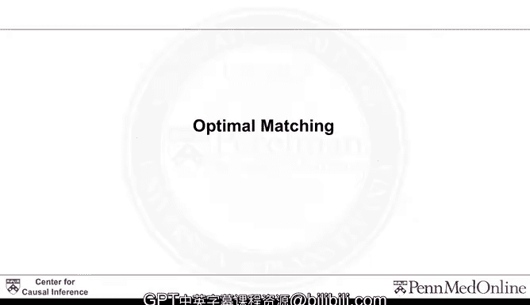
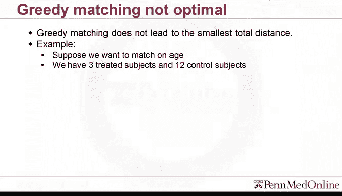
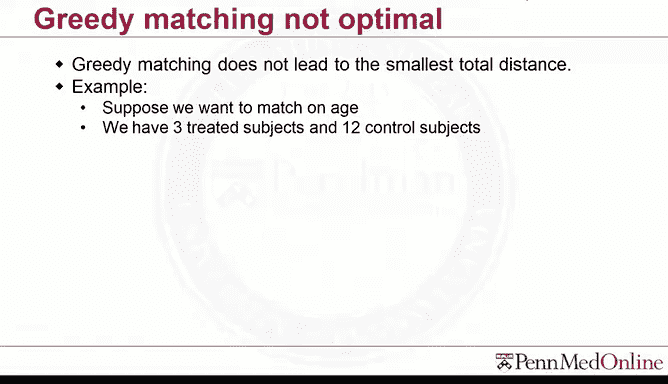
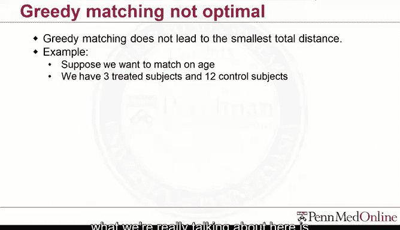
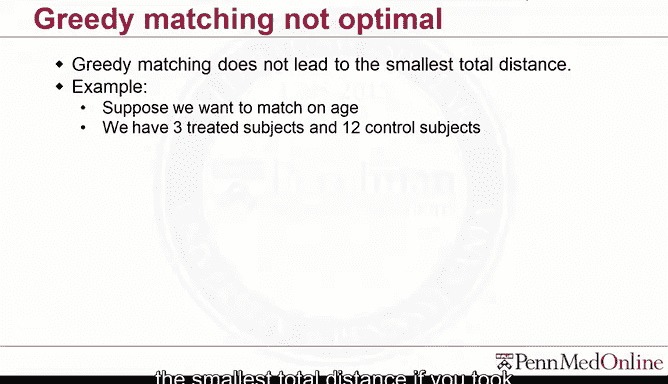
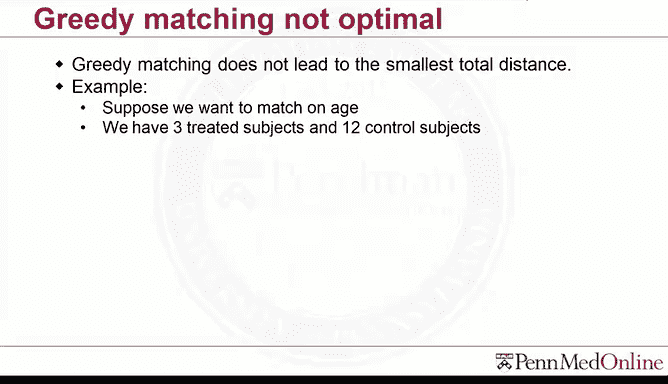
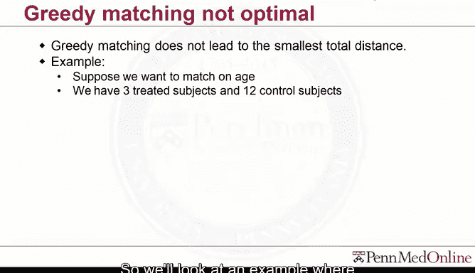
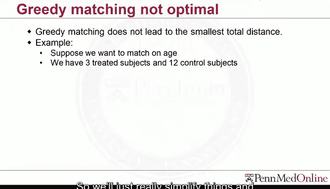
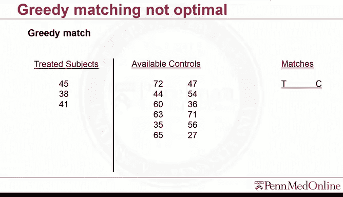

# 21：因果推断速成课程 - P21：最优匹配 🎯

在本节课中，我们将学习最优匹配的概念。我们将从一个例子开始，说明为什么贪心匹配并非最优，然后详细讨论什么是最优匹配以及它的实现方式。

## 为什么贪心匹配不是最优的？ 🤔

上一节我们介绍了匹配的基本概念，本节中我们来看看贪心匹配的局限性。所谓“最优”，我们指的是在全局距离度量上的最优。例如，最优意味着所有匹配对的距离总和最小。理想情况下，这个总和应该是可能达到的最小值，我们称之为全局最优。而贪心匹配通常达不到全局最优。

我们来看一个例子。假设我们想根据年龄进行匹配。为了简化，我们假设只有一个混杂因素，即年龄。现在我们想象有三个处理组对象和十二个对照组对象。

以下是处理组对象的年龄：45岁、38岁和41岁。以下是可用的对照组对象的年龄列表。

我将使用贪心算法，逐个进行匹配。处理组对象和对照组对象在左侧。当我找到匹配时，我会将它们放在右侧的列中。

我们从第一个对象开始。第一个对象是45岁，其最佳匹配是44岁的对照组对象。我将这个匹配放在这里。我们匹配了一个处理组对象和一个对照组对象。第一个处理组对象是45岁，最佳匹配（即年龄绝对差值最小）是44岁。

接下来，我们看第二个处理组对象，即38岁。我划掉了44岁，因为他不再可用于匹配。我们发现36岁是最佳匹配。我们在这里是贪心的，我们只是找到年龄绝对差值最接近处理组对象的对象。现在我们将38岁与36岁匹配，并从列表中划掉36岁，这个人不再可用于匹配。

接下来，我们转到41岁。41岁可以匹配到47岁（如图所示），也可以匹配到35岁，距离相同。我随便选了一个。无论哪种情况，距离都是6。现在我们可以把这些绝对距离加起来。第一个匹配对的距离是1，第二个匹配对的距离是2，第三个匹配对的距离是6，因此总距离为9。所以，处理组和对照组之间的年龄总差异是9。这是贪心匹配的结果。

然而，实际上可以找到一组更好的整体匹配。这里我列出了一组更好的匹配。

同样，处理组对象在这里，年龄是45、38和41。我将这个对照组对象与第一个处理组对象匹配，这个对照组对象与第二个处理组对象匹配，这个对照组对象与第三个处理组对象匹配。如果你把这些距离加起来，第一对的差异是2，第二对的差异是2，第三对的差异是3。所以这里的总距离是7。而回顾之前，总距离是9。因此，这里的总距离更小。

这个例子说明了，使用贪心算法时，总是选择当前最小距离的匹配，并没有考虑全局情况。有时你可能希望为后面的对象保留一个更好的匹配，而接受当前一个稍差的匹配。但贪心匹配从不向前看，不考虑全局，只是总是抓住最佳匹配。因此，在全局距离意义上，它不一定是最优的。

这说明了贪心匹配不一定是最优的，而且通常确实不是，至少在最小化总距离方面是如此。

## 什么是最优匹配？ 🧠

那么最优匹配是做什么的呢？最优匹配旨在最小化全局距离。全局指的是总距离。你可以想象全局情况是：考虑处理组对象和对照组对象之间所有可能的匹配组合，计算每种组合的总距离，然后选择具有最小总距离的那组匹配。

但这会涉及大量计算。虽然可以做到，但如果数据集很大，计算量会非常大。这是一个难题。

它可以通过网络流优化方法来解决。其细节远超本课程范围，但本质上，这是一个困难的优化问题，不过人们已经找到了解决方法。即便如此，计算要求仍然很高。

总的来说，对于小数据集，最优匹配非常可行；对于大数据集，计算负担可能变得过大。但核心思想是，最优匹配旨在最小化这个全局距离。

有软件包可以实现这一点，例如R语言中的`optmatch`或`RCbalance`。

## 最优匹配的计算可行性 ⚙️

那么最优匹配在计算上是否可行呢？这实际上取决于问题的规模。这里的规模通常指的是可能的处理-对照配对数量。

例如，如果你有100个处理组对象和1000个对照组对象，就有100,000种可能的配对。实际上，这是可以在合理时间内解决的问题规模。事实上，你的计算机甚至可能处理一百万个处理-对照配对，但这需要一些时间。一旦你达到数千个对象和可能上百万个配对，你的计算机可能会运行很长时间，但通常处理这个数量级是可行的。

然而，一旦达到例如10,000个处理对象和100,000个对照对象（即十亿级别的配对），你可能就无法使用最优匹配了。你的计算机可能会运行一个月或更长时间，所以这实际上不可行。

因此需要注意，尽管最优匹配应该比贪心匹配更好，但有时最优匹配根本不可行。

不过，你可以采取一些措施。有不同的方法可以使最优匹配更可行。这可能不是完全的全局最优匹配，而是一种折中方案。

你可以施加一些约束来使最优匹配变得可行。例如，想象一下，在一项多中心临床研究中，我们可能希望在医院内部进行匹配。与其在整个数据集上一次进行最优匹配，不如在医院内部进行最优匹配。这样做的想法是，你只接受给定医院内的处理-对照配对。在医院内部进行最优匹配，这大大减少了问题的规模。

假设有10家规模相同的医院，你基本上将优化问题的规模减少了10倍（除以10），因此可能变得可行。你可以将这些视为区组，你可能希望在区组内进行匹配。

另一个例子可能是在主要疾病类别内进行匹配。例如，主要疾病类别可能是某人住院时的主要诊断代码，如心力衰竭、慢性阻塞性肺病等。你可能希望将处理组和对照组对象在主要疾病类别内进行匹配，这就是一个区组的例子。如果你在这些区组内进行优化，就可能得到计算上可行的方案。

这也被称为稀疏匹配。你可以在R包`RCbalance`中实现这一点。使用这种特定软件包，你还可以告诉它容忍一些不完美的匹配，只要实现了精细平衡。我们之前讨论过一点精细平衡，但提醒一下，你可能愿意接受不完美的匹配。例如，只要性别在治疗组和对照组中的总体分布相同，你可能愿意匹配一个男性和一个女性。

有多种方法可以使这些匹配问题更可行，例如在给定约束条件下进行优化等。有软件可以使所有这些变得可行，你可以根据特定研究的需求进行定制。使用软件相对简单，并且在计算上是可行的。

## 总结 📝

本节课中我们一起学习了最优匹配。我们首先通过一个例子说明了贪心匹配并非全局最优，因为它只关注当前最佳匹配而不考虑整体。然后，我们探讨了什么是最优匹配，即旨在最小化所有匹配对总距离的全局优化方法。我们讨论了其计算可行性，指出对于大数据集可能面临挑战，但可以通过施加约束（如区组内匹配）来应对。最后，我们提到了实现最优匹配的软件工具。理解最优匹配有助于我们在进行因果推断时，构建出协变量平衡性更好的处理组和对照组，从而得到更可靠的效应估计。