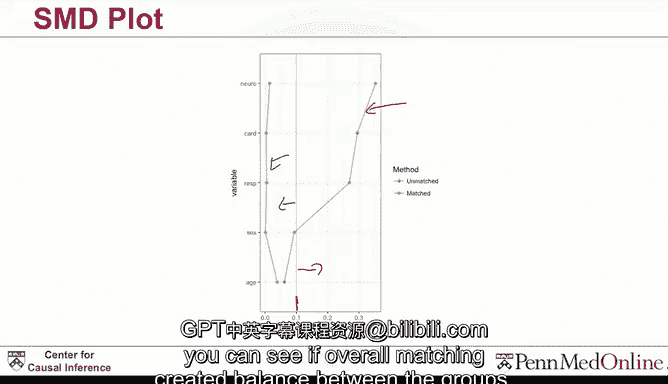

# 课程22：平衡性评估 📊

在本节课中，我们将学习如何评估匹配后的协变量平衡性。我们将介绍标准化差异的概念，并展示如何通过表格和图形来检查匹配是否成功。

---

## 概述

上一节我们介绍了匹配的基本方法。本节中，我们来看看如何评估匹配的效果。匹配的主要目标之一是使处理组和对照组在协变量上达到平衡，类似于随机试验中的情况。为了判断匹配是否成功，我们需要检查协变量在两组之间是否平衡。

## 什么是平衡性评估？

平衡性评估是指在完成匹配后，检查处理组和对照组在各个协变量上的分布是否相似。在随机试验中，由于随机化，协变量会自动平衡。匹配的目标就是创造类似的条件。

以下是评估平衡性的两种主要方法：

1.  **标准化差异**：检查两组间均值的差异，并以标准差为单位进行标准化。
2.  **假设检验**：例如，对连续变量使用双样本T检验，对分类变量使用卡方检验，并报告P值。

然而，假设检验的P值依赖于样本量。在大样本研究中，即使均值差异很小，也可能得到显著的P值。因此，通常更推荐使用标准化差异。

## 标准化差异详解

标准化差异是一种不直接依赖于样本量的平衡性度量。其核心思想是将两组间的均值差异，除以一个合并的标准差，从而得到一个以标准差为单位的差异值。

对于一个给定的协变量 **X**，其标准化均值差异的计算公式如下：

**SMD = (X̄_treatment - X̄_control) / S_pooled**

其中：
*   **X̄_treatment** 是处理组中该协变量的样本均值。
*   **X̄_control** 是对照组中该协变量的样本均值。
*   **S_pooled** 是合并标准差，计算公式为：`sqrt((S²_treatment + S²_control) / 2)`。`S²_treatment` 和 `S²_control` 分别是两组的样本方差。

SMD的绝对值通常被用来评估平衡性。常见的经验法则是：
*   **SMD < 0.1**：通常表示平衡良好。
*   **0.1 ≤ SMD ≤ 0.2**：存在一定差异，但通常可以接受。
*   **SMD > 0.2**：表示存在严重的失衡，需要关注。

## 如何呈现结果：Table 1

在学术论文中，通常使用“Table 1”来呈现研究人群的基本特征。在匹配分析中，Table 1 会分别展示匹配前和匹配后的情况。

以下是一个来自右心导管插入术（RHC）研究的简化示例。表中列出了几个协变量在处理组（RHC）和对照组（No RHC）中的情况。

**匹配前 (Unmatched)**
| 变量 | 对照组 (No RHC) | 处理组 (RHC) | 标准化差异 |
| :--- | :--- | :--- | :--- |
| 样本量 (N) | 2,181 | 2,184 | - |
| 年龄 (岁), 均值 (标准差) | 61.2 (16.7) | 60.8 (16.0) | 0.06 |
| 性别 (% 男性) | 55.6% | 55.0% | 0.01 |
| ... (其他变量) | ... | ... | ... |
| 神经疾病 (%) | 16.2% | 5.4% | **0.35** |

从表中可以看到，匹配前，在“神经疾病”这个变量上，两组的患病率差异很大（16.2% vs 5.4%），标准化差异为0.35，表明存在严重失衡。

**匹配后 (Matched)**
| 变量 | 对照组 (Matched No RHC) | 处理组 (Matched RHC) | 标准化差异 |
| :--- | :--- | :--- | :--- |
| 样本量 (N) | 2,184 | 2,184 | - |
| 年龄 (岁), 均值 (标准差) | 60.8 (16.0) | 60.8 (16.0) | 0.00 |
| 性别 (% 男性) | 55.0% | 55.0% | 0.00 |
| ... (其他变量) | ... | ... | ... |
| 神经疾病 (%) | 5.7% | 5.3% | **0.02** |

匹配后，两组样本量相同（配对匹配），所有协变量的标准化差异绝对值都降到了0.1以下。特别是“神经疾病”的差异变得非常小（5.7% vs 5.3%），标准化差异仅为0.02。这时的数据分布更接近随机试验的结果，说明匹配是成功的。

## 可视化平衡性：Love Plot

当协变量很多时，用图形来展示所有变量的标准化差异会非常直观。这种图形有时被称为“Love Plot”。

下图展示了上述例子中匹配前后各变量标准化差异的变化：
*   **红线** 代表匹配前的标准化差异。
*   **蓝线** 代表匹配后的标准化差异。
*   **灰色虚线** 位于0.1处，作为平衡性良好的参考阈值。

从图中可以清晰地看到，匹配前（红线），多个变量的点位于0.1阈值右侧，表明存在失衡。匹配后（蓝线），所有变量的点都聚集在0.1阈值左侧，非常接近0，说明匹配显著改善了所有协变量的平衡性。

这种图形能让我们快速、整体地评估匹配效果。

## 总结

本节课中，我们一起学习了如何评估匹配后的协变量平衡性。我们介绍了**标准化差异**这一核心概念及其计算公式，它比假设检验的P值更稳定。我们学习了如何通过**Table 1**来对比匹配前后的数据，并利用**Love Plot**对多个协变量的平衡性进行可视化评估。成功的匹配应使处理组和对照组在关键协变量上的分布尽可能相似，标准化差异的绝对值最好小于0.1，从而使观察性研究的数据更接近随机试验的理想状态。如果评估发现平衡性不佳，我们可能需要返回上一步，重新考虑或调整匹配策略。