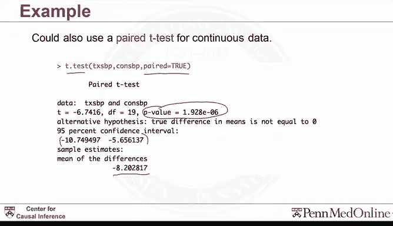

# 课程23：匹配后数据分析 📊


在本节课中，我们将学习如何分析经过匹配处理后的数据。我们将假设你已经完成了数据匹配，并检查了平衡性，现在准备分析结果数据。我们将重点介绍适用于匹配数据的统计方法，特别是随机化检验（也称为置换检验或精确检验），并解释其原理和用途。

---

## 概述

上一节我们介绍了数据匹配和平衡性检查。本节中，我们来看看如何对匹配后的结果数据进行统计分析。核心目标是检验处理效应是否存在，并估计其大小和置信区间。所有分析方法都应考虑数据已匹配这一事实。

---

## 随机化检验（置换检验）🎲

随机化检验的核心思想是：在完成匹配后，我们可以将数据视为来自一项随机化试验。检验步骤如下：

1.  **选择一个检验统计量**。
2.  根据观察到的数据计算该统计量。
3.  假设零假设（即无处理效应）成立。
4.  在每一对匹配的个体中，随机置换处理分配标签（例如，随机决定谁被视为处理组，谁被视为对照组）。
5.  基于置换后的数据重新计算检验统计量。
6.  重复步骤4和5多次（例如1000次），记录每次的统计量。
7.  将观察到的统计量与置换产生的统计量分布进行比较。如果观察值在分布中显得“异常”（例如，处于极端位置），则拒绝零假设。

以下是具体操作流程：

### 二元结果数据示例

假设我们有一个二元结果（例如，事件发生=1，未发生=0），并且有13个匹配对。

我们选择的检验统计量是**处理组中事件发生的总次数**。

以下是一些假设的匹配对数据：

| 匹配对编号 | 处理组结果 | 对照组结果 |
| :--- | :--- | :--- |
| 1 | 0 | 0 |
| 2 | 1 | 0 |
| 3 | 0 | 1 |
| 4 | 0 | 0 |
| 5 | 1 | 0 |
| 6 | 1 | 0 |
| 7 | 0 | 0 |
| 8 | 0 | 0 |
| 9 | 1 | 0 |
| 10 | 0 | 1 |
| 11 | 0 | 0 |
| 12 | 1 | 0 |
| 13 | 0 | 0 |

在观察数据中，处理组共有 **6** 次事件发生（统计量 T = 6）。

接下来，我们在零假设下进行随机置换。对于每个匹配对，我们随机交换处理组和对照组的标签（相当于以50%的概率交换0和1）。**只有结果不一致的匹配对（即一个为0，一个为1）在置换时会影响统计量**。

重复此过程多次（例如1000次），每次记录处理组的事件发生次数，得到该统计量的经验分布。

如果观察到的统计量（T=6）在这个分布中处于常见区域（例如，靠近中心），则说明该结果在无处理效应的情况下并不罕见，我们没有足够证据拒绝零假设。反之，如果观察值处于分布的极端尾部，则表明可能存在处理效应。

对于此例，我们可以使用**McNemar检验**（一种用于配对二元数据的标准检验）来获得精确的p值。在R语言中，操作如下：

```r
# 创建列联表矩阵
# 格式：[两者均为1, 仅处理组为1; 仅对照组为1, 两者均为0]
x <- matrix(c(1, 5, 2, 5), nrow=2, byrow=TRUE)
# 执行McNemar检验
mcnemar.test(x)
```

检验结果会给出一个p值（例如p=0.45），这远大于0.05，因此我们不能拒绝“无处理效应”的零假设。这个p值与通过大量随机置换计算得到的p值在概念上是等价的。

---

## 连续结果数据示例

上一节我们看了二元结果的例子。本节中，我们来看看当结果是连续变量时（例如收缩压）该如何分析。

假设我们有20个处理-对照匹配对。我们选择的检验统计量是**处理组与对照组样本均值的差异**。

**公式**： `T = mean(处理组) - mean(对照组)`

假设计算出的观察差异为 **-8.2**（即处理组的平均收缩压比对照组低8.2个单位）。

同样，我们进行随机化检验：在每个匹配对内随机置换处理标签，重新计算均值差异，重复多次。

经过1000次置换后，我们得到统计量T的经验分布。如果零假设成立，这个分布应大致以0为中心。

在我们的例子中，观察值T = -8.2 落在了经验分布的极端尾部，甚至在1000次置换中从未出现过如此极端的值。这表明观察到的差异在“无处理效应”的假设下极不可能发生，因此我们拒绝零假设，认为存在处理效应。

对于连续配对数据，更常用的方法是**配对t检验**。在R中操作如下：

```r
# 假设‘treated’和‘control’是两个对应的数值向量
t.test(treated, control, paired=TRUE)
```

该检验会输出均值差异的点估计（如-8.2）、置信区间（如-10.7 到 -5.7）和一个极小的p值，从而为处理效应提供统计证据。

---

## 其他适用的结果模型 🧮

除了上述的随机化检验和配对t检验，还有其他统计模型可以用于分析匹配后的数据，具体取决于结果变量的类型：

以下是几种常用模型：

*   **条件逻辑回归**：适用于匹配后的二元结果数据。
*   **分层Cox模型**：适用于生存时间或事件发生时间数据。与标准Cox模型类似，但允许基线风险函数在每个匹配集内不同（通过`strata(匹配ID)`实现）。
*   **广义估计方程**：适用于多种类型的结果，特别是二元结果。通过指定`cluster=匹配ID`来解释匹配集内的相关性。GEE可以用于估计**因果风险差**（使用恒等连接函数）、**因果风险比**（使用对数连接函数）或**因果优势比**。



---

## 总结

本节课中，我们一起学习了如何分析经过匹配后的数据。我们介绍了**随机化检验（置换检验）** 的基本原理和步骤，并通过**二元结果**和**连续结果**的两个例子演示了其应用。我们还提到了其他适用于匹配数据的标准分析方法，如**McNemar检验**、**配对t检验**、**条件逻辑回归**、**分层Cox模型**和**广义估计方程**。选择哪种方法取决于结果数据的类型和你想要估计的因果效应度量。关键在于，所有分析都必须尊重数据经过匹配这一设计。