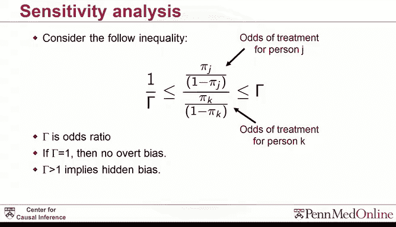

# 课程24：敏感性分析 🔍

在本节课中，我们将学习敏感性分析的核心概念。敏感性分析用于评估研究结论在关键假设（如无未测量混杂）被违反时的稳健性。我们将探讨什么是隐藏偏倚，并介绍一种在实践中进行敏感性分析的具体方法。

## 隐藏偏倚的概念

上一节我们介绍了匹配分析的目标。匹配的主要目标是实现**观测协变量**的平衡。这些协变量是你事先选定、认为足以控制混杂的变量集合。如果这些观测变量不平衡，就会产生**显性偏倚**。匹配后，你可以检查平衡性，如果发现不平衡，可以识别并尝试纠正它。

然而，匹配并不能保证我们未匹配的变量达到平衡。这些可能是未观测到的变量，或是你选择不匹配的变量。如果这些未观测变量本身是混杂因子且不平衡，就会产生**隐藏偏倚**。这种情况违反了“可忽略性”假设，也可称为存在**未测量混杂**。

这与随机试验不同，随机试验通过随机化应能平衡所有变量（包括观测和未观测的）。在匹配分析中，我们只能期望实现观测变量的平衡。

## 敏感性分析的核心思想

那么，敏感性分析的主要思想是什么呢？我们思考的是：如果存在隐藏偏倚，它需要达到多严重的程度，才会改变我们的研究结论？

“改变结论”可以指：
*   一个原本统计显著的结果变得不显著。
*   处理效应的方向发生改变（例如从正效应变为负效应）。

这是一个非常有用的概念，因为我们通常认为研究中很可能存在某种程度的未测量混杂。我们想知道，我们的结论是对关键假设的轻微违反就很敏感，还是对违反具有相当的稳健性。

## 量化隐藏偏倚：Gamma (Γ)

为了更详细地讨论敏感性分析，引入一些符号会很有帮助。

令 **π_j** 表示个体 **j** 接受处理的概率。
类似地，**π_k** 表示个体 **k** 接受处理的概率。

假设个体 **j** 和个体 **k** 在观测协变量上完全匹配，即 **X_j = X_k**。

那么，如果 **π_j = π_k**，则不存在隐藏偏倚。这意味着在匹配对中，尽管观测特征相同，但接受处理的概率也相同，因此没有未观测因素影响处理分配。

现在，考虑以下不等式：

**1/Γ ≤ (π_j / (1 - π_j)) / (π_k / (1 - π_k)) ≤ Γ**

不等式中的分子是个体 **j** 接受处理的**比值比**（概率除以1减概率），分母是个体 **k** 的比值比。因此，这个比值本身就是一个比值比。

这里的 **Γ** 就是一个比值比。

*   如果 **Γ = 1**，则 **π_j = π_k**，意味着**没有隐藏偏倚**。
*   如果 **Γ > 1**，则表示存在隐藏偏倚。这意味着即使观测协变量相同，个体 **j** 接受处理的可能性也高于个体 **k**，这可能是由未观测变量导致的。

因此，**Γ 可以量化“无隐藏偏倚”这一假设被违反的程度**：
*   Γ = 1：假设完全成立。
*   Γ 非常接近 1：假设轻微违反。
*   Γ 远大于 1：假设严重违反。

## 实践中的敏感性分析

接下来，我们看看如何利用 Γ 代表隐藏偏倚这一思想进行实践分析。

假设你完成了一项匹配分析（确保良好的平衡性），并进行了结果分析，**发现了处理效应的证据**。这个证据是基于“无隐藏偏倚”（即 **Γ = 1**）的假设得出的，这通常是你初步分析（主要分析）的起点。

敏感性分析部分则是：**逐渐增大 Γ 的值**，直到处理效应的证据消失（例如，结果不再具有统计显著性）。对于每个选定的 Γ 值，你都需要在假设该 Γ 值成立的前提下重新分析数据。

以下是评估敏感性的逻辑：

*   如果你发现 Γ 只需增加到很小（例如 **Γ = 1.1**）结论就改变了，那么我们可以说**推断结果对未测量混杂非常敏感**。这意味着匹配对中一个个体相对于另一个个体的处理概率只需有微小差异，就足以改变我们的结论。
*   反之，如果结论直到 Γ 增加到很大（例如 **Γ = 5**）才改变，那么我们可以说**结论对隐藏偏倚不敏感**，我们会对自己的结论更有信心。因为需要相当强的隐藏偏倚才能推翻原结论。

具体的重新分析方法超出了本视频的范围，但已有一些 R 软件包（如 `rbounds`、`sensitivitymv`、`sensitivityfull`）可以实现。Paul Rosenbaum 的《观察性研究设计》一书也提供了更多细节。

## 总结

本节课中，我们一起学习了敏感性分析。我们首先了解了**隐藏偏倚**（由未观测混杂因子引起）与**显性偏倚**（由观测变量不平衡引起）的区别。然后，我们引入了参数 **Γ** 来量化隐藏偏倚的程度。最后，我们探讨了敏感性分析在实践中的应用逻辑：通过考察结论随着 Γ 值增大而改变的程度，来评估研究结果对未测量混杂假设的**稳健性**。这帮助我们理解研究结论在多大程度上依赖于“无未测量混杂”这一关键假设。