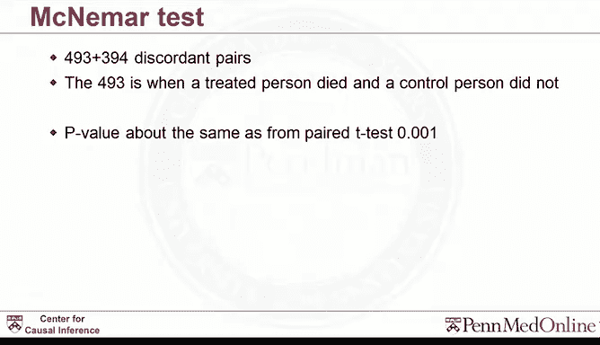

# 25：R语言因果推断数据实例分析 🧪


在本节课中，我们将学习如何使用R语言进行一项实际的匹配因果分析。我们将使用一个公开的右心导管插入术（RHC）数据集，通过匹配方法来估计治疗（RHC）对结局（死亡）的因果效应。

---

## 数据准备与加载

首先，我们需要加载分析所需的数据和R包。我们将使用两个主要的包：`tableone`用于创建描述性表格以评估组间平衡，`Matching`用于执行实际的匹配过程。

以下是加载数据和必要包的代码：

```r
# 加载所需的包
library(tableone)
library(Matching)

# 读取数据
rhc_data <- read.csv("path_to_your_rhc_data.csv")

# 查看数据结构，了解变量和缺失值
str(rhc_data)
head(rhc_data)
```

为了简化后续分析，我们将数据中的一些字符型变量转换为数值型变量。例如，结局变量“death”在原始数据中编码为“Yes”/“No”，我们将其转换为1/0的二进制变量。

```r
# 将字符变量转换为数值变量
rhc_data$death_numeric <- ifelse(rhc_data$death == "Yes", 1, 0)
# ... 对其他需要的变量执行类似转换

# 创建用于分析的新数据集，包含治疗变量、结局变量和选定的协变量
my_data <- rhc_data[, c("treatment", "death_numeric", "age", "meanbp", "...")]
```

我们定义了一个协变量列表 `X_vars`，用于匹配和平衡评估。在实际分析中，您应该包含所有相关的混杂变量，但为了演示清晰，这里仅使用一个子集。

```r
# 定义用于匹配的协变量列表
X_vars <- c("age", "meanbp", "...")
```

---

## 评估匹配前的组间平衡

在开始匹配之前，评估治疗组和对照组在协变量上的初始不平衡程度至关重要。这有助于我们了解潜在的混杂程度。

我们可以使用 `tableone` 包轻松创建“表1”，来比较两组在关键协变量上的分布。

```r
# 创建匹配前的平衡表
table1_unmatched <- CreateTableOne(vars = X_vars,
                                   strata = "treatment",
                                   data = my_data,
                                   test = FALSE)
# 打印表格，并显示标准化均值差（SMD）
print(table1_unmatched, smd = TRUE)
```

输出表格会显示每个协变量在两组中的均值、标准差，以及**标准化均值差（SMD）**。通常，SMD的绝对值大于0.1被认为存在有意义的失衡。从示例结果中，我们可以看到一些变量（如平均血压`meanbp`）在两组间存在较大差异，这表明需要进行匹配来调整这些混杂因素。

---

## 执行贪婪匹配

上一节我们介绍了如何评估初始的不平衡，本节中我们来看看如何使用`Matching`包执行贪婪最近邻匹配，以改善组间的可比性。

匹配的目标是为每个治疗组个体找到一个或多个在协变量上最相似的对照组个体。这里我们进行1:1配对匹配。

```r
# 执行贪婪匹配
set.seed(123) # 设置随机种子以保证结果可重复
match_result <- Match(Y = NULL, # 暂时不指定结局变量
                      Tr = my_data$treatment,
                      X = my_data[, X_vars],
                      M = 1, # 1:1匹配
                      replace = FALSE)

# 从匹配结果中提取匹配对的数据
matched_data <- my_data[c(match_result$index.treated, match_result$index.control), ]
matched_data$pair_id <- rep(1:length(match_result$index.treated), 2)
```

---

## 评估匹配后的组间平衡

匹配完成后，我们必须再次评估平衡性，以确认匹配是否有效减少了混杂偏倚。

我们使用与匹配前相同的`CreateTableOne`函数，但这次应用于匹配后的数据集。

```r
# 创建匹配后的平衡表
table1_matched <- CreateTableOne(vars = X_vars,
                                 strata = "treatment",
                                 data = matched_data,
                                 test = FALSE)
print(table1_matched, smd = TRUE)
```

在理想的匹配后，所有协变量的SMD都应变得非常小（远小于0.1）。在示例中，匹配后所有变量的SMD都接近于零，表明治疗组和对照组在观察到的协变量上已经非常相似，类似于随机化试验后的情况。这为我们后续的因果效应估计提供了良好的基础。

---

## 进行结局分析：配对T检验

既然我们已经通过匹配获得了平衡的数据集，现在可以估计治疗对结局的因果效应了。一种简单的方法是使用配对T检验。

首先，我们需要根据匹配对，分别提取治疗组和对照组的结局数据。

```r
# 提取匹配对中的治疗组和对照组结局
y_treated <- matched_data$death_numeric[matched_data$treatment == 1]
y_control <- matched_data$death_numeric[matched_data$treatment == 0]

# 计算配对差异（每个治疗-对照对的结局差异）
pair_diff <- y_treated - y_control

# 对配对差异执行单样本T检验（检验均值是否为0）
t_test_result <- t.test(pair_diff)
print(t_test_result)
```

检验结果提供了**因果风险差**的点估计和置信区间。例如，点估计为0.045意味着，如果所有人都接受RHC治疗，与所有人都不接受治疗相比，死亡概率平均高出4.5个百分点。一个具有统计学显著性的P值（如 `< 0.05`）支持存在因果效应的结论。

---

## 进行结局分析：McNemar检验

对于二分类结局，除了配对T检验，我们还可以使用McNemar检验，它专门用于分析配对分类数据。

以下是创建配对列联表并执行McNemar检验的步骤：

```r
# 创建配对结局的列联表
pair_table <- table(y_treated, y_control)
print(pair_table)

# 执行McNemar检验
mcnemar_result <- mcnemar.test(pair_table)
print(mcnemar_result)
```



列联表显示了四种类型的配对数量：两者均死亡、两者均存活、治疗死亡而对照存活、治疗存活而对照死亡。McNemar检验关注的是后两种不一致配对的数量。如果治疗导致更高的死亡风险，我们预期“治疗死亡/对照存活”的对数会显著多于“治疗存活/对照死亡”的对数。检验结果同样会给出一个P值，用于判断治疗效应是否显著。

---

## 总结与扩展说明

本节课中，我们一起学习了在R语言中执行匹配因果分析的完整流程：
1.  **数据准备**：加载数据、转换变量格式、选择协变量。
2.  **平衡评估**：使用`tableone`包在匹配前后创建“表1”，并通过标准化均值差（SMD）量化不平衡。
3.  **执行匹配**：使用`Matching`包进行贪婪最近邻匹配，以构建一个协变量平衡的数据集。
4.  **效应估计**：在匹配数据上，使用**配对T检验**或**McNemar检验**来估计平均治疗效应（此处为因果风险差）。

**重要说明与扩展**：
*   本教程为演示目的，仅使用了部分协变量。**在实际分析中，您应基于领域知识，尽可能纳入所有重要的混杂变量**。
*   我们估计的是**因果风险差**。如果您想估计风险比或比值比，可以使用广义估计方程（GEE）等模型，例如在`geepack`包中使用logit链接函数。
*   `Matching`包是基础选择。对于更复杂的匹配需求（如精细平衡、最优匹配），推荐研究`rcbalance`包，其在学术文献中有详细说明。
*   `tableone`包的功能非常强大，不仅能生成表格，还能创建用于评估平衡的图形（如爱丽丝图、标准差分布图），是进行严谨匹配分析的重要工具。

通过以上步骤，我们得出结论：在控制了所选混杂因素后，接受右心导管插入术（RHC）的患者具有更高的死亡风险。这展示了如何使用观察性数据进行因果推断的基本方法。