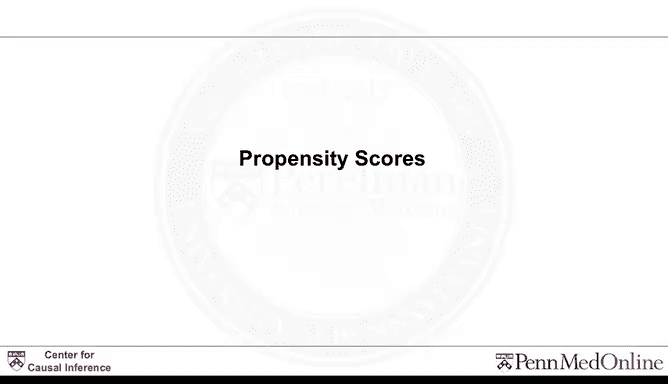

# 26：倾向性评分 🎯

在本节课中，我们将学习倾向性评分的概念及其平衡性质。倾向性评分是因果推断中的一个核心工具，它帮助我们处理观察性研究中的混杂变量。

## 什么是倾向性评分？

倾向性评分是指在给定协变量 **X** 的条件下，个体接受治疗的概率。具体来说，我们将治疗定义为 **A = 1**，对照定义为 **A = 0**。

因此，对于个体 **i**，其倾向性评分 **πᵢ** 的正式定义为：

**πᵢ = P(A = 1 | Xᵢ)**

倾向性评分是协变量 **X** 的函数。例如，假设年龄是唯一的协变量，且年龄越大的人接受治疗的可能性越高。那么，60岁个体的倾向性评分就会高于30岁的个体。

如果一个体的倾向性评分为0.3，这意味着在给定其特定协变量的情况下，他们有30%的概率会接受治疗。

## 倾向性评分的平衡性质

上一节我们介绍了倾向性评分的定义，本节中我们来看看它的一个重要特性：平衡性质。

倾向性评分是一个平衡评分。这意味着，如果我们限定在具有相同倾向性评分值的人群中，那么治疗组和对照组之间的协变量分布应该是平衡的。

为了理解这一点，想象有两个个体，他们有不同的协变量值 **X**，但却有相同的倾向性评分 **π(x)**。由于倾向性评分就是接受治疗的概率，这意味着尽管他们的协变量不同，但接受治疗的可能性是相同的。因此，在治疗组中，我们预期会以大致相同的比例看到这两种类型的协变量组合。

更正式地说，对于任意一个固定的倾向性评分值 **p**，以下等式成立：

**P(X | π(X) = p, A = 1) = P(X | π(X) = p, A = 0)**

这个性质意味着，如果我们根据倾向性评分进行匹配或分层，就可以在分析中实现协变量的平衡。这之所以有效，是因为我们假设了可忽略性，即在给定 **X** 的条件下，治疗分配是随机的。通过限定倾向性评分，我们实际上是在限定治疗分配的概率，从而模拟了一个随机试验的环境。

## 如何估计倾向性评分？

在随机试验中，倾向性评分通常是已知的，由研究设计决定。然而，在观察性研究中，倾向性评分是未知的，需要我们根据观测数据进行估计。

以下是估计倾向性评分的主要步骤：

1.  **构建预测模型**：将治疗变量 **A** 视为“结果”，将协变量 **X** 视为预测因子。这是一个典型的二元分类预测问题。
2.  **选择模型**：最常用的方法是逻辑回归。模型形式如下：
    `logit(P(A=1 | X)) = β₀ + β₁X₁ + ... + βₖXₖ`
    但也可以使用任何其他适用于二元结果的机器学习模型。
3.  **获取预测概率**：拟合模型后，为每个个体计算其接受治疗的预测概率。这个介于0和1之间的概率值，就是该个体的**估计倾向性评分**。

关键在于，我们的兴趣不在于模型系数本身，而在于为每个个体生成的预测概率。

## 总结

本节课中我们一起学习了倾向性评分。我们首先定义了倾向性评分是给定协变量下接受治疗的概率。接着，我们探讨了其核心的平衡性质，即相同倾向性评分下，治疗组与对照组的协变量分布相同。最后，我们介绍了在观察性研究中如何通过建模（如逻辑回归）来估计倾向性评分，为后续基于倾向性评分的匹配、加权或分层分析奠定基础。