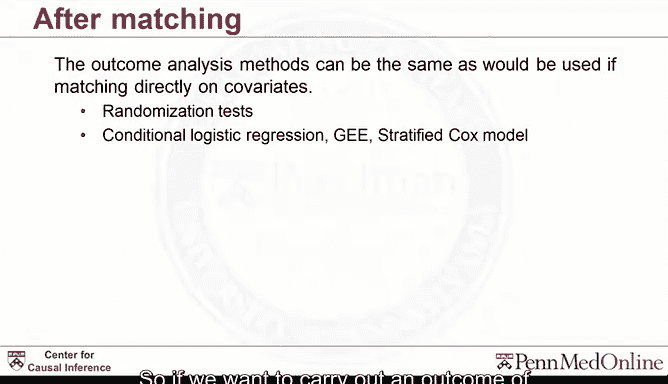
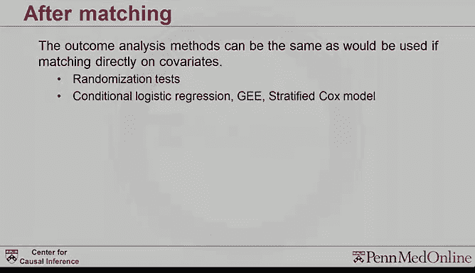

# 27：倾向性评分匹配 🎯

在本节课中，我们将学习倾向性评分匹配的核心概念与操作步骤。我们将重点介绍倾向性评分重叠、尾部修剪、卡钳匹配等关键方法，并解释如何利用这些技术来估计因果效应。

---

## 概述

倾向性评分匹配是一种简化多变量匹配问题的有效方法。它通过将多个协变量汇总为一个单一的评分（即倾向性评分），然后基于此评分进行匹配，从而在处理组和对照组之间实现协变量分布的平衡。

---

## 倾向性评分作为平衡评分

上一节我们介绍了倾向性评分的基本概念。本节中，我们来看看它如何作为平衡评分发挥作用。

倾向性评分是一个平衡评分。这意味着，即使我们没有直接在协变量上进行匹配，而只是在倾向性评分上进行匹配，也应该能够实现处理组和对照组之间协变量分布的平衡。

此外，倾向性评分是一个标量。每个人只会得到一个介于0和1之间的单一数值。这极大地简化了匹配问题，因为我们只需要在一个变量上进行匹配，而不是在一整套变量上。本质上，倾向性评分汇总了所有协变量X的信息，我们只需基于这个汇总值进行匹配。

---

## 检查倾向性评分重叠

在估计出倾向性评分之后、实际进行匹配之前，通常需要检查倾向性评分分布的重叠情况。

以下是检查重叠的步骤：
1.  比较处理组和对照组的倾向性评分分布。
2.  通过绘图直观地观察两组分布是否有重叠区域。
3.  理想的重叠意味着所有研究对象都有一定的概率接受任一种处理，这支持了“正性”假设。

一个良好的重叠示例如下：处理组（蓝色）的倾向性评分分布整体略高于对照组（红色），但两组在整个评分范围内都存在重叠。这表明，无论倾向性评分高低，两组中都有个体存在，因此可以合理地假设所有个体都有机会接受任一种处理。

相反，如果出现下图所示的**重叠不良**情况：在高倾向性评分区域，对照组几乎没有个体；在低评分区域，处理组几乎没有个体。这意味着对于具有某些极端协变量组合的个体，他们几乎注定会接受某一种处理，这违反了正性假设。

---

## 尾部修剪

当出现重叠不良时，一个常见的处理方法是进行“尾部修剪”。

尾部修剪是指从数据中移除具有极端倾向性评分的个体。这样做的目的是使正性假设更合理，并防止在估计因果效应时进行不可靠的外推。

以下是两种常见的修剪方法：
1.  移除任何倾向性评分**低于**处理组最小倾向性评分的对照组个体。
2.  移除任何倾向性评分**高于**对照组最大倾向性评分的处理组个体。

分析师可以自行决定“极端”的定义，但上述方法是常见的选择。修剪尾部是一个可选步骤，但检查分布重叠并据此决定是否修剪，是良好的实践。

---

## 进行匹配

在检查并可能修剪了尾部之后，我们就可以进行匹配了。

现在，我们基于倾向性评分这个单一数值来计算个体间的距离，并尝试最小化这个距离。我们可以使用贪婪最近邻匹配或最优匹配等方法，步骤与之前基于多变量匹配类似，只是距离度量现在基于倾向性评分。

一个常用的技巧是，在匹配前对倾向性评分进行**logit变换**。公式如下：
`logit(p) = log( p / (1-p) )`
其中 `p` 是倾向性评分。这个变换将0到1之间的评分拉伸到整个实数轴，保留了原始评分的排序，但在某些情况下（如处理罕见时）能使匹配更容易。

---

## 使用卡钳确保匹配质量

为了确保匹配质量，避免“糟糕”的匹配，我们可以使用“卡钳”。

卡钳定义了我们认为可接受的最大距离阈值。距离超过卡钳的匹配将被视为不可接受。在实践中，一个常见的卡钳设置方法是基于logit变换后倾向性评分的标准差。

具体步骤如下：
1.  估计倾向性评分 `p`。
2.  计算其logit值：`logit(p)`。
3.  计算数据集中 `logit(p)` 的标准差 `sd`。
4.  将卡钳设置为 `0.2 * sd`。

`0.2` 这个因子是经验值，意味着我们允许的匹配差异约为标准差的20%。你可以调整这个值（例如改为 `0.1`），更小的卡钳会得到质量更高、偏差更小的匹配对，但也会减少匹配成功的数量，从而增加效应估计的方差。这需要在偏差和方差之间进行权衡。

---

## 匹配后的分析

一旦完成了倾向性评分匹配，后续的分析就与任何其他匹配分析完全相同。

我们可以使用随机化检验、条件逻辑回归、分层Cox模型等方法来分析匹配后的数据，以估计处理效应。

---

## 总结

本节课中，我们一起学习了倾向性评分匹配的全过程。我们从理解倾向性评分作为平衡评分开始，学习了如何检查评分分布的重叠，以及如何处理重叠不良的情况（尾部修剪）。接着，我们探讨了基于倾向性评分进行匹配的步骤，包括可选的logit变换和使用卡钳来控制匹配质量。最后，我们指出匹配后的分析与标准匹配分析无异。掌握这些步骤，能够帮助我们在存在多个混淆变量的情况下，更有效地估计因果效应。